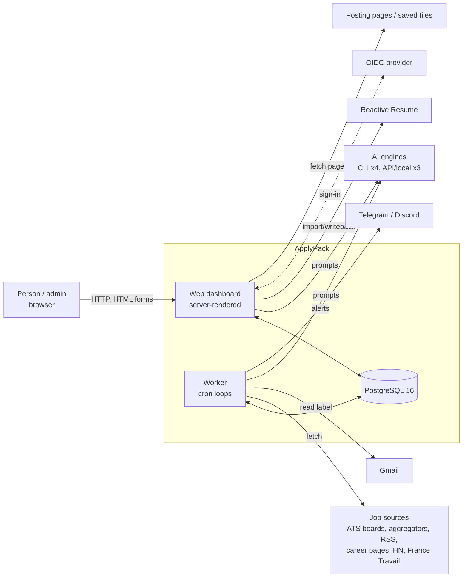
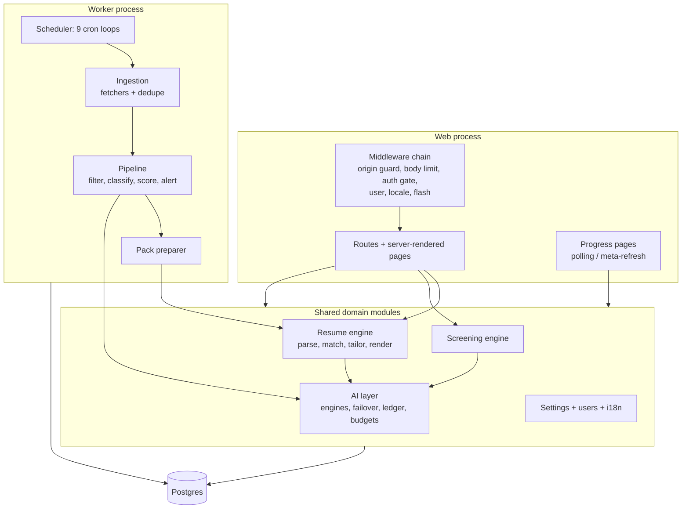
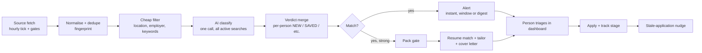

# 00 - System overview

What ApplyPack is, drawn only from what the code does. Read this first, then the area documents (01-09) for detail. Feature IDs (e.g. `PIP-11`) point into those documents; the whole list is in [FEATURES.md](./FEATURES.md).

## 1. What the product is

A self-hosted job-search assistant for one person or a small team (with an optional "employer mode" that screens applicants instead). It:

1. **Collects** postings from about 40 sources (company ATS boards, aggregators, RSS feeds, career-page watches, Gmail leads, pasted URLs, files and folders).
2. **Judges** each posting with a cheap deterministic filter, then an AI classifier that scores it against each person's saved searches.
3. **Alerts** the person on Telegram or Discord, on their own schedule (instant, windowed, or digest).
4. **Matches** the person's uploaded resumes to a posting (keyword and alignment scoring).
5. **Tailors** a resume copy and a cover letter for a posting, with fact-check guardrails against invented claims, and renders clean DOCX/PDF (or writes back to Reactive Resume).
6. **Prepares application packs** automatically for strong matches, and **tracks** applications through their stages.
7. **Screens applicants** (employer mode): intake of resumes, redaction, rubric scoring, calibration, comparison, export.

It ships in two topologies from one codebase: a **local launcher** (bundled Postgres, loopback only) and a **server** install (Docker: postgres + worker + web).

## 2. System context

Web and worker never call each other. They coordinate only through Postgres rows (a run table, settings, job rows) plus one advisory lock that serialises fetching.

## 3. Containers and modules

| Area | Document | One-line role |
|---|---|---|
| Data model | [01](./01-data-model.md) | 33 tables, settings layering, per-user scoping |
| Sourcing | [02](./02-job-sourcing.md) | Every route a posting can enter the system |
| Pipeline and alerts | [03](./03-job-pipeline-and-alerts.md) | Filter, AI verdict, status, alerts, scheduler, run tracking |
| AI layer | [04](./04-ai-layer.md) | Provider abstraction, failover, cost ledger, budgets |
| Resume intake and match | [05](./05-resume-intake-and-match.md) | Upload, structure, facts, per-job match score |
| Tailoring and render | [06](./06-resume-tailoring-and-render.md) | Condense/tailor, fact-check, cover letter, DOCX/PDF, Reactive Resume |
| Packs, applications, screening | [07](./07-packs-applications-screening.md) | Pack gating, application stages, employer-mode screening |
| Web app and UX | [08](./08-web-app-and-ux.md) | Sitemap, filters, onboarding, settings map, request lifecycle |
| Platform | [09](./09-platform-runtime-and-deploy.md) | Launcher, env, auth, i18n, CI, deployment |

## 4. The core loop (high level)

Noted by the pipeline analysis: a posting with no AI verdict is not stored, and fetching is off by default on a fresh install.

## 5. Scheduler (worker)

| Loop | When | Purpose |
|---|---|---|
| fetch | hourly, install-specific minute | Search sources if the schedule gate allows; also carries held-alert and page-change delivery |
| gmail | hourly, :35 | Read each connected person's label |
| gmail-requests | every minute | Handle "check now" clicks |
| digest | hourly | Per person, at their digest hours |
| stale-applications | hourly | Nudge about applications gone quiet |
| pack | every minute | Prepare queued application packs |
| cleanup | Sun 03:00 | Retention |
| hn-hiring | monthly, day 1 06:xx | Parse the HN hiring thread |
| discovery | Sun 04:xx | Probe new boards from harvested URLs |

## 6. Cross-cutting concerns

| Concern | Summary | Detail |
|---|---|---|
| Multi-user | Install-level settings plus per-person settings and per-person job rows; roles ADMIN and MEMBER | 01, 09 |
| AI cost control | Ledger per feature call, price tables, spend caps with alert marker, cooldown and failover across engines | 04 |
| Safety against invention | Fact-check, replacement and removal gates before any tailored text is accepted | 06 |
| Prompt injection | Untrusted text is fenced before it reaches a prompt | 04 |
| Security posture | Loopback by default, origin check on POST, unclassified routes admin-only, half-configured auth refuses to start | 09 |
| i18n | Message catalog, locale resolution, a pseudo-locale used by CI to fail on untranslated English | 09 |
| Observability | Structured logs, run table with live progress, worker heartbeat file, health endpoint | 03, 09 |
| Backups | Dated snapshots in the data folder (local install) | 09 |

## 7. Rewrite guidance (the short version)

Each area document ends with an "oddities" section. The themes that recur across them:

- **Collapse layered concepts.** The AI layer has tasks, roles and 20 ledger features on top of 7 engines; the schedule is one JSON shape serving two owners; settings split between global and personal columns by a build-time classification.
- **Decouple coupled loops.** Held alerts, page-change notices and a mirror job ride on the fetch tick.
- **Fix known smells.** Secrets stored in plaintext in several tables; the `Company` table doubles as virtual sources and watchlist rows; name collisions (starter packs vs application packs, company mute list vs employer mode).
- **Keep the guardrails.** The business-rule sections hold the real constants (dedupe window and distance, score formula, caps, tolerances). Those are the product's behaviour, not accidents.
- **Cut scope deliberately.** 768 features were found. Treat FEATURES.md as a checklist and mark each rebuild, merge, or drop before writing code.
