# 02 - Job sourcing and ingestion

Derived from source code only. Behaviour is described in implementation-neutral terms; paths appear in the Source map at the end.

## 1. Purpose and scope

This area is every route by which a job posting enters the system, and the machinery that keeps those routes polite, deduplicated and observable. The routes are: the hourly scheduled walk over many remote sources (employer ATS boards, aggregator feeds, user-supplied feeds and careers pages), a monthly pull of the Hacker News "Who is hiring" thread, manual paste, file import, watched folders (rows written by tools, or postings saved by the user), a per-person Gmail label of job-alert mails, and a licence-driven daily mirror for one national board.

Everything normalises to one shape (`NormalizedJob`) and then flows through one shared ingestion pipeline: filter, employer gate, exact dedupe, near-duplicate annotation, optional AI scoring, persistence, alert. Scoring, alert wording and application packs belong to other areas; this document covers them only where they decide whether a row is stored.

Out of scope here: the liveness verification ladder (a separate "is this posting still open" check), the classifier internals, notifier channels, and resume/tailoring features. Delisting by a board's own full listing is in scope.

## 2. Architecture

### 2.1 Components and dependencies

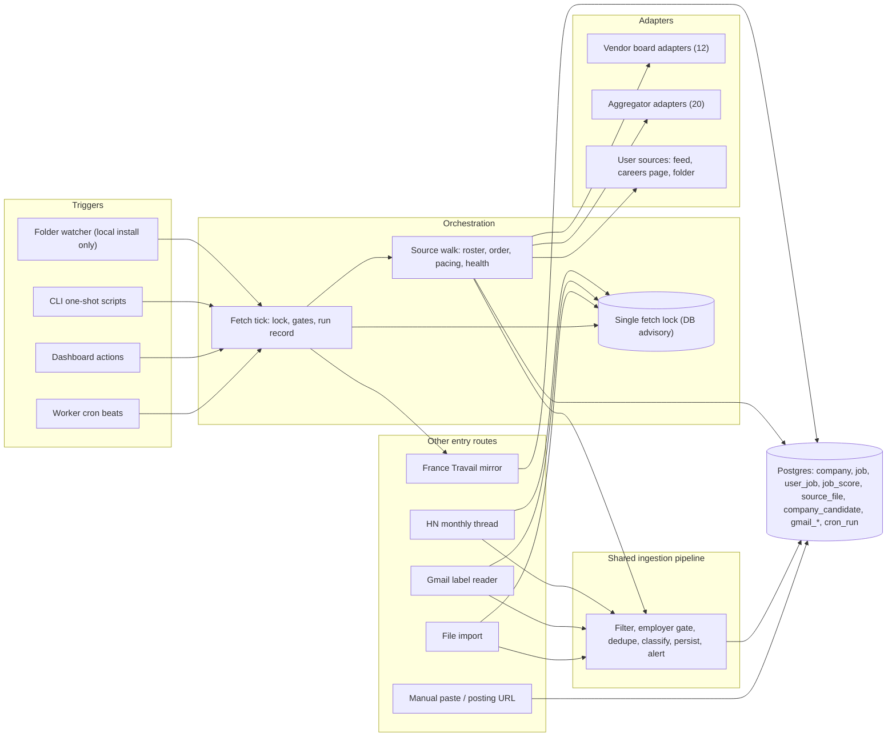

### 2.2 Support modules around the adapters

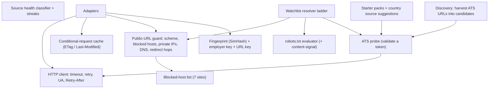

### 2.3 Source kinds (the "family" concept)

Every source is one `company` row with a kind (`atsType`) and a token. The table is the complete list (39 kinds).

| Family | Kind | Feed shape | Auth | Token format | Fetched by tick? |
|---|---|---|---|---|---|
| Vendor board (per company) | GREENHOUSE | GET JSON, whole board with content | none | board slug | yes |
| | LEVER | GET JSON array | none | company slug | yes |
| | ASHBY | GET JSON, `jobs[]` with `isListed` | none | org slug | yes |
| | WORKABLE | POST JSON, paged list, no descriptions | none | account slug | yes |
| | SMARTRECRUITERS | GET JSON list + per-posting detail GET | none | company id (case-sensitive) | yes |
| | RECRUITEE | GET JSON `offers[]` | none | subdomain slug | yes |
| | BREEZY | GET JSON (verbose) | none | subdomain slug | yes |
| | BAMBOOHR | GET JSON list (no description, no date) | none | subdomain slug | yes |
| | PINPOINT | GET JSON (no posting date) | none | subdomain slug | yes |
| | RIPPLING | GET JSON list + per-posting detail GET | none | board slug | yes |
| | PERSONIO | GET XML feed | none | slug or `*.jobs.personio.(de/com)` host | yes |
| | TEAMTAILOR | GET RSS | none | slug or a public career host | yes |
| Aggregator, JSON | REMOTEOK | one JSON array, first element is a legal notice | none | label (`remoteok`) | yes |
| | REMOTIVE | JSON, software-dev category | none | label | yes |
| | ARBEITNOW | paged JSON (max 3 pages) | none | label; `visa` = visa-sponsorship feed | yes |
| | WORKINGNOMADS | JSON, ~30 newest | none | label | yes |
| | HIMALAYAS | JSON browse or per-country search | none | label | yes |
| | FOURDAYWEEK | paged JSON (max 3 pages) | none | label | yes |
| | SOLIDJOBS | paged JSON (500/page, max 3) | `campaign` slug in URL | label | yes |
| | JOBTECH | JSON search, filter string | none (open data) | filter string (`occupation-field=...`) | yes |
| | HN_JOBS | Algolia search `tags=job`, last 14 days | none | label | yes |
| | HN_HIRING | Algolia: latest monthly thread + comments, parsed by heuristics | none | label | yes (also monthly job) |
| Aggregator, RSS/Atom | LARAJOBS_RSS | RSS with custom namespace | none | label | yes |
| | WEWORKREMOTELY | RSS per category | none | category slug | yes |
| | GOLANGPROJECTS | RSS, location from URL slug | none | label | yes |
| | JOBICY | RSS, one feed per place slug | none | label | yes |
| | DOU | RSS, title grammar carries structure | none (needs project UA) | query string (`category=PHP&remote`) | yes |
| | DJINNI | RSS, location only in the filter | none | filter string | yes |
| | DEVITJOBS | RSS, one site per country | none | host (`germantechjobs.de`, `devitjobs.uk`, `devitjobs.nl`) | yes |
| | LANDINGJOBS | Atom | none | label | yes |
| Aggregator, keyed | ADZUNA | JSON search per market | user's app_id + app_key (query params) | 2-letter market code | yes (4x/day) |
| | FRANCETRAVAIL | OAuth2 + JSON search | user's client id + secret | filter string (`codeROME=...`) | yes + daily mirror |
| User's own | FEED | any RSS/Atom job feed | none | feed URL | yes |
| | CAREER_PAGE | careers page; change watch, never yields jobs | none | page URL | yes |
| | BROWSER_PAGE | page the user pastes as text | none | page URL | no (never active) |
| Rows the user brings | IMPORT | uploaded file | none | slug of source name | no |
| | FOLDER | local folder of row files or saved postings | none | absolute folder path | yes (reads disk, no request) |
| | GMAIL | per-person label of mails | OAuth (read-only) | `user-<id>` | no (own job) |
| | MANUAL | pasted posting | none | slug of company name | no |

## 3. Key flows

### 3.1 The scheduled tick (hourly)

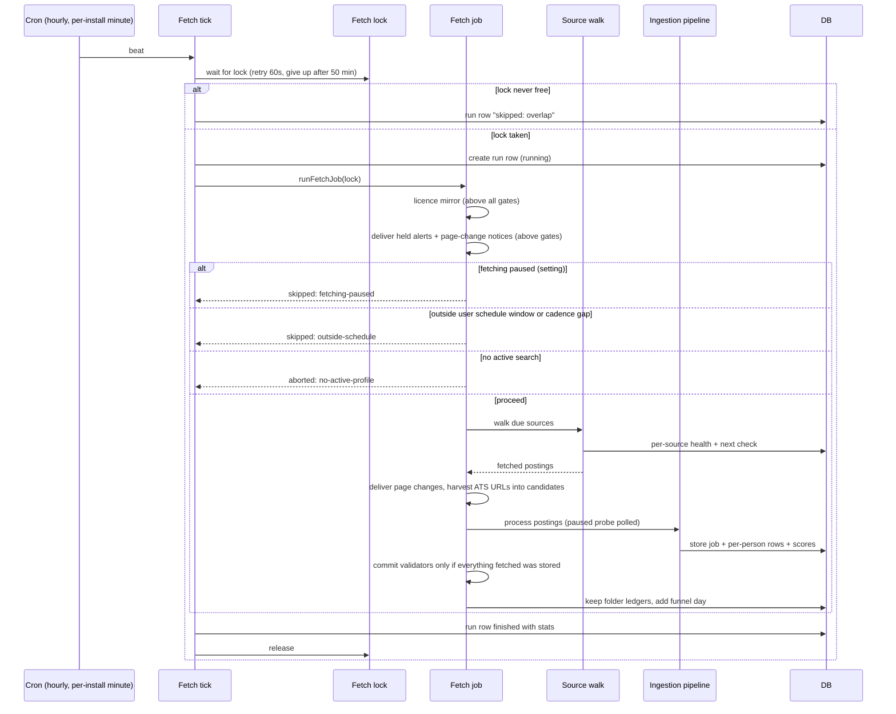

### 3.2 One source inside the walk

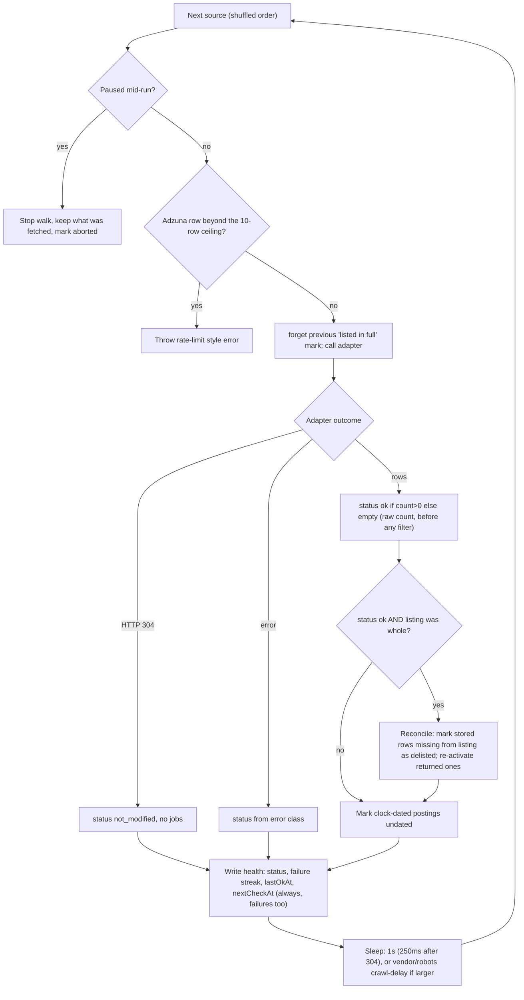

### 3.3 Ingestion pipeline per batch of postings

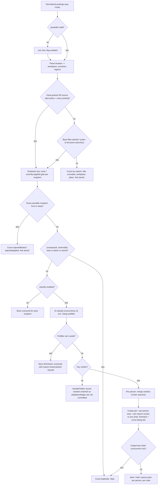

### 3.4 Adding a URL to the watchlist (resolver ladder)

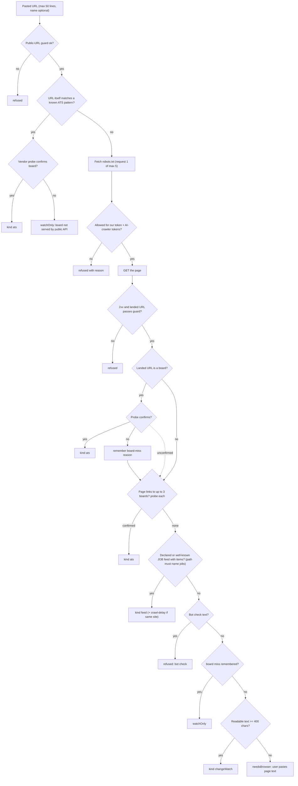

### 3.5 Folder source: one look

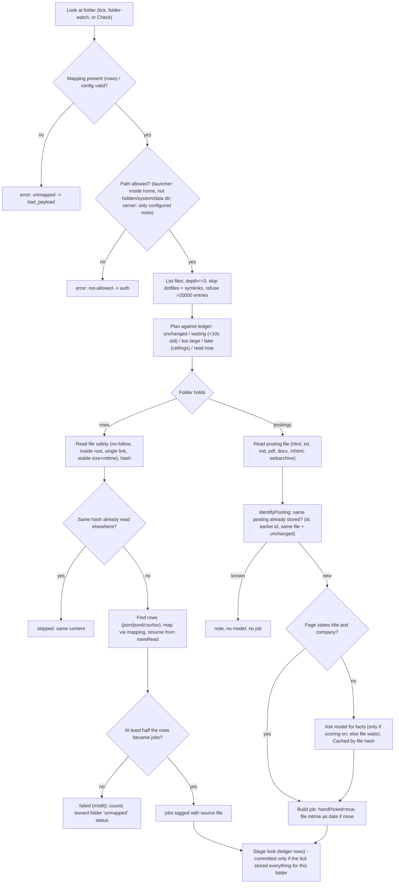

### 3.6 One person's Gmail check

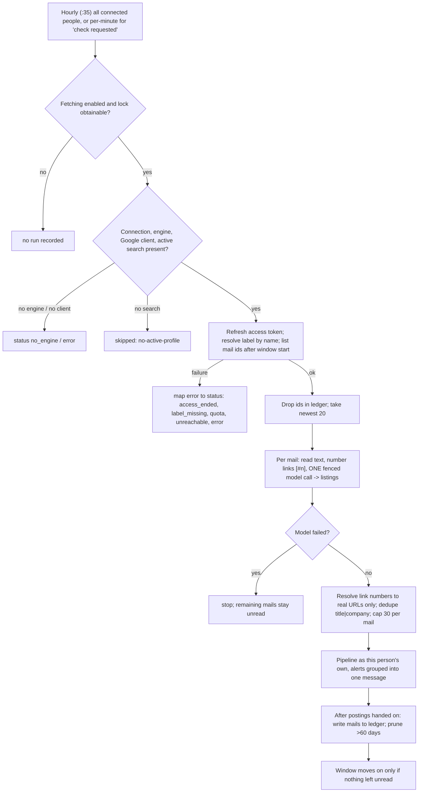

### 3.7 France Travail licence mirror

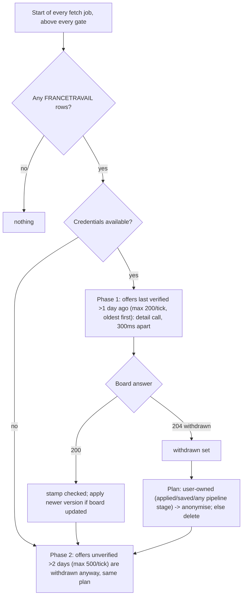

## 4. State machines

### 4.1 Source health (per company row)

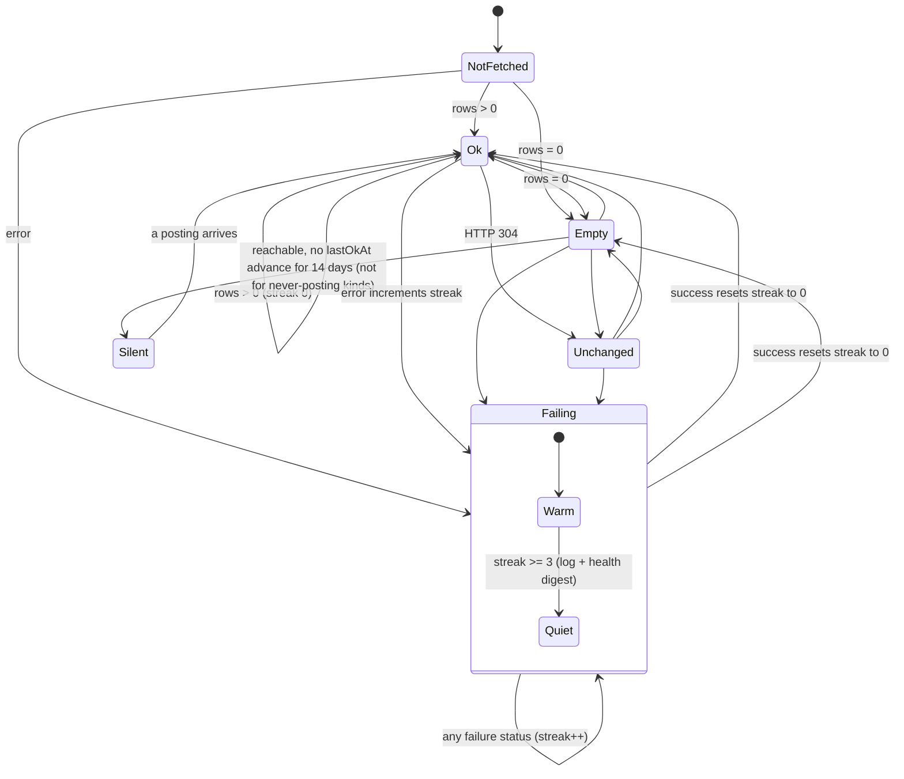

Failure statuses: `slug_gone` (404/410, redirect refusal), `auth` (401/403, missing key, folder not allowed), `rate_limit` (429), `server` (5xx), `network` (DNS/reset/timeout/fetch failed), `bad_payload` (schema/JSON error, folder unmapped), `too_many` (folder >20000 entries), `unknown`. A 304 repeats the previous verdict: it advances `lastOkAt` only if the cached row count was > 0.

### 4.2 Discovery candidate

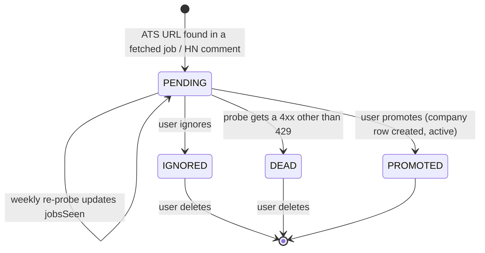

### 4.3 Folder file ledger entry

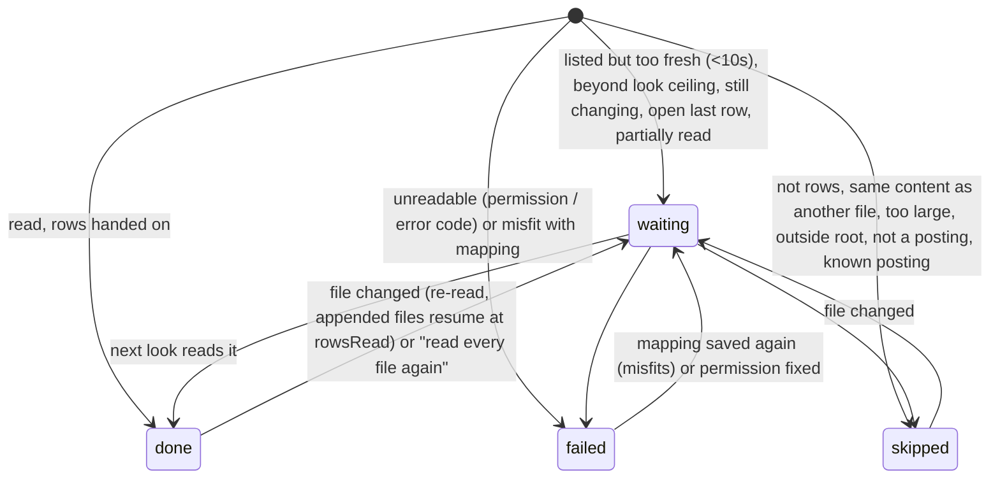

### 4.4 Gmail connection status

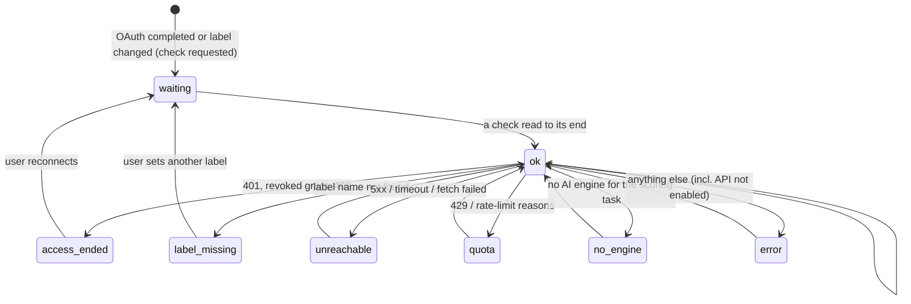

### 4.5 Job liveness as written by sourcing

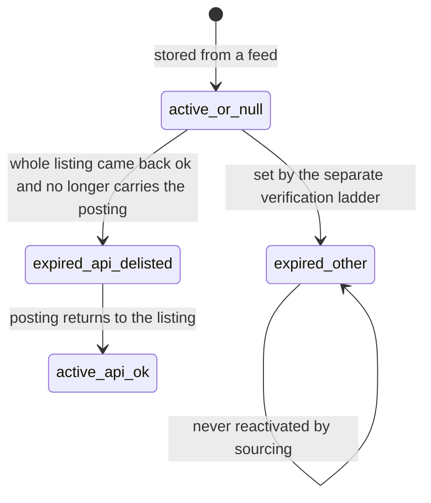

Only rows whose liveness code is the delisting code are ever re-activated by sourcing.

### 4.6 Careers-page change watch

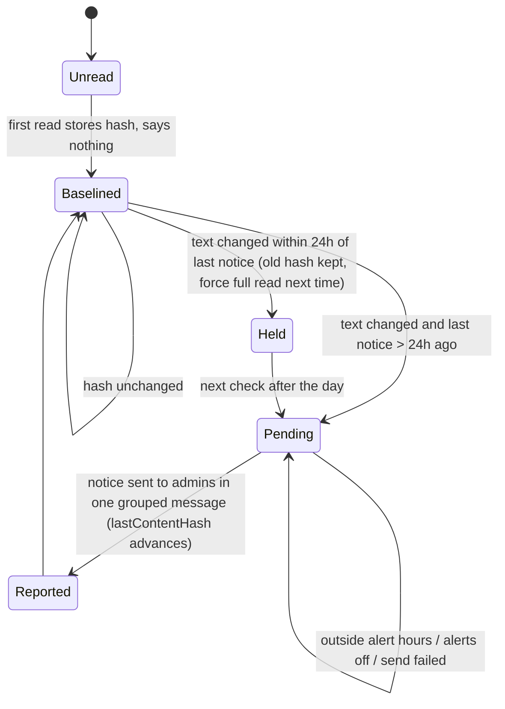

## 5. Feature list

Trigger legend: U = user action, S = schedule, E = event.

### 5.1 Orchestration and scheduling

| ID | Feature | What it does | Trigger | Key config/settings |
|---|---|---|---|---|
| SRC-01 | Hourly fetch heartbeat | Cron beat at a per-install minute (hash of install id + job name) so installs sharing seed data do not hit boards simultaneously. Beat calls the tick; the tick decides whether anything runs. | S | cron `5 * * * *` with minute replaced; same spread for `hn-hiring`, `discovery` |
| SRC-02 | User fetch schedule gate | A beat searches only if the weekday is allowed, the hour is inside the from/to window (wraps midnight), and the gap since the last real fetch is at least cadence minus 5 min. "Last real fetch" is read from run rows that carry a `fetched` counter. | S | schedule: every `hour/2h/4h/day`, from, to, days, timezone |
| SRC-03 | Global pause | When fetching is disabled the scheduled tick skips (still runs licence mirror and held-alert delivery). Manual fetch still fetches but stores unscored. A mid-run pause is detected by a latching probe re-reading the setting every 5 s and aborts the walk and the classify loop. | U / S | `fetchingEnabled` |
| SRC-04 | Single fetch lock | One Postgres advisory session lock on a dedicated one-connection client. Held by tick, manual fetch, CLI fetch, HN monthly, import, folder look, Gmail. Crash drops the lock. A run that cannot take it records `overlap` and does nothing. | E | constant lock key |
| SRC-05 | Lock waiting | The hourly tick retries every 60 s for up to 50 min before giving up (one `overlap` row). Gmail hourly waits up to 10 min; per-minute Gmail and folder checks try once. Waiting checks the shutdown flag each second. | S | constants |
| SRC-06 | Manual "Fetch now" | Dashboard button runs the same job in the web process with live per-source progress; ignores pause, schedule and per-source pacing; scopes: every source, aggregators only (setup test search), or one company. A second press joins the active run. Recorded as a distinct run name so it does not reset the cadence clock. | U | scope; places override for setup |
| SRC-07 | CLI one-shot fetch | Script runs seed then the same manual job, for smoke-testing a new adapter or fetching without the dashboard. | U | none |
| SRC-08 | Roster selection | Active rows whose family is not switched off and whose `nextCheckAt` is null or within now + 5 min; counts how many are "waiting". Manual runs take every active row. | S | `active`, `disabledSources`, `nextCheckAt` |
| SRC-09 | Randomised walk order | Due rows are shuffled with a per-tick random seed (seeded PRNG) so identical installs diverge. | S | none |
| SRC-10 | Polite inter-source delay | After each source: 1 s; 250 ms after a 304; never less than a vendor's declared crawl-delay (Lever 1 s) or the row's stored robots crawl-delay (capped 30 s). | S | constants |
| SRC-11 | Per-source check interval | Each row has `checkEvery` hour/day/week; after every attempt (failures included) `nextCheckAt = tick start + interval`. 5-minute tolerance prevents hourly rows being read every other hour. | S | `checkEvery` |
| SRC-12 | Source family switches | Settings can switch off a whole kind; the HN parser has its own switch that also disables the HN kind in the walk and the monthly job. | U | `disabledSources`, `hnParserEnabled` |
| SRC-13 | Search-place context | Union of active, non-blank searches' countries/regions is handed to geo-aware adapters; any search that hunts anywhere (no places or WORLDWIDE) makes the context "anywhere". | S | profile countries/regions |
| SRC-14 | Keyed-source credentials | Per-source credential fields stored in settings (fallback to env vars); a source is "unlocked" only when every field exists; missing key raises an error classed as `auth`; secrets are redacted from any error text. | U | Adzuna app_id/app_key; France Travail client id/secret |
| SRC-15 | Conditional requests | Per-company cache of {url, etag, lastModified, rowCount}. Sends If-None-Match / If-Modified-Since plus `Cache-Control: max-age=0` only when the same URL gave a validator. A 304 returns no jobs. Staged during the tick, promoted only if the tick stored everything (no mid-run abort, no skipped blank search, no classification failure), then persisted to the row so a restart does not cost a full read. | S | none (learned) |
| SRC-16 | Source-health recording | Maps the outcome to a status (section 4.1), updates failure streak, `lastOkAt`, `lastFetchStatus` after each source; health write failure never breaks the tick. | S | none |
| SRC-17 | Quiet/silent detection | Failing = streak >= 3; silent = reachable but no `lastOkAt` for 14 days (never for change-watch, manual, browser-page, import, Gmail or folder kinds). Optional health line in the daily digest. | S | `sourceHealthAlerts` |
| SRC-18 | Re-probe | Row action: probe the token again, set status ok/empty, clear streak, advance `lastOkAt` if jobs exist. | U | none |
| SRC-19 | Delisting reconciliation | After an `ok` read that was provably the whole listing (Greenhouse total matches, Lever, Ashby, SmartRecruiters totalFound met, Workable pages exhausted), stored rows of that company not in the listing become `expired/api_delisted`; previously delisted rows that return become `active/api_ok`. Never on `empty`. | S | none |
| SRC-20 | Clock-dated marking | After each read, any posting whose date is at/after the read start (i.e., written by the mapper from "now") is flagged `undated` so it is never treated as evidence of recency. | S | none |
| SRC-21 | Run record and stats | Each tick writes a run row with status, per-source (name, status, count, ms), counts of sources/failed/unchanged, candidates, licence counters, pipeline counters; live progress saved at most every few seconds; run history pruned after 90 days; a daily funnel rollup is added per run. | S / U | retention constants |
| SRC-22 | Paused/abort handling | A pause mid-walk keeps fetched data in memory, skips storing, skips validator commit, records `paused-mid-run`. | U | none |

### 5.2 Shared ingestion pipeline

| ID | Feature | What it does | Trigger | Key config/settings |
|---|---|---|---|---|
| SRC-23 | Base filter union | A posting is admitted if ANY active search admits it (title/exclude/workplace/place gates); rejection is attributed to the furthest-reaching search's gate. Bypassed for hand-picked postings and sources with policy "every posting". Blank searches (no stack, no role types) are removed from the roster. | E | profile filters |
| SRC-24 | Employer identity | Aggregator rows carry the hiring company in a field; key = accent/case-folded, `&`->and, punctuation removed, leading "the" and trailing legal forms (inc, gmbh, sa, ...) stripped. A source that IS the employer uses its own name; an aggregator that did not say gives no key (so it cannot be muted). | E | closed legal-form list |
| SRC-25 | Mute / recently-applied gate | Per person: muted employer keys, and employer keys applied to within the re-apply window (30/60/90/180 days, or off) turn a posting away before any AI. Stored only if at least one possible recipient does not turn it away; the others get no row. Watchlist policy "every posting" ignores the re-apply window (not mutes). Hand-picked postings skip the gate. | E | mutes, re-apply days |
| SRC-26 | Exact dedupe | Key `(companyId, externalId)`; one batched DB read per tick; in-batch set; unique constraint as final arbiter (race loser counts as duplicate, not an error). | E | schema unique |
| SRC-27 | Cross-listing annotation | 64-bit SimHash of normalised description (3-token shingles, SHA-1); compared to rows fetched in the last 90 days at OTHER companies; Hamming distance <= 7 links the new row to the earlier one. Annotation only, nothing merged or hidden. Texts under 400 normalised chars get no fingerprint. | E | thresholds |
| SRC-28 | Location parsing at ingest | Source hints (ISO countries, region markers, arrangement) first, parser for the rest; stored structured columns beside the raw location string; AI-read location merged afterwards. | E | none |
| SRC-29 | Unscored storage mode | If classification is off (paused / manual during pause) rows passing the filter are stored without score for every person. | U / S | `fetchingEnabled` |
| SRC-30 | Prefilter parking | Rows set aside by the cheap prefilter are stored as dismissed+unscored with the reason, so they are not re-evaluated every tick; hand-picked rows are kept Saved. | E | classifier mode |
| SRC-31 | Per-person rows | One shared job; one `user_job` per person with their status; verdicts from each person's searches are merged separately; scores stored per search. Dismissed rows are deleted after 30 days if not in a pipeline; jobs with no holder are deleted too. | E | users |
| SRC-32 | Classification concurrency | At most `AI_CONCURRENCY` (default 3, 1-8) postings classify in parallel; results consumed in order so persist/alert stay sequential. | E | env |
| SRC-33 | Unstored tracking | Postings that passed the filter but got no verdict are tallied by source so validators and folder ledgers are not committed for them. | E | none |
| SRC-34 | Alert routing hooks | Per person: skip (no stack flag, quiet source, no chat), hold (outside window, alerts off, grouped import), send, or hold after failure; also queues an application pack when enabled. | E | alert schedule, pack settings |

### 5.3 Vendor board adapters

| ID | Feature | What it does | Trigger | Key config/settings |
|---|---|---|---|---|
| SRC-35 | Greenhouse adapter | One request with `content=true`; id = job id; date = updated_at; HTML stripped; location from top-level or first office; conditional; whole-listing signal. | S | token |
| SRC-36 | Lever adapter | `mode=json` array; location + workplace type in parens; country hint; conditional; whole-listing; declared 1 s pacing. | S | token |
| SRC-37 | Ashby adapter | Posting API; unlisted jobs dropped; locations joined with " / "; country name->code; remote flag; conditional; whole-listing. | S | token |
| SRC-38 | Workable adapter | POST list, up to 5 pages (300 ms apart, `nextPage` token as next body token); no description (title-only classification); later page failure keeps earlier pages; whole-listing only if pages ran out. | S | token |
| SRC-39 | SmartRecruiters adapter | List (limit 100, one page) + detail GET for the first 60 postings (250 ms apart, 8 s timeout, failures tolerated); a failed list is an error not an empty list; conditional on the list; whole-listing when total met. | S | token (case-sensitive) |
| SRC-40 | Recruitee adapter | `api/offers/`; drafts skipped. Conditional. | S | token |
| SRC-41 | Breezy adapter | Verbose JSON with description; conditional. | S | token |
| SRC-42 | BambooHR adapter | List only; redirect refused (a dead slug is a redirect to marketing site); no date (first-seen); conditional. | S | token |
| SRC-43 | Pinpoint adapter | JSON with description sections joined; no date (first-seen); conditional. | S | token |
| SRC-44 | Rippling adapter | List (cap 1000 rows, warns) + detail for first 60 (250 ms); conditional on list. | S | token |
| SRC-45 | Personio adapter | XML feed `?language=en`, hand-parsed; redirect refused; accepts slug or feed host; 20 s timeout; location typed by employer passed to parser; URL built from id. | S | token |
| SRC-46 | Teamtailor adapter | RSS at `{slug}.teamtailor.com/jobs.rss` or a custom public host (private-host guard); remote status mapped; countries by gazetteer; 15 s timeout. | S | token |

### 5.4 Aggregator adapters

| ID | Feature | What it does | Trigger | Key config/settings |
|---|---|---|---|---|
| SRC-47 | LaraJobs | RSS with namespace fields (location, salary, company, tags) folded into the description; employer from feed. | S | none |
| SRC-48 | RemoteOK | JSON; first array element (legal notice) skipped; employer from field. | S | none |
| SRC-49 | Remotive | Software-dev category JSON; employer from field. | S | none |
| SRC-50 | Arbeitnow | Up to 3 pages (1 s apart) following only the API's own next link on the same endpoint; dedupe by id inside the read; token `visa` selects a server-side visa-sponsorship filter as a separate source. | S | token |
| SRC-51 | We Work Remotely | One row per category slug; every job is remote; title "Company: Role" gives employer; country allow-list (flag + name list) wins over the region label; long lists keep the region in the string and the list in hints. | S | token = category |
| SRC-52 | Golang Projects | RSS; region derived from URL slug; employer unknown. | S | none |
| SRC-53 | Jobicy | One RSS feed per place slug known to Jobicy for the searches' places (merged by guid, 1 s between feeds); unknown places or "anywhere" fall back to the unfiltered feed; only known slugs are ever sent (unknown slug returns an empty feed). | S | search places |
| SRC-54 | Working Nomads | ~30 newest; all categories, culled by the base filter. | S | none |
| SRC-55 | Himalayas | With searched countries: one country-locked search per country (max 8, 1 s apart) plus a worldwide call, merged by guid; also the browse feed if a group region is named; otherwise newest 20 browse. | S | search places |
| SRC-56 | 4 Day Week | Up to 3 pages (1 s apart), scoped by country names/continents when searches have places (rows without a location dropped when scoped); salary in minor units (/100). | S | search places |
| SRC-57 | DOU.ua | One row per query string; token re-serialised through known keys (category, city, remote, search, exp, page); fetched with the project UA (site 403s the RSS parser's); title grammar parser gives role, company, salary, cities; id = vacancy number. | S | token |
| SRC-58 | Djinni | One row per filter string; location written from the filter (region, employment, location); rows whose category is not the requested keyword are the bare-feed fallback and are dropped. | S | token |
| SRC-59 | solid.jobs | Up to 3 pages of 500; campaign slug required; PL country hint; arrangement from two flags; 20 s timeout. | S | none |
| SRC-60 | DevITjobs family | One site per token host; country hint from site; only the last 90 days taken; title "Role @ Company [salary]"; 30 s timeout. | S | token |
| SRC-61 | Landing.jobs | Atom feed; city/country/remote policy from fields; author = employer. | S | none |
| SRC-62 | JobTech (Sweden) | Search with token filters plus a 24 h lookback, newest first, 100 per page, up to 3 pages (500 ms); timestamps read as UTC; taxonomy code 199 = Sweden. | S | token |
| SRC-63 | Hacker News /jobs | Algolia `tags=job` within last 14 days, 100 per page; location from trailing parenthesis; employer from "X is hiring" title; URL kept verbatim for discovery. | S | none |
| SRC-64 | Hacker News Who-is-hiring (walk) | Finds the most recent "Ask HN: Who is hiring?" thread within 60 days, reads up to 2000 top-level comments, parses "Company / Role / Location / URL" structure with heuristics, skips unparseable comments. | S | none |
| SRC-65 | Adzuna | One row per market (max 10 active rows; rows beyond are rejected with a rate-limit style error, decided by id order over ALL active rows); IT category, last day, newest first, 50 per page; only called at UTC hours 0/6/12/18 on scheduled ticks (manual always); snippet text flagged as snippet; credentials redacted from errors. | S | token, keys |
| SRC-66 | France Travail | OAuth client-credentials (token cached until 60 s before expiry; 401 drops cache and retries once); up to 3 pages of 150, 300 ms apart, last day; whole offer stored as received with source line and update date; licence line prepended to description. | S | token filter, keys |

### 5.5 User-defined sources and watchlist

| ID | Feature | What it does | Trigger | Key config/settings |
|---|---|---|---|---|
| SRC-67 | Generic feed source | Any RSS/Atom URL; guarded on every tick (scheme, blocked hosts, private IPs, DNS, redirect hops); id = link else guid else title hash; relative links made absolute; location empty (parser reads text); tags appended. | S | token = URL |
| SRC-68 | Careers-page change watch | Fetches the page (guarded, conditional), refuses bot-check pages, hashes normalised text, stages a change; never returns jobs. | S | token = URL |
| SRC-69 | Paste-the-page watch | For pages drawn in the browser: user pastes page text; lines (3-120 chars, max 400, repeats removed) are compared with the previous paste; new lines and lines matching a search's title words are reported. No AI. Never active. | U | paste cap 200,000 chars |
| SRC-70 | Page-change notices | After the walk a first read stores a hash silently, a change becomes pending; pending changes are sent in one grouped message to each administrator allowed by their own schedule, alerts switch and chats; the row's hash advances only when sent. At most one notice per page per 24 h. | S | alert schedule |
| SRC-71 | Add companies by URL (resolver) | Pasted list (max 50 lines; separators ` - `, em/en dash, pipe, tab, comma before a URL; `#` comments; dedupe on host+path) resolved by the ladder in 3.4; progress per URL; preview with editable names; add switches rows ON. | U | max 5 requests per host |
| SRC-72 | Watch / unwatch / interval / policy | Mark a company watched (star), set check interval and alert policy `matches` (normal pipeline) or `all` (keep and alert every posting regardless of filter/threshold); "Check now" sets due immediately. | U | `watched`, `checkEvery`, `alertPolicy` |
| SRC-73 | Add company by token | Form with name, kind, token, career URL; probes first; refuses duplicates `(kind, token)`; race on insert reported. | U | none |
| SRC-74 | Token probe | Per kind, a lightweight validation request (8 s timeout) returning ok + job count, with dead-token vs rate-limit vs outage wording; FEED and CAREER_PAGE also check robots; feed must have items; careers page must have >=400 chars of text and no bot check. | U / S | none |
| SRC-75 | Active toggle / delete | Toggle excludes a row from the walk; delete cascades jobs. | U | none |
| SRC-76 | Company mutes | Add/remove muted employers (by key); takes effect at next ingest; mutes also hide stored rows. | U | mutes |

### 5.6 Discovery and starter data

| ID | Feature | What it does | Trigger | Key config/settings |
|---|---|---|---|---|
| SRC-77 | ATS URL harvesting | Scans each fetched job's URL and description (and HN comment text) for up to 20 URLs and extracts recognised ATS board tokens (12 vendors); records new candidates if not already a company or candidate. | S | `discoveryEnabled` |
| SRC-78 | Candidate review | List by status; promote (creates an active company in a transaction, idempotent), ignore, delete. | U | none |
| SRC-79 | Weekly candidate probe | Sunday 04:xx: re-probes PENDING candidates of Greenhouse/Lever/Ashby only (1 s apart), updates `jobsSeen`, marks DEAD on a non-429 4xx. Manual "probe now" with an in-flight guard. | S / U | `discoveryEnabled` |
| SRC-80 | HN monthly pull | 1st of month 06:xx: takes the fetch lock, requires fetching on, parser on, kind not disabled, an active search; upserts the HN company row; fetches thread; harvests candidates; runs the shared pipeline. Manual trigger on the discovery page. | S / U | `hnParserEnabled` |
| SRC-81 | Seed data | On start: delete obsolete tokens, upsert reference rows without changing `active` on existing rows. Nine aggregator rows ON by default (RemoteOK, Remotive, HN /jobs, Jobicy, Working Nomads, 4 Day Week, Himalayas, We Work Remotely back-end and full-stack); every regional or vendor row ships OFF. | E | seed list |
| SRC-82 | Starter packs | Curated catalog: 7 segments (php-laravel, js-infra, js-product, remote-first, ua-friendly, us-product, eu-product), 110 company boards. Preview resolves each entry (pinned board first, then derived slug across 12 vendors; board accepted only with >= 1 job; 4 parallel, 60 s budget), user confirms; added OFF unless "enable" chosen. | U | catalog |
| SRC-83 | Source suggestions by country | From searches' places and stack, offers regional rows (DOU/Djinni categories, Arbeitnow for DE/AT/CH/GB, solid.jobs, DevITjobs sites, Landing.jobs, JobTech, Adzuna markets, France Travail); keyed ones only when unlocked; max 3 feed rows per search; states missing/off/on. | U | profile places |
| SRC-84 | Pack suggestions | Picks which starter segments fit the searches (country/group, tech, remote preference). | U | profile |

### 5.7 Manual, URL and description routes

| ID | Feature | What it does | Trigger | Key config/settings |
|---|---|---|---|---|
| SRC-85 | Manual paste | Form: company, title, optional URL/location/salary, description 200-60,000 chars. Creates inactive MANUAL company per company slug; id `manual-<hash of title+description>`; same text reuses the job (gives the pasting person their own Saved row); transactional with retry on unique race; HTML entities decoded; optionally scored immediately keeping status. Also used by the comparison/screening flows. | U | none |
| SRC-86 | Posting URL reader | Fetch one user-supplied URL to plain text: guard layers, 12 s timeout, <=5 redirects each re-guarded, text <=30,000 chars, rejects bot checks and texts < 200 chars; Ashby job URLs answered from Ashby's board API instead (job by id, else by exact title). | U | none |
| SRC-87 | Posting fact extraction | One cheap model call over the first 6000 chars returns company, title, location, yearly salary, workplace (null when absent); reversed salary ranges swapped; fallback title = first line (4-90 chars, not a section heading) else "Untitled role". | U / E | model |
| SRC-88 | Description refresh | Fetch the company's own listing, diff against stored text, user confirms; stores original once, re-fingerprints, re-scores keeping status; "Restore the original" swaps back. | U | none |
| SRC-89 | Description edit | A person adds context to a posting only if they alone hold it; same swap columns. | U | none |

### 5.8 File import and folders

| ID | Feature | What it does | Trigger | Key config/settings |
|---|---|---|---|---|
| SRC-90 | File import upload | Upload (<=5 MB) of json/jsonl/csv/tsv (format sniffed from content); source name -> `IMPORT` row (same name = same source); encoding decoded (UTF-8, UTF-16, Cyrillic/Western heuristics); up to 2000 rows; held in memory 30 min (max 4 stashes). | U | limits |
| SRC-91 | Column mapping | 16 fields (title, url, applyUrl, employer, description, location, postedAt, id, country, workplace, salary, salaryMin/Max/Currency/Period, closed); detected from names (English, other languages) then values; person-related columns (names, e-mails, phones) never offered or read; mapping saved on the source and reused if columns still fit; weak-id warning (row counters, repeats, >2^53). | U | `sourceConfig` |
| SRC-92 | Import preview | No AI: shows mapping, sample rows, counts (already stored, passing the filter, employer-gated), cost hint, who would be alerted, packs upper bound; refuses with a reason when no mapping/no job/no search/blank searches/nothing new. | U | none |
| SRC-93 | Import run | Runs the shared pipeline under the fetch lock as the importing person's own rows; grouped alerts (one message per chat, best listed, rest counted); offered "no alerts" above 20 passing rows; alerts "off" suppresses sends and packs. | U | alerts choice |
| SRC-94 | Row mapper | Row -> job: drop if closed / no title / no identity; id = id column else hash of link; clip lengths; entities decoded; best of apply vs listing link (apply link on a blocked host not used); dates parsed from ISO/month-name/epoch only (relative words are not dates), else undated; locations from strings, objects, schema.org places, lists (max 5); salary parsing with currency signs, k/m, decimal comma; description prefixed with a salary line and annotated when thin (<200 chars) or absent. | U / S | none |
| SRC-95 | Folder source create/check | User names a folder (or creates a default inbox folder under home on a local install); Check reads without storing or spending; Add saves OFF with mapping/holds/include glob/alerts; saving a mapping again makes misfit files wait. | U | `sourceConfig`, folder path |
| SRC-96 | Folder access rules | Launcher install: folder must be inside home, not hidden, not under app/system data folders, not overlapping the app data dir; server install: only under configured root paths. Files opened without following links, must lie inside root, single hard link, stable size+mtime; disk calls time out at 30 s and a stalled disk is not asked again while a call is out. | S | roots env |
| SRC-97 | Folder row files | Per look: up to 400 files / 25 MB / 5000 rows; files <10 s old wait; changed files re-read, appended files resume at `rowsRead`; duplicate content (hash) skipped; open last row waits until file still for 2 min; <50% mapped rows = misfit. Folder name filter is a glob list. | S / E | include glob |
| SRC-98 | Folder saved postings | Per look up to 20 posting files (html, txt, md, pdf, docx, mhtml, webarchive); browser "_files" resource folders ignored; identity from page's own address (tracking params removed) + stated title/location else text hash; same posting re-saved is recognised (same id, same file + same title, same file + text grew by a note, or SimHash within 12 bits); a model fills title/company only if the page did not, skipped (file waits) when scoring is off; results cached by file hash (500). Jobs are hand-picked: never filtered/gated, kept Saved. | S / E | scoring on |
| SRC-99 | Saved-page readers | HTML to text with structured `JobPosting` block (up to 8 blocks, nested/graph), canonical/og address, application-form detection; single-file MIME HTML (.mhtml, first text/html part, <=40 parts) and Safari `.webarchive` (binary plist, three keys) decoded without rendering or network. | S | size caps 2/5/10 MB |
| SRC-100 | Folder ledger | `source_file` rows per file: size, mtime, hash, kind, status, detail, jobCount, rowsRead, seenAt, readAt. Written only after the tick's jobs are stored, folder by folder. "Read every file again" resets files read at the last look. Summary: files, new at last look, waiting, failed, partial. | S / U | none |
| SRC-101 | Folder watcher | Local installs only: OS recursive watchers on active posting folders; changes ignored for hidden files / in-progress downloads / too deep; 12 s settle then a scoped fetch under the lock (never while paused); refresh list every 60 s; re-open on inode change; busy lock retries after 60 s; folders that cannot be watched fall back to the hourly tick. | E | none |
| SRC-102 | Folder alerts off | A folder may keep matches on the jobs page without any alert, held alert, daily recap line or pack. | U | `alerts: off` |

### 5.9 Gmail leads

| ID | Feature | What it does | Trigger | Key config/settings |
|---|---|---|---|---|
| SRC-103 | Gmail connect | OAuth authorisation-code with PKCE; read-only scope plus account address; state kept in memory 10 min (max 200), usable only by the starting person; refresh token stored per person (never selected into pages); first check queued on connect. | U | Google client id/secret, public URL |
| SRC-104 | Label and check-now | Person sets a label name (default "Job Leads", <=225 chars); changing it resets the window; "Check now" sets a request flag (idempotent). | U | label |
| SRC-105 | Gmail hourly and requested checks | Hourly :35 for all connected people; every minute for requested checks; each person is a separate run in their language; one person failing does not stop others. | S | none |
| SRC-106 | Mail reading | Window = last 14 days at first run, else from 2 days before last full check; max 20 unseen mails per run (rest wait); text part preferred to HTML; links replaced by `[#n]` markers (max 60); body capped 12,000 chars; raw parts capped 200k. | S | constants |
| SRC-107 | Mail extraction | One fenced model call per mail returns listings; link must be a marker number (so only addresses in the mail can be stored); entries without title or link dropped; dedupe by title+company; <=30 per mail; salary swap; no link is ever opened. | S | model |
| SRC-108 | Gmail job mapping | Listing -> job under the person's hidden `GMAIL` row: id = hash(title, company key, location) so the same job in two digests dedupes; employer = company named or nobody; date = mail received time; description = what the mail said. | S | none |
| SRC-109 | Gmail ledger and window | Mails written to ledger only after their postings were handed on (crash re-reads, pipeline dedupes); pruned after 60 days; `lastCheckAt` only moves when nothing was left unread. | S | none |
| SRC-110 | Gmail status | Eight statuses (section 4.4) shown on the connection card; raw errors stay in logs. Disconnect revokes and deletes (ledger cascades). | U | none |

### 5.10 Licence mirror, maintenance

| ID | Feature | What it does | Trigger | Key config/settings |
|---|---|---|---|---|
| SRC-111 | France Travail mirror | See 3.7. Runs above pause/schedule gates; ignores `active`; deletes or anonymises withdrawn offers; anonymised rows keep the user's record but replace description/location/url/salary/payload. | S | constants |
| SRC-112 | Retention cleanup | Weekly Sunday 03:00: delete person rows Dismissed >30 days and not in a pipeline, delete jobs nobody holds, plus AI-call ledger (400 days), run history (90 days), expired screenings. | S | constants |
| SRC-113 | Backfill/refetch scripts | CLI scripts to re-clean stored descriptions, recompute fingerprints, re-flag apply links, locations, and re-pull descriptions from boards (dry-run first). | U | none |

## 6. Business rules and invariants

**HTTP politeness**
- Default timeout 10 s (adapters override: 8 s probes, 12 s posting reads, 15-30 s for big feeds). Up to 3 attempts total with waits 1 s then 3 s; 5xx and transport errors retried; 4xx never; 429 honoured only if `Retry-After` is <= 10 s (seconds or HTTP date), otherwise fails as rate-limit. A timeout is rewritten to a plain error "timed out after Nms" (classified as network).
- User-Agent `applypack/<major.minor> (+repo URL)` unless the caller sets one.
- Redirects: followed by default; adapters that must detect dead slugs set `redirect: error` (BambooHR, Personio); user-URL fetches use manual redirect and re-check each hop (max 5).
- Inter-source delay 1 s, 250 ms after 304; crawl-delay cap 30 s; intra-adapter pauses: Workable 300 ms, SmartRecruiters/Rippling details 250 ms, Arbeitnow/4dayweek/Himalayas/Jobicy 1 s, JobTech/solid.jobs 500 ms, France Travail 300 ms.
- Caps per read: Workable 5 pages, SmartRecruiters 1 list page + 60 details, Rippling 1000 rows + 60 details, Arbeitnow 3 pages, 4dayweek 3, solid.jobs 3 x 500, JobTech 3 x 100, France Travail 3 x 150, HN comments 2000, Himalayas 8 countries.

**Compliance and safety**
- Blocked hosts (never requested, subdomains included): linkedin.com, indeed.com, glassdoor.com, workday.com, myworkdayjobs.com, wellfound.com, dice.com. Applies to every user URL, feed item link choice and apply-link selection.
- Public-URL guard layers: (1) scheme http/https, no credentials, not blocked, not private name (`localhost`, `.local`, `.internal`, `.lan`, `.home.arpa`, dot-less names) or private literal in any spelling (IPv4-mapped/NAT64 IPv6, 10/8, 127/8, 169.254/16, 172.16/12, 192.168/16, 100.64/10, >=224, 0/8, ::1, fe80::/10, fc00::/7); (2) DNS resolution where every address is public; (3) each redirect hop re-checked.
- robots.txt (for user-supplied hosts): the strictest verdict across our token and the AI-vendor crawler tokens of the engines the install actually uses (fallback: all supported engines); longest match wins, ties go to Allow; `*` group only used when the token has no own group; 404/410/other 4xx = allow; 5xx or no answer = refuse; `Content-Signal: ai-input=no` refuses, `ai-input=yes` drops the vendor-token groups. Crawl-delay stored per row, capped 30 s. Vendor API hosts are not robots-checked.
- Keyed sources: not offered until every field is present; Adzuna max 10 active rows and 4 polls/day; France Travail 4 calls/s ceiling respected with 300 ms gap; licence duties (daily recheck, deletion on withdrawal, anonymisation of user-owned rows, whole offer retained, source line shown) are code.
- Gmail is read-only; mail content is wrapped in an untrusted-text fence; model can only select among link markers present; the refresh token is read only by the worker and by disconnect.
- Folder reads never write/move/delete; links are not followed; reads bounded by size caps (rows 5 MB, text 2 MB, pdf/docx 5 MB, single-file archives 10 MB; docx unpack cap 2 MB).

**Identity and dedupe keys**
- Job identity: `(companyId, externalId)`. External ids by source: vendor id/uuid/shortcode; feed: guid else normalised-URL hash else title+company text hash; saved posting: `saved-` + hash of (stated title, location, own address else text); manual: `manual-` + hash(title + "\n" + description); Gmail: hash(title|employer key|location); import: id column else hash of link.
- URL normalisation key: lower-cased host, no fragment, trailing slashes removed, tracking params (utm_*, gh_src, fbclid, gclid, mc_cid, mc_eid, _hsenc, _hsmi, trk, trkCampaign) dropped, remaining params sorted; null (never empty string) for junk so unrelated rows cannot collapse.
- Company identity: unique `(atsType, atsToken)`; tokens are lower-cased except SmartRecruiters.
- Candidate identity: unique `(atsType, atsToken)`; never recorded if already a company.
- Cross-listing: distance <= 7 of 64 bits, different company only, 90-day window, min 400 normalised chars. Same-company repeats are intentionally not linked.
- Dates: invalid date -> now + `undated`; dateless sources (BambooHR, Pinpoint, Workable-without-published, HN comments) use first-seen time and are `undated`; `undated` rows never get automatic application packs.
- A row is never stored twice because of a race: the unique violation is counted as `duplicate`.

**Ordering and gates**
- Order in the pipeline: valid date -> parse location -> base filter (unless bypass) -> employer gate -> dedupe -> classify -> persist -> alert. Unscored mode skips classify.
- Hand-picked postings (saved by the user) bypass filter and employer gate and are kept as Saved even when dismissed by every search.
- A score produced without a required stack never alerts (except watch policy "every posting").
- Walk status is computed from the RAW fetch count before any filter so a profile that matches nothing never looks like a broken board.
- Validators and folder ledgers are committed only after storage; one wasted full re-read is preferred to a lost posting.
- Licence mirror and held-alert/page-change delivery run before the pause and schedule gates; the fetch lock covers everything else that classifies.
- A tick that "stored everything" requires zero mid-run abort, zero skipped-blank-search and zero classification failures.

**Thresholds and constants worth keeping** (value, meaning)
- QUIET_STREAK 3 (failing); SILENT_DAYS 14; PACING_TOLERANCE 5 min; interval hour/day/week; schedule cadence tolerance 5 min.
- Gmail: first window 14 d, overlap 2 d, 20 mails/run, 30 listings/mail, ledger 60 d, body 12,000 chars, 60 links, 3,500 max tokens.
- Folder: depth 3, 20,000 entries, settle 10 s (+2 s watcher), clock slack 5 min, open-row settle 2 min, 30 s disk answer, look ceilings 400 row files / 25 MB / 5,000 rows / 20 postings.
- Import: 5 MB, 2000 rows, 200 columns kept (header up to 5000 cells), stash 30 min.
- Watchlist: 50 lines, 5 requests per host, 3 board probes, 400 chars minimum text, 24 h notice gap, challenge text window 2000 chars.
- Discovery: 20 URLs per text; weekly probe; DEAD on 4xx != 429.
- Manual paste: 200 to 60,000 chars; fields 200; salary <= 5,000,000.
- France Travail: due 1 day, hard expiry 2 days, 200 checks and 500 expiries per tick, delete batches of 1000.
- Retention: dismissed 30 d, run rows 90 d, AI ledger 400 d.

## 7. External dependencies and integration contracts

| System | Used for | Contract notes |
|---|---|---|
| Postgres | all state; advisory lock for single-flight | session lock key constant; dedicated one-connection client; unique constraints are the dedupe backstop; BIGINT SimHash stored as signed 64-bit reinterpretation |
| Vendor ATS APIs (12) | company boards | public, unauthenticated; schemas validated (zod) and a mismatch is `bad_payload`; some answer 304 to If-None-Match (Greenhouse, Lever, Ashby, SmartRecruiters, Pinpoint, Personio, Teamtailor, Breezy, DevITjobs, Golang Projects, Remotive via If-Modified-Since) |
| Aggregator feeds (20) | breadth | per section 2.3; DOU rejects non-project UA; Jobicy and Djinni return a bare/empty feed for unknown parameters (guarded in code); several terms require link-back/attribution (Adzuna label, DOU, Jobicy credit) |
| Algolia HN search | HN thread and /jobs | `hn.algolia.com/api/v1`; 30 s timeout for the thread |
| Adzuna | job search | query-string credentials; monthly quota 2,500 calls |
| France Travail | job search, detail, OAuth | token endpoint with realm; scopes `api_offresdemploiv2 o2dsoffre`; search 200/206 with `Content-Range`; detail 204 = withdrawn |
| Google OAuth + Gmail API | Gmail leads | token, revoke, labels list, messages list (`labelIds`, `q=after:<epoch>`), message get; scope `gmail.readonly openid email` |
| AI engine | prefilter/classification, posting facts, Gmail extraction | called through the shared runtime with role "classifier"; JSON replies parsed tolerantly; absence of an engine is a status, not a crash |
| Local file system | folders, watchers | recursive `fs.watch` (non-recursive fallback); real-path and inode checks |
| Notifier | page-change notices, grouped import/Gmail alerts, alerts | covered elsewhere; this area calls `alertChannel`, send functions, held-alert delivery |
| Cron (node-cron) | worker beats | timezone from config; beats: fetch hourly, gmail :35, gmail-requests and pack every minute, digest hourly, cleanup Sun 03:00, hn-hiring 1st 06:00, discovery Sun 04:00 |

## 8. Known oddities and accidental complexity

1. **Module-level mutable state as a hidden tick context.** The conditional-request cache, the "listed in full" marks, staged page changes and staged folder looks are process-global maps cleared at specific points of the tick. A rewrite should pass an explicit per-tick context and commit it transactionally.
2. **The source-kind enum doubles as three different concepts**: real fetchable sources, pseudo-sources that exist only to own rows (MANUAL, IMPORT, GMAIL, BROWSER_PAGE), and watch-only rows. Each place that cares re-lists the exceptions (health, silent rule, family grouping, employer rules). Model "source" and "origin of a posting" separately.
3. **Twelve near-identical vendor adapters.** Most are: URL template, schema, map to title/url/location/description/date, optional conditional request. A declarative adapter spec (plus custom code for Workable, SmartRecruiters, Rippling details) would cut thousands of lines.
4. **HN is read twice**: by the hourly walk (if the HN row exists/active) and by a monthly job with its own lock, switches and candidate harvesting. One path would do.
5. **Duplicated small helpers**: several adapters re-implement `safeDate`/`parseDate`; `formatLocation` variants; salary text builders.
6. **Ingestion function is too large.** The shared pipeline filters, gates, classifies, persists, alerts, queues packs and counts ~30 counters; a rewrite should split gate, enrich, persist and notify, and make stats an event stream.
7. **Delisting reuses the liveness columns** of a different mechanism (verification). The code protects against clobbering by checking the code string; two distinct fields would be clearer.
8. **robots handling mixes site policy and AI-vendor crawler policy** (strictest across tokens, content-signal overrides). It is deliberate, but the AI-crawler token list ties source onboarding to which AI engine is configured, which is surprising; a simpler policy (own token + `*`) might satisfy the intent.
9. **In-memory stashes lose state on restart or multi-process deployment**: import rows, PKCE state, fetch-run progress, watchlist resolve runs. Fine for single-process local use, wrong for a server; a rewrite should persist short-lived state.
10. **Keyed/licence-specific logic is embedded in the core** (France Travail mirror above all gates, Adzuna 10-row/4-hour policy inside the walk). If those sources are dropped most of this disappears; if kept, make them plug-in "source policies".
11. **Pacing is layered three ways**: user schedule gate, per-company `nextCheckAt` with tolerance, per-adapter internal sleeps; and two different tolerance constants (both 5 min). One scheduler with per-source budgets would be simpler.
12. **Secrets**: the Gmail refresh token is a plain column (access discipline is by code convention and a test); source API keys are in a settings JSON. Use a secrets store or encryption.
13. **Health vocabulary leaks adapter details** (e.g. folder faults mapped onto HTTP-ish statuses `slug_gone`, `auth`). A neutral status set with source-specific detail would read better.
14. **Seed list churn**: obsolete-token deletions and "never touch active on update" rules exist because the seed is also a migration. With a clean rewrite, seed once from a catalog.
15. **Several adapters ship measured, dated vendor quirks as comments** (what 304s, which redirect, which empty-feed behaviour). Those facts are valuable test fixtures; capture them as contract tests rather than prose.
16. **Workable and BambooHR yield no description/date**, so classification runs on title alone; consider a detail fetch or a "needs enrichment" state.
17. **`FolderError`/`SourceKeyMissingError` classification is by error `name` string** to avoid imports; use typed error codes.

## 9. Source map

| Concern | Paths |
|---|---|
| Walk, roster, health write, delisting | `src/fetchers/index.ts`, `src/fetchers/source-health.ts`, `src/fetchers/source-order.ts`, `src/fetchers/delisted.ts`, `src/fetchers/listing.ts`, `src/fetchers/dates.ts`, `src/fetchers/fetch-context.ts` |
| Conditional requests | `src/fetchers/conditional.ts` |
| Tick, lock, pause, run record | `src/jobs/fetch-job.ts`, `src/jobs/fetch-tick.ts`, `src/jobs/fetch-lock.ts`, `src/jobs/lock-wait.ts`, `src/jobs/fetch-pause.ts`, `src/jobs/cron-run.ts`, `src/index.ts`, `src/schedule.ts`, `src/user-schedule.ts`, `src/web/fetch-now.ts`, `src/scripts/fetch-once.ts` |
| Shared ingestion | `src/jobs/process-jobs.ts`, `src/filter.ts`, `src/employer.ts`, `src/fingerprint.ts`, `src/types.ts`, `src/text-utils.ts` |
| Vendor adapters | `src/fetchers/{greenhouse,lever,ashby,workable,smartrecruiters,recruitee,breezy,bamboohr,pinpoint,rippling,personio,teamtailor}.ts` |
| Aggregator adapters | `src/fetchers/{larajobs,remoteok,remotive,arbeitnow,weworkremotely,golangprojects,jobicy,hn-jobs,hn-hiring,hn-parser,workingnomads,himalayas,fourdayweek,dou,dou-title,djinni,solidjobs,devitjobs,landingjobs,jobtech,adzuna,francetravail,francetravail-auth}.ts` |
| User-source adapters | `src/fetchers/feed.ts`, `src/fetchers/career-page.ts`, `src/fetchers/folder.ts`, `src/fetchers/folder-ledger.ts` |
| HN monthly, France Travail mirror | `src/jobs/hn-hiring-job.ts`, `src/jobs/france-travail-sync.ts` |
| Source keys | `src/source-keys.ts` |
| HTTP and safety | `src/http.ts`, `src/robots.ts`, `src/jobs/blocked-hosts.ts`, `src/jobs/posting-url.ts` |
| Probe and discovery | `src/ats-probe.ts`, `src/discovery.ts`, `src/jobs/discovery-job.ts`, `src/web/routes/discovery.tsx` |
| Watchlist | `src/watchlist/{resolve,scan,page-hash,page-changes,interval,paste,parse-input,verdict}.ts`, `src/jobs/page-change-alerts.ts`, `src/web/routes/watchlist.tsx`, `src/web/routes/companies.tsx` |
| Starter packs, seed, suggestions | `src/starter-packs/{catalog,resolve,probe,suggest}.ts`, `src/starter-packs/catalog.json`, `src/seed.ts` |
| Manual and description | `src/jobs/manual-job.ts`, `src/jobs/posting-extract.ts`, `src/jobs/posting-limits.ts`, `src/jobs/description-refresh.ts`, `src/jobs/description-diff.ts`, `src/jobs/description-columns.ts`, `src/jobs/job-edit.ts`, `src/web/routes/jobs.tsx` |
| Import | `src/jobs/import-job.ts`, `src/web/routes/jobs-import.tsx`, `src/web/import-stash.ts`, `src/datasets/{rows,delimited,decode,map,preview,read-notes}.ts` |
| Folders | `src/datasets/{folder-scan,folder-io,folder-path,folder-deadline,posting-file,saved-page,mhtml,webarchive}.ts`, `src/jobs/{folder-watch,folder-watch-plan,source-file-store}.ts`, `src/web/routes/folders.tsx`, `src/web/inbox-folder.ts` |
| Gmail | `src/gmail/*`, `src/jobs/{gmail-job,gmail-tick,gmail-live}.ts`, `src/web/routes/gmail.ts` |
| Held / grouped alerts (consumer) | `src/jobs/alert-delivery.ts`, `src/jobs/held-alerts.ts` |
| Retention | `src/jobs/cleanup-job.ts` |
| Schema | `prisma/schema.prisma` (models: `Company`, `Job`, `SourceFile`, `CompanyCandidate`, `GmailConnection`, `GmailMessage`, `CronRun`; enum `AtsType`) |
