# 03 - Job Processing Pipeline, Scoring, Alerts and Scheduling

Derived from source code only (`src/`, `prisma/schema.prisma`, `package.json`). Numbers are taken from constants in code.

## 1. Purpose and scope

This area turns a "fetched row" (a normalized posting handed over by a source fetcher) into a stored, scored, per-person inbox item and, when it is a match, a chat alert. It covers the cheap deterministic gates, the AI classification (one call that scores a posting against every running search of every person), verdict merging, status rules, alert routing/holding/grouping, the recurring summaries (daily recap, stale-application nudge), housekeeping, and the worker process that schedules all recurring loops and records every run. It also covers re-scoring paths (re-classify all, per-job, wizard "score what we found", edit a posting), the free/AI posting-liveness checks, and the daily search funnel rollup.

Out of scope here: the fetchers themselves, the dashboard pages, resume tailoring, application packs (only the trigger that queues them is described), Gmail/folder/import job sources (only how they share the lock and the pipeline).

Key concept: the posting catalog (`Job`) is shared by all people on an install; everything personal (score of the winning search, inbox status, alert stamps, application tracking) lives on a per-person row (`UserJob`). One AI call scores a posting for all running searches at once; the verdict is stored per search (`JobScore`) and per person (`UserJob`, best-of that person's searches).

## 2. Architecture

### 2.1 Process and component view

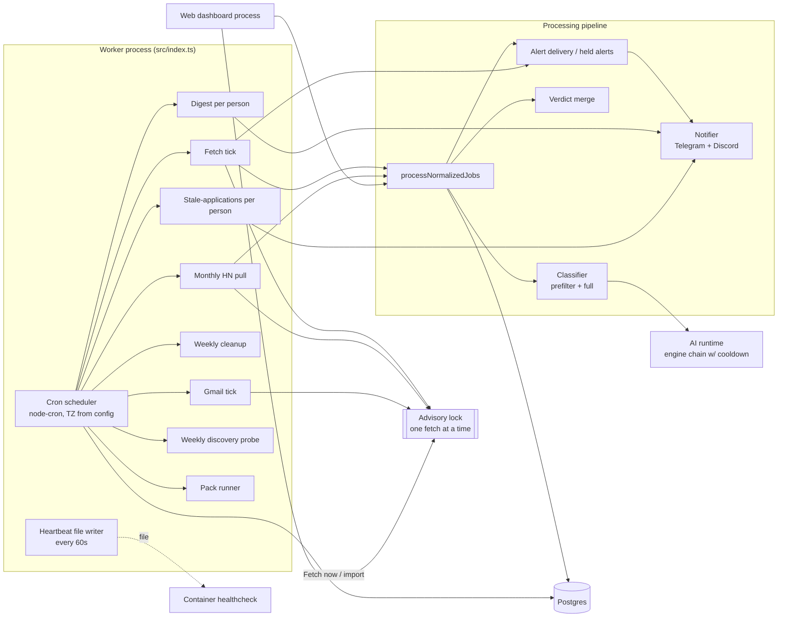

### 2.2 Data model touched (simplified)

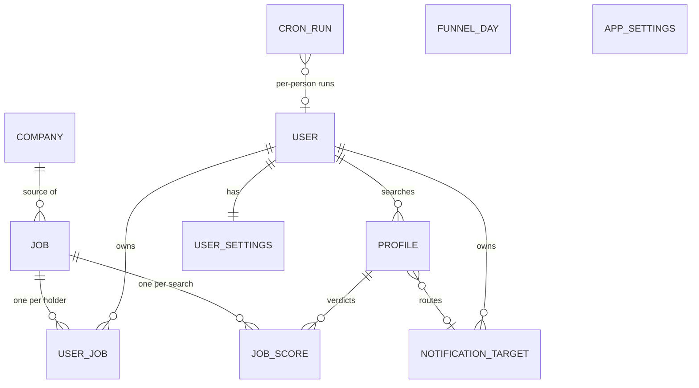

Tables and their role in this area:

| Table | Role |
|---|---|
| `job` | Shared posting. Unique (companyId, externalId). Holds parsed place (workplace, countries[], regions[], locationSource), posting-level salary (min/max/currency/period), simhash, `crossListedOfJobId`, `employer`, `employerKey`, liveness (state, code, checkedAt), description + original. |
| `job_score` | One row per (job, profile): fitScore, locationMatch, techMatch[], redFlags[], summary, priorityRulesApplied[]. Replaced wholesale on every re-score. |
| `user_job` | One row per (user, job): fitScore?, techMatch, redFlags, summary, priorityRulesApplied, status (NEW/ALERTED/APPLIED/DISMISSED/SAVED), alertedAt, alertHeldAt, application tracking (pipelineStage, appliedAt, recruiterContact, notes, applied resume snapshot). Unique (userId, jobId). |
| `profile` | A search: stackRequired, roleTypes, stackNiceToHave, stackExclude, seniority, countries, regions, workplace[], onsiteCities, residence, relocation (no/yes/sponsorship), minSalaryUsd (default 0), minFitScore (default 70), priorityRules JSON, active, notificationTargetId, resumeId, notes. |
| `notification_target` | Per-user Telegram (botToken+chatId) or Discord (webhookUrl) destination; unique per user on token+chat / webhook. |
| `app_settings` (singleton id 1) | classifierMode (`single`/`two_stage`), fetchingEnabled (default **false**), disabledSources[], discoveryEnabled, hnParserEnabled, sourceHealthAlerts, schedule JSON (install's fetch half), instanceId. |
| `user_settings` | telegramEnabled (the per-person "Alerts" switch, default true), applicationTrackingEnabled, staleApplicationsDigestEnabled, reapplyDays, schedule JSON (zone + alert timing), pack JSON, locale. |
| `cron_run` | One row per job execution: name, startedAt, finishedAt, status RUNNING/OK/FAILED, stats JSON, progress JSON (live), errorMessage, userId?. |
| `funnel_day` | One row per UTC day of summed tick counters; never pruned. |
| `company_mute` | Per-user muted employer keys. |
| `company` (watch columns) | `watched`, `alertPolicy` (`matches`/`all`), `checkEvery` (hour/day/week), `nextCheckAt`, content hashes for page-change watch, `validator` (HTTP validators), `consecutiveFailures`, `lastFetchStatus`. |

## 3. Key flows

### 3.1 Lifecycle of a posting (fetch tick)

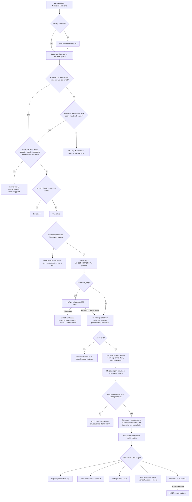

### 3.2 Fetch tick ordering and gates (worker "fetch" cron)

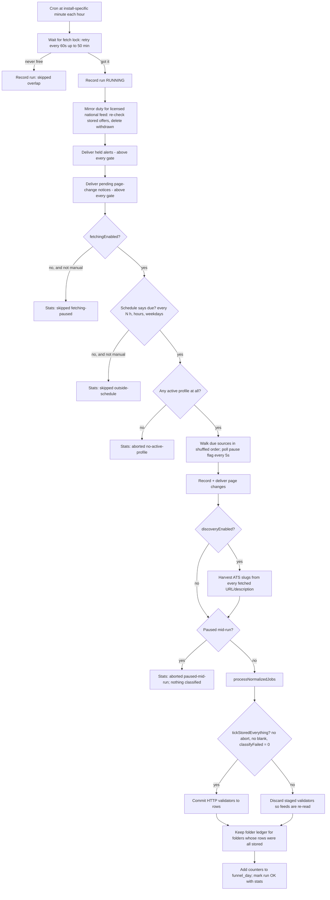

### 3.3 Alert hold / delivery sequence

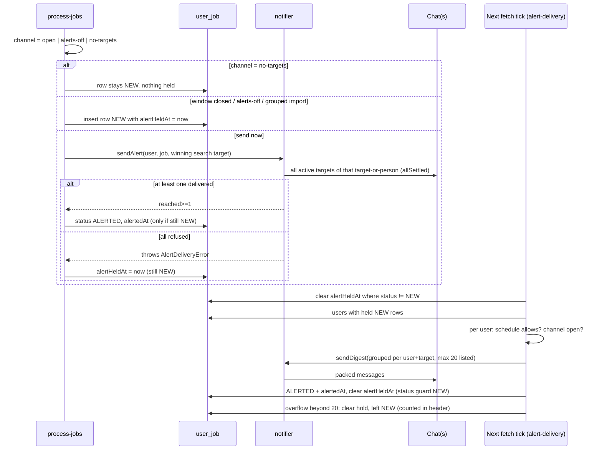

### 3.4 Re-score paths

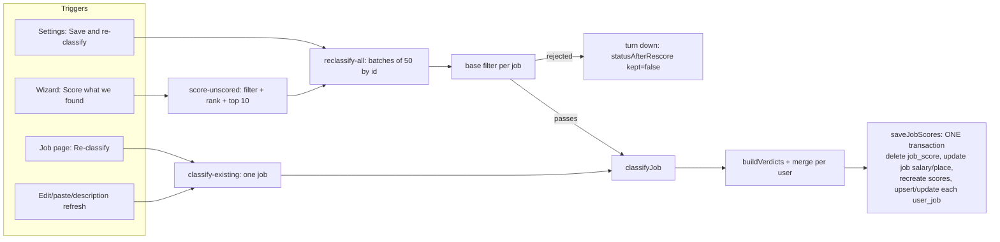

## 4. State machines

### 4.1 Per-person inbox status (`UserJob.status`)

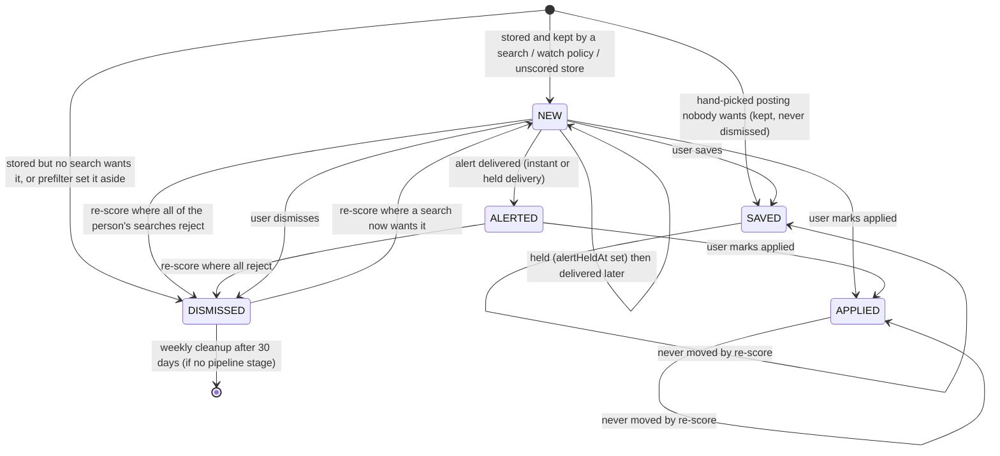

User-initiated status changes go through one endpoint (`POST /jobs/:id/status`); setting APPLIED also seeds `pipelineStage='applied'` (only from no stage or Consider/Applying, only when tracking is enabled), sets `appliedAt` if empty, snapshots which resume (id, version, text) went out.

### 4.2 Held alert

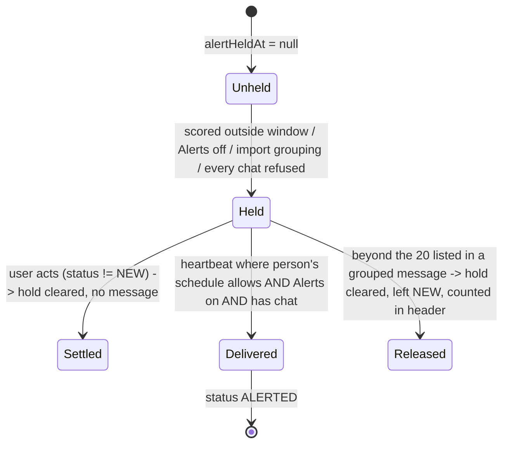

### 4.3 Run record (`CronRun.status`)

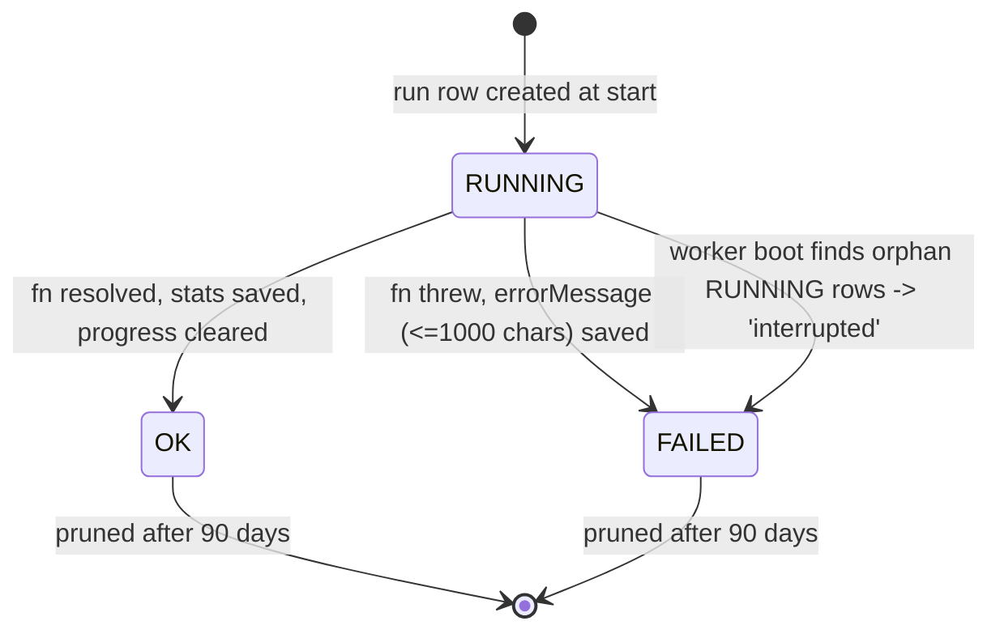

### 4.4 Liveness verdict (`Job.liveness`)

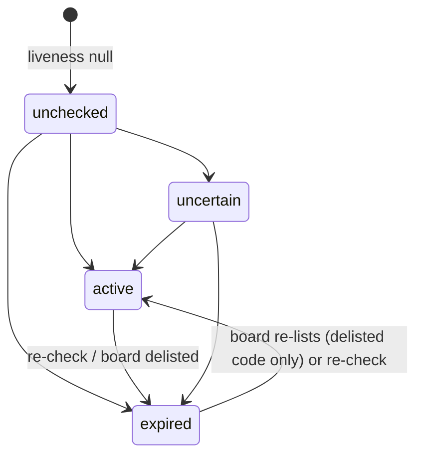

### 4.5 Fetch-lock / tick overlap

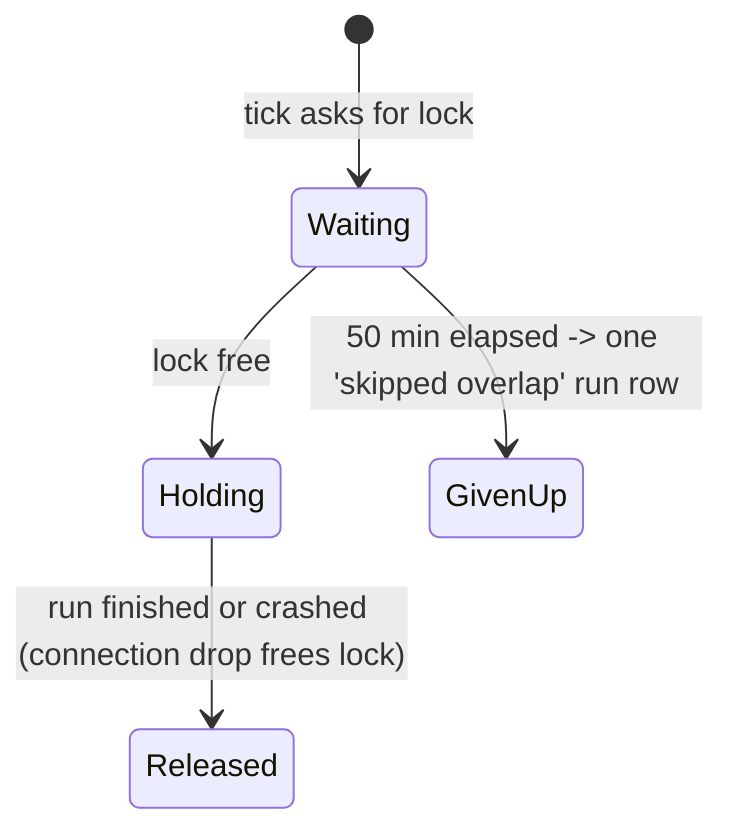

## 5. Feature list (contract)

| ID | Feature | What it does | Trigger | Key config/settings |
|---|---|---|---|---|
| PIP-01 | Worker boot sequence | Applies DB schema (migrate deploy if migrations folder exists, else schema push), pings DB, marks orphan RUNNING runs FAILED ("interrupted"), seeds source companies, bootstraps a default blank profile if none, imports Telegram/Discord target from env once, backfills employer keys once. | Worker start | `DATABASE_URL`, `MIN_FIT_SCORE`, `MIN_SALARY_USD`, `TELEGRAM_BOT_TOKEN/CHAT_ID`, `DISCORD_WEBHOOK_URL` |
| PIP-02 | Cron scheduler | Registers 9 recurring loops in `TZ`, no-overlap per loop in-process, logs every start/end (quiet loops at debug), wraps every beat in the interface-language context. | Worker start | `TZ` (default UTC) |
| PIP-03 | Per-install minute spreading | Replaces the minute field of `fetch`, `hn-hiring`, `discovery` with `FNV-1a(instanceId:jobName) mod 60` so installs do not hit boards in the same second. Throws if instanceId empty. | Worker start | `AppSettings.instanceId` |
| PIP-04 | Graceful shutdown | On SIGTERM/SIGINT/launcher stop: stop pack runner and folder watcher, kill AI CLI children, wait up to 60 s (poll 250 ms) for in-flight beats, disconnect DB, exit 0. Beats arriving during shutdown are skipped. | Signal | constants 60 s / 250 ms |
| PIP-05 | Worker heartbeat file | Writes ISO timestamp to a file every 60 s; healthcheck treats it stale after 180 s. Write failures logged once per streak. | Timer | `HEARTBEAT_FILE` |
| PIP-06 | Run tracking | Every job execution writes a `cron_run` row (RUNNING -> OK/FAILED) with stats JSON and error text; per-person runs carry userId; "last successful run" lookup (default user also matches rows with null userId). | Every cron beat | - |
| PIP-07 | Live run progress | Jobs report `{stage,label,unit,done,total,counters}`; writes throttled to one per 5 s per stage (stage change immediate), heartbeat re-write every 5 s, single write in flight, flush before the final update; ETA from sample window (12 samples, >=30 s apart, needs >=20 done); report older than 120 s = stale worker. Progress cleared on completion. | During runs | counters: kept, setAside, classified, errors, listings |
| PIP-08 | Per-person job runner | Runs a job once per person with own run row, own locale; one person's failure does not stop others. | Digest/stale/gmail beats | - |
| PIP-09 | Single-fetcher advisory lock | Postgres session advisory lock on a dedicated one-connection client ensures only one of: hourly tick, monthly HN pull, Gmail read, folder look, import scoring, dashboard "Fetch now", fetch-once script runs at a time; crash releases it. Separate key for pack runner. | Any fetch start | key constants |
| PIP-10 | Lock waiting | Hourly tick retries lock every 60 s up to 50 min; Gmail hourly up to 10 min; Gmail "requested" and folder-check ask once. Lock is asked before a run row is written, so meeting another fetch leaves no row (except tick giving up). | Fetch/gmail beats | - |
| PIP-11 | Hourly fetch tick | Orchestrates mirror duty, held alert delivery, page-change delivery, pause check, schedule check, source walk, discovery harvest, processing, validator commit, funnel update. See flow 3.2. | Cron `5 * * * *` (minute spread) | `fetchingEnabled`, `schedule.fetch`, `classifierMode`, `discoveryEnabled`, `disabledSources` |
| PIP-12 | Manual / scoped fetch | "Fetch now" and folder-triggered checks run the same tick but ignore schedule and (for manual) the pause; while paused they store postings unscored. Scoped by `only(company)` for folder checks. | User, folder watcher | `manual`, `only` |
| PIP-13 | Fetch schedule gate | Fetch is due only if weekday is allowed, hour within window (inclusive, wraps midnight), and gap since the last real fetch >= cadence minus 5 min tolerance. Last real fetch = latest of the last 200 `fetch` runs whose stats have numeric `fetched`. | Each hourly beat | `schedule.fetch.{every: hour/2h/4h/day, from, to, days}` |
| PIP-14 | Pause switch and mid-run abort | `fetchingEnabled=false` skips the tick; a latching probe re-reads the flag at most every 5 s during walk, discovery harvest and classify loop; a pause mid-run discards unconsumed classifications and queued AI thunks. | Settings toggle | `PAUSE_RECHECK_MS=5000` |
| PIP-15 | Source walk selection | Picks active companies in non-disabled families that are due (`nextCheckAt` null or <= now+5 min); manual asks all; shuffled order seeded per tick; per-source status/count/ms recorded in run stats; failure streak counters. | Inside tick | `disabledSources`, per-company `checkEvery` (hour/day/week) |
| PIP-16 | Conditional-request cache | HTTP validators are staged during the walk and promoted/persisted only if the tick stored everything it fetched (no abort, no blank-profile skip, zero classify failures). | Tick end | `Company.validator` |
| PIP-17 | Candidate prep: date and place | Invalid posting date replaced by now and flagged `undated`; location string + source hints parsed into workplace/countries/regions. | Per posting | - |
| PIP-18 | Location text parser | Detects workplace (remote/hybrid/on-site words in several languages), country/region mentions via gazetteer aliases, flags, demonyms+residency words, "City, ST" disambiguation, German "(m/w/d)" => DACH hint. Source structured hints win over text; workplace hint replaces text reading. `source` = structured/parsed/null. Bare "Remote" => REMOTE with empty countries. | Per posting | countries.json gazetteer |
| PIP-19 | Base filter (per search) | Gate 1 title must contain a stackRequired or roleType keyword (skipped if both empty); gate 2 title must not contain an exclude keyword; gate 3 location: listed on-site city in location string admits outright, workplace not accepted rejects, then country/region overlap check (groups expanded) when both sides name places. Unknown/empty on either side defers to AI. | Per posting | profile lists |
| PIP-20 | Union filter + furthest reason | Posting admitted if ANY active search admits; otherwise reason = the gate that got furthest across searches (title < excluded < workplace < place). | Per posting | - |
| PIP-21 | Whole-word title keyword matching | Boundary required only where the keyword's own edge is a letter/digit; allowed suffixes `s, er, ers, js, lang, ing`; Unicode letters/digits count as word chars. | Per keyword | - |
| PIP-22 | Blank-search exclusion | A search with no required stack and no role types is dropped from the roster each tick; if none usable, classification and alerts are skipped (`skippedBlankProfile`). Blank searches cannot be activated. | Every tick/re-score | `isBlankProfile` |
| PIP-23 | Employer gate (mute / re-apply window) | Per recipient: muted employer key or applied-to employer within `reapplyDays` => no row for that person; if all possible recipients turn it away, rejected before AI. Bypassed for hand-picked postings and, for the re-apply window, watched companies on "all". Unknown employer passes. | Per posting | `company_mute`, `reapplyDays` (30/60/90/180/null) |
| PIP-24 | Employer key normalization | Lowercase, accent-fold, `&`->and, drop punctuation, leading "the", trailing legal forms (closed list e.g. inc, llc, gmbh, sp z o o); aggregator rows with no named employer have null key. | Ingest | `EMPLOYER` rules |
| PIP-25 | Dedup on store | In-batch `seen` set + one bulk read of stored (companyId, externalId) pairs; unique-violation on insert (race with another run) counted as duplicate. | Per posting | - |
| PIP-26 | Cross-listing fingerprint | 64-bit SimHash over 3-token shingles of the description (null if <3 tokens or <400 normalized chars); nearest *other-company* job within Hamming distance <= 7 among jobs fetched in last 90 days recorded as `crossListedOfJobId`; annotation only. | On store | `MAX_HAMMING_DISTANCE=7`, `DEDUP_WINDOW_DAYS=90` |
| PIP-27 | Unscored store | When classification is off (paused manual fetch), rows passing the filter are stored NEW with no score for every recipient (all users) except those who turn the employer away; no AI, no alerts; never revisited by cron. | Manual fetch while paused | `classify=false` |
| PIP-28 | Prefilter (stage 1) | In `two_stage` mode: tiny union yes/no call (<=100 tokens, first 800 chars) generous by design; "no" => store DISMISSED unscored with summary "Set aside by the prefilter: reason" (SAVED if hand-picked). Failure/garbage => fail open to stage 2. | Per posting | `classifierMode` |
| PIP-29 | Full classification | One AI call per posting, all active searches in one prompt; returns posting salary (own numbers/currency/period), location block, and per-search `{fit 0-100, location_match, tech_match[], red_flags[], summary}`. Max tokens 400 + 180 per search; description cut to 4000 chars; one retry on malformed reply; reply rejected if it names unknown or repeated search ids; partial replies keep what came back. | Per posting | `AI_CONCURRENCY` (1-8, default 3), `MAX_ACTIVE_PROFILES=8` |
| PIP-30 | Prompt contract | Per-search block (seniority, required stack, role types, nice-to-have, auto-reject, location codes, residence/relocation, min salary, notes), tech-match caps (<=35 when required stack absent), location_match rules (country/region locks, worldwide, bare remote false, default false), eligibility rules (permit/sponsorship flags), scoring bands 90-100/70-89/40-69/0-39, kebab-case flags, injection flag, fenced untrusted content. Prompt version 4. | Per call | - |
| PIP-31 | No-stack score cap | Code-level clamp: search with no required stack => fit <= 50 and red flag `no-profile-stack` added; such a verdict never alerts. | Post-parse | `NO_STACK_FIT_CAP=50` |
| PIP-32 | AI location merge | Model's place block replaces parser values only where more specific: workplace if parser UNKNOWN; countries if parser empty or AI list is a strict subset; regions only if parser found nothing; `locationSource='ai'` if changed. | After classify | - |
| PIP-33 | Priority rules | Per-search post-AI overrides: rule = label, techsAny, regionsAny, minFitFloor; match if any tech phrase in title+description AND (regionsAny empty OR any phrase in location); multi-word phrase needs every token (word-prefix boundary); effect: fit = max(fit, highest matching floor), location_match forced true; salary untouched. Text editor format `LABEL | techs | regions | floor`. | After classify | `Profile.priorityRules` |
| PIP-34 | Dismiss reason per search | Order: fit < minFitScore => `low-fit`; not location_match => `location-mismatch`; salary (converted to USD/yr) < minSalaryUsd (only when both known and min > 0) => `low-salary`. | Per verdict | `minFitScore`, `minSalaryUsd` |
| PIP-35 | Verdict merge | Per person: winner = highest fit among searches that did not dismiss (ties by profile id); if all dismissed, highest fit overall; `kept` = any search keeps; score line "Name 87 · Name 41" sorted by fit. Posting-level facts (salary) come from the global best. | After verdicts | - |
| PIP-36 | Per-person persistence | One `Job` create with nested `UserJob` rows (one per person with a verdict, minus employer-away users, minus non-owner on imports) and `JobScore` rows for every search; status NEW if kept else DISMISSED (SAVED if hand-picked). | After merge | - |
| PIP-37 | Watchlist policy "all" | Company with alertPolicy `all` bypasses base filter, fit threshold and re-apply window: row kept and alerted as "new posting" with watch star, still classified. | Per posting | `Company.watched/alertPolicy` |
| PIP-38 | Currency/period normalization | Converts posting salary to USD per year using dated static rate table (28 currencies) and per-year multipliers (month 12, week 52, day 220, hour 1760); unknown currency = USD; null period = year. Formatting helpers produce "€60k-80k", "zł20k/mo", "≈ $78k/yr". | Dismiss logic, messages | `RATES_TO_USD`, `PER_YEAR` |
| PIP-39 | Apply-link flags | Adds red flags `apply-url-missing` (unless pasted), `apply-url-unusable` (not http/https), `apply-url-shortened` (13 shortener hosts), `apply-url-not-an-application` (social/video hosts) at every site that persists red flags. Flags only, nothing hidden. | On persist | host lists |
| PIP-40 | Auto application pack queueing | For each keeper (not no-stack, not quiet source, packs enabled, fit >= 0): queue an "auto" pack if fit >= minFit, posting dated, age <= maxAgeDays, daily auto count < dailyLimit (UTC day); a copy of a role already stored gets no second pack and no backlog entry. Failure never costs the alert. | After store | pack settings: minFit 50-100 (90), dailyLimit 0-50 (5), maxAgeDays 1-60 (7) |
| PIP-41 | Alert decision per keeper | Skip if no-stack flag (unless watch=all); skip if source quiet; skip if no active target (stays NEW, nothing held); hold if outside person's alert window, Alerts switch off, or grouped-import; else send immediately to the winning search's target (or all of the person's active targets). | After store | `alerts.mode/from/to/days`, `telegramEnabled` |
| PIP-42 | Alert modes | `instant` (send when scored), `window` (send only on allowed weekdays within hours, else hold), `digest` (never instant; held until a digest hour). | Per match | `schedule.alerts` |
| PIP-43 | Instant alert message | Header with fit score (names the winning search when several; "★ new posting" for watched), title @ company, place line with flags, salary, tech match, red flags, "also listed at", per-search score line, summary, source attribution line, apply link only if valid web URL. Telegram MarkdownV2 (4096) and Discord (2000) renderings. | Per match | locale |
| PIP-44 | Send failure handling | Alert to all targets in parallel; success if >=1 reached; all fail => error and row held for next heartbeat; Alerts switched off between read and send => held. | Per send | - |
| PIP-45 | Target resolution | Search-specific target if it belongs to the person and is active, else warn and fall back to all the person's active targets. | Per send | `Profile.notificationTargetId` |
| PIP-46 | Held-alert delivery | At the top of each fetch tick (above pause/schedule): clear holds on rows no longer NEW; for each holder whose schedule allows release and Alerts on with a chat, group rows by (person, target), list first 20 per group sorted by fit desc then newest, count the rest in header and release their hold; mark listed rows ALERTED (guard NEW); failures keep holds. | Each tick | `HELD_LIST_MAX=20`; `shouldDeliverHeld` |
| PIP-47 | Held release rule | instant mode: always; digest mode: only at a digest hour; window mode: when inside window. | Each tick | schedule |
| PIP-48 | Page-change notices | Career-page watch: first read stores hash silently; a change sets `pendingContentHash`; notice (one grouped message listing companies with links) goes to each administrator whose schedule/Alerts/targets allow, then `lastContentHash` advances (only if hash unchanged since). Admins with no chat count as reported; if any admin is waiting and none sendable, defer. Delivered at tick top and right after the walk. | Tick | company `watched` |
| PIP-49 | Daily recap (digest) | Per person at their digest hour(s): lists their NEW/ALERTED, scored, not-held, non-quiet postings fetched since their last successful digest (or 24 h if first), best first; unscored postings as one line; admins also get a "failing sources" line (active sources with >=3 consecutive failures, if `sourceHealthAlerts`). Broadcast to all the person's targets. | Hourly beat, gated by digest hour | `alerts.digestAt` (1-4 hours, default [9]) |
| PIP-50 | Stale-applications nudge | At the person's first digest hour: applications with stage `applied`, appliedAt older than 14 days, no recruiter contact, oldest first, as one message (with "applied with resume vX"); skipped if tracking or the nudge toggle is off, or nothing found. | Hourly beat, first digest hour | `applicationTrackingEnabled`, `staleApplicationsDigestEnabled` |
| PIP-51 | Digest hour gating | Hourly beat evaluates each person's digest hours in their own timezone; no run row if nobody is due. | Hourly | `timezone`, `digestAt` |
| PIP-52 | Weekly cleanup | Deletes DISMISSED user rows older than 30 days (fetchedAt) with no pipeline stage; then jobs older than 30 days nobody holds; AI call ledger >400 days; employer-mode screenings past retention; finished runs >90 days (never RUNNING); optional update check. | Sunday 03:00 | retention constants |
| PIP-53 | Monthly HN thread pull | Under the fetch lock: pulls latest "Who is hiring" thread through the same pipeline when fetching enabled, parser enabled and source family not disabled; discovery harvest of ATS links. | 06:xx on the 1st | `hnParserEnabled` |
| PIP-54 | Weekly discovery probe | Re-probes PENDING company candidates of Greenhouse/Lever/Ashby, updates `jobsSeen`, marks DEAD on 4xx (not 429), 1 s polite delay. | Sunday 04:xx | `discoveryEnabled` |
| PIP-55 | Slug discovery from fetched postings | Every fetched URL/description is scanned for ATS slugs and recorded as candidates (idempotent). | Fetch tick | `discoveryEnabled` |
| PIP-56 | Pack runner beat | Every minute: if unfinished packs or messages owed, run pack job under its own advisory lock; otherwise no row. | Every minute | pack settings |
| PIP-57 | Gmail beats | Hourly (minute 35, not spread) read every connected person's label; every minute process "check now" requests; both under the fetch lock, no row when nothing to read or fetching paused. | Cron | `fetchingEnabled` |
| PIP-58 | Reclassify all | Batches of 50 by id over all jobs except those where every holder has APPLIED; skips jobs whose every holder muted the employer; non-hand-picked jobs failing the base filter are turned down without AI; others classified at AI_CONCURRENCY; rewrites scores and per-person status via `statusAfterRescore`; counters promoted/demoted/keptSaved/unchanged/failed/priorityBoosted/dismissed* ; reports lastError. Single run at a time. | "Save & re-classify" (profile save) | `classifierMode` |
| PIP-59 | Status after re-score | APPLIED and SAVED never move; kept: DISMISSED -> NEW else unchanged; not kept: DISMISSED stays, otherwise DISMISSED (or SAVED if hand-picked). | Re-score | - |
| PIP-60 | Score unscored (wizard) | Takes a person's NEW unscored non-muted jobs, dismisses those failing the base filter in one update, ranks the rest by profile term hits (required x3, role x2, nice-to-have x1; title hit doubles; ties by newer), classifies top 10, reports `remaining`. | Wizard step | `SCORE_BATCH=10` |
| PIP-61 | Per-job re-classify | Scores one stored job against all active non-blank searches; returns scored/prefiltered/no-search/failed; `keepStatus` leaves statuses (and does not hand rows to others) for paste/edit/refresh paths. | Job page, paste, edit, description refresh | - |
| PIP-62 | Posting edit | Only for postings from own sources (MANUAL/GMAIL/IMPORT/FOLDER) held by exactly this person: validates title (<=300, non-empty), company (<=200), location (<=300), description (200..60000 chars, only checked if changed); re-parses location, recomputes employer key, re-scores with statuses preserved. | User edit | `posting-limits` |
| PIP-63 | Location mismatch explanation | Builds a one-line reason (workplace not accepted / no country / posting elsewhere / residence not covered with relocation hint) from columns without AI. | Job page | - |
| PIP-64 | Residence coverage | Posting open to residence if no place named, WORLDWIDE, listed country, region containing it, or group of which residence is a member. | Explanations | - |
| PIP-65 | Search profile management | CRUD for searches; up to 8 active per person (serialized by a global write lock); primary search cannot be switched off or deleted and is always active; resume ownership check; new members get a blank primary. | Settings | `MAX_ACTIVE_PROFILES=8` |
| PIP-66 | Filter-change detection | Saving a search tells whether fields read by the base filter changed (set-compare, case/order insensitive) to decide whether to hint at re-reading folders. | Settings save | - |
| PIP-67 | Liveness ladder (free) | Rung 1: ATS vendor public API for Greenhouse/Lever/Ashby/Workable/SmartRecruiters (fixed hosts, slug charset check); rung 2: fetch stored URL (SSRF-guarded, hop-by-hop) and classify page; any ambiguity => `uncertain`; contradictory rung1 expired vs live page => `conflicting_signals`. Stored with code and timestamp. | User "verify" (free first) | codes: 16 |
| PIP-68 | Page classification | 404/410 => expired; bot-challenge text, 401/403/429/5xx => uncertain; redirect off posting => uncertain; multilingual closed-banner patterns => expired; <200 chars text => uncertain; else active. | In ladder | - |
| PIP-69 | Delisting tracking | When a board walk lists a board in full, stored jobs missing from it are marked expired with delisted code and re-listed ones flipped back. | Fetch walk | `delistPlan` |
| PIP-70 | Deep verification (AI) | Optional web-research ghost/scam check with verdict legit/suspicious/fake, recommendation apply/caution/skip, confidence 0-100, evidence list (<=30), red flags (<=20), company snapshot, company's own posting URL; 6000 tokens, 10-minute timeout, job text cut at 12000 chars. | User "Deep check" or when free rungs uncertain | AI role `resume` |
| PIP-71 | Search funnel rollup | After each tick/HN pull, adds 22 counters into the UTC-day row; runs cut short (paused mid-run, aborted, blank) contribute only delivered counts; view for 7 and 30 days with six stages (read, passed, fresh, scored, matches, alerted) and ranked "why" lists. Failure to write never fails the run. | After runs | `FUNNEL_KEYS` |
| PIP-72 | Source yield | Per source, last 30 days: stored postings vs those kept (non-dismissed, scored) by a person. | Dashboard | - |
| PIP-73 | Telegram delivery | Bot API `sendMessage`, MarkdownV2, no link preview, 10 s timeout, 4096-char packing; multi-part messages stop at first refusal (reached if first part arrived). | Any send | token+chat |
| PIP-74 | Discord delivery | Incoming webhook POST, content cut at 2000, `allowed_mentions` empty, webhook URL validated against Discord host regex (at add time and again at send); secret masked in UI. | Any send | webhook URL |
| PIP-75 | Alert channel state | `no-targets` (no active chat) > `alerts-off` (switch off) > `open`; drives hold/skip behavior everywhere. | Everywhere | - |
| PIP-76 | Operator notices | AI-budget warning and similar plain notices go to each administrator via their own targets/switch; throws only if every admin attempt failed. | Event | - |
| PIP-77 | Pack-ready notice | Grouped plain-line message to pack owner. | Pack runner | - |
| PIP-78 | AI engine cooldown (consumer) | After 3 consecutive failures an engine is skipped for 60 s; a refused credential for 10 min unless the credential changes. | Within AI calls | - |
| PIP-79 | Once-scripts | CLI entry points to run one tick/digest/stale/cleanup/HN/discovery/gmail/pack now, plus backfills (fingerprints, apply-link flags, descriptions, locations, refetch descriptions). | Operator | - |
| PIP-80 | Health check | `health-check web|worker`: worker healthy iff heartbeat file age <= 180 s. | Container | - |
| PIP-81 | Per-user alert schedule defaults | New person: instant alerts, hours 8-22, all days, digest at 09:00, zone = install `TZ`; unparseable stored schedule falls back to defaults whole. Install's fetch half is shared; members cannot change it. | Settings | `defaultSchedule` |
| PIP-82 | Folder-watch quick check | Under launcher only, a changed file in a postings folder triggers a scoped fetch within a minute (never while paused). | File event | - |

## 6. Business rules and invariants

**Scheduling (all in `TZ`)**

| Loop | Expression | Notes |
|---|---|---|
| fetch | `5 * * * *` | minute replaced per install; schedule gate decides if it searches |
| gmail (all connected) | `35 * * * *` | not spread |
| gmail-requests | `* * * * *` | quiet; one ask for the lock |
| digest | `0 * * * *` | per person: runs only if hour in `digestAt` (their zone) |
| stale-applications | `0 * * * *` | per person: first digest hour only |
| cleanup | `0 3 * * 0` | Sunday 03:00 |
| hn-hiring | `0 6 1 * *` | minute spread |
| discovery | `0 4 * * 0` | minute spread |
| pack | `* * * * *` | quiet; writes a row only when work exists |

- Heartbeat 60 s; stale threshold 3 beats (180 s). Shutdown wait max 60 s.
- Fetch-schedule cadence tolerance 5 min; page-watch `nextCheckAt` tolerance 5 min (otherwise hourly sources were read every other hour).
- Fetch cadence choices: `hour`, `2h`, `4h`, `day`; digest hours max 4; weekdays ISO 1-7.
- Fetch is **disabled by default** on a new install (`fetchingEnabled=false`); `classifierMode` default `single`.

**Gates and thresholds**

- Max 8 active searches per person; prompt tokens = 400 + 180 per search; description cap 4000 chars (prefilter 800, 100 tokens).
- Default search: minFitScore 70 (blank search from env `MIN_FIT_SCORE` default 70), minSalaryUsd 0 = no salary filter, workplace default REMOTE, exclude defaults `junior, intern` (+ internship, entry-level, apprentice for the bootstrapped profile).
- Dismissal precedence: low-fit, then location-mismatch, then low-salary; a missing salary never dismisses.
- Fit-score floors: priority rule floor applies after the model, before thresholds; no-stack cap (50) applies before priority rules, but the `no-profile-stack` flag survives boosts and blocks alerting.
- A posting is stored only if at least one verdict was obtained; no verdict => not stored (so it is retried next tick, costing AI again) and the tick will not commit feed validators.
- Prefiltered postings *are* stored (dismissed, unscored) to avoid paying the prefilter hourly.
- Hand-picked postings (pasted, saved files) bypass the filter and employer gates and are never DISMISSED (SAVED instead), because dismissed rows are deleted after 30 days.
- Dedup key: (companyId, externalId). Cross-listing: other company only, Hamming <= 7, 90-day window, needs >= 400 normalized chars.
- Salary: stored from the best verdict; currency table dated; day=220, hour=1760 working units.
- Alert ordering: alerts per posting sent in original fetch order (classification is parallel but results consumed in order); held/digest lists sorted by fit desc (nulls last), then newest.
- Held list cap 20 per (person, target) per delivery; Telegram 4096, Discord 2000; at most 8 failing sources named in a digest line.
- Stale nudge threshold 14 days; digest window = since last successful digest run per person (24 h on first).
- Retention: dismissed 30 d, runs 90 d, AI ledger 400 d, funnel days forever.
- Status guards: every alert-state write is conditioned on `status = NEW`, since the dashboard is open during sends.
- Re-score never touches APPLIED/SAVED; reclassify scope excludes jobs where all holders APPLIED.
- Posting edit allowed only for the sole holder of an own-source posting.
- A person's mute promises no AI spend on that employer for that person; the shared pass scores a posting unless every holder muted it.
- Pause/aborted/blank/skipped ticks add nothing to the funnel except delivered counts.
- Per-person data isolation: a message never mixes two people's rows; each person's alerts use their own targets and Alerts switch.
- Funnel counters are computed in `process-jobs` (rejectedTitle/Excluded/Workplace/Place/Muted/Applied, duplicate, preFiltered, classified, classifyFailed, dismissed*, matched, alerted, alertHeld, alertsOffHeld, alertFailed, alertNoTarget, alertSourceOff, watchedKept, packsQueued, priorityBoosted, crossListed, abortedMidRun, skippedByPause, skippedBlankProfile).

## 7. External dependencies and integration contracts

| Dependency | Contract |
|---|---|
| Postgres 16 | Advisory locks (`pg_try_advisory_lock`) on a separate single-connection client; array columns (GIN-indexed countries/regions); JSON columns; BigInt simhash. Migrations at boot. |
| AI runtime (engine chain) | `complete({json, system, user, maxTokens, label, role})` returns text or null; roles `classifier` and `resume`; configurable engine order with fallbacks; web tools only for deep verification; every call logged to an AI ledger. Replies must be JSON; extractor tolerates wrapping; schema validated with zod. |
| Telegram Bot API | `POST https://api.telegram.org/bot<token>/sendMessage` JSON `{chat_id,text,parse_mode:'MarkdownV2',disable_web_page_preview:true}`, 10 s timeout, non-2xx = failure. |
| Discord webhook | `POST` to `https://(ptb.|canary.)?discord(app).com/api/webhooks/<id>/<token>`, body `{content (<=2000), allowed_mentions:{parse:[]}}`. |
| ATS vendor public APIs (liveness) | Greenhouse `boards-api.greenhouse.io/v1/boards/{slug}/jobs/{id}`; Lever `api.lever.co` (or `api.eu.lever.co`) `/v0/postings/{slug}/{id}`; Ashby `api.ashbyhq.com/posting-api/job-board/{slug}` (list, find id, `isListed`); Workable `apply.workable.com/api/v2/accounts/{slug}/jobs/{id}` (`state` published/closed/archived); SmartRecruiters `api.smartrecruiters.com/v1/companies/{co}/postings/{id}` (`active`). 10 s timeout. |
| Hacker News (Algolia/firebase via fetcher) | Latest "Who is hiring" thread. |
| Licensed national job board mirror | Daily re-check duty executed at top of tick above all gates. |
| node-cron | 5-field expressions, timezone, noOverlap. |
| Filesystem | Heartbeat file; folder watcher (local launcher only). |
| Interface locale | Every outbound message rendered in the person's language per run; prompts stay English. |

## 8. Known oddities and accidental complexity

1. **Everything runs on one hourly cron plus gates.** The fetch tick doubles as the carrier for held-alert delivery, page-change notices and the licence mirror, so "fetch" runs even when paused. A rewrite should make these separate loops (or an event-driven delivery) instead of coupling them to the fetch lock and cadence.
2. **Two schedules.** One install-level fetch schedule and a per-person alert schedule share one JSON shape; the fetch half is "ignored" in personal rows and copied back in. Simplify to two separate settings objects.
3. **Per-user data model grafted onto a single-user design.** `Job` carries "best-of" columns historically; now `UserJob` carries them, `JobScore` the per-search ones; process-jobs builds `PersonPlan`, rows, scores in one nested create. A rewrite should start from (posting, user, search) verdicts and derive the rest.
4. **Not storing a posting when the AI gives no verdict** couples feed correctness (validator commit, folder ledger) to AI availability, adding `unstored`/`tickStoredEverything` machinery. Storing as "pending score" would remove it.
5. **Held-alert semantics are scattered**: written at insert time, re-evaluated at delivery, cleared in three places, with guards on status; plus "Alerts off" vs "no targets" distinction. A single outbox table (pending message per person/target with state) would be simpler.
6. **Stats are an untyped JSON bag** copied into run rows, then the funnel re-reads a hard-coded key list; the funnel's cut-short rule is duplicated in a SQL backfill migration.
7. **Run semantics are inconsistent**: some beats write a row only when they did work, some always, some are skipped before the row (lock waiting). Decide one rule.
8. **Dismiss-after-30-days** forces special cases (SAVED for hand-picked, `pipelineStage: null` guard, cleanup of jobs with no holders). Use an explicit "archived/hidden" flag with retention independent of status.
9. **Filter keyword suffix list and substring tuning** (`s, er, ers, js, lang, ing`) is corpus-tuned; keep behaviour but expose as data.
10. **Blank-profile handling** exists in 5 call paths (tick, reclassify, classify-existing, wizard, fetcher places) and is enforced again in code at parse time; centralize in a "usable roster" function.
11. **Hard-coded currency table** with a review date; replace with refreshed rates or keep static but externalize.
12. **AI call concurrency and ordering**: classification is parallel but persisted sequentially to keep order; a queue worker with idempotent per-posting jobs would remove the in-memory promise array and the pause-abort juggling.
13. **Dev-only `churn-once` script** (resume tailoring churn measurement) lives beside the pipeline scripts but belongs to the resume area; drop or move.
14. **Locale handling inside the worker** (run-locale wrapper at every beat and per-user) leaks UI concerns into scheduling; pass the locale to the message formatter instead.
15. **Duplicate notification formatting** (Telegram vs Discord) is already abstracted through markup tags; a third channel would be simple, but the "held title / digest title" strings reused as run labels are a hidden coupling.

## 9. Source map

| Area | Path |
|---|---|
| Worker entry, cron registration, shutdown, heartbeat | `src/index.ts`, `src/heartbeat.ts`, `src/schedule.ts` |
| Boot, migrations, bootstrap | `src/init.ts` |
| Run tracking and progress | `src/jobs/cron-run.ts`, `src/jobs/run-progress.ts`, `src/jobs/for-each-user.ts` |
| Fetch tick, lock, pause | `src/jobs/fetch-job.ts`, `src/jobs/fetch-tick.ts`, `src/jobs/fetch-lock.ts`, `src/jobs/lock-wait.ts`, `src/jobs/fetch-pause.ts`, `src/cancellation.ts`, `src/fetchers/index.ts` (walk), `src/fetchers/conditional.ts`, `src/fetchers/source-health.ts` |
| Core pipeline | `src/jobs/process-jobs.ts` |
| Filters and location | `src/filter.ts`, `src/location.ts`, `src/countries.ts`, `src/countries.json`, `src/jobs/location-merge.ts`, `src/jobs/location-reason.ts`, `src/eligibility.ts` |
| Classification | `src/classifier.ts`, `src/classifier-prefilter.ts`, `src/profile-guards.ts`, `src/priority-rules.ts` |
| Verdicts, persistence, statuses | `src/jobs/verdict-merge.ts`, `src/jobs/score-store.ts`, `src/jobs/user-job.ts`, `src/jobs/user-job-store.ts`, `src/jobs/rescore-status.ts`, `src/applied-state.ts` |
| Re-scoring | `src/jobs/reclassify-job.ts`, `src/jobs/classify-existing.ts`, `src/jobs/score-pick.ts`, `src/jobs/job-edit.ts`, `src/jobs/job-edit-store.ts`, `src/jobs/posting-limits.ts` |
| Money, links, dedup, employer | `src/currency.ts`, `src/apply-link.ts`, `src/fingerprint.ts`, `src/employer.ts`, `src/jobs/employer-store.ts` |
| Profiles | `src/profiles.ts` |
| Schedule rules | `src/user-schedule.ts`, `src/settings-split.ts`, `src/settings.ts` (getAlertSchedule) |
| Alerts and notifications | `src/notifier.ts`, `src/notify/{lines,discord,markup,pack,targets}.ts`, `src/jobs/alert-delivery.ts`, `src/jobs/held-alerts.ts`, `src/jobs/page-change-alerts.ts` |
| Summaries and housekeeping | `src/jobs/digest-job.ts`, `src/jobs/stale-applications-job.ts`, `src/jobs/stale-applications-format.ts`, `src/jobs/cleanup-job.ts`, `src/jobs/hn-hiring-job.ts`, `src/jobs/discovery-job.ts` |
| Funnel | `src/funnel.ts`, `src/jobs/funnel-store.ts` |
| Liveness / verification | `src/verification/liveness.ts`, `src/verification/verify.ts`, `src/verification/prompts.ts`, `src/fetchers/delisted.ts` |
| Pack trigger (consumer) | `src/pack/trigger.ts`, `src/pack/settings.ts`, `src/jobs/pack-job.ts` |
| Watch pacing | `src/watchlist/interval.ts` |
| AI cooldown | `src/ai-cooldown.ts` |
| Gmail beats | `src/jobs/gmail-tick.ts` |
| Web triggers | `src/web/routes/jobs.tsx` (status, reclassify, verify, edit), `src/web/routes/settings.tsx` (save and re-classify) |
| Scripts | `src/scripts/*-once.ts`, `src/scripts/backfill-*.ts`, `src/scripts/health-check.ts`, `src/scripts/churn-once.ts` (resume churn measurement, unrelated to the pipeline) |
| Schema | `prisma/schema.prisma` |
