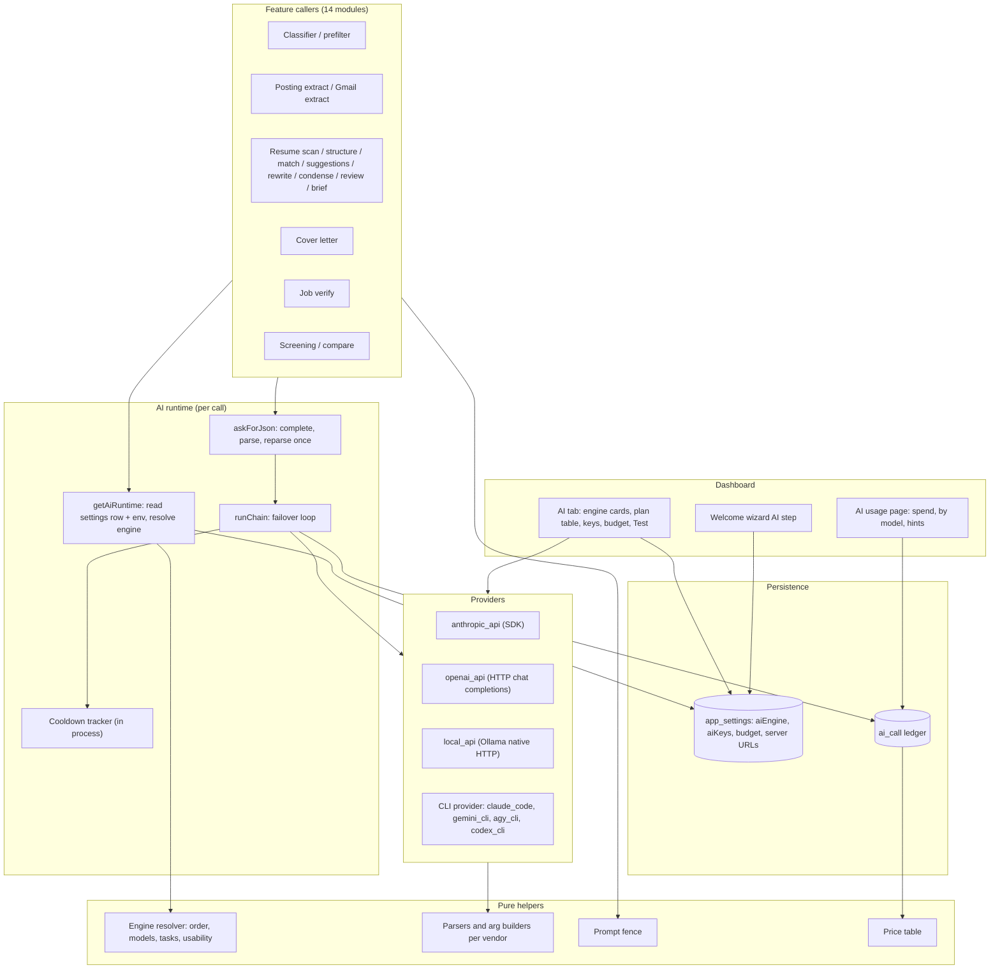
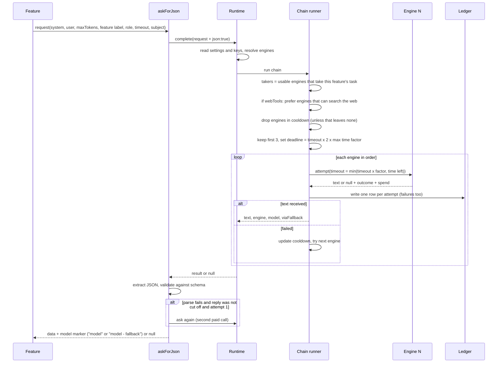
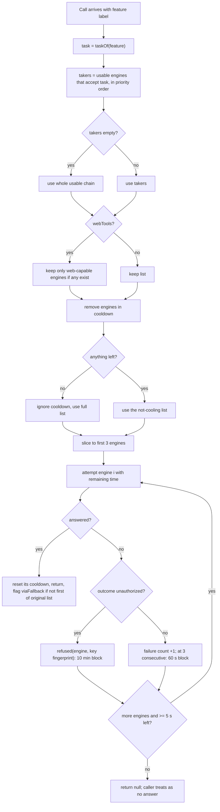
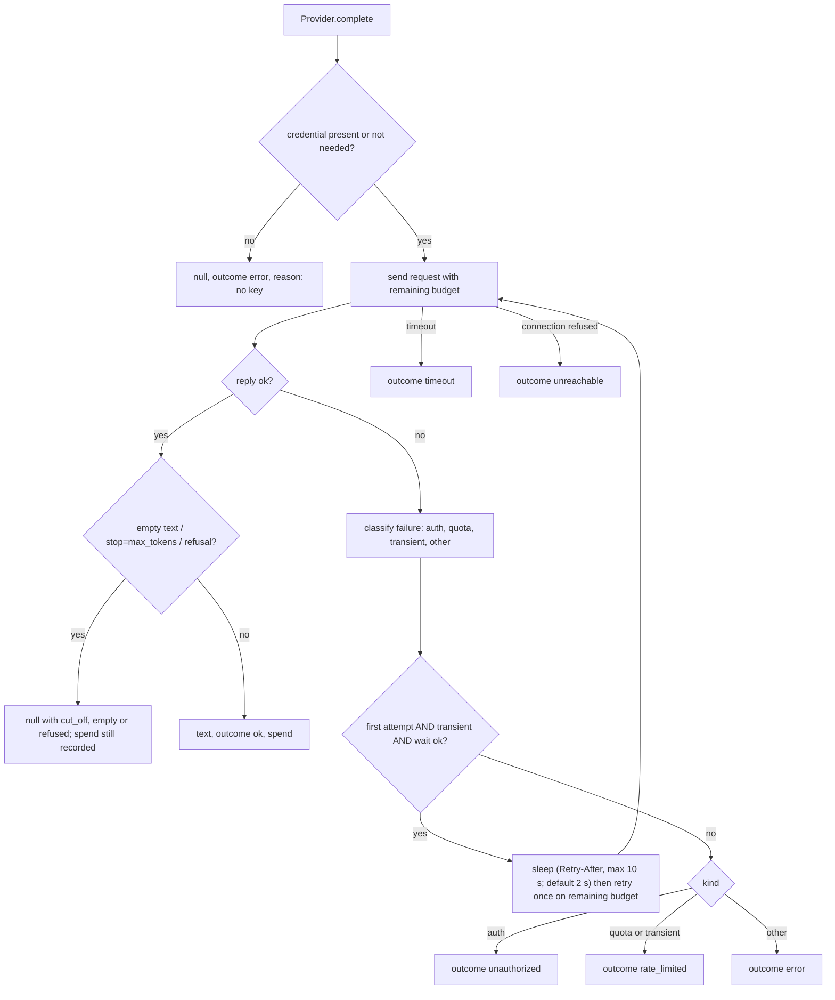
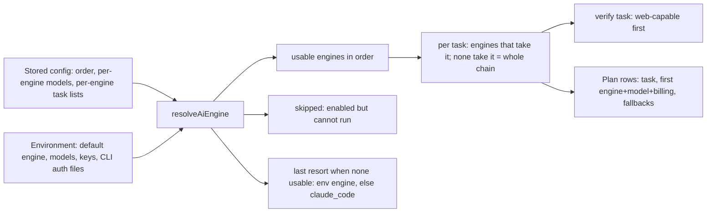
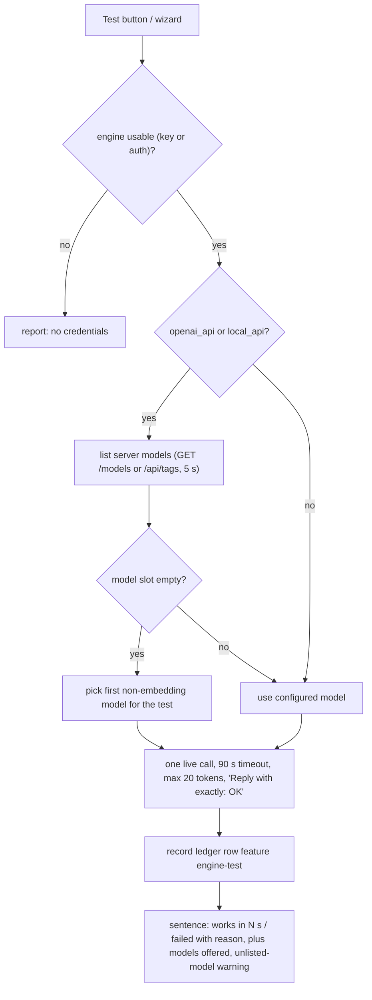
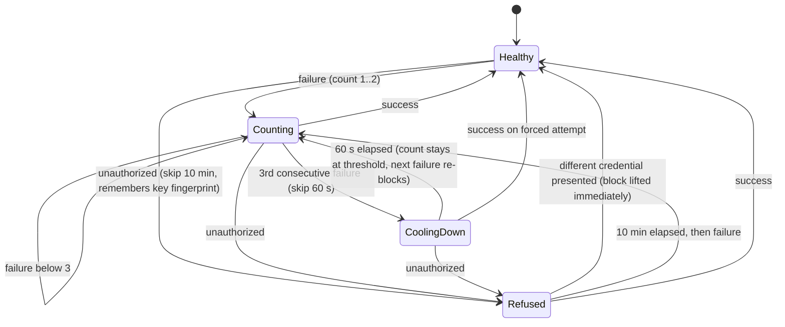
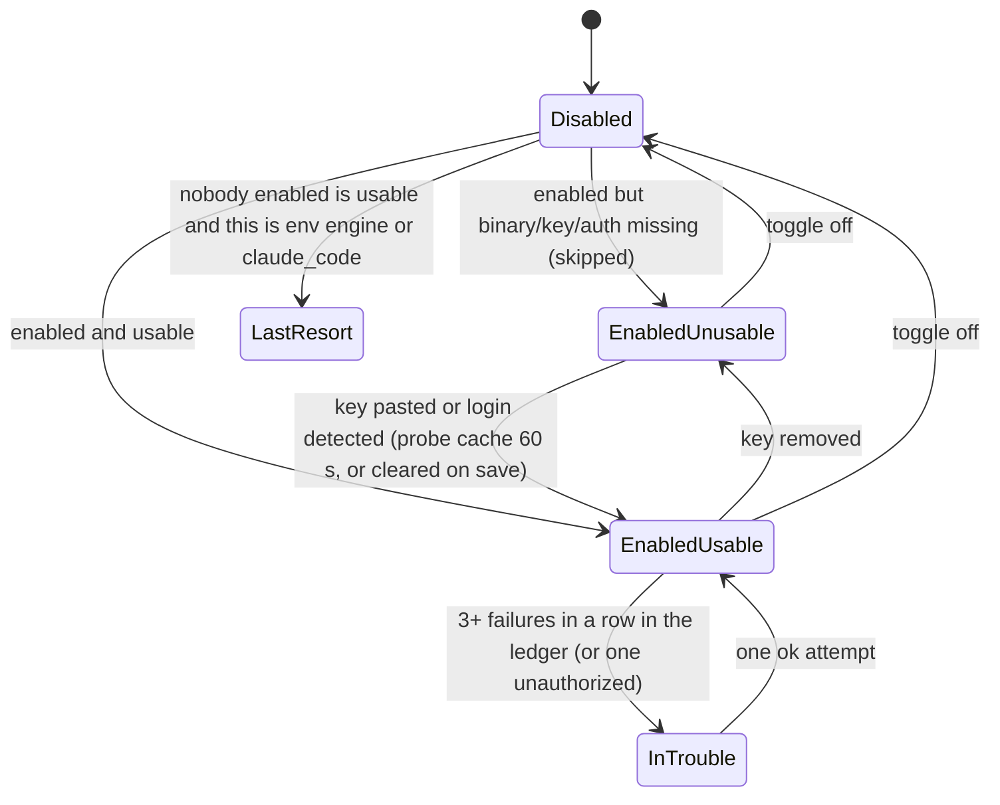
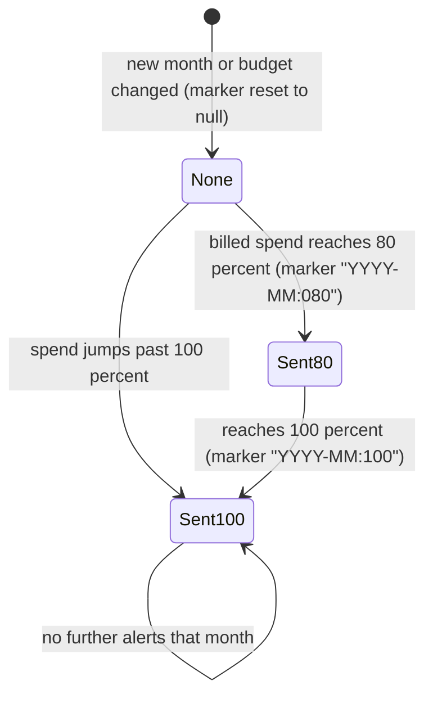

# 04 - The AI Layer

Derived from source only (src/, prisma/). Behaviour is described in implementation-neutral terms; the source map at the end lists where to verify each part.

## 1. Purpose and scope

The AI layer is the single seam between every feature that needs a language model (job scoring, resume analysis, cover letters, job verification, applicant screening, e-mail reading) and whatever actually runs the model. It hides seven interchangeable "engines" (hosted APIs, subscription command-line tools, and local servers) behind one `complete(request) -> text` call. It adds an ordered failover chain with per-task routing, cooldowns, retries and deadlines, a prompt-injection fence, tolerant JSON parsing with one reparse retry, a per-attempt cost ledger with a price table, a monthly budget warning, an engine-health detector, and the "AI plan" and "AI usage" UI that let a non-technical person see and change who answers what and what it costs.

Out of scope here: the prompts' domain content (rubrics, scoring maths), which belong to the classifier, resume, verification and screening areas; this document records only how each task invokes the layer.

## 2. Architecture

### 2.1 Components and dependencies

### 2.2 Layering rules worth keeping

- Resolution of the engine chain, model choice, task routing and usability is pure (no I/O) and unit-testable; I/O (settings read, process spawn, HTTP, ledger write) is injected into the chain runner.
- Settings are re-read on every call, so a dashboard change applies to the next call in both the web process and the background worker without a restart.
- The web process and the worker share nothing in memory except by the database: cooldown state is per process; budget-alert de-duplication uses a conditional database update.

## 3. Key flows

### 3.1 One logical AI call (sequence)

### 3.2 Chain selection and failover logic

### 3.3 One attempt inside a provider (retry rules)

### 3.4 Engine plan resolution (what the AI tab shows)

### 3.5 Engine test and local discovery

## 4. State machines

### 4.1 Per-engine cooldown (in-process, keyed by engine)

Notes: a plain failure never shortens a standing refusal. A cooling engine is still tried if every candidate is cooling.

### 4.2 Engine availability (as the UI sees it)

### 4.3 Monthly budget alert marker

The marker advances through a conditional database update so only the process that moves it sends the chat message.

### 4.4 Ledger row outcome values

`ok`, `rate_limited`, `timeout`, `cut_off`, `refused`, `empty`, `unauthorized`, `unreachable`, `too_large`, `error`. Only `unauthorized` triggers the long cooldown; a cut-off, refused or empty reply still carries spend because the vendor billed it.

## 5. Feature list

Engine catalog (7 engines): `anthropic_api` (Anthropic Messages API via SDK), `claude_code` (headless `claude -p`), `gemini_cli`, `agy_cli` (Antigravity CLI), `openai_api` (any OpenAI-compatible `/chat/completions`: OpenAI, OpenRouter, Groq, DeepSeek, LM Studio), `codex_cli` (headless `codex exec`), `local_api` (Ollama native API).

| ID | Feature | What it does | Trigger | Key config/settings |
|---|---|---|---|---|
| AIL-01 | Unified completion seam | One `complete(system, user, maxTokens, label, role, timeout, webTools, json, subject)` returns raw text plus engine, model and a fallback flag; callers own JSON extraction and validation. | event (every AI call) | none |
| AIL-02 | Seven provider backends | Anthropic SDK, OpenAI-compatible HTTP, Ollama HTTP (streamed), and four CLI wrappers behind one interface; each lazily constructed and cached per process. | event | `AI_PROVIDER` default engine; binary paths `CLAUDE_CODE_BIN`, `GEMINI_CLI_BIN`, `AGY_CLI_BIN`, `CODEX_CLI_BIN` |
| AIL-03 | Ordered engine chain | User-editable priority list of engines; first usable engine answers, the rest are fallback. An empty stored list means "the env engine alone". | user (edit) / event | `app_settings.aiEngine.order`, `AI_PROVIDER` |
| AIL-04 | Enable/disable engine | Toggle appends/removes an engine; disabling the env engine when it is the only one is refused; warns if the engine is unusable or is a billed engine sitting behind subscription engines. | user | `POST /settings/ai/enable` |
| AIL-05 | Reorder engine | "Move up" swaps an engine with its predecessor. | user | `POST /settings/ai/move` |
| AIL-06 | Per-engine model slots by role | Each engine has three model slots (classifier, resume, cover); empty slot falls to a per-engine/per-role default; a stored model not plausibly in the engine's family is ignored. | user | `aiEngine.models`, `CLAUDE_MODEL`, `CLAUDE_MODEL_RESUME`, `CLAUDE_MODEL_COVER`, `OPENAI_MODEL`, `LOCAL_MODEL` |
| AIL-07 | Model-family validation | Rejects a model id that does not fit the engine (claude* for Anthropic/Claude Code incl. aliases haiku/sonnet/opus, gemini* for Gemini CLI, gemini/claude/gpt for agy, gpt-/o#/codex for Codex; anything non-empty for openai/local). | user (save) | `modelFitsProvider` |
| AIL-08 | Curated model suggestions | Fixed dropdown lists per engine; openai/local are free text with suggestions from the server's own model list. | user | `PROVIDER_MODEL_OPTIONS` |
| AIL-09 | Task registry (6 tasks) | Groups the 20 ledger features into scoring, resume-read, analysis, letters, verify, screening; each task maps to a model role. | event | `AI_TASKS`, `AI_TASK_ROLE` |
| AIL-10 | Per-engine task routing | Each engine can be limited to a subset of tasks; all-ticked is stored as no list so later-added tasks are taken automatically; an engine unable to search the web is never offered "verify". | user | `aiEngine.tasks`, `POST /settings/ai/tasks` |
| AIL-11 | Task fallback to whole chain | If no usable engine takes a task, the whole chain answers, so a narrowed list never starves the pipeline; the plan flags this as "unclaimed". | event | none |
| AIL-12 | Hidden screening task | The screening task is shown/saved only in employer mode; when hidden, existing choices are preserved, and a new narrow list is not handed applicants' resumes. | user | `employerMode`, `pickedTasks` |
| AIL-13 | Last-resort engine | When nothing in the list is usable, the env engine (or `claude_code` if that is unusable) answers anyway so the pipeline always has a chain. | event | `lastResort` |
| AIL-14 | Usability detection | Anthropic needs key; OpenAI-compatible needs key unless URL is local; Gemini needs key or auth files/env; Codex needs `~/.codex/auth.json`; Claude Code and agy and local are "let the call decide". | event | `providerUnusable` |
| AIL-15 | Failover chain runner | Per logical call: choose takers, prefer web-capable for web calls, skip cooling engines, cap at 3 engines, enforce deadline, log fallback use. | event | constants in 6.1 |
| AIL-16 | Web-tool preference | Calls that ask for web research go to web-capable engines (anthropic_api, claude_code, gemini_cli, codex_cli) first, but a tool-less engine is still better than none. | event (verify) | `webTools` flag |
| AIL-17 | Engine cooldown | 3 consecutive failures block an engine 60 s; unauthorized blocks 10 min unless the credential fingerprint changes. | event | `ai-cooldown` constants |
| AIL-18 | Retry on transient failure | One retry for 429/5xx/overloaded after the server's Retry-After (<=10 s) or 2 s default, only if >=5 s of budget remains; never for auth or quota. | event | `retryWait` |
| AIL-19 | Failure classification | Status codes and message patterns map to auth, quota, transient, other and then to ledger outcomes. | event | regexes in 6.4 |
| AIL-20 | Error redaction | Failure reasons shown in the browser are collapsed to one line, key-shaped tokens masked (`sk-`, `sk_`, `gsk_`, `AIza...`, `Bearer ...`), capped at 200 chars; CLI failures are read from stderr/exit code, never from the command line (which contains the prompt). | event | `describeAiFailure`, `cliFailure` |
| AIL-21 | Anthropic web tools | When `webTools`, enables web search (max 10 uses) and web fetch (max 6) server tools; resumes `pause_turn` up to 5 times; direct-only caller mode for models that lack programmatic tool calling. | event | constants in 6.5 |
| AIL-22 | Anthropic output budgeting | Requested max tokens = answer budget + 8,000 thinking headroom, capped at 21,000; prompt-cache marker on the system block. | event | `anthropicMaxTokens` |
| AIL-23 | Incomplete-reply handling | `max_tokens` stop -> `cut_off`, `refusal` -> `refused`, empty text -> `empty` (all fail over, none treated as answers). Same mapping for OpenAI `finish_reason` length/content_filter and Ollama `done_reason` length. | event | per provider parser |
| AIL-24 | OpenAI-compatible provider | POST `{base}/chat/completions`; for api.openai.com uses `max_completion_tokens` (+2,048 headroom and `reasoning_effort=low` for gpt-5/o-series), others `max_tokens`; no key sent to local servers. | event | `OPENAI_BASE_URL`, `openAiBaseUrl`, `OPENAI_API_KEY` |
| AIL-25 | Local (Ollama) provider | Native `/api/chat`, streamed; sets context window per call; JSON mode when caller parses JSON; adds 4,096 tokens thinking headroom; one concurrent call per server; refuses prompts that cannot fit the window before sending; strips inline think blocks. | event | `localAiUrl`, `OLLAMA_URL`, `LOCAL_MODEL`, `localContextTokens` |
| AIL-26 | Local context window setting | Choice of 8,192 / 16,384 (default) / 32,768 / 65,536 tokens; token estimate is cautious (3.5 chars/token Latin, 1.5 other, +64 template). | user | `POST /settings/ai/local` |
| AIL-27 | CLI provider runner | Spawns the vendor CLI without a shell, closes stdin, kills with SIGKILL on timeout, 1 MiB output cap, runs in an empty temp directory, filtered environment; parses JSON/JSONL output for text, usage and cost; one retry for rate limit. | event | `CLI_TIMEOUT_MS` 180 s |
| AIL-28 | CLI environment allowlist | Child process gets only base variables plus its own auth variables, so a leaked `ANTHROPIC_API_KEY` cannot silently bill the API behind a subscription CLI. | event | `CLI_PROVIDER_ENV_KEYS` |
| AIL-29 | Claude Code isolation and thinking cap | Disables CLAUDE.md and auto-memory loading; for tool-free calls sets `MAX_THINKING_TOKENS=0` and effort `high`; web calls keep default thinking. | event | `CLAUDE_CODE_ISOLATION_ENV` |
| AIL-30 | Windows CLI shim resolution | Resolves npm `.cmd` shims to Node plus script path so no shell parses the prompt. | event | `cli-command` |
| AIL-31 | Graceful shutdown of CLI children | Process exit kills all in-flight CLI children and refuses new ones. | event (SIGINT/SIGTERM) | `stopCliChildren` |
| AIL-32 | Credential storage | Per-engine keys (Anthropic key, Claude Code OAuth token, Gemini key, OpenAI-compatible key) stored in settings JSON; DB key wins over env; max 500 chars; merged in SQL so concurrent saves cannot lose one; never returned to browser. | user | `aiKeys`, `POST /settings/ai/key`, `POST /welcome/ai/key` |
| AIL-33 | Server address settings | OpenAI-compatible base URL (https required unless local; no embedded credentials) and Ollama root (must be local or resolve entirely to local addresses; `/v1`, `/api` suffix stripped). | user | `openAiBaseUrl`, `localAiUrl` |
| AIL-34 | Local-address rule | "Local" = localhost, `*.localhost`, `*.local`, `host.docker.internal`, loopback, RFC1918, link-local/ULA IPv6, 100.64.0.0/10. | event | `isLocalHost` |
| AIL-35 | Engine probe | Per engine: key source, binary `--version` (5 s), auth-file detection, local server model listing (1.5 s); cached 60 s per locale; cache dropped on key save. | user (page view) | `PROBE_TTL_MS` |
| AIL-36 | Engine Test button | One tiny live call (90 s, 20 tokens) with a named failure reason, optional model listing, auto-picked model for a test when slot empty; recorded in ledger as `engine-test`. | user | `POST /settings/ai/test` |
| AIL-37 | Local server discovery | Finds Ollama (11434) and LM Studio (1234, `/v1`) on 127.0.0.1 and host.docker.internal, lists their models, excludes embedding/speech models from default pick. | user (wizard) | `findLocalServers` |
| AIL-38 | "Use it" local-first | Wizard action stores server address, puts that engine first with one model in every slot, keeps prior engines behind as fallback, lifts task narrowing. | user | `withEngineFirst` |
| AIL-39 | Prompt-injection fence | All outsider text (postings, resumes, mails, fetched pages) wrapped in fixed `=== BEGIN/END UNTRUSTED <LABEL> ===` markers; forged markers inside are replaced with a visible placeholder; a security directive in the system prompt names the red-flag tag `prompt-injection-attempt`. | event | `prompt-fence` |
| AIL-40 | Tolerant JSON parse with one reparse | Extracts text between first `{` and last `}`, validates with a schema; on failure asks once more, except when the reply was cut off. Returns a model marker with " - fallback" suffix. | event | `PARSE_ATTEMPTS=2` |
| AIL-41 | Per-attempt ledger | Every attempt (failures included) writes one `ai_call` row: engine, asked model, resolved model, feature, outcome, tokens (input/cache write 5m/1h/cache read/output/searches), our cost, vendor-reported cost, price date, billing kind, job and resume ids. Never throws. | event | `recordAiCall` |
| AIL-42 | Billing kinds | Each attempt is `billed` (pay per token), `plan` (subscription; dollars are what the API would have cost), or `local`; the three are never summed together. | event | `billingOf` |
| AIL-43 | Price table | USD-per-million-token prices (also micro-dollars/token) for Claude, GPT, Gemini families with cache write/read, per-search and long-context tiers; model ids canonicalised (date and `[1m]` suffix stripped); unknown model = unpriced, never $0. | event | `PRICES_AS_OF = 2026-10-03` |
| AIL-44 | Monthly budget and alerts | Optional monthly ceiling on billed money (UTC month); warnings at 80% and 100%, each once per month, delivered to chat channels; never blocks calls. | user (set) / event | `aiBudgetCents`, `aiBudgetAlerted`, max $100,000 |
| AIL-45 | Spend aggregation | Grouped by feature, engine, resolved model, billing: calls, failures, no-usage, unpriced, tokens, cost, median and p90 latency (ok only), rate limits, fallback attempts and cost. | user (page view) | `loadSpendGroups` |
| AIL-46 | Spend periods | Last 7 days, this month, last month, this year, all UTC-bucketed. | user | `SPEND_PERIODS` |
| AIL-47 | AI usage page | Totals per billing kind, by-model table, notes (top feature share, unpriced models, unheard calls), hints, plan table, budget gauge. | user | `GET /ai` |
| AIL-48 | Usage hints | Rule-based advice from ledger arithmetic: engine in trouble, budget pace, most-billed task could move to a free engine, billed fallback spend, high failure rate, expensive scoring model, volume on plan that a local model could take. | user (page view) | thresholds in 6.7 |
| AIL-49 | Engine health detection | An engine is "in trouble" after 3+ consecutive failures (or one unauthorized) in its latest ledger rows (last 7 days, 20 per engine); kind is signin/unreachable/window/limited/failing. | user (page view) | `TROUBLE_STREAK=3` |
| AIL-50 | AI plan table | Pure view: per task the first engine+model+billing kind, then the fallbacks; unclaimed warning; one-line plan summary. | user | `aiPlanRows`, `planSummary` |
| AIL-51 | Billing trap notes | Warns when a billed engine is ahead of a plan engine for a task (so the plan is used only after the key fails); screening excluded. | user | `billingNotes` |
| AIL-52 | Cost hints on buttons | Under expensive buttons shows median of last 20 successful calls of that feature on the same billing kind (needs >=3), else the billing kind of the first-answering engine. | user (page view) | `spendHint`, `kindHint` |
| AIL-53 | Per-posting spend | Sum of ledger cost per job id by billing kind, shown on the job details. | user | `jobSpend` |
| AIL-54 | Spend report script | CLI that prints the ledger per UTC day/engine/model, tab-separated, with totals per billing kind, for manual comparison with vendor invoices. | user (CLI) | `npm run spend:report -- --from --to` |
| AIL-55 | Crawler-token binding | Maps engines to the vendor crawler user-agent tokens that bind a site's robots.txt for this install; local engines bind none. | event (fetch) | `aiCrawlerTokens`, `bindingProviders` |
| AIL-56 | Concurrency cap for batch AI work | Scoring, reclassification and screening run at most N AI calls at a time. | event | `AI_CONCURRENCY` 1-8, default 3 |
| AIL-57 | Welcome-wizard AI step | Key paste, local server "Use it", and a Test of the engine that would serve the pipeline. | user | `/welcome/ai/*` |
| AIL-58 | Tasks catalog: scoring tasks (classifier, prefilter, posting-extract, gmail-extract) | See table 5.1. | event | table 5.1 |
| AIL-59 | Tasks catalog: resume tasks (13 features) | See table 5.1. | user/event | table 5.1 |
| AIL-60 | Tasks catalog: verify and screening tasks | See table 5.1. | user/event | table 5.1 |

### 5.1 Catalog of every AI task / prompt purpose (20 ledger features)

All calls ask for a JSON object reply except `cover-letter` (JSON with a `letter` field) and `engine-test` (plain text). Role decides which model slot is used: classifier = cheap/fast, resume = analysis, cover = strongest writer.

| Feature label | Task group | Role | Owning module | Trigger | Max tokens | Timeout | Reply schema (summary) | Parse retry |
|---|---|---|---|---|---|---|---|---|
| `classifier` | scoring | classifier | classifier.ts (via process-jobs, classify-existing, reclassify-job) | each new/imported job, manual re-score, description refresh, bulk re-classify | 400 + 180 per active search | default 180 s | salary_min/max/currency/period, location block (workplace, countries, regions, note), `scores[]` of {profile_id, fit_score 0-100, location_match, tech_match[], red_flags[], summary}; one call scores every active search | own loop, 2 attempts |
| `prefilter` | scoring | classifier | classifier-prefilter.ts | two-stage mode only, before the classifier | 100 | default | {relevant:boolean, reason}; failure = fail open to the full classifier | none |
| `posting-extract` | scoring | classifier | jobs/posting-extract.ts (folder fetcher) | saved posting page with missing facts | 250 | default | company, title, location, salary_min/max, workplace(remote/hybrid/onsite) all nullable; posting head limited to 6,000 chars | none |
| `gmail-extract` | scoring | classifier | jobs/gmail-live.ts, gmail-job.ts | scheduled mailbox read | 3,500 | default | `listings[]` {title, company, location, salary_min/max, workplace, link marker number}; empty list for non-job mail | none; a null reply stops the run with the mail unread |
| `posting-brief` | analysis | resume | resume/brief.ts | before match/suggestions/pack; reused from storage by posting hash and prompt version | 6,000 | 120 s | role (title, family, seniority, years_min, focus), company (industry, product, audience, stage), screening/keyword frame | askForJson (2) |
| `resume-scan` | resume-read | resume | resume/scan.ts | resume upload/edit (background), manual rescan, bulk script | 4,000 | 120 s | title, seniority, years_experience, skills, primary_skills, role_types, industries, summary, issues[] {section, issue, fix} | askForJson |
| `resume-structure` | resume-read | resume | resume/structure.ts | render page first visit | 10,000 | 120 s | JSON Resume shape, anchored against the source text; rejected if emptied or if roles/lines are missing | askForJson |
| `resume-match` | analysis | resume | resume/match.ts (mode full) | user compares resume to posting; pack; tailoring; letter flow | 12,000 | 180 s | summary, alignment grades (title, summary, recent_role), strengths, red_flags, cautions, hard_requirements[], keywords[] with status/priority/requirement/group, actions[] with quote and replacement; no score (score computed in code) | askForJson |
| `resume-match-fast` | analysis | resume | resume/match.ts (mode fast) | quick check | 4,000 | 90 s | score-complete subset of the full reply | askForJson |
| `resume-suggestions` | analysis | resume | resume/suggestions.ts | lazy, after a match lacking actions; floor re-ask | 10,000 | 180 s | strengths, cautions, actions[] (verbatim quote + complete rewrite) | askForJson |
| `resume-condense-cuts` | analysis | resume | resume/condense-call.ts findCuts | editor "condense" stage; pack policy | 6,000 | 180 s | `removals[]` {section, where, what, why, quote} | askForJson |
| `resume-condense-words` | analysis | resume | resume/condense-call.ts tightenWording | editor, after cuts | 6,000 | 180 s | `rewrites[]` (max 25) {section, where, what, why, quote, replacement} | askForJson |
| `resume-rewrite` | analysis | resume | resume/rewrite.ts | rewrite one suggestion; re-ask on refused wording | 2,000 | 90 s | {what, why, replacement} | askForJson |
| `resume-review` | analysis | resume | resume/review.ts | on-demand job-agnostic strength review | 6,000 | 120 s | headline, grades[] per dimension with evidence quotes, advice[] | askForJson |
| `cover-letter` | letters | cover | resume/cover-letter.ts | letter page, job detail, pack | 2,000 | 180 s | {letter, keywords_used[], gaps_acknowledged[]}; fact-check gate; at most one regeneration with quoted violations (also on >200 words) | askForJson inside gate loop |
| `job-verify` | verify | resume | verification/verify.ts | job detail button, letter flow, pack | 6,000 | 600 s | verdict (legit/suspicious/fake), recommendation (apply/caution/skip), confidence 0-100, summary, evidence[] (check, finding, url, signal), red_flags, company_snapshot, posting_url; uses web tools | askForJson |
| `screening` | screening | resume | screening/batch.ts | employer mode: score uploaded applicants | 7,500 | 180 s | summary, roles[], answers[] per rubric criterion (status/rung/level/impact/overall, verbatim quote), standout (max 3), questions, risks, consistency, injection flag | askForJson |
| `screening-compare` | screening | resume | screening/compare.ts | employer mode: compare up to 5 applicants | 6,000 | 240 s | criteria[] with ranking and quotes, order[], decider, injection flag | askForJson |
| `screening-bench` | screening | resume | scripts/screen-bench-once.ts | manual benchmark script | 7,500 / 6,000 | 180/240 s | same as screening/compare | askForJson |
| `engine-test` | (none) | classifier slot | web/ai-test.ts | Test button, wizard | 20 | 90 s | plain text "OK" | none |

Task grouping: scoring = {classifier, prefilter, posting-extract, gmail-extract}; resume-read = {resume-scan, resume-structure}; analysis = {posting-brief, resume-match, resume-match-fast, resume-suggestions, resume-condense-cuts, resume-condense-words, resume-rewrite, resume-review}; letters = {cover-letter}; verify = {job-verify}; screening = {screening, screening-compare, screening-bench}; engine-test belongs to no task and goes to the one engine under test.

A seventh AI consumer, the resume benchmark script, talks to a provider directly and is intentionally not recorded in the ledger.

## 6. Business rules and invariants

### 6.1 Chain and timing constants
- Max engines tried per logical call: 3. Per-attempt default timeout: 180,000 ms (callers override; verify 600 s). Chain deadline = per-attempt timeout x 2 x largest engine time factor in the list (local_api factor 3, others 1). A later engine is not started if < 5,000 ms remain. Each attempt gets min(timeout x factor, time left).
- Ordering: engines that take the task, in user order; web calls reduce to web-capable if any exist; cooling engines dropped unless that empties the list; `viaFallback` = served engine is not first of the post-task/web list (before the cooldown filter).
- A ledger row is written for every attempt before the next engine is tried.

### 6.2 Cooldown
- Threshold 3 consecutive failures, block 60 s; refusal block 10 min; refusal lifted when the credential fingerprint (short hash of key, never the key) differs; a success deletes state. State is per process, not shared.

### 6.3 Retry
- Max one retry per attempt, only for transient failure (HTTP 429, 500, 502, 503, 504, 529, or text "rate limit/overloaded/too many requests"), not for timeouts, auth, or quota (text "usage limit/quota/resource exhausted"). Wait = `retry-after-ms`, else `Retry-After`, else 2 s; skipped when wait > 10 s or less than 5 s of budget would remain. The SDK's own retries are disabled so this loop is the only one. A dropped connection (not a timeout) counts as transient on the Anthropic path.
- JSON reparse: at most 2 completions per `askForJson`; none when the brace count shows the reply was cut off (same call would be cut off again). Classifier runs its own 2-attempt loop; prefilter, posting-extract and gmail-extract do not retry parse.

### 6.4 Failure taxonomy
- auth: HTTP 401/403 or sentences like "invalid api key", "not logged in", "please run /login", "set an auth method". Outcome `unauthorized`.
- quota and transient both end as `rate_limited`; other as `error`.
- Special outcomes: `timeout` (abort/kill), `unreachable` (no server answered), `too_large` (prompt exceeds local window, not sent), `cut_off`, `refused`, `empty`.

### 6.5 Provider constants
- Anthropic: answer budget + 8,000 thinking headroom, ceiling 21,000; web search max 10 uses, web fetch max 6, `pause_turn` resumes max 5; usage from several resumed requests is summed; prompt-cache marker on system block; cached client rebuilt when key changes.
- OpenAI-compatible: gpt-5/o-series on api.openai.com: +2,048 tokens and `reasoning_effort=low`; fallback model `gpt-5-mini` if no model anywhere.
- Local: window default 16,384; output limit = maxTokens + 4,096; one call at a time per server root; a call that gets its turn with < 5 s left fails as timeout.
- CLI: buffer 1 MiB; SIGKILL on timeout; retry only for a printed rate-limit; empty reply = failure to fail over from.
- Default models: classifier role = `CLAUDE_MODEL` (default `claude-haiku-4-5-20251001`) on both Claude engines; resume role default `claude-sonnet-5` on Claude Code, `claude-haiku-4-5-20251001` on the API; cover default `claude-opus-5`; Gemini CLI `gemini-2.5-flash` (classifier) / `gemini-2.5-pro`; agy `gemini-3.8-flash-high` / `gemini-3.1-pro-high`; Codex and CLI-default engines leave the model empty (CLI's own configuration); OpenAI/local use env model.

### 6.6 Ledger, pricing, budget
- All money is integer micro-dollars (price per million tokens equals micro-dollars per token). Local-billed calls carry no cost. `costMicroUsd` is computed from the resolved model (else the asked model); vendor-reported cost kept separately; the displayed amount is our price, else the vendor's.
- A number the vendor did not report is null, never 0: timeouts have no usage; unknown models are "unpriced". A row remembers the price-table date that priced it, so history is not repriced.
- Cache pricing: 5-minute write x1.25 input, 1-hour write x2 input (Anthropic); OpenAI/Gemini bill no cache write. Web search $10 per 1,000 on Anthropic. Gemini Pro long-context tier above 200,000 prompt tokens applies to the whole call.
- Budget: cents stored, range 0 to $100,000, 0/empty clears; month is UTC; alert thresholds 80% and 100%; marker text `YYYY-MM:080` / `YYYY-MM:100` compared as strings; checked after each billed attempt with positive cost; skipped when the 100% marker is already out; warning only, never a stop ("a missed match costs more than a cent"). Changing the budget resets the marker.
- Billing kind by engine: anthropic_api billed; openai_api billed unless URL local (then local); gemini_cli billed when a Gemini key resolves else plan; claude_code, codex_cli, agy_cli plan; local_api local.
- Typical-cost estimate: median of last 20 successful calls of a feature, on the same billing kind as the latest; needs >= 3 samples.

### 6.7 Hint thresholds
- Failure pattern: >= 5 calls and >= 20% failed for one feature+engine; engine trouble: 3 consecutive failures; budget pace read from day 3 of the month; "volume" = scoring >= 100 calls and >= 60% of calls, all on plan; "pricey scoring" = >= 50 billed scoring calls on a model whose input price is >= 2x the cheapest model offered by the same engine; a hint never moves analysis or letters to a local model, never moves screening to a plan. Hints are sorted warn, neutral, ok.

### 6.8 Security invariants
- Never log or send keys; keys never reach the browser; pasted key max 500 chars, over-long values rejected (not truncated).
- Every prompt that embeds outside text uses the fence and the directive in the system prompt (never inside a fence); fence markers are fixed (not random) so the prompt cache works; forged markers are replaced with `[fence-marker removed]`; an empty payload shows `(empty)`.
- Plain HTTP is allowed for an OpenAI-compatible server only when local; a key must not cross the internet in the clear.
- The Ollama root must be local; a hostname that is not obviously local is resolved and every address must be local (judged at save time, 5 s lookup limit).
- CLI children never receive the database URL, chat tokens or other engines' keys.

### 6.9 Misc rules
- Engines other than the env engine: a task not offered to an engine (verify on non-web engine) cannot be ticked.
- Probe results are cached 60 s per language; model lists from servers are remembered in memory for suggestions (8 servers, 500 models each).
- Crawler tokens bind only the vendors of engines actually in play (including skipped engines and the last resort), local engines none.
- Analysis outputs record `model` marker; a trailing " - fallback" shows a non-primary engine produced it.

## 7. External dependencies and integration contracts

| Dependency | Contract |
|---|---|
| Anthropic Messages API | SDK `messages.create` with system block (cached), optional tools `web_search_20260209`, `web_fetch_20260209`; reads `stop_reason` (`end_turn`, `max_tokens`, `refusal`, `pause_turn`), usage incl. cache read/write (5m, 1h) and thinking tokens. No SDK retries. |
| Claude Code CLI | `claude --print --output-format json --model M --system-prompt S --tools "" (or WebSearch,WebFetch with --allowedTools) --no-session-persistence -- USER`. Result JSON: `result`, `is_error`, `subtype`, `api_error_status`, `usage`, `total_cost_usd`, `modelUsage`. Auth: `CLAUDE_CODE_OAUTH_TOKEN`, credentials file, or logged-in account in config. |
| Gemini CLI | `gemini --output-format json [--model M] [--allowed-tools google_web_search --allowed-tools web_fetch] --prompt=SYSTEM\n\nUSER`; JSON has `response`, `error`, per-model token stats. Auth: `GEMINI_API_KEY`, Vertex/GCA env, `~/.gemini/oauth_creds.json` or `settings.json` auth type. |
| Antigravity CLI (agy) | `agy --output-format json --disable-slash-commands [--model M] --prompt=...`; no web tools; temp working directory. |
| Codex CLI | `codex exec --json --skip-git-repo-check --sandbox read-only [--model M] [--search] -- PROMPT`; JSONL events, reply = last agent message (two event shapes). Auth: `~/.codex/auth.json` or `OPENAI_API_KEY`. |
| OpenAI-compatible server | `POST {base}/chat/completions` Bearer key; OpenAI error envelope; `GET {base}/models` for listing; usage may include vendor cost (OpenRouter `usage.cost`). |
| Ollama | `POST {root}/api/chat` (stream, `format:json`, `options.num_ctx/num_predict`); `GET {root}/api/tags`; NDJSON chunks with `done`, `done_reason`, `prompt_eval_count`, `eval_count`, `error`. |
| Database | `app_settings` singleton (aiEngine JSON, aiKeys JSON, aiBudgetCents, aiBudgetAlerted, openAiBaseUrl, localAiUrl, localContextTokens); `ai_call` table with indexes on `at`, `jobId`, `(feature, at)`; raw SQL for sums, medians, p90 and a window query for recent attempts. |
| Notifier | `sendBudgetAlert(text)` to the chat channels the alerts use. |
| Config | `AI_PROVIDER` (enum of 7, default `anthropic_api`), `ANTHROPIC_API_KEY`, `CLAUDE_MODEL`, `CLAUDE_MODEL_RESUME`, `CLAUDE_MODEL_COVER`, `*_CLI_BIN`, `OPENAI_API_KEY/BASE_URL/MODEL`, `OLLAMA_URL` (default http://127.0.0.1:11434), `LOCAL_MODEL`, `AI_CONCURRENCY`. All validated by a schema; engines' keys are optional in env so the dashboard can start without them. |
| i18n | Failure sentences, labels, hints are localized messages; prompts for screening are built in English regardless of the page language. |

## 8. Known oddities and accidental complexity

- Two parallel concepts of "what to call": 20 ledger features vs 6 tasks vs 3 model roles. A rewrite could keep only task + role and derive the ledger label from the call site.
- The failover chain is only 3 deep and uses a per-process cooldown, so the web process and worker each rediscover a dead engine independently.
- `viaFallback` is computed before the cooldown filter, so an engine that is only first because the primary was cooling is not counted as fallback traffic; the label can mislead.
- The classifier runs its own parse-retry loop while others use `askForJson`; prefilter, extract and gmail extract have no retry. Unifying would simplify.
- Four near-duplicate CLI parsers (claude, gemini, agy, codex) with different JSON shapes; a rewrite could standardise on API-only engines or isolate CLI support as plug-ins. CLI support also drags in env allowlists, Windows shim resolution, isolation env variables, thinking caps and process killing.
- Local-address logic is spread over several modules (URL check, DNS resolution, billing kind, crawler tokens, probe) with subtly different rules; DNS-rebinding is acknowledged as unaddressed.
- Price table is hand-maintained with a date constant; model ids with dates/suffixes need a canonicalisation hack. A rewrite should either read vendor-reported cost first or version the table as data.
- The "plan" billing kind carries an estimated API-equivalent dollar value that is never real money, which forces three separate totals everywhere in the UI.
- Usage hints are a large rules engine (7 rules, step phrasing matrix) that never claims a cheaper model is good enough; high maintenance for modest value.
- Dedicated model slot per engine per role plus per-engine task lists plus an env default creates a three-layer precedence (stored slot, family check, env default) that is hard to explain; a rewrite could use per-task model selection directly.
- Settings shapes are tolerant JSON blobs (unknown ids dropped silently); budget alert marker is a magic string compared lexically.
- The resume benchmark bypasses the runtime and the ledger, so some spend is invisible by design; screening benchmark is recorded.
- Provider-specific tweaks accumulated from measurements (thinking headroom, reasoning effort, effort env var, isolation env) are valuable knowledge but are embedded as constants without a test harness describing why.

## 9. Source map

| Area | Path |
|---|---|
| Engine ids, labels, models, resolution, task routing, crawler tokens | src/ai-engine.ts |
| Task registry (6 tasks, feature to task, task to role) | src/ai-tasks.ts |
| Feature list, outcomes, usage shapes, billing kinds, local-URL rules | src/ai-usage.ts |
| Runtime: settings merge, probes, auth detection, chain wiring | src/ai-runtime.ts |
| Failover loop | src/ai-failover.ts |
| Cooldown tracker | src/ai-cooldown.ts |
| Health from ledger rows | src/ai-health.ts |
| Providers (Anthropic, OpenAI-compatible, Ollama, CLI runner) | src/ai-provider.ts |
| Vendor parsers, arg builders, failure classification, retry wait, redaction, env allowlist, token budgeting | src/ai-provider-parse.ts |
| JSON ask with reparse | src/ai-json.ts |
| Key storage rules | src/ai-keys.ts |
| Ledger I/O, budget alert, recent attempts, typical cost, per-job spend | src/ai-ledger.ts |
| Ledger row building, spend view, periods, budget maths, report lines, billing notes, formatting | src/ai-spend.ts |
| Price table | src/ai-prices.ts |
| Prompt fence | src/prompt-fence.ts |
| CLI command resolution (Windows shims) | src/cli-command.ts |
| Model listing and local discovery | src/server-models.ts |
| Local Ollama address check | src/local-ai-url.ts |
| Plan rows and summary | src/web/ai-plan.ts, src/web/pages/ai-plan.tsx |
| Engine Test | src/web/ai-test.ts |
| Cost hints under buttons | src/web/cost-hint.ts |
| Usage hints | src/web/usage-hints.ts |
| Usage page and route | src/web/pages/ai-usage.tsx, src/web/routes/ai-usage.tsx |
| Spend report script | src/scripts/ai-spend-report.ts |
| AI settings routes (enable, move, models, tasks, key, budget, local, openai-base, test) | src/web/routes/settings.tsx |
| Wizard AI step | src/web/routes/welcome.tsx |
| Settings accessors | src/settings.ts |
| Schema (ai_call, app_settings AI columns) | prisma/schema.prisma |
| Env schema | src/config.ts |
| Shutdown of CLI children | src/index.ts, src/web/server.ts |
| Task owners | src/classifier.ts, src/classifier-prefilter.ts, src/jobs/posting-extract.ts, src/jobs/gmail-live.ts, src/jobs/gmail-job.ts, src/gmail/prompt.ts, src/resume/{brief,scan,structure,match,suggestions,condense-call,rewrite,review,cover-letter,prompts}.ts, src/verification/{verify,prompts}.ts, src/screening/{batch,compare,prompts}.ts, src/scripts/{screen-bench-once,resume-bench-once}.ts |
