# 05 - Resume intake, parsing, structure and job matching

Scope: everything between "a person hands the system a resume" and "the system has scored that resume against a stored job posting and told the person what to change". Tailoring/condense/review/cover-letter/rendering/Reactive Resume write-back are owned by another document; the hand-off interface is described in section 3.6.

All facts below were derived from source (src/resume, src/web, prisma/schema.prisma, scripts). Numbers are the constants found in code.

---

## 1. Purpose and scope

A person owns several resumes (files in PDF, DOCX, Markdown or text). The system turns each into plain text (the single source of truth), profiles it once with an AI "scan" (skills, seniority, primary stack, sectors, ATS issues), and can compare any resume text against any stored job posting. A comparison is one AI judgment of facts (keyword statuses, three alignment grades, red flags, hard requirements) wrapped in a large deterministic layer that fixes the keyword list, re-derives statuses from the text, applies the person's own overrides/answers, and computes the 0-100 number in code. Results are stored as immutable-ish rows, memoised by exact text, and can be re-scored for free when the person edits keywords or answers a question.

Out of scope here: writing replacement wording UI, condense stage, strength review rubric, cover letters, rendering/PDF/DOCX writing, Reactive Resume API calls.

---

## 2. Architecture

### 2.1 Component view

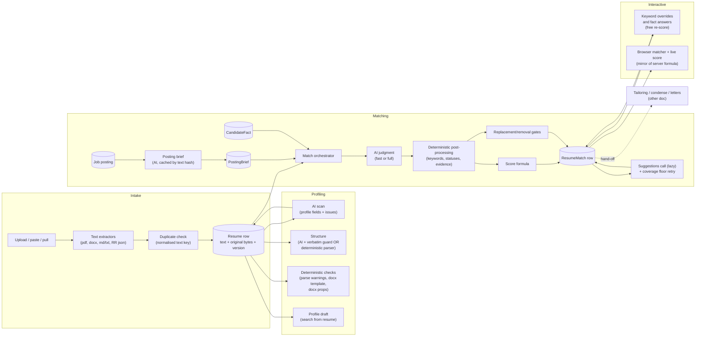

### 2.2 Layering of the match pipeline (what is AI, what is code)

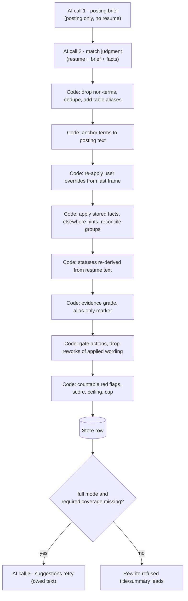

Principle: the model judges facts; the number, the keyword list integrity, and anything applied "with one press" are decided in code.

---

## 3. Key flows

### 3.1 Upload to stored resume

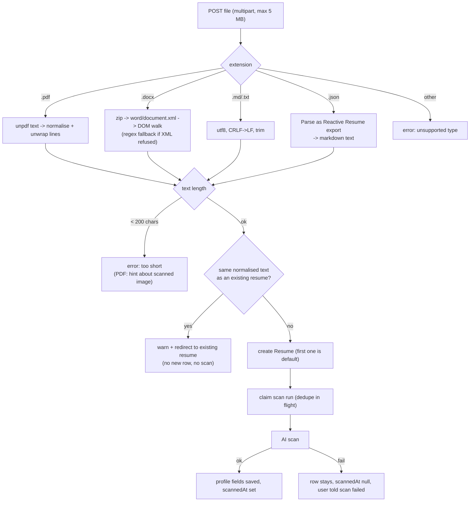

Failure branches that matter: password-protected PDF, unreadable PDF, no extractable text, DOCX that is not a zip, DOCX part inflating past 8 MB (zip bomb guard), invalid JSON, JSON that is not a Reactive Resume export or is empty.

### 3.2 New version of an existing resume

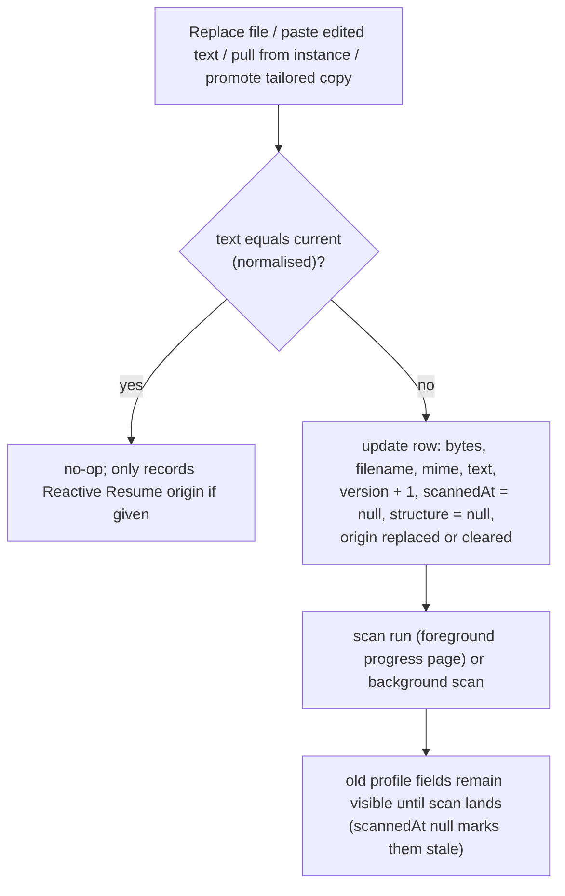

Old matches keep their own text snapshot and resumeVersion, so history stays true.

### 3.3 Comparison (the main path)

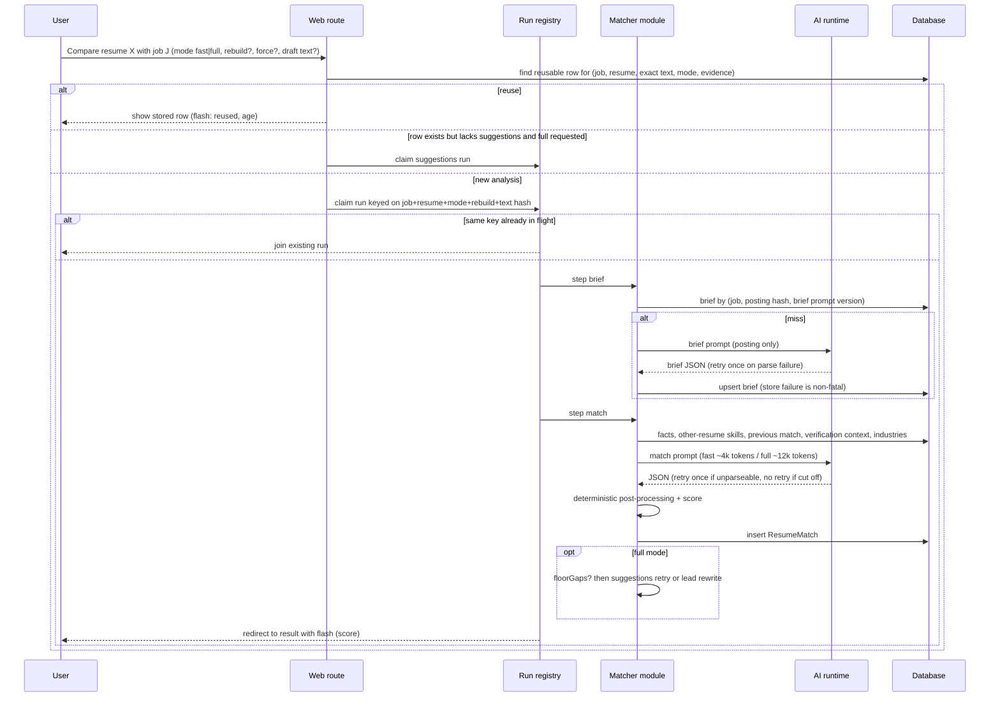

Failure behaviour: if the brief call fails, matching proceeds without a brief (the model derives the frame itself, no groups). If the match call fails after retry, the run ends in an error state with the engine's reason; nothing is stored. If the suggestions retry fails, the stored row is kept as is.

### 3.4 Free re-score (keyword override or fact answer)

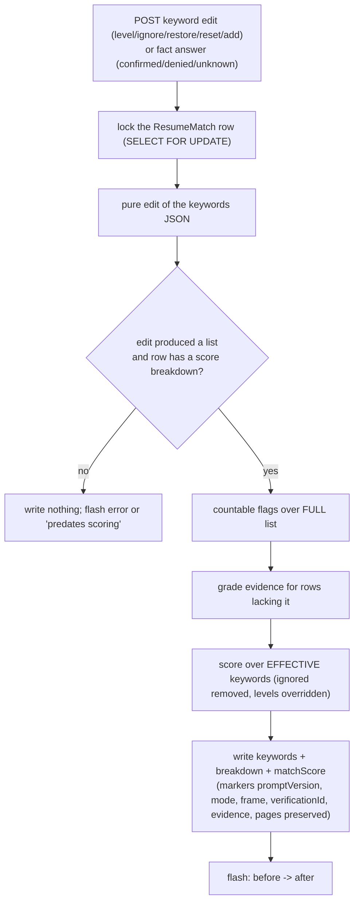

A fact answer also upserts the CandidateFact for the user (key: user + lowercased term), so every later comparison sees it.

### 3.5 Keyword status resolution (how a term ends up present/add/ask/cannot)

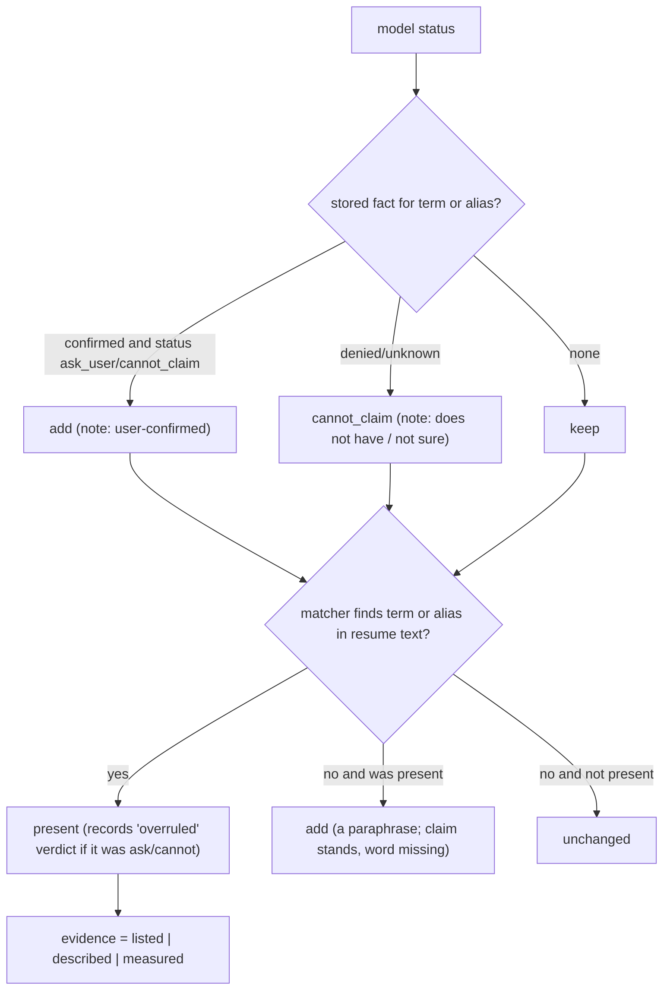

### 3.6 Hand-off interface to tailoring and downstream consumers

What the next stage receives:

- Resume row: id, userId, name, text (the working text), original bytes + sourceFilename + mimeType (the patch base), version, optional structure JSON (JSON-Resume subset), profile fields, remote origin triple (id, generation, host), answers JSON.
- ResumeMatch row (full mode): matchScore, summary, strengths, redFlags, cautions, keywords[] (term, priority 1-4, requirement, primary, status, aliases, where, note, group, evidence, elsewhere, aliasOnly, overruled, unanchored, override), actions[] (section, where, what, why, priority, quote verbatim, replacement or explicit null if gated, insert_after), removals[] (always empty at write time; filled by condense), hardRequirements[], breakdown JSON (score parts + markers), condense JSON, resumeText snapshot, resumeName snapshot, draft flag, tailoredId.
- PostingBrief row for the job text.
- TailoredResume: one per (resume, job); saving a copy never touches the resume's text/version/scan. Matches of a copy carry tailoredId and are excluded from the resume's own counts, best score, coverage and history. "Working resume per job": once a copy exists the editor opens its newest comparison.
- The application-pack worker consumes the same API: it reuses a stored full comparison for (job, resume text) when prompt version matches and evidence is "own", otherwise runs brief + full match, then applies a ceiling/hard-gate stop rule (owned elsewhere).

---

## 4. State machines

### 4.1 Resume lifecycle

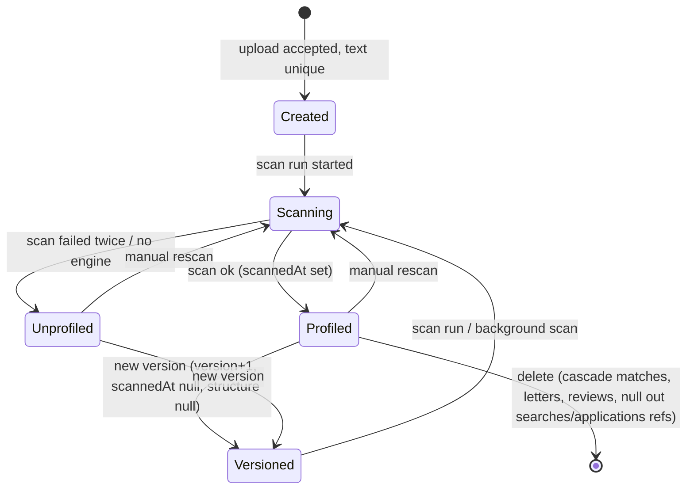

### 4.2 Comparison row lifecycle (mode marker)

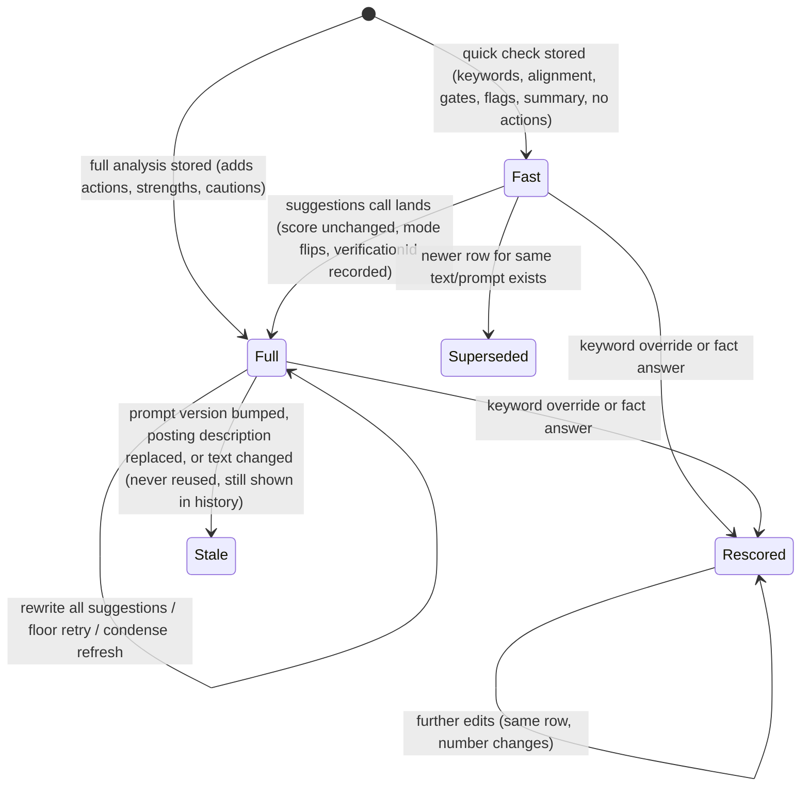

### 4.3 Keyword frame reason (stored on each row)

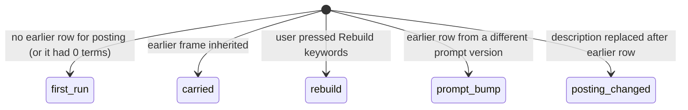

Only `carried` and `first_run` produce scores comparable with the previous row; the other three make the UI replace the version delta with a notice.

### 4.4 Keyword row lifecycle (per comparison)

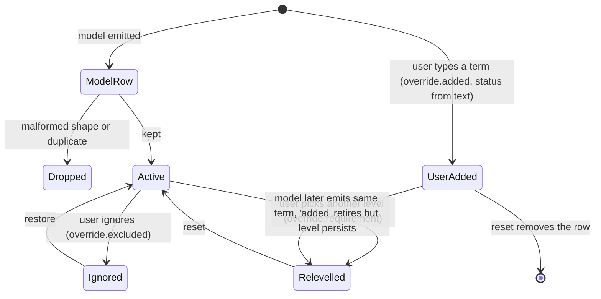

---

## 5. Feature list

| ID | Feature | What it does | Trigger | Key config/settings |
|---|---|---|---|---|
| RES-01 | Resume file upload | Accepts pdf, docx, md, txt (plus .json Reactive Resume export, not in the general accepted list), reads text, rejects short/unreadable files, stores original bytes + extracted text. Name defaults to the filename with `_ - ` and spaces collapsed, max 100 chars. | User (resumes page, wizard, settings "fill from resume", job editor re-upload) | Max upload 5 MB (body-limit middleware, flash on overflow); min text 200 chars; name max 100; accepted ".pdf, .docx, .md, .txt"; one in-flight upload guard per action key |
| RES-02 | DOCX text reader | Reads word/document.xml via a bounded zip reader and a DOM walk; one line per paragraph; "- " for list items, "# " Title style, "## " Heading style or a single-line ALL-CAPS paragraph (<=48 chars); tabs become " | "; table rows flattened to "cell | cell" with a blank line after each table; math text included; soft breaks kept. Falls back to a regex reader if the XML is rejected. | Upload / replace / format compare | Heading max 48 chars; per-part inflate cap 8 MB; total cap 512 MB; max 2,000 zip entries |
| RES-03 | PDF text reader | Extracts text with a pure-JS PDF engine, merges pages, normalises whitespace (collapse blanks, max one blank line between paragraphs) and undoes page-width line wraps inside paragraphs so bullets/stack lines read like the DOCX version. Distinct errors for password, unreadable, no extractable text (scan hint). | Upload | Min 200 chars after normalisation |
| RES-04 | Plain text/markdown intake | utf8 decode, CRLF to LF, trim. | Upload, "paste edited text" | Min 200 chars (draft paste max 200,000) |
| RES-05 | Reactive Resume intake as Markdown | A RR export (file or pulled from the person's instance) is converted to Markdown and stored as a .md resume with name from the export; records remote origin (id, format generation v4/v5/v6, host). Origin is written together with the text and cleared by any new text without its own origin. | User (upload .json, "pull from Reactive Resume", pick page) | Instance connection stored per user; pull list is a one-shot token bound to user; admin-only privilege to target internal network |
| RES-06 | Duplicate-resume detection | Two files are the same resume when their text is equal after normalising line ends, runs of blanks (incl. NBSP) and blank lines. A repeat redirects to the existing resume (warning naming it and its version) and spends no scan. Same check on "new version" against the current text. | Every create/replace path | Comparison key = normalised text; empty key never matches |
| RES-07 | Resume library management | List (default first, then id), rename (<=100 chars), set default (single default per user, transactional), download original, delete with impact preview. First resume a user creates becomes default (created under a global write lock to avoid two firsts). | User | Delete impact counts: matches, letters, reviews (cascade); searches and applications referencing it (nulled) |
| RES-08 | Upload new version | Replaces bytes/text, version+1, clears scannedAt and structure, replaces or clears remote origin, starts scan. Older matches keep their text snapshot. | User | Version file name pattern for generated files: slug(name)-v{N}.{ext} |
| RES-09 | Save edited text as a version | Stores editor text as the next version as a .md file (text/markdown). | User (draft save from resume page) | Draft min 200 / max 200,000 chars |
| RES-10 | Promote tailored copy to master | Copy's file+text become the resume's next version (name `slug-vN.ext`); a background scan follows. | User | - |
| RES-11 | AI resume scan | One AI call returns: title, seniority (junior/mid/senior/staff/lead/principal), years_experience (0-60), skills (lowercase canonical tags), primary_skills (2-5 core stack), role_types, industries (<=6, most recent first), summary (2 sentences), issues (<=40: section/issue/fix, job-agnostic ATS/recruiter problems). Saved to the resume with scannedAt. Resume text treated as untrusted content in the prompt; prompt injection attempts are reported as an issue. | Upload, new version, rescan, wizard, settings "fill from resume" when unscanned or primarySkills empty | Max 4,000 output tokens; timeout 120 s; input clipped to 30,000 chars; 2 parse attempts |
| RES-12 | Background scan | Fire-and-forget scan after promote or a render save; failure only logged. Until it lands, profile fields describe the previous version. | Event | - |
| RES-13 | Manual rescan | Re-runs RES-11 on the current text via a progress page; flash with skills and issues counts. | User | Run key `scan:{id}:{text hash}` dedupes concurrent clicks |
| RES-14 | ATS parse warnings | Pure text checks: too_short (<300 chars, stops other checks), unreadable_chars (U+FFFD), control_chars, no_email, no_phone (needs >=9 digits in one run), glued_words (avg word length > 11), too_long (> 2 pages by chars-per-page). Shown on the resume page. The same contact-detail test protects the contact line in removal gating. | View resume | MIN 300; MAX_PAGES 2; glued avg 11; phone min digits 9 |
| RES-15 | DOCX template check | Classifies a docx as flow (paragraph-only, fully patchable), structural (tables, text boxes, columns, header/footer text) or unsupported (no text, or text-box text outweighs body). Reports counts and notes: tables, text boxes, columns, math, drawings, hidden runs, white-colour runs, tiny runs (<= 4 pt), header/footer chars, editable vs total lines. Recomputed on every view; nothing stored. | View resume / target page | Tiny = half-points <= 8 |
| RES-16 | DOCX document properties fix | Shows title/creator/lastModifiedBy/modified/application; on click rewrites core properties to the candidate (first text line, else resume name): title "{name} - Resume", creator, lastModifiedBy; stamps modified; every word/* part byte-identical; replaces only the stored bytes (no new version, no rescan). | User | DOCX only |
| RES-17 | Format comparison | Compares the stored resume's extracted text with another uploaded file's extracted text (line diff) to show how a different file type parses; rendered only, never stored, no AI. | User | Upload limit 5 MB |
| RES-18 | Deterministic structure from text | Splits text into JSON-Resume-subset sections: header (name, label, contacts), summary, skills (grouped), work roles (company, position, dates, location, bullets, "stack line" after bullets), education, languages, certificates, projects, extras. Headings recognised as markdown `#`, ALL-CAPS short lines (<=44 chars, no list-like commas, no date range, no bullet/URL/email), or whole-line known phrases ("work experience", "technical skills", ...). Optional PDF layout hints re-pair skills tables and company/place columns. Used as floor when the AI structure is absent/unusable and as the yardstick for completeness. | System | Heading max 44 chars (80 for markdown headings); known phrase list; section kinds: summary, skills, work, education, languages, certificates, projects, other |
| RES-19 | AI structure extraction with verbatim guard | A separate on-demand AI call copies the resume into the structure shape. Every returned string must be a contiguous span of the resume after normalisation (dash/quote families flattened, whitespace collapsed, case ignored; strings < 3 chars pass); others are dropped. Reply rejected when: no work/skills/summary survive, dropped > kept, or roles emptied with zero bullets. Also rejected when it lost a role or more than 10% of lines the deterministic reader finds (60% partial-line tolerance). Only a surviving structure is stored. | Render page first visit (lazy) | Max 10,000 tokens; timeout 120 s; caps: 40 entries/section, 120 terms/skill group, 1,500 chars/line; line key min 8 chars, name key min 3 |
| RES-20 | Typography/layout inference | Infers from the file itself: font family, body/name/heading sizes, accent colour, margins, page size (A4/Letter), name centering (DOCX: weighted by text per run, runs beat styles.xml; PDF: from glyph geometry). PDF layout adds two-column pairs, skills label/value pairs, per-role looks (bold/colour/size), header/heading rules, justification, label column offset. Feeds the clean re-render. | Render page | PDF: column gap 18 pt / 2 em, label gap 4 pt, flush-right 6 pt, same-column 2.5 pt, rule height <= 2.5 pt and width >= 40% of page |
| RES-21 | Search (profile) draft from resume | Maps a scan to a search: required stack = primary skills; nice-to-have = other skills minus required, minus universal tooling (git, github, gitlab, bitbucket, svn, mercurial, jira, confluence, agile, scrum, kanban, ci/cd, rest, restful), capped at 20 with a warning; role types; seniority (only if one of the six levels); name from headline only when the search still has a default name ("New profile"/"My profile"). A resume that reads as non-engineering (product/project/program/delivery manager/owner/lead, recruiter, talent acquisition, marketing, sales, account manager, customer success, designer, HR, business analyst) leaves required stack alone with a warning. Created searches start inactive and link the resume. | User ("Create a search from this resume", wizard, settings) | NICE_TO_HAVE_MAX 20; requires scannedAt |
| RES-22 | Default resume choice per job | Preselects: the resume linked to the winning search; else the resume whose scanned skills appear most (as whole tokens) in title+description, ties to default then lowest id. "Mark applied" preselects the resume of the newest comparison for that job. | Page render | Tokeniser keeps `+ # .` inside tokens |
| RES-23 | Posting brief | One AI call reads the posting alone and returns: role (posted_title, family, seniority, years_min, focus), company (industry, product, audience, stage), screening (reader, scan_for <=10, wow <=8, dealbreakers <=8), requirement_groups (<=24; only satisfy="any" groups with >1 options survive, options <=12), keyword frame (<=80: term, priority 1-4, requirement must/preferred/nice/context, primary, aliases, group), gates (<=8). Cached per (job, hash of title+description, brief prompt version); concurrent writers upsert. | Start of any comparison, pack prep | Brief prompt version 3; max 6,000 tokens; timeout 120 s; posting clipped to 15,000 chars |
| RES-24 | Posting depth and orientation | From the stored brief only (no AI): depth high/medium/low from six signals (>=8 must/preferred terms, >=4, seniority or years_min, industry or product, any gate, >=3 scan_for): >=5 high, >=3 medium. Medium/low show a "thin posting" notice; no brief shows nothing. Orientation rows: sector (+stage unless repeated), product (else role focus), first reader, each clipped to 130 chars. | Target page | - |
| RES-25 | Resume-vs-posting comparison (fast / full) | Fast = score-complete subset (keywords, alignment, gates, red flags, summary); full = also actions, strengths, cautions. Context given to the model: brief (as the frame to copy), confirmed facts, denied terms, other-resume skills present in the posting, previous keyword frame (only when no brief), applied wording from the last run (full), candidate domains (full), company snapshot from job verification (full). Stores a row with a snapshot of judged text, resume name/version, model label (+" · fallback"), score, markers. | User (job page Compare, editor re-check/re-upload, draft), pack worker, cover-letter launcher | Mode default fast; max tokens 4,000 fast / 12,000 full; timeout 90 s fast / 180 s full; reply 2 parse attempts; resume clipped 30,000 chars |
| RES-26 | Deterministic score | See section 6.1. 60 keyword points + 40 alignment points - capped red-flag penalty, held under a primary-stack cap; also computes a reachable ceiling. Model never supplies a number. | Every comparison, every re-score | Score formula version 6 |
| RES-27 | Keyword post-processing pipeline | In order: shape filter + dedupe; alias-table merge; posting anchoring; override carry-over; fact application; elsewhere annotation; group reconciliation; text-based status re-derivation; alias-only marker; evidence grading. See section 6.2-6.4. | Every comparison | - |
| RES-28 | Keyword-frame stability | Reuses the previous term list/levels for the same posting so a better resume shows as a better number; re-judges only status/aliases/where. Frame dropped on rebuild, prompt version change, or posting description refresh. User overrides survive every case. When a brief exists the brief is the frame. | Automatic; "Rebuild keywords" button | Previous frame sent: up to 40 effective keywords |
| RES-29 | Comparison memo (reuse) | Before running, looks at the 4 newest rows for (job, resume, identical text) created after the posting's last description refresh. A full row answers any request; a fast row answers fast; full requested on a fast row means "suggest" (only the second call). Disqualifiers: different prompt version (17), different evidence mode, full-on-full with a different verification id. "Re-run anyway" and "rebuild" skip the memo. | Every comparison start | REUSE_CANDIDATES 4; prompt version 17 |
| RES-30 | Lazy suggestions call | Second AI call over stored verdicts (summary, alignment, gates, keywords with evidence) writing actions, strengths, cautions. Judged against the row's text (or the editor's condensed text if passed). Empty replies are rejected. Applies the same gates and applied-wording filter. "Rewrite them all" re-runs it on a full row. | User ("Get suggestions"), full-mode floor retry | Max 10,000 tokens; timeout 180 s |
| RES-31 | Required-coverage floor | After a full report, checks in code that high-priority actions exist for: title/summary/recent role graded below strong; a must-level term only "listed"; a must-level `add` term that no replacement wording contains. If gaps exist, one corrected suggestions call is made (the owed text names what is missing). Exempt when there is no core (no primary present, or <2 must terms claimable) or ceiling < 50. | Automatic after full match | WORTH_CHASING 50 |
| RES-32 | Replacement gating (interface) | Actions' replacement wording is judged in code (fact-check vs resume+posting+facts, no new cannot_claim keyword except the posted title on the title line, no lost must/primary keyword, no instruction-to-writer text); blocked wording becomes explicit null. Removals checked: not the contact line, not a wanted keyword that is present. Details live in the tailoring doc. | Automatic | - |
| RES-33 | Applied-wording churn control | Detects which previous-report replacements the text now carries (>=12 chars, located exactly or whitespace/punctuation-insensitively), tells the prompt they are done, and drops new actions that rework them unless their why/what names a keyword that is not present. Logs rewrites-of-applied as a regression metric. | Automatic on full runs/suggestions | MIN_CHARS 12 |
| RES-34 | Keyword overrides | Per comparison row: re-level (must/preferred/nice/context; choosing the model's own level clears the override), ignore, restore, reset (also deletes a user-added row), add term (<=60 chars, no clash with any name/alias, status from resume text: present, else ask_user; flagged unanchored when not literally in the posting; priority from level 1-4). Overrides persist across re-runs of the same posting. Free re-score under row lock. Posting-supplied `override` fields are stripped from model replies. | User | Default added level "preferred"; term length 60 |
| RES-35 | Candidate facts ("Confirm your experience") | Per user, per lowercase term: confirmed / denied / unknown(not sure) with optional note (<=300 chars). Confirmed flips ask_user/cannot_claim to `add`; denied and unknown give `cannot_claim` with a distinguishing note so the question is not re-asked. Written words in the resume outrank any fact. Facts feed prompts (confirmed as evidence, denied as always cannot_claim). Delete forgets. Card offers asks plus "unproven" cannot_claim terms, excluding context-level terms, previously answered terms and the posting's own title. | User | Fact statuses: confirmed, denied, unknown |
| RES-36 | Elsewhere hints | Skills from the user's other resumes (first resume to have each skill wins, ordered default first) annotate ask_user/cannot_claim/borrowed-add terms with "in {resume}". A borrowed `add` earns half credit but does not cover the primary stack. Only skills the posting mentions are sent to the prompt. | Automatic | Not used when a comparison is "text only" |
| RES-37 | Domain verdict | Compares the resume's scanned industries with the brief's industry via domain vocabulary (stop-worded, plural-folded stems). match / different / unknown; employers that serve any sector (agency, consultancy, consulting, software house, staffing, outsourcing, freelance, studio) always match; "different" adds a one-sentence notice and tells the prompts to reframe transferable work, never claim the sector. A lean metric counts suggestion wording that uses domain words. | Automatic; target page | MIN word 3 chars |
| RES-38 | Hard requirements (gates) | Model lists up to 8-12 gates (authorization, location, minimum years, certification, clearance) with pass / unknown / fail and a note; silence is never fail; shown outside the score. | Automatic | Max 12 stored |
| RES-39 | Missing-across-postings coverage | Zero-AI card on a resume: takes the latest non-draft, non-copy comparison per posting (up to 100, newest first), re-reads statuses against the resume text as it is now plus current facts, skips context rows and either/or groups already met, folds by term across postings. Shown only with >= 5 compared postings; lists terms missing in >= 2 postings, max 10, sorted by postings missing, then must count, then alphabetical; kind unwritten > unconfirmed > gap. | View resume | MIN_POSTINGS 5; MIN_MISSING 2; MAX_TERMS 10; COVERAGE_POSTINGS 100 |
| RES-40 | Term usage at work | For present terms: dated roles (from the deterministic structure) whose own lines name the term; merged years and months since the last such role ("3.5 yrs at work, current", "1 yr, 4 yrs ago"). Display only; never scored. | Match card | STALE_MONTHS 36 for "not recent" styling |
| RES-41 | Shared keyword matcher and live score | One browser/server module finds a term (and aliases) in text as whole tokens: case/quote/NBSP folded, separators between tokens interchangeable and optional ("CI/CD" = "ci cd" = "CI-CD", "front-end"/"frontend"), regular plurals tolerated on the last token (except Rails, Windows), no match glued to `\w + # .`. Also locates quotes (exact, then whitespace/punctuation-insensitive) and orders keywords (rank = weight, +1 for primary must; ties by posting frequency, priority, alphabetical). The editor computes the same score formula from live text. | Server and browser | Parity-tested between server formula and browser mirror |
| RES-42 | Comparison history and delta | Lists up to 50 newest comparisons per job (any resume) or per resume (excluding copies); shows delta against the previous row of the same resume (score, alignment, flags, keywords, cap); replaces the delta with a notice when the frame is fresh (rebuild, prompt bump, posting changed). Page target setting (condense) is copied from the earlier row of same job+resume. | View | MATCH_LIST_LIMIT 50 |
| RES-43 | Draft and re-upload comparison | Judge editor text or a freshly uploaded file against a job without saving a resume: the row stores its own text snapshot with draft=true. Re-upload from the editor always runs full mode. | User | - |
| RES-44 | Run registry and in-flight dedupe | Every slow call runs behind a progress page with steps (brief, match/match-fast, suggestions, scan, review); runs are claimed by a key so a second submit joins the first; per-user ownership; polled state endpoint with elapsed times. | Event | Keys: `match:{job}:{resume}:{mode}:{rebuild|frame}:{text hash}`, `scan:{id}:{hash}`, `suggestions:{matchId}`, `review:{id}:v{version}:{answers hash}` |
| RES-45 | Resume hub statistics | One grouped query: per resume number of own comparisons and best score ever (absent when never compared); latest review summary; a default marker. | List page | Copies excluded |
| RES-46 | Review answers store | Candidate's typed figures for the strength review's questions are saved on the resume (question <=300, answer <=300, max 30, newest kept; blank answer deletes; same question replaces). Written under row lock. Included in the next review prompt as trusted candidate-supplied metrics. | User | MAX_ANSWERS 30 |
| RES-47 | Cover-letter addressee guess | From a verifier's "named person" finding, picks the first 2-3 word capitalised name that is not a role word, vendor name, verifier vocabulary or part of the company name; also reads a stored letter's greeting back ("Hi X,") unless it is a team/hiring greeting. | Letter generation | Name run: 2-3 capitalised words |
| RES-48 | Applied-resume record rules | When marking a job applied, the chosen resume's id, version and full text snapshot are stored on the application, because the resume's bytes change in place on new versions. Form semantics: absent field = keep, empty = clear, id = set, "pack-{timestamp}" = the pack's prepared file only if that exact pack is still ready and unfrozen. | User | - |
| RES-49 | Tailored copy storage rules (hand-off) | One copy per (resume, job), upserted so earlier comparisons stay attached; file to patch is the copy when the editor's base text equals the copy text (trimmed), else the master; copy file name `slug(resume)-slug(job).ext`; editor history hides the resume's own non-draft runs once a copy exists. | Save in editor | Unique (resumeId, jobId) |
| RES-50 | Ownership scoping | Every read/write is scoped to the owning user (matches/letters/reviews through resume.userId); foreign ids read as not found. Store functions take the user id explicitly; no ambient user. | All | - |
| RES-51 | Quality harnesses (dev) | `matrix:compare` runs a resume x job matrix and checks invariants on written rows; `variance:compare` repeats one pair N times (default 5, optional --rebuild / --stored / --discard) and attributes spread to keyword statuses, alignment grades, flags or cap by holding each at its modal value; `bench:resume` runs gold fixtures through each engine without DB writes; churn and verify-brief scripts exist. | Developer | Spends AI; never CI |

---

## 6. Business rules and invariants

### 6.1 Score formula (version 6)

- Keyword pool: 60 points. Weight per term by requirement: must 3, preferred 2, nice 1, context 0. Credit per status: present 1 (0.85 if its evidence is only "listed" on a term list), add 0.5, ask_user 0, cannot_claim 0. Points = 60 x earned / total weight, one decimal. No weighted terms = 0.
- Alignment pool: 40 points = title 10 + summary 10 + most recent role 20, each x strong 1 / partial 0.5 / off 0.
- Red flag penalty: 10 per counted flag, max 20 total.
- Score = round(max(0, keywordPts + alignmentPts - penalty)), then min(raw, cap) when a cap applies, clamped 0..100.
- Primary-stack cap: primary terms count only when requirement = must. Covered = status present or add (an `add` borrowed from another resume does not cover). All covered or none defined: no cap; none covered: 30; at least half: 70; some but under half: 45.
- Either/or groups fold into one entry (strongest level, best credit, primary if any member primary) before everything.
- Ceiling = the score if every claimable (present/add) term were written and alignment were perfect with the same penalty and a cap recomputed from claimable primaries; never below the score.
- Breakdown stored: parts plus markers: promptVersion, mode, frame reason, verificationId, evidence, pages.
- Browser mirror: credit from textual presence (written = 1 or 0.85 listed; evidenced-but-unwritten add/present = 0.5; ask/cannot unwritten = 0), fixed analysis-time penalty. Must stay equal to the server formula (a parity test exists).

### 6.2 Which red flags are charged

A flag is exempt (free) when its text names a keyword the resume does not show, or shows only on a term list: the keyword pool already priced it. Only non-keyword flags (location, authorization, minimum not met, excluded seniority, injection attempt) count. Re-scoring must use countable flags over the FULL keyword list but points over the EFFECTIVE list, or the number drifts down on every edit.

### 6.3 Keyword hygiene rules

- Keyword test: a thing a recruiter would type into a search box; verbatim from posting, 1-4 words in the prompt; hard cap 80 rows stored.
- Rejected in code (unless user-added): more than 5 words; years-of-experience expressions; degree/education requirements; bare quantities ("0 to 1", "10x"); empty.
- Duplicates fold on a key built from case/separator-free, plural-stripped term plus all aliases; survivor is the harder requirement (primary flag OR-ed). Posting order preserved.
- Anchoring: a term not found in the posting is shortened to its longest verbatim multi-word phrase (unless another row owns that phrase); otherwise flagged `unanchored`.
- Alias table: 170 groups of spellings of the same thing (never related technologies: Vue is not React); versioned names ("PHP 8") get their bare technology as alias for a fixed list of technologies; plurals/separators are the matcher's job.
- Priority numbers: 1 required technical skill, 2 exact posted title, 3 methodology/process, 4 domain. Phrases of priority 3/4 are not "named skills" and are not auto-written onto skills lines (user-added terms always are).
- Status truth comes from text: written term is present whatever the model said (the prior verdict is remembered as `overruled`); a "present" the matcher cannot find becomes `add`; unwritten ask/cannot/add are left alone. Known cost: homonyms (an acronym with another meaning) read as present.
- Evidence grade per present term: listed (the line segment is a term list: separators `, · | ; •` with >= 2 short items (<=4 words) or >= 6 items with 80% short, no sentence ending, grammar words not above 1 in 5), measured (sentence with a %/currency/magnitude/duration/count), else described; best across all occurrences. Table rows are judged cell by cell.
- Alias-only: present only through an alias and not the posting's own spelling is flagged so the person writes the posting's word once.
- Title keyword: a keyword is the posting title if its letters/digits equal the title's, or it has priority 2, >= 2 words and every word is in the title. Never asked as a question and never offered for skills lines.
- Group labels must exist in the brief and list the term (modulo `.js`/`js`/`.net` suffix) or are dropped; no brief means no groups.

### 6.4 Overrides and facts

- Override lands on exactly one fresh row: exact term match first, alias match only if none. A user-added row the model did not repeat is re-added with status re-read from the current resume text.
- Ignored rows stay visible (to undo) but leave score, highlights and prompt frames.
- Fact precedence: resume text > stored fact > model. Facts stored lowercased/trimmed; unique per user+term.

### 6.5 Reuse and invalidation

- A stored row answers a request only for byte-identical judged text (plain string equality; one character is a new analysis), the same prompt version, the same evidence mode (own vs text-only), created after the posting's description was last replaced/restored, and (full-on-full) the same latest verification id.
- Rows without a prompt-version marker are never reused. Rows without a mode marker are treated as full; without an evidence marker as "own".
- Posting brief key: (job, hash of title+description, brief prompt version).
- Prompt version bumps (currently 17 for matching, 3 for briefs, 3 for review) make old frames non-inheritable and old rows non-reusable while leaving them visible.
- Resume text change never edits old rows; they keep resumeText, resumeVersion, resumeName.

### 6.6 Numbers worth keeping

Upload 5 MB; min text 200; clip to the model 30,000 resume chars and 15,000 posting chars; company snapshot 2,000 chars; AI JSON reply: 2 parse attempts, none after a cut-off; keywords 80 hard / ~25 soft cap on nice+context only (every must and preferred is listed); actions max 40; removals max 30; strengths max 20; red flags max 20; cautions max 10 (prompt asks 5); gates 12 stored (prompt asks 8); stored lists: 50 matches; scan skills tags lowercased and de-duplicated; years 0-60; scan issues <=40.

### 6.7 Safety and trust

- Resume and posting text, and anything derived from them by a model, are fenced as untrusted data in prompts; the person's own answers/facts sit outside the fence. Prompt injection inside a resume is to be reported as a "format" issue, not obeyed.
- Concurrency: first-resume default under a global lock; read-modify-write of JSON columns (keywords, answers) under row locks; brief upsert; in-flight run dedupe.
- Zip reading is bounded (per-part and total inflate caps, entry-count cap).
- Reactive Resume API key is read per request and never placed in pages, flashes or logs.

---

## 7. External dependencies and integration contracts

| Dependency | Contract |
|---|---|
| AI runtime (role "resume") | `complete({system, user, maxTokens, label, timeoutMs, json: true, subject})` returning `{text, model, providerId, viaFallback}` or null when no engine answers; engine fallback chain; task chains "resume-read" (scan/structure) and "analysis" (match/brief/suggestions). All replies parsed with schema validation (zod-like) into typed objects; unknown extra fields tolerated; missing arrays default to empty. |
| AI call labels / budgets | resume-scan (4k tokens, 120 s), resume-structure (10k, 120 s), posting-brief (6k, 120 s), resume-match-fast (4k, 90 s), resume-match (12k, 180 s), resume-suggestions (10k, 180 s), rewrite one suggestion (2k, 90 s), review (6k, 120 s). |
| PDF text engine | Pure-JS PDF library (unpdf/pdf.js) for text and glyph geometry; errors: PasswordException vs others. |
| ZIP/XML | Own bounded zip reader (stored + deflate); DOM parser for OOXML; JSZip only for rewriting docProps. |
| Database (Postgres) | Tables: resume, resume_match, posting_brief (unique job+hash+version), candidate_fact (unique user+term), tailored_resume (unique resume+job), resume_review. JSON columns hold keywords/actions/removals/hardRequirements/condense/breakdown/structure/answers/issues. Cascade: resume -> matches, letters, reviews, copies; job -> matches/briefs/copies. Profile.resumeId and UserJob.appliedResumeId set null on delete. Raw SQL used for FOR UPDATE row locks and DISTINCT ON latest-per-job keyword tables. |
| Job verification subsystem | Provides latest company snapshot text (and its id) used by full comparisons/suggestions as emphasis-only context, plus named-person finding for the addressee guess. |
| Reactive Resume instance | Import: list resumes, fetch one, convert to Markdown with generation tag; the stored origin enables later send-back (other doc). |
| Browser module `target.mjs`/`score.mjs`/`evidence.mjs`/`title-keyword.mjs` | The server loads the same files the browser serves, so matcher, evidence and title tests have one implementation (score and evidence are mirrored copies with parity tests). A rewrite should ship one shared library. |
| i18n catalog | All user-visible sentences are catalog keys; stored English notes (e.g. "user-confirmed", "added by you") are values the UI translates on read. |
| Job/profile domain | Reads Job (title, description, location, employer, descriptionRefreshedAt), Profile (resume link) and UserJob (applied resume snapshot). |

Reply contracts (shapes):

- Scan: `{title, seniority, years_experience, skills[], primary_skills[], role_types[], industries[], summary, issues[{section,issue,fix}]}`.
- Match: `{summary, alignment{title,summary,recent_role}, strengths[], red_flags[], cautions[], hard_requirements[{requirement,status,note}], keywords[{term,priority,requirement,primary,group,status,aliases,where,note}], actions[{section,where,what,why,priority,quote,replacement,insert_after}], removals[]}`; fast omits actions/strengths/cautions; sections enum: title, summary, skills, experience, education, format.
- Suggestions: `{strengths, cautions, actions}`.
- Brief: see RES-23.

---

## 8. Known oddities and accidental complexity

1. **Match prompt is the product, and it is huge.** A 1,600-line prompt module encodes dozens of rules (primary stack, bullet style, summary style, coverage floor). Most behaviours were later re-enforced in code because the model drifted (statuses, flags, groups, keywords, replacements). A rewrite should treat the model as a fact extractor with a small schema and keep the code-side invariants (sections 6.1-6.5) as the spec.
2. **Statuses are overridden by text anyway.** The model's present/add distinction is mostly discarded by the matcher, so the prompt could drop that judgment and ask only for ask_user vs cannot_claim vs add-eligible.
3. **Scan no longer returns structure, but the schema, clearing code and docs still reference it.** Structure is now a separate lazy call plus a deterministic fallback. A rewrite should have one structure producer, deterministic first, AI optional.
4. **Two structure readers + guards** (verbatim anchor, completeness vs deterministic yardstick) exist only because rendering from model output can fabricate words. If a rewrite does not re-render resumes from structure, all of RES-18/19/20 can go.
5. **Mirrored logic in two languages.** Score, evidence and title-keyword rules exist in TS and in browser .mjs with parity tests; the matcher is loaded by the server via a dynamic import of the static folder. Use one shared package.
6. **Marker-in-JSON versioning.** promptVersion, mode, frame, verificationId, evidence and page target ride inside the `breakdown` JSON with tolerant readers and defaults ("no marker means full / own"). Proper columns would remove ~100 lines of readers and the legacy rules.
7. **Legacy compatibility code.** Rows predating the deterministic score (breakdown {}), predating groups, predating evidence grading, predating replacement fields are all still handled (e.g. `withEvidence` grades lazily on rescore, `v6 rows carry no grade and keep full credit`). A new system with no legacy data can drop all of it.
8. **Text-only evidence mode** ("text" vs "own") is read everywhere but nothing writes "text" now; it is dead except for stored rows.
9. **Fast then full is two models of one row.** The fast/full split plus "suggest" reuse decision, floor retry and rewrite-leads pass is intricate; consider one call that always returns advice, with the cost accepted, or a cleaner "analysis" + "advice" resource pair.
10. **Resume vs copy vs draft vs version identity.** A comparison can judge a stored version, a draft, a fresh upload or a tailored copy; counts and history filters (`tailoredId IS NULL`, `draft`) are repeated across queries. A rewrite should model "document snapshot" as its own entity (resume version, draft, copy) and have comparisons reference one.
11. **Duplicate detection uses only text equality** with whitespace normalisation; it ignores case/punctuation differences and runs a full scan of all the user's resumes each time.
12. **Coverage card and match list limits** (100 postings, 50 rows) are arbitrary caps with no pagination.
13. **Domain "lean" metrics, variance harness, churn metric, alias-only badges, usage lines** are measurement/diagnostic features that could be separated from the core product.
14. **DOCX heading heuristic** (ALL-CAPS single line <= 48 chars) and the PDF heading heuristic differ slightly (44 vs 48) - accidental drift.
15. **Wizard/settings/resumes routes each wrap the scan in their own run** with near-identical code.
16. **The default resume for the first upload uses a global write lock** (whole-system lock) for a per-user concern.
17. **Mixed AI role names** ("resume", "resume-read", "analysis") across config for one feature family.

---

## 9. Source map

| Area | Files |
|---|---|
| Storage and ownership | src/resume/store.ts; prisma/schema.prisma (Resume, ResumeMatch, PostingBrief, CandidateFact, TailoredResume, ResumeReview) |
| Upload and text extraction | src/web/upload.ts; src/resume/resume-text.ts; src/resume/docx-text.ts; src/resume/pdf-text.ts; src/resume/zip.ts; src/resume/duplicate.ts |
| Deterministic file checks | src/resume/parse-warnings.ts; src/resume/docx-structure.ts; src/resume/docx-props.ts; src/web/format-compare.ts |
| Structure and style | src/resume/json-resume.ts; src/resume/structure-from-text.ts; src/resume/structure-anchor.ts; src/resume/structure-complete.ts; src/resume/structure.ts; src/resume/style-infer.ts; src/resume/pdf-geometry.ts; src/resume/pdf-layout.ts |
| Scan and profile | src/resume/scan.ts; src/resume/profile-draft.ts; src/web/profile-from-resume.ts; src/resume/pick.ts; src/web/resume-label.ts; src/web/resume-source.ts |
| Prompts and schemas | src/resume/prompts.ts (scan, structure, brief, match, suggestions prompts; zod schemas; versions; budgets) |
| Brief | src/resume/brief.ts; src/resume/brief-depth.ts; src/resume/posting-orientation.ts |
| Match orchestration | src/resume/match.ts; src/web/comparison-run.ts; src/web/suggestions-run.ts; src/web/routes/jobs.tsx (match, suggestions, target, reupload routes); src/web/target-runs (run registry) |
| Scoring | src/resume/score.ts; src/resume/red-flags.ts; src/resume/variance.ts; src/web/public/score.mjs |
| Keywords | src/resume/keyword-aliases.ts; keyword-shape.ts; keyword-anchor.ts; keyword-group.ts; keyword-frame.ts; keyword-overrides.ts; keyword-matcher.ts; title-keyword.ts; evidence.ts; src/web/public/target.mjs, evidence.mjs, title-keyword.mjs |
| Facts and cross-resume evidence | src/resume/facts.ts; src/web/routes/facts.ts; store.ts (listOtherResumeSkills) |
| Overrides route | src/web/routes/keywords.ts |
| Memo and markers | src/resume/match-reuse.ts; match-mode.ts; match-name.ts (previous-row lookup in duplicate.ts/match-name.ts); applied.ts |
| Suggestions | src/resume/suggestions.ts; suggestion-floor.ts; (gating/rewrite: replacement-gate.ts, rewrite.ts - other doc) |
| Analytics cards | src/resume/coverage.ts; usage.ts; domain.ts; src/web/pages/resume-match-card.tsx |
| Resume pages and routes | src/web/routes/resumes.tsx; src/web/pages/resumes.tsx; src/web/pages/resume-detail.tsx |
| Review answers / letters helpers | src/resume/answers.ts; src/resume/addressee.ts; src/web/applied-resume.ts; src/resume/tailored.ts |
| Consumers | src/pack/prepare.ts (reuse + match in pack worker); src/web/routes/letter.tsx; src/web/routes/welcome.tsx; src/web/routes/settings.tsx |
| Dev scripts | src/scripts/match-matrix-once.ts; match-variance-once.ts; resume-bench-once.ts; churn-once.ts; rescan-resumes.ts; verify-brief-once.ts |
| AI JSON helper | src/ai-json.ts |
