# 06 - Resume tailoring, review, cover letters, rendering and Reactive Resume

Derived from source only. Behaviour is described in implementation-neutral terms; the source map at the end lists where each piece lives. Upstream outputs this area consumes (owned by other areas): the stored resume (text, original file bytes, version, scan fields), the resume-vs-posting comparison row (keyword verdicts, alignment grades, hard-requirement gates, score breakdown), the posting brief, candidate facts (confirmed / denied terms) and the keyword matcher.

---

## 1. Purpose and scope

This area turns a stored resume and a stored posting into things a candidate can send. It proposes gated, fabrication-resistant edits ("suggestions"), lets the person accept them in an editor, shrinks the resume toward a page target ("condense"), keeps one working copy of the resume per job, re-emits that copy as a file that preserves the original formatting (in-place DOCX patching) or as a clean re-typeset DOCX/PDF, writes grounded cover letters, scores a resume's general strength with no posting, and round-trips resumes to a self-hosted Reactive Resume instance (import, and write a tailored copy back as a new resume).

The design principle everywhere: the model proposes, deterministic code decides. Every place where a model's text could reach the candidate's file (replacement wording, cuts, cover letter, review examples) is gated by code that checks for invented numbers, employers, titles and tools, forbidden keywords, lost must-have keywords and contact-detail damage.

Out of scope here (other areas): upload and text extraction, structure parsing, scoring and keyword extraction/matching, posting brief generation, job verification itself, application pack queue/orchestration beyond the tailoring step.

---

## 2. Architecture

### 2.1 Component map

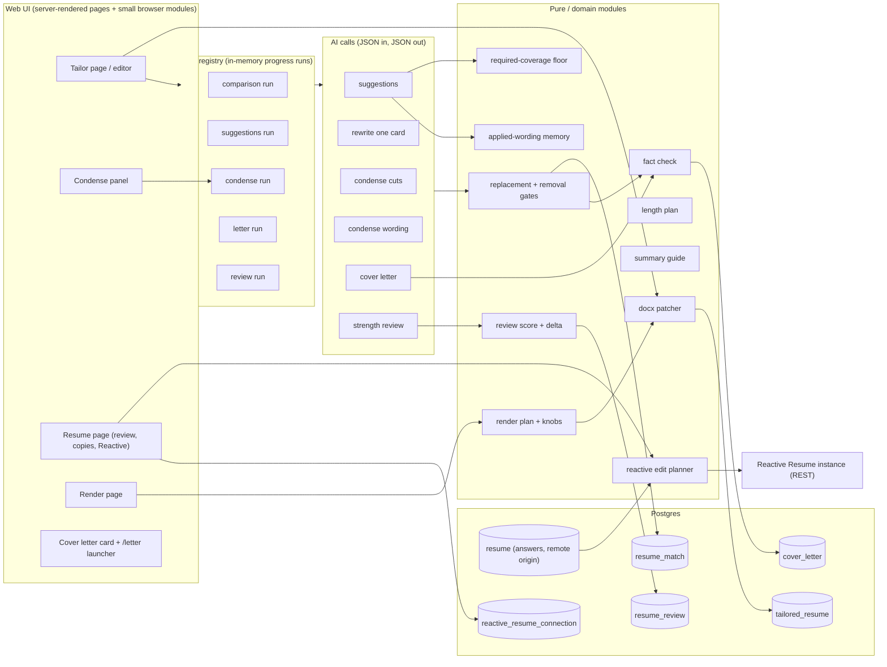

### 2.2 Document pipeline (how an edited text becomes a file)

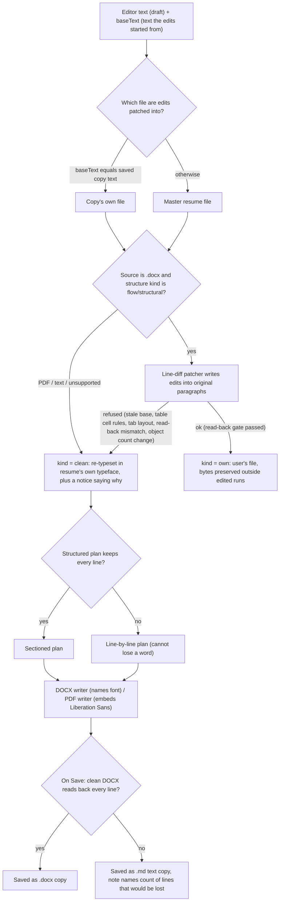

### 2.3 Reactive Resume integration

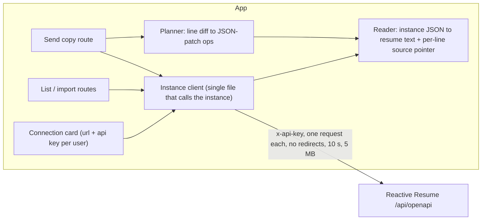

---

## 3. Key flows

### 3.1 Comparison, suggestions and floor (what produces the cards)

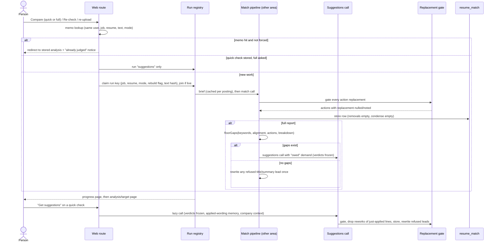

### 3.2 One-card Rewrite

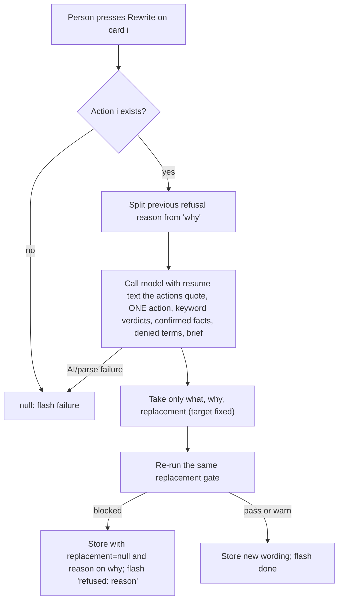

### 3.3 Condense (two reviewed steps plus refresh)

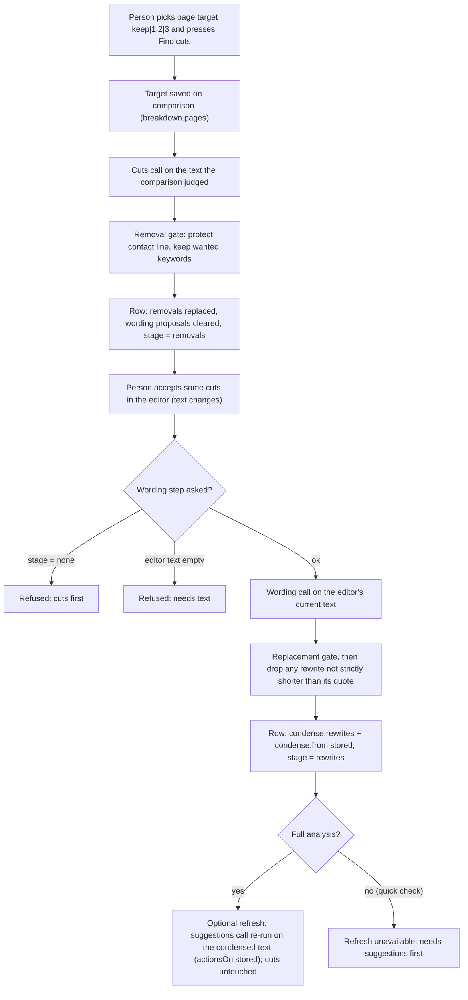

### 3.4 Save as the working copy for a job

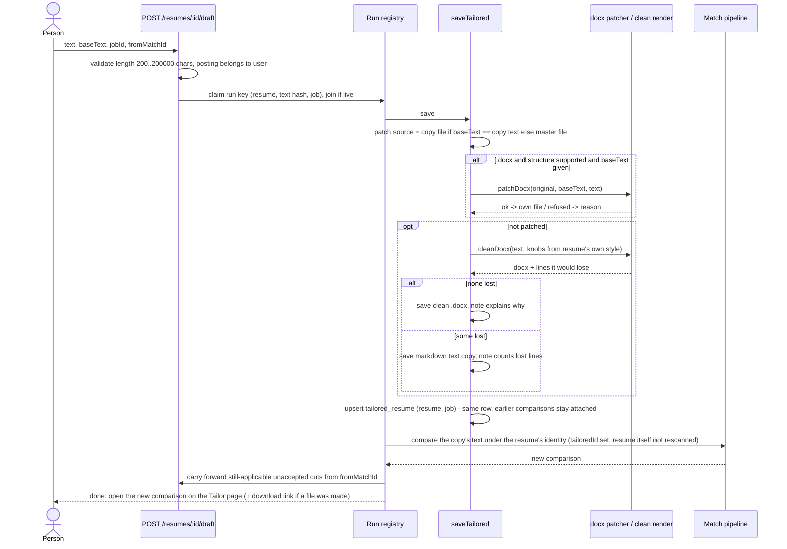

### 3.5 Cover letter generation

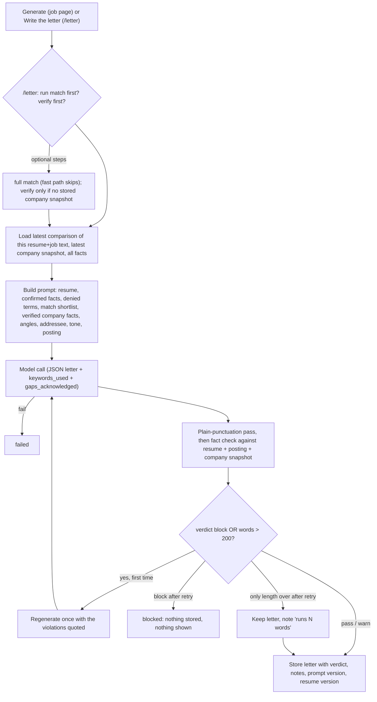

### 3.6 Strength review

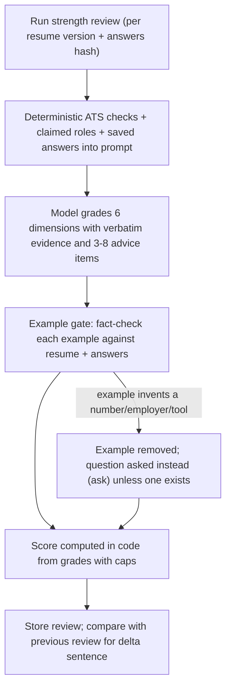

### 3.7 Send a tailored copy to Reactive Resume

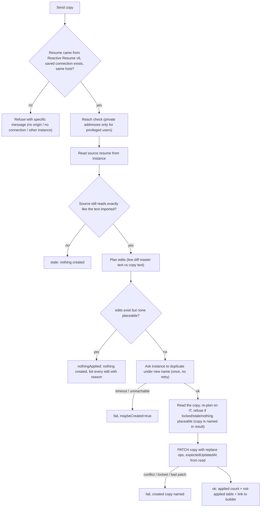

---

## 4. State machines

### 4.1 Condense stage on a comparison row

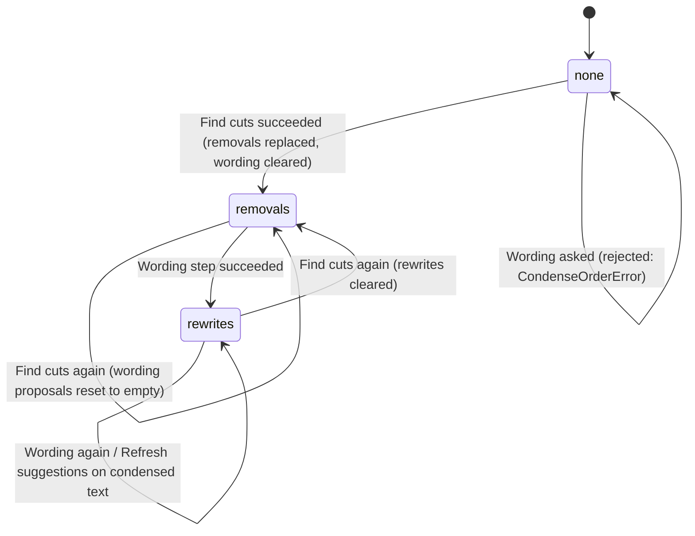

Panel is open by default when the resume is over its page target (`met` false) or the stage is not `none`.

### 4.2 Comparison row mode (relevant to suggestions)

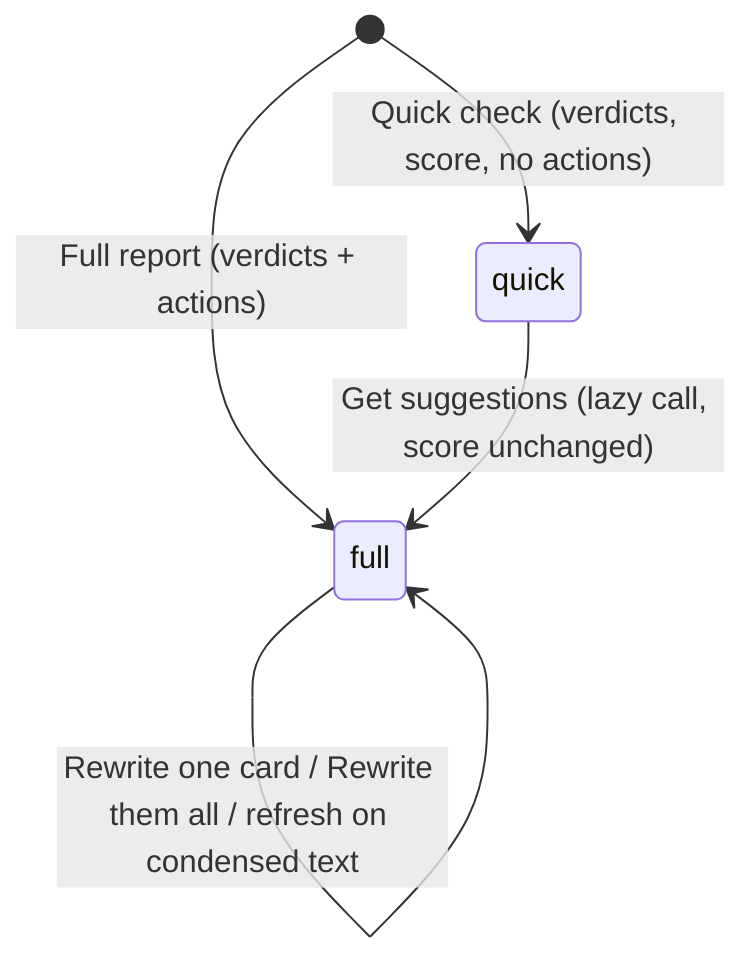

### 4.3 Suggestion card (action) wording lifecycle

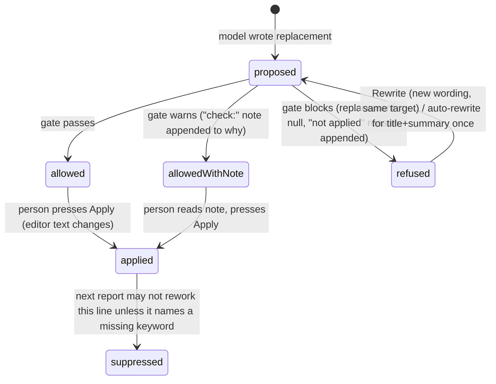

### 4.4 Tailored copy lifecycle (per resume x job)

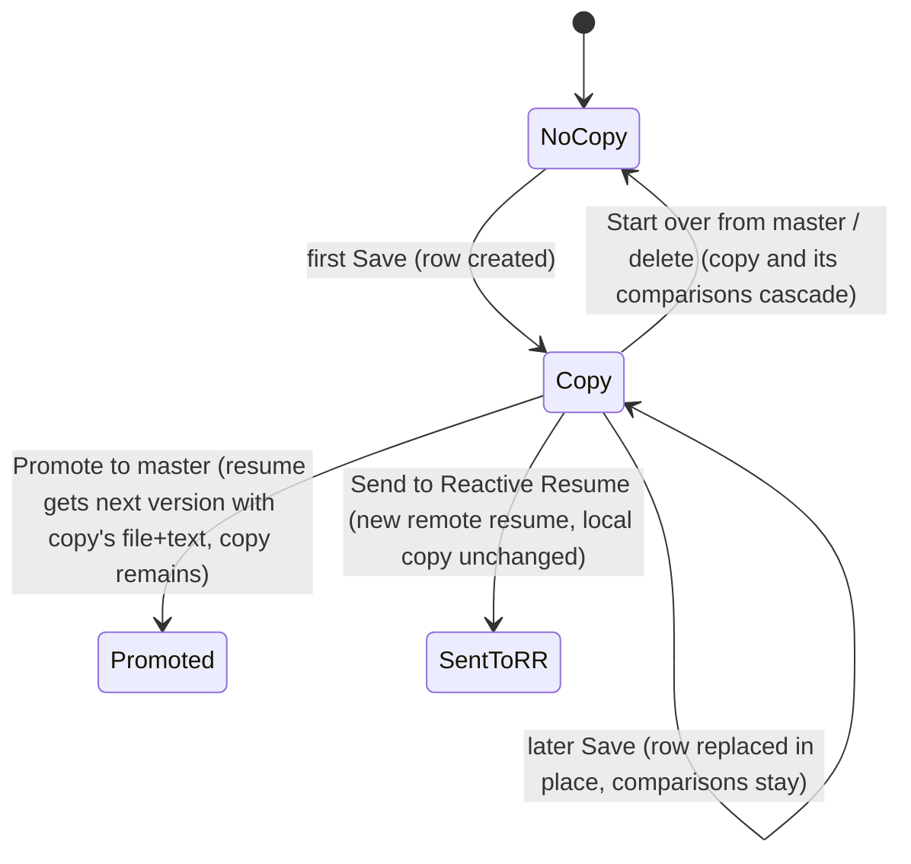

### 4.5 Cover letter gate verdict

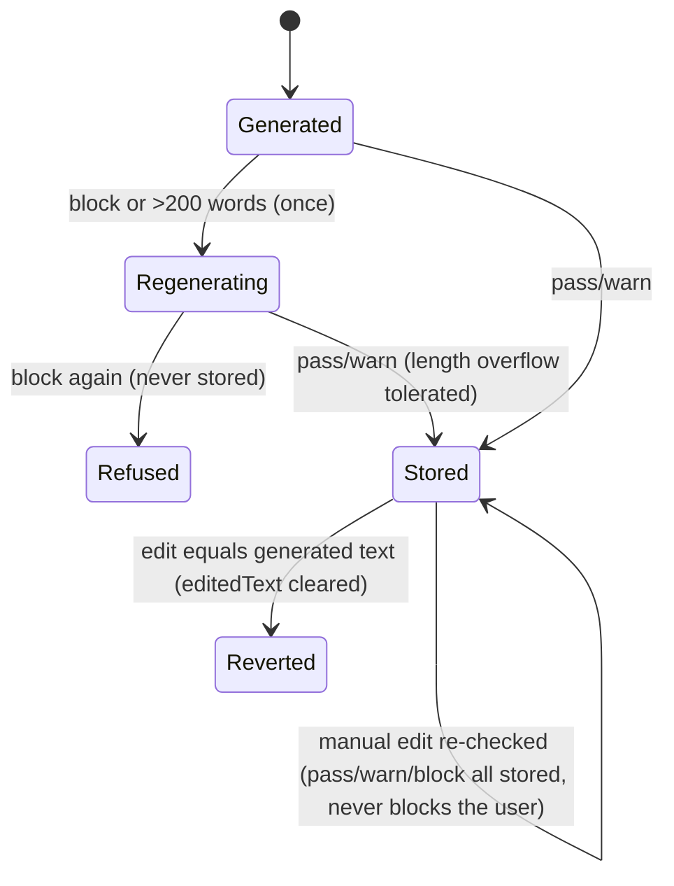

### 4.6 Reactive Resume send outcome

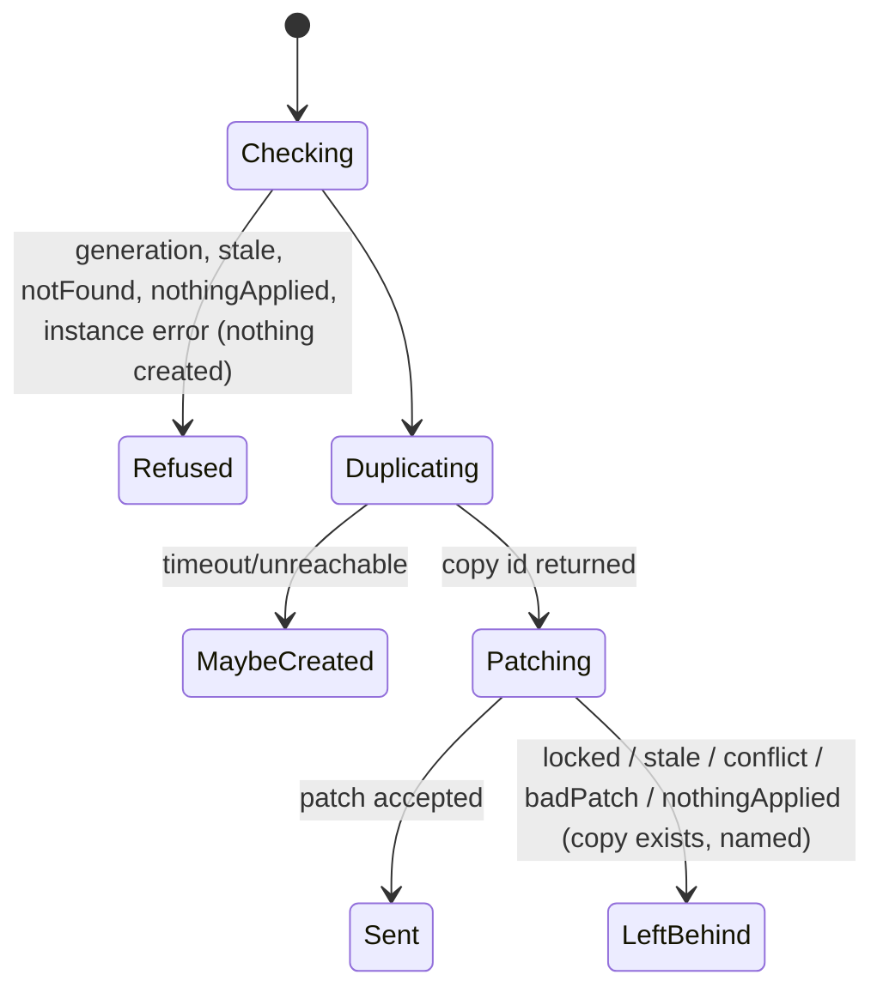

---

## 5. Feature list (the rewrite contract)

### 5.1 Suggestions, gates and the editor loop

| ID | Feature | What it does | Trigger | Key config/settings |
|---|---|---|---|---|
| TLR-01 | Suggestions call (lazy second half) | Given a stored comparison (keyword verdicts, alignment, gates fixed), asks the model only for `actions`, `strengths`, `cautions`. Judged against the text the row analysed (or the last refresh text), never the resume's current text unless the editor's text is handed in. Empty reply (no actions, strengths or cautions) is a parse failure so the row cannot be flipped to "full" with nothing in it. After storing it gates replacements, drops pure reworks of already-applied lines, then rewrites any refused title/summary lead once. | User ("Get suggestions" on quick check, Rewrite them all, Condense refresh); floor retry | max tokens 10,000; timeout 180 s; <=~16 actions requested; row mode flips quick to full |
| TLR-02 | Full report actions | The full comparison already carries actions; they are gated before storage; removals are always stored empty (cuts belong to Condense); then the floor check runs. | User or pack (Compare full) | prompt version 17; tokens 12,000 full / 4,000 quick |
| TLR-03 | Action schema | Each action: section (title, summary, skills, experience, education, format), where, what, why, priority (high/medium/low), quote (verbatim <=~200 chars or null), replacement (complete new text; null = judged/no wording), insert_after (anchor line for additions). Max 40 actions, 30 removals per reply. | Model output contract | schema limits |
| TLR-04 | Replacement gate (gateActions) | Runs on every action with a replacement: (a) fact check vs resume + posting + confirmed facts; (b) instruction-in-wording detector; (c) blocks a newly introduced `cannot_claim` keyword (except the posted job title keyword, priority 2, in `title`/`summary` sections); (d) warns on introduced `ask_user` keyword; (e) for a quote's `present` keyword that disappears: warns if the resume still has it elsewhere, blocks if must-level or primary, else warns. Block: replacement becomes null and reason is appended to `why` (" · not applied - reason"). Warn: wording kept, " · check: reason" appended. Wording is normalised to plain punctuation first. | Every time actions are stored or rewritten | punctuation fold; only first reason written |
| TLR-05 | Fact check engine | Deterministic fabrication detector over generated prose. Extracts metrics (percent, money, counts, ranges, magnitudes, spelled-out numbers), employer assertions ("at/for/joined/left Capitalized Name") and title assertions ("as a ... engineer"); supports a claim only if sources contain it (unit drift tolerated: a bare source number supports any unit; bare numbers on the generated side are not claims); tool claims are checked only against candidate facts (confirmed = support, denied and not in sources = block); masks contacts, years, version tokens, letter-digit tokens; non-Latin dominant segments cannot be count-checked and become "unchecked" (warn). Verdict: block if any unsupported claim, warn if unchecked>0, else pass. Ambiguity resolves toward not blocking. | Called by TLR-04, letters, review examples | thresholds below in section 6 |
| TLR-06 | Instruction-in-wording detector | Refuses wording that is a note to the writer: "ask the candidate", "confirm with the candidate", "if applicable, add", parentheses opening with an order, bracketed slots, TBD/TODO, placeholder figures (XX%, $X, N%), and sentence-ending question marks, unless the quoted line already carried that span. | Part of TLR-04; also unattended policy | regex list |
| TLR-07 | Required-coverage floor | After a full report, checks in code that the advice owes nothing: title/summary/recent-role alignment below strong must each have a high-priority action; a must-level keyword present only as "listed" evidence needs an experience/skills action; every must-level keyword marked `add` must appear in some replacement. Exempt when candidate has no core (no primary keyword present/add; or no primary stack and fewer than two must-level covered) or when the score ceiling is <50. Gaps trigger exactly one suggestions call carrying a "last reply missed required coverage" demand; otherwise refused leads are rewritten once. | Automatically after a full comparison | worth-chasing ceiling 50 |
| TLR-08 | Refused-lead auto-rewrite | For each title/summary action whose wording was refused, one rewrite call with the refusal reason; second refusal stays on the card. Runs sequentially because each call stores the whole action list. | After suggestions/full report | applies to sections title, summary |
| TLR-09 | Rewrite one card | Rewrites only the wording of one action (target section/where/requirement fixed): takes what, why, replacement from the model; passes the same gate; blocked wording is stored with its reason visible, not discarded. Prompt includes the previous refusal reason or the rejected wording. | User (Rewrite button) | tokens 2,000; timeout 90 s; once-guard per match+index |
| TLR-10 | Applied-wording memory | Locates the previous report's replacements inside the current text (exact, then whitespace/punctuation-insensitive); those lines are handed to the prompt as "APPLIED FROM THE LAST RUN - done". After the call, any new action whose quote overlaps applied text is dropped unless its why/what names a keyword that is not `present`. Logged churn metric. | Inside TLR-01 and full report | wording shorter than 12 chars is a term, ignored |
| TLR-11 | Prompt trust boundaries | Resume, posting, verdicts, company facts, match shortlist are wrapped in fenced untrusted blocks with forged-marker neutralisation; user-authored inputs (angles, notes, addressee, answers, standing facts) sit outside fences. Every prompt states an untrusted-input directive. | All AI calls here | fence marker format |
| TLR-12 | Proposal extraction + change sheet | `proposalOf` returns the replacement as the proposal, or (legacy rows without a replacement field) parses quoted wording out of `what`; an explicit null replacement never falls back to parsing. `suggestionSheet` renders all actions and removals as Markdown (heading with job/company/resume, "Now / Replace / Add" quotes, why) for manual copy to Word/Docs. | User (Copy as Markdown) | min quoted proposal 12 chars |
| TLR-13 | Suggestion identity key | Stable short hash of section + where + quote names a card for applied/skipped marks and batch reports; two additions to one place share it. | Editor | hash of `section|where|quote` |
| TLR-14 | Editor Apply / Apply all / Undo | Browser module applies change (quote to replacement, located exact then fuzzy), add (after anchor line), remove (delete span), missing-keyword insertion into the best skills line, or new skills line; each op runs on the output of the previous; each returns an inverse edit with context so it can be undone independently; unplaceable ops are reported and skipped. | User | shared by the unattended runner |
| TLR-15 | Missing-keyword add | Offers keywords with status `add`, requirement not `context`, that are named skills (not the job title, not methodology/domain phrases) for insertion on skills lines. | User / unattended | skills section must be allowed |
| TLR-16 | Live score on edited text | Recomputes the keyword score on any text: re-anchors statuses, re-measures evidence, keeps the judged alignment grades and the original flag penalty (so a better title line earns nothing until a new analysis). Browser has a mirrored scorer for the live ring. | Editor edits; unattended runner | score is a floor |
| TLR-17 | Summary guide | Deterministic checklist of what this posting's first reader looks for in a summary, applied to the resume's current summary (found under its heading, else the span an action quotes) and to the proposed replacement: role named, years stated (warn if fewer than asked), primary stack named, two must-have keywords named, a metric present, length 2-4 sentences and 25-80 words, voice (no I/my/me, no filler adjectives), and "avoid" list (cannot_claim must/primary terms; the other half of an either/or the resume already meets; never the posting's own title). Shows reader and up to 4 scan-for lines from the brief. | Tailor page render | sentences 2..4, words 25..80, show 4 scan lines, 3 terms |
| TLR-18 | Verification hint and cautions | Reads the stored "Is this job real?" verdict and shows one line on the comparison and editor header (skip = danger, caution = warn, apply = ok, with confidence and the verifier's lead flag) and folds up to 5 de-duplicated verifier red flags / ghost / scam findings into "Worth knowing - not scored". Never stored on the match, never scored. | Page render | max 5 cautions |
| TLR-19 | Comparison run orchestration | One entry point for every comparison (job page Compare, editor Re-check, re-upload): answers from memo (unless forced or rebuild), or completes a stored quick check with the suggestions call, or claims a run keyed by job+resume+mode+rebuild+text-hash (second submit joins), shows steps `brief` then `keywords`/`match`, and lands on the new analysis (also exposing a "tailor" URL). Error text = failure label + model reason + next step. | User | quick vs full mode; rebuild keywords; force "re-run anyway" |
| TLR-20 | Version delta | Computed (not narrated) difference of two comparisons of one job: terms that became present, terms lost, and per-component score differences (keyword points, alignment points, penalty, score, cap before/after). | Page render | by lowercase term |
| TLR-21 | Countable red flags | A red flag only costs points if it is not just a restatement of a keyword gap: flags that name a keyword the resume lacks, or only lists on a skills line, are exempt (reported with the term they restate). | During scoring | penalty 10 per counted flag, max 5 flags (prompt) |
| TLR-22 | Posting-reading orientation inputs | The suggestions prompt receives the brief's screening block (first reader, scan-for, wow shapes), requirement groups, company context (emphasis only), candidate domain mismatch, confirmed/denied facts and "owed" demands. | Inside TLR-01 | brief version 3 |

### 5.2 Condense

| ID | Feature | What it does | Trigger | Key config/settings |
|---|---|---|---|---|
| TLR-30 | Page target | Per-comparison target `keep`, 1, 2 or 3 pages stored in the breakdown. Length estimate = characters (carriage returns ignored) / 3,500 per page; plan = target, estimated pages, budget chars, overshoot chars, met flag. Mirrored in a browser module for the editor meter (a test enforces parity). | User (select beside Find cuts) | 3,500 chars/page; invalid value = keep |
| TLR-31 | Find cuts (step one) | Model proposes removals against the text the comparison judged: unevidenced skills, number-less or irrelevant bullets (esp. roles older than two years), roles older than ~10 years condensed to one line (but an old role holding the posting's best evidence is last to cut), duplicate tech lists, filler, recruiter-unfriendly personal data, empty sections. Count requested = 8 default or ceil(overshoot/250) capped 30 when over target. Extra output tokens (120 per extra cut) added. Each removal: section, where, what, why (<=12 words), verbatim quote <=~200 chars. | User (Find cuts / again) | tokens 6,000 (+extra); timeout 180 s |
| TLR-32 | Removal gate (gateRemovals) | Code enforcement of two rules: a quote that contains the contact email or phone is blocked; a quote that spells a `present`/`add` keyword is blocked if primary or must, otherwise warned; also blocks removing a whole labelled line (>=80% of its terms) that is what shows a wanted keyword without spelling it (matched by the line's label or the keyword's `where`). Block: quote nulled (advice stays, nothing deletable in one press). Warn: note appended. | Inside Find cuts | whole-line threshold 0.8; label min 4 letters |
| TLR-33 | Wording (step two) | After cuts exist, model shortens wording of what is left, working on the editor's current text. Each rewrite: quote verbatim + replacement STRICTLY shorter, keeping every number, date, employer, title, tool and present/add keyword, never touching contact line or headings. Count requested 12 default, up to 25 when over target (ceil(overshoot/60)). | User (Shorten wording) | tokens 6,000; timeout 180 s; max 25 |
| TLR-34 | Shorter-only filter | After the replacement gate, rewrites whose replacement is not strictly shorter than the quote are dropped and counted. | Inside wording step | - |
| TLR-35 | Step ordering and stage marker | Stage `none -> removals -> rewrites` stored in the breakdown; asking for wording at stage `none` throws a typed order error (UI: "cuts first"); empty editor text also refused. Re-running cuts clears wording proposals. | Server | stage in `breakdown.condense` |
| TLR-36 | Refresh suggestions on condensed text | Re-runs the suggestions call on the editor's text after cuts/wording; stores `actionsOn` (the text the actions now quote); cuts and rewrites are untouched; only available on a full analysis. Actions are then displayed/applied against that text. | User (Refresh) | needs full mode |
| TLR-37 | Carry cuts to the next comparison | When the copy is saved, cuts from the comparison being edited that are not yet accepted (their quote still occurs in the saved text) are copied onto the copy's new comparison (stage becomes `removals`). | Save of working copy | quote must still be in text |
| TLR-38 | Condense runs | Each step is a claimed progress-page run (`condense-cuts:ID`, `condense-words:ID`) joined by repeat presses; result flash counts cuts/rewrites; errors carry the model's reason. | Server | per-comparison per-step key |
| TLR-39 | Condense panel | Collapsible panel with page-target select, Find cuts, review list of removals (interactive), Shorten wording (locked until cuts), rewrites list, optional Refresh; text for steps 2/3 sent through a hidden field kept in step with the editor. | UI | opens if over target or stage != none |

### 5.3 Working resume per job and documents

| ID | Feature | What it does | Trigger | Key config/settings |
|---|---|---|---|---|
| TLR-40 | One working copy per resume and job | A tailored copy (text, file, mime, filename) is unique per (resume, job); saving again replaces it in place so earlier comparisons stay attached. The resume's own text/version/scan never move on a tailoring save. Comparisons of a copy carry `tailoredId`; resume-level stats (count, best score, coverage) ignore them. | Save in editor | unique(resumeId, jobId) |
| TLR-41 | Save as copy (draft route) | Validates text 200..200,000 chars and that the posting is the user's; claims a run keyed by resume+text-hash+job BEFORE saving (so a double submit cannot save twice); saves; then compares the copy's text under the resume's identity (no resume rescan); carries cuts; lands on the new comparison with a download link when a file was produced. | User (Save) | min 200, max 200,000 chars |
| TLR-42 | Patch-source selection | Edits are patched into the copy's own file when the editor's base text equals the copy's text, else into the master file; used by save, preview and download. | Server | trimmed equality |
| TLR-43 | Working comparison selection | Editor opens on the copy's newest comparison whenever a copy exists (a non-draft comparison of the resume's own words is only a report once a copy exists); history list hides the resume's own non-draft runs when a copy exists; draft texts the person brought stay. | Page render | matches newest first |
| TLR-44 | Start over from master | Deletes the copy (its comparisons cascade) so the editor opens on the master text again. | User | needs copy of this job |
| TLR-45 | Promote to master | The copy becomes the resume's next version (file + text, versioned name), then the new text is scanned in the background. The old overwrite on purpose. | User | - |
| TLR-46 | Copy download / delete | Download the copy's stored file; delete from the resume page (job title named in flash). | User | content-disposition with ASCII fallback + UTF-8 name |
| TLR-47 | Draft document (own vs clean) | Draws the editor text as the file it would be: user's own .docx with edits patched when the patcher accepts, else the clean re-typeset DOCX plus a notice with the reason (pdf source, text source, unsupported template, stale base, patcher refusal). Never silently swaps the user's design. | Document pane, downloads | basis: own, pdf, text, unsupported, stale, refused |
| TLR-48 | Document endpoint | POST returns a JSON preview (kind, basis, notice, base64 docx, filename, whether the PDF is "print" (own file) or "render") or an attachment (docx / pdf). A clean PDF is rendered; for an own .docx a PDF request returns 409 "print" so the browser prints it. Nothing is stored. | Document pane, Download buttons | no-store |
| TLR-49 | Applied-resume recording | "Which resume did I send?": a form value of absent = keep, empty = clear, id = set, `pack-<ts>` = the application pack's file (only if the pack is still ready, unfrozen and prepared at exactly that time). Stores id, version and a TEXT SNAPSHOT because bytes are replaced in place on new versions. A resume deleted in another tab records nothing instead of blocking a status change. Prompt to record when the job is past applying and nothing was recorded. | User (status change) | snapshot columns on job |
| TLR-50 | File naming | `tailoredFileName` = slug(resume)-slug(job title).ext; `documentFileName` strips path/control characters, 80 code points; `contentDisposition` emits ASCII fallback and RFC 5987 UTF-8 name. | Downloads | 80 chars |

### 5.4 Rendering: DOCX patching and clean re-typeset

| ID | Feature | What it does | Trigger | Key config/settings |
|---|---|---|---|---|
| TLR-60 | In-place DOCX patcher | Writes the edited text into the user's own .docx. Contract: the analysed text must equal exactly what the file renders to (else refused "stale"). Edits are a line diff mapped back to the paragraph that rendered each line: changed line rewrites that paragraph's runs (only the changed window when raw text equals rendered text, so bold fragments outside the edit keep their runs; otherwise first run takes all and rest emptied); deleted line removes its paragraph; inserted line clones the paragraph above (paragraph properties and first run properties). Table rows are edited cell by cell (same cell count, no empty cell, one paragraph per cell). One refusal fails the whole save (a half-patched file is worse than a text version). All other zip parts are byte-identical; only document.xml and core.xml are rewritten. | Save, document pane, pack | zip inflation cap; all-or-nothing |
| TLR-61 | Patcher refusals | Reasons: not a docx, unsafe archive, unparsed xml, stale base, line in a text box, paragraph shared by several rendered lines, tab layout changed (different number of tab-separated parts), line with no paragraph, add inside table or text box, delete of a table cell/row, cell count/emptied/multi-paragraph cell. | Patcher | refusal text shown to the person and logged |
| TLR-62 | Patcher read-back gates | After writing, the file is read back with the same reader and must equal exactly the expected text (accounting for style-derived markers such as heading/bullet); counts of math objects, drawings, text boxes and hidden runs must be unchanged. Failure refuses and reports the first differing line. | Patcher | gate before returning ok |
| TLR-63 | Plain punctuation on patch | Edited lines pass through the plain-punctuation fold (curly quotes, dashes, ellipsis, bullets, NBSP, arrows, zero-width, emoji) before being written. | Patcher | same fold as cover letters |
| TLR-64 | Template check | Classifies a .docx as flow (paragraphs, fully patchable), structural (tables, text boxes, columns, header/footer content; patched where a paragraph exists) or unsupported (not patched at all); counts tables, text boxes, drawings, columns, header/footer chars, math, hidden/white/tiny runs and produces plain-language notes. Re-computed on each page (not stored). | Upload and any page needing it | tiny run <= 4 pt |
| TLR-65 | Document properties fix | Opt-in: rewrites title, creator, last-modified-by in core.xml (candidate name in, template author out), words untouched; clean renders carry the candidate only (no tool names). | User ("Fix document properties") | candidate = first resume line |
| TLR-66 | Render plan | One reading of a structured resume into blocks (heading, line with left/right runs, bullet, paragraph, gap, label/value pair) shared by both writers so DOCX and PDF never drift. Header: name, headline, deduped contact line (location, email, phone, url, profiles), extra header lines. Section order driven by knobs. | Render | default order summary, skills, work, projects, education, certificates, languages, extras |
| TLR-67 | Line-by-line plan | Fallback plan: every line of the text as its own block (first non-empty line = name; `#`/`##` or short all-caps lines = headings; bullet markers = bullets). Chosen whenever the structured reading would drop a line (content comparison ignoring case, spacing, separators, punctuation but keeping symbols). | Draft/clean render | heading max 44 chars |
| TLR-68 | Clean DOCX writer | Single-column Word file: no tables, no text boxes, no headers; font is NAMED (reader's Word supplies it); headings upper-cased with optional rule; right-aligned dates via a right tab at text width; hanging-indent bullets; per-role looks (colour, weight, size scaled by body size) when read from a PDF's page; justification and header rule when the page had them; pairs as a two-column layout only if the source had a skills table. Metadata: candidate only. | Render, save, pack | muted colour 404040; bullet indent 0.22 in |
| TLR-69 | Clean PDF writer | Same plan drawn with pdfkit: embeds Liberation Sans regular/bold (metric-compatible with Arial, covers Latin + Cyrillic) whatever the DOCX names; manual pagination; Producer/Creator blank, Title/Author = candidate. | Render, pack, document | page LETTER or A4 |
| TLR-70 | Render knobs | Typography defaults read from the resume's own file and overridable on the render page: font family (<=60 chars), body 8-14 pt (default 10.5), name 12-36 (20), heading 8-20, accent hex or none, four margins 0.3-1.5 in (clamped to 2), section order (missing sections appended so none is lost), name centred, page LETTER/A4, read-only looks from PDF. Validated server-side. Not stored. | Render form | see LIMITS in section 6 |
| TLR-71 | Drawable-character folding | Characters the bundled face cannot draw are replaced by their NFKD decomposition when that is drawable (math italics to letters, subscripts to digits, ligatures), else dropped; applied once to the plan for the PDF (and the unfolded plan for DOCX, which names a user font). The page lists characters the PDF render would drop. | Render | kept ranges verified against the font by test |
| TLR-72 | Render page | Preview = the clean DOCX read back through the same text reader (what an ATS sees) with parse warnings; knob form; downloads (docx, pdf); "Save as a new resume" (stores the clean DOCX as a new resume named "<name> - clean", background scan); explains why the resume is offered a re-render (pdf, flow, structural, unsupported, text). | User | - |
| TLR-73 | Structure source for render | Uses the stored AI structure only if it re-anchors verbatim against the current text, is usable and complete; otherwise the built-in text-derived reading (which takes a PDF's columns and skills table). AI reading is started only by an explicit button (a GET must never spend a model call); one reading per resume text at a time. | Render page load / button | structure run key resume+text hash |
| TLR-74 | Clean save guard | Saving a clean DOCX reads it back; if any line of the text would be lost the copy is stored as a Markdown text file instead and the note says how many lines. | Save copy | - |
| TLR-75 | Letter file writers | Dependency-free minimal DOCX (3 parts, one paragraph per line, US Letter, 1 in margins) and minimal PDF (US Letter, Helvetica 11 pt, WinAnsi, 80-char wrap, 16 pt leading, 40 lines per page; non-Latin-1 becomes "?"). | Letter download | - |
| TLR-76 | Two-file format comparison | Reads a saved resume and an uploaded second file (typically DOCX vs PDF export) as an ATS would; ranks measures in order (email+phone found, dated roles, roles, sections, link+location, parse warnings) to say which reads better; lists lines only in A, only in B, moved, and changed (cap 25 each); flags identical. Rendered, never stored, no AI. | User (compare formats) | measure order decides |
| TLR-77 | Parsed view block | Shows what a plain parser extracts: name, headline, contact badges found/missing, sections, roles with dates (role without dates highlighted). | Resume page, comparison page | - |

### 5.5 Cover letters

| ID | Feature | What it does | Trigger | Key config/settings |
|---|---|---|---|---|
| TLR-80 | Generate letter | Grounded 120-180 word letter (never over 200) in a chosen tone, from resume text, posting, candidate facts, the latest comparison for that resume and job text (shortlist of evidenced keywords <=12 and gaps <=6), verified company facts, saved angles and addressee. Structure: greeting, opening, middle (why this company/role), one-sentence close, sign-off with name only. Output also lists keywords used and gaps acknowledged. | User (job card Generate/Regenerate; /letter; pack) | tone neutral/warm/direct (default warm); tokens 2,000; timeout 3 min; prompt version 4 |
| TLR-81 | Letter fact gate with one retry | Plain-punctuation pass then fact check (sources: resume, posting incl. title/company/location, company snapshot; angles and match content deliberately excluded so numbers typed into angle boxes cannot launder themselves). Block or >200 words triggers one regeneration quoting the violations; second block = refused, nothing stored. Length-only overflow after retry is kept with a note. | Inside generation | max one regeneration |
| TLR-82 | Plain punctuation | Deterministic fold to keyboard characters (applied before checking so what is checked is what is stored): curly quotes, en/em dashes (digit ranges keep a bare hyphen, clauses keep spaced hyphen), ellipsis, bullets, NBSP, arrows, zero-width, emoji. Accents in names survive. | Letters, patcher, replacement gate | - |
| TLR-83 | Angles | Four optional free-text fields (why company, problem, approach, standing notes) each trimmed to 500 chars (form truncates 300 / notes 500) and saved per user as prefill when the form carries `saveAngles=1`; a regenerate without the marker reuses saved values and never wipes them. Angles steer emphasis, never evidence. | User | settings: coverAngles |
| TLR-84 | Addressee | Optional name the greeting uses (<=80 chars, per letter, not saved with angles); prefilled from the verifier's `named_humans` finding by shape (2-3 capitalised words, no role/vendor/company words); regenerate keeps the name the stored letter greeted (`greetingOf` reads "Hi/Dear/Hello X,", team greetings return none). The greeting words are excluded from claims in the fact check. | User | - |
| TLR-85 | /letter launcher | Pick stored job + saved resume + tone (+angles); optional pre-steps `match` (full report so the letter has strengths) and `verify` (company research, skipped if a snapshot exists); fast path default. Run key includes job, resume, tone, enrichers and angles hash so only identical requests join. Pre-step failures become warnings on the done flash; blocked/failed letter ends the run with error. | User | steps match, verify, letter |
| TLR-86 | Manual edit with re-check | Edits autosave over fetch (JSON) or classic form; text 1..20,000 chars; re-run of the fact gate in warn-only mode: a `block` is stored and shown but never prevents saving; text equal to generated text clears `editedText` (reverted). | User | max 20,000 chars |
| TLR-87 | Letter downloads | DOCX or PDF of the edited text if any, else generated text; filename `cover-letter-<employer-or-company-slug>.<ext>`. | User | - |
| TLR-88 | Letter history and card | Lists all letters per job with tone, resume, edited marker and verdict badge (pass ok, warn warn, block danger); word count vs 120-200 band; copy; quick-check warning suggesting "Get suggestions first". | UI | - |

### 5.6 Strength review

| ID | Feature | What it does | Trigger | Key config/settings |
|---|---|---|---|---|
| TLR-90 | Strength review | Job-agnostic hiring-manager read of one resume: headline, six graded dimensions (first_impression, impact, seniority_signal, clarity, keyword_coverage, polish) each strong/ok/weak with 1-2 verbatim evidence strings, 3-8 prioritised advice items (issue, why, fix, example, ask, quote), 2-5 strengths. The model NEVER outputs a score. Inputs: deterministic ATS parse warnings, claimed role types, saved answers. | User (Run strength review) | tokens 6,000; timeout 120 s; prompt version 3; run key resume+version+answers hash |
| TLR-91 | Review score | Weighted points: first_impression 20, impact 30, seniority_signal 20, clarity 15, keyword_coverage 10, polish 5 (total 100); credit strong 1, ok 0.5, weak 0; ungraded dimension earns 0 and counts as weak. Caps: impact weak (or ungraded) caps at 55; two or more weak caps at 45 (the lower wins). Stored with the cap reason so the card explains the number. | Server | caps 55 / 45; scoring version 1 |
| TLR-92 | Review example gate | Each advice `example` is fact-checked against resume + answers; a blocked example is removed and the unsupported claim becomes the `ask` question (unless an ask exists). | Server | question templates for metric / tool / other |
| TLR-93 | Answers loop | Answers to review asks are stored on the resume (question verbatim, answer <=300 chars, question <=300, newest 30 kept), replacing earlier answers to the same question, blank deletes; no AI call on save. The next review gets them as CANDIDATE-SUPPLIED METRICS (outside fences) and must write them into examples and not ask again, but figures never change a grade. Card counts unanswered asks. | User | max 30 answers |
| TLR-94 | Review delta and staleness | Compares with the previous review of the same resume: score points, dimension moves, same-version flag ("re-judged"), incomparable when prompt versions differ (says so rather than subtracting). A review is stale once the resume version moves on. | Page render | - |

### 5.7 Reactive Resume

| ID | Feature | What it does | Trigger | Key config/settings |
|---|---|---|---|---|
| TLR-100 | Connection card | One connection per user (base URL + API key). Save validates URL (blank, invalid, scheme http/https only, no embedded credentials; scheme defaulted: http for private hosts, https otherwise; query/hash stripped; trailing slashes and a pasted `/api/openapi` removed), key (non-empty, <=500 chars, a long paste refused not cut), reachability, and a real list request; only a working pair is saved. Key never in flash, log, redirect, page; pages receive only base and host. Remove deletes it. | User (Settings) | once-guard per user |
| TLR-101 | Reach rule | Privileged users (admins; the single person of a local install) may call any address. Others: private host or a name resolving to any private address is refused; unresolvable host refused; IP literals public allowed. DNS rebinding not pinned. | Every call | - |
| TLR-102 | List and pick | Lists the user's resumes on the instance (accepts a bare array or items/resumes/data wrapper; name falls back to title, slug, id), stashes the id list for 10 min per user, shows a pick page; target is a new resume or the next version of an existing one. | User | stash TTL 10 min |
| TLR-103 | Import | Re-reads connection and standing at import time, fetches one resume, converts to the resume text dialect and stores as new resume or next version (same-text guard avoids a pointless version/scan); records origin (remote id, generation, host). | User | name <= max resume name chars |
| TLR-104 | Export reader (v4/v5/v6) | Pure converter from a Reactive Resume JSON to the app's text dialect: name, headline, one contact line, `## ` section headings only (no other `#`), per job a company line, `Position - Dates` line and bullets; rich-text HTML to lines with link targets preserved as `words (url)`; hidden items skipped; generation inferred from shape (no top-level summary object = v4; summary object with dated items = v6; else v5). Also produces, per output line, its source (JSON pointer, item id, field kind html/text/keywords, English label), using private control characters as temporary tags that are stripped from input. | Import; write-back | link window 2,000 chars; heading <=80 |
| TLR-105 | Edit planner | Turns master-text vs copy-text line diff into JSON-patch `replace` ops: leftovers of a delete run and an insert run are paired as one reworded line; edits are placed via line sources; rich-text fields are changed block by block (paragraph/list item), untouched blocks stay byte-identical, the new field is read back with the reader's rules and must produce exactly the described lines or the field is left alone; headline and keyword lists are single-value fields (keyword list label must be unchanged). Unplaceable edits are reported with reason: noField, assembled, misaligned, newSection, labelChanged. Heading case changes from the renderer are ignored. | Send | only `replace` is emitted |
| TLR-106 | Write-back as new resume | Only generation v6 is writable. Sequence: read source, check it still reads as the stored text, plan, duplicate (never edits the original) under `<Resume> - <Company> - <Role>` (<=200 chars, empty parts omitted), read the copy, re-plan on it, PATCH with expectedUpdatedAt. Every call made once (no retry), copy named in every failure after it exists; timeout at duplicate flags maybeCreated. | User (Send to Reactive Resume) | once-guard per user |
| TLR-107 | Send result page | A GET page (so reload cannot send twice) fetched by token from an in-memory stash (per user max 4, global 64, TTL 10 min); lists applied count, each edit not applied with kind, label, line, reason, link to open the new resume in the instance builder; expired token shows a gone page. | After send | stash TTL 10 min |
| TLR-108 | Instance client | Only file that calls the instance: GET list, GET resume, POST duplicate, PATCH; header `x-api-key`; manual redirect (any 3xx = failure so the key is never forwarded); 10 s timeout; 5 MB body cap enforced while streaming; error body read (16 KB) for `RESUME_LOCKED`. Failure vocabulary: unauthorized, notApi, redirect, tooLarge, timeout, unreachable, locked, conflict, badPatch. | All calls | - |
| TLR-109 | Failure messages | Single catalogue of person-facing sentences for URL, key, reach, instance, send and edit-reason failures; a saved key the instance refuses says to fix it in Settings. | UI | - |

### 5.8 Unattended tailoring (application pack's tailoring step)

| ID | Feature | What it does | Trigger | Key config/settings |
|---|---|---|---|---|
| TLR-110 | Edit policy plan | Applies a stored report's suggestions under person-set limits, holding the rest with reasons: allowed sections (default title, summary, skills, experience), max experience edits (default 2, highest priority first), removals off by default, keywords on. Held reasons: no-wording, check-first (gate left a "check:" note), drops-figure (rewrite loses a number the quote had), section, over-limit, removals-off. Skills-line keywords only when skills section allowed. | Pack | DEFAULT_POLICY |
| TLR-111 | Unattended safety checks | Taking every change back (last first) must reproduce the original text exactly; each change/removal may only remove words inside its suggestion's quote; additions/keywords remove nothing; no email/phone in anything removed; live score must not fall. Any failed check drops all edits (resume goes out as it stood). | Pack | checks: unexplained-change, beyond-quote, contact-changed, score-dropped |
| TLR-112 | Pack document and letter | Draws the pack's file with the same draft-document logic (clean PDF only when the file is clean); optional re-judge of the tailored text; optional cover letter (tone warm, saved angles) whose failure never fails the pack. | Pack | - |

---

## 6. Business rules and invariants

### 6.1 Anti-fabrication rules (the heart of the area)

1. Verdicts are fixed once a comparison is stored: the suggestions, rewrite and condense calls are told not to re-judge keywords and the code never changes `status`, `primary`, `requirement`, alignment or gates in these calls.
2. A replacement may not introduce a keyword whose status is `cannot_claim` for this posting. Single exemption: the posted job title keyword (priority 2) on the `title` and `summary` sections (the role being applied for is not a claim of past employment); in bullets it blocks.
3. A replacement introducing an `ask_user` keyword is allowed with a "confirm you have it first" note.
4. A replacement that removes a `present` keyword from the quoted span: warn if the resume still contains it elsewhere; block if the keyword is primary or must-level; otherwise warn.
5. Fact-check claim extraction (see TLR-05):
   - metrics: percent (incl. ranges "15-20%" and spelled-out numbers), money ($ EUR GBP with k/m/b/hundred/thousand/million/billion), counts (number + noun, not followed by a function word), vague magnitudes (hundreds/thousands/millions/billions, optionally "of ..."), bare numbers (never claims on the generated side; used as support on the source side).
   - number parsing: thousands separators only when fully group-structured (`1,234` or `1 234`); "one" never a count.
   - non-Latin-dominant segments (>=30% of letters, >=8 letters) skip count nouns; remaining digits counted as "unchecked" (warn).
   - masks: emails, URLs, domains, phone numbers, big-O, `v1.2`, letter+digit tokens (EC2, p95), and years 1900-2099.
   - employers: triggers at/for/joined/left + capitalised run (<=4 words), cut at ". ", trailing pronoun contractions trimmed, addressee and month/day/pronoun words ignored; must appear whole in source text.
   - titles: "as a/an ..." with a role noun (engineer, developer, architect, lead, manager, designer, analyst, scientist, director, consultant, administrator, specialist, programmer, devops, sre); every word must appear somewhere in sources.
   - tools: only CandidateFact vocabulary; confirmed supports, denied (and absent from sources/allowlist) blocks.
   - allowlist entries that can never match are reported as inert.
6. Cover letter sources deliberately exclude angle text and AI-derived match content.
7. Wording that is a note to the writer (see TLR-06) is never appliable; the gate checks the wording against the quote so the candidate's own text is never held against a rewrite.
8. Contact line is protected: removal quotes may not contain the email or phone; unattended edits may not remove either.
9. Bullet rules in prompts (code does not enforce): verb first, past tense, <=~28 words, outcome -> how -> with what, posting's vocabulary, quantify only with numbers already in the resume or confirmed facts, banned words (results-driven, passionate, synergy, dynamic, go-getter, team player, detail-oriented, proven track record, responsible for, seasoned, leverage, utilize, spearheaded). Summary rules: 2-4 sentences, <= ~75 words, WHO/PROOF/FIT, implied first person, no objective, never more than five technologies, name only the half of an either/or the resume has.
10. A minimum the candidate exceeds is met: never a red flag.

### 6.2 Numbers and constants

| Area | Constant |
|---|---|
| Prompt versions | match PROMPT_VERSION 17; brief 3; cover 4; review 3; review scoring 1 |
| Token budgets | scan 4,000; structure 10,000; full match 12,000; quick 4,000; suggestions 10,000; brief 6,000; rewrite 2,000; cover 2,000; review 6,000; condense 6,000 (+120 per extra cut) |
| Timeouts | scan 120 s; quick 90 s; full 180 s; suggestions 180 s; review 120 s; structure 120 s; brief 120 s; rewrite 90 s; condense 180 s; cover 180 s |
| Model reply parsing | 2 attempts per call; a cut-off reply is not retried; empty-after-parse suggestions are an error |
| Inputs clipped | resume 30,000 chars; posting 15,000 chars; keywords stored <= 80 (soft cap ~25 for nice/context; every must/preferred kept) |
| Page estimate | 3,500 chars per page |
| Cuts | 8 default; 30 max; 1 per 250 overshoot chars |
| Rewrites (words) | 12 default; 25 max; 1 per 60 overshoot chars |
| Floor | ceiling must be >=50 to chase; one retry only |
| Cover letter | 120-200 words band (prompt 120-180, never >200); one regeneration; angles 500 chars; addressee 80; edited text <=20,000; match shortlist aligned <=12, gaps <=6 |
| Primary-stack cap on the score (other area, referenced by prompts) | all present: none; >= half: 70; some under half: 45; none: 30 |
| Review score | weights 20/30/20/15/10/5; caps 55 (impact weak) / 45 (>=2 weak) |
| Review answers | answer <=300; question <=300; newest 30 kept |
| Review output limits | grades <= 12; advice <= 20 (prompt asks 3-8); strengths <= 10; evidence <= 4 per grade |
| Applied-wording | minimum 12 chars |
| Replacement-gate removals | whole-line threshold 80% of line letters; label min 4 letters |
| Render limits | body 8-14 pt (10.5); name 12-36 (20); heading 8-20 (body+1 rounded); margins 0.3-1.5 in (read-from-file clamp to 2); page LETTER default; muted colour 404040 |
| Document sizes | draft text 200..200,000 chars; file name 80 code points |
| Reactive client | 10 s timeout; 5 MB body; error body 16 KB; stash TTL 10 min; sends stash 4/user, 64 total; key <=500 chars; new name <=200 chars |
| Format comparison | 25 lines per difference list |
| Summary guide | 2-4 sentences, 25-80 words, show 4 scan lines, 3 offered terms |
| Verification cautions | at most 5 |

### 6.3 Ordering and idempotency rules

- Run keys make repeated presses join, not duplicate: comparison (job, resume, mode, rebuild, text hash); suggestions (match id); condense (step + match id); letter (job, resume, tone, hash of angles+addressee); /letter (job, resume, tone, enrichers, angle hash); review (resume, version, answers hash); draft save (resume, text hash, job) claimed BEFORE the save; structure read (resume, text hash). Runs live only in the web process memory; a restart forgets unfinished runs.
- Rewrite and Reactive send are additionally guarded by a once-guard.
- Condense order is cuts -> (user accepts) -> wording -> optional refresh; wording at stage none is refused.
- Floor retry happens at most once per comparison; refused-lead rewrites are sequential.
- A comparison memo reuse never applies when forced or when keywords are being rebuilt; a quick check stored for the same text completes with only the suggestions call.
- Saving the tailored copy never changes the resume's own text, version or scan; promote does.
- Patch is all-or-nothing; clean fallback has its own all-lines-kept guard; the last-resort stored form is a Markdown text copy.
- Reactive Resume: never write the original; duplicate first; one attempt per call; the copy is always named in a failure that happens after it exists.
- Deleting a tailored copy cascades its comparisons.

### 6.4 Persisted shapes the rewrite must keep (or migrate)

- comparison row: score, summary, strengths, red flags, cautions, keywords (JSON), actions (JSON), removals (JSON), condense (JSON `{rewrites, from, actionsOn}`), breakdown (JSON incl. mode, pages target, condense stage, evidence mode, prompt version), hard requirements, text snapshot, name snapshot, draft flag, version, optional tailored copy id.
- tailored copy: resume, job, text, source filename, mime, original bytes; unique per (resume, job).
- cover letter: job, resume, resume version, kind (`letter`, reserved), tone, text, editedText, model, prompt version, keywordsUsed, gapsAcknowledged, usedVerification, gateVerdict, gateNotes.
- review: resume, resume version, model, score, headline, grades, advice, strengths, breakdown with prompt version marker.
- resume: answers JSON, remote origin (id, generation, host - all set or all null).
- Reactive connection: per user, base URL + API key (the only read path that returns the key is the one used to call the instance).

---

## 7. External dependencies and integration contracts

### 7.1 AI provider contract

Every call is: system prompt + user prompt, JSON-only reply, with label, role (`resume` for tailoring/review/condense, `cover` for letters), max tokens, timeout and a subject (job id, resume id) for usage accounting. A runtime picks the provider chain; the reply carries `model` (with a " - fallback" marker when not the primary), chars and ms. Tolerant JSON extraction, schema validation (zod) and two parse attempts. The model name is stored on each analysis/letter/review so the card can show which engine produced it. No web tools in any call here (tool-free by construction).

### 7.2 AI call inventory (what each prompt does)

| Call | Inputs | Output contract | Notes |
|---|---|---|---|
| Resume scan (other area) | resume | skills, issues, two sentences | listed for context |
| Resume structure (other area) | resume | JSON Resume subset, every string copied verbatim (checker drops non-contiguous spans) | read on explicit render-page button |
| Posting brief (other area) | posting only | role, company, screening (reader, scan-for, wow shapes, dealbreakers), requirement groups, keywords, gates | cached per posting text |
| Full comparison | resume, posting, brief, previous keywords, facts, applied lines, company context | summary, alignment {title, summary, recent_role}, strengths, red_flags (max 5, only application-blocking), cautions (max 5, unscored), hard_requirements (max 8-12), keywords (term verbatim from posting, 1-4 words; priority 1-4; requirement must/preferred/nice/context; primary; group; status present/add/ask_user/cannot_claim; aliases; where; note), actions | model never outputs a score; "add" = evidenced by the resume's own facts, sibling technologies never qualify |
| Quick comparison | same minus actions/strengths/cautions | verdict subset (what the score needs) | cheaper first pass |
| Suggestions | resume text, verdicts (fixed), alignment, gates, facts, brief, company context, applied lines, domain mismatch, owed demand | strengths (<=6), cautions (<=5), actions | requires REQUIRED COVERAGE; profession-mismatch exemption only when no primary item present/add (or fewer than two must-level for no-primary postings) |
| Rewrite one | resume text, one action, refusal or rejected wording, verdicts, brief, facts | `{what, why, replacement}` | target fixed; must materially differ; title = headline only; summary rules vs bullet rules |
| Condense cuts | resume, verdict table, length target | `removals[]` | protects contact line and wanted keywords |
| Condense wording | current editor text, verdict table, target | `rewrites[]` (quote + shorter replacement) | adds nothing |
| Cover letter | resume, facts, denied, match shortlist, company facts, angles, addressee, tone, posting, prior violations | `{letter, keywords_used, gaps_acknowledged}` | "NOTHING INVENTED"; no em dashes/curly quotes/markdown; banned openers and words |
| Strength review | resume, claimed roles, ATS checks, answers | `{headline, grades[], advice[], strengths[]}` | never scores |

### 7.3 Reactive Resume REST contract (as used)

| Operation | Request | Success shape used | Failure mapping |
|---|---|---|---|
| List | `GET {base}{path-prefix}/api/openapi/resumes` | array or `{items|resumes|data: []}` of `{id, name|title|slug}` | 401/403 unauthorized; 404/405/410 notApi; 3xx redirect; other non-2xx unreachable |
| Get | `GET .../resumes/{id}` | `{name, data, isLocked, updatedAt}` or bare data with `basics` | as above |
| Duplicate | `POST .../resumes/{id}/duplicate` body `{name}` | non-empty string id | as above + 400 badPatch, 409 conflict |
| Patch | `PATCH .../resumes/{id}` body `{operations: [{op: replace, path, value}], expectedUpdatedAt?}` | `{updatedAt}` | 403 with code `RESUME_LOCKED` = locked; 409 conflict; 400 badPatch |

Auth: header `x-api-key`. Open-in-app link: `{base}/builder/{id}`.

### 7.4 Other integrations

- Browser-side shared modules (also loaded by the server so both sides agree): line diff, quote location (`locateQuote`: exact, then whitespace/punctuation-insensitive), apply-all / text-edits (apply, insert, remove, undo), keyword matcher, length meter.
- Document libraries: a DOCX XML DOM parser and zip reader/writer (with an inflation cap), a DOCX generator, a PDF generator, bundled Liberation Sans fonts.
- Database: Postgres via an ORM; JSON columns for actions/keywords/removals/condense/breakdown.
- Settings: per-user cover angles; pack settings (policy, automatic cover letter).
- Posting URL guard predicates reused for SSRF checks on the Reactive instance.

---

## 8. Known oddities and accidental complexity (honest opinion)

1. **Two stores of "state" hidden inside the breakdown JSON.** Condense stage, page target, match mode, prompt version and evidence mode all ride in a free-form JSON column next to the score. A rewrite should give them real columns/typed fields.
2. **Suggestion wording lives in a legacy dual form.** `replacement` (null = judged, absent = legacy) plus a parser that extracts quotes from `what` for old rows (`proposalOf`). A rewrite starting clean should drop the legacy parse entirely and model a tri-state explicitly.
3. **Refusal reason stored by string-splicing `why`.** Blocked/warn reasons are appended to the human text with magic separators and parsed back (`splitRefusal`, `hasCheckNote`). Use structured fields (`gateStatus`, `gateReason`).
4. **Pure logic shared as ES modules between browser and server by file path import.** Line diff, quote locator, apply-all, text edits, keyword matcher are loaded from the browser's public folder by the server. Convenient for parity but ties the server to the web asset layout and to a particular runtime. A rewrite should use a shared package.
5. **Length is a character heuristic.** 3,500 chars/page is a guide, not layout; the real page count of the produced file is never measured. If the product promises page targets, measure the rendered PDF page count.
6. **Condense is three loosely-ordered buttons plus a stage machine.** The business intent (shorten to N pages while keeping must-have keywords) could be one orchestrated flow with an accept/reject review; the "refresh" step exists only because additions were written against pre-cut text.
7. **Floor retry plus auto-rewrite of refused leads plus applied-line suppression.** Three layered corrections for model inconsistency (empty advice, refused headline, churn). They are valuable behaviours but are implemented as sequential patches with different triggers; a rewrite could fold them into one "advice completion" step with a clear contract.
8. **Two different fact-check consumers with different strictness.** Letters block, review examples remove, replacements block/warn, manual letter edits never block. The policy ("gate polices the model, not the user") is sound but spread across call sites; centralise the policy table.
9. **In-memory run registry and stashes.** Runs, Reactive pick lists and send results vanish on restart and do not scale beyond one web process. Acceptable for a single-user local app; a server rewrite should use a job table.
10. **DOCX patcher complexity.** The reader/patcher pair (markers for headings/bullets inferred from styles, row-joined table cells, tab-group alignment, read-back gate) is the most intricate code in the area. The all-or-nothing rule is wise; consider whether a simpler "replace paragraph text, keep first run formatting" approach plus the same read-back gate would cover 90% of real resumes.
11. **Two PDF/DOCX writers for letters vs resumes.** Letters use hand-built minimal DOCX/PDF writers (Helvetica, WinAnsi, "?" for other characters) while resumes use full libraries with embedded fonts. A rewrite should use one writer path so a Cyrillic or accented name works in a letter.
12. **Clean PDF vs own DOCX asymmetry.** For an own .docx the server cannot produce a PDF ("print" 409) and relies on the browser to print the preview. A rewrite with a headless converter would unify this.
13. **Reactive Resume generation handling.** Reading supports v4/v5/v6 by shape inference, but writing is v6-only and was "checked against a live instance"; the format guess (summary object + dated items) is fragile. Treat the instance's declared version, if any, as authoritative.
14. **Line-sourced round trip to Reactive Resume.** The reader embeds control characters as per-line source tags, the planner re-derives blocks from HTML with a bespoke tag scanner, and edits are verified by reading back. It works but is intricate; an alternative is to patch structured fields (bullets as array items) directly if the target data model exposes them.
15. **Prompt text is policy.** ~1,600 lines of prompts embed business rules (priorities, coverage, exemptions) that are partly re-implemented in code (floor, gates, summary guide). Keep one source of truth, e.g. a rules table rendered into prompts and also used by the checkers.
16. **Unused/placeholder surfaces.** `kind` on cover letters is reserved for email drafts but only `letter` exists; format-comparison, parsed-view and verification-card are display-only conveniences that could be dropped from a first rewrite without losing core behaviour.
17. **Dual cover-letter entry points.** The job-page card and the `/letter` launcher duplicate angle handling and run claims; one endpoint with optional pre-steps would suffice.

---

## 9. Source map

| Concern | Path(s) |
|---|---|
| Prompts (all call builders, schemas, parsers, constants, plain punctuation, cover gate sources) | `src/resume/prompts.ts` |
| Untrusted-input fencing | `src/prompt-fence.ts`; JSON ask with retries `src/ai-json.ts` |
| Suggestions call | `src/resume/suggestions.ts`; run wrapper `src/web/suggestions-run.ts` |
| Required-coverage floor | `src/resume/suggestion-floor.ts` (called from `src/resume/match.ts`) |
| Replacement + removal gates | `src/resume/replacement-gate.ts` |
| Fact check | `src/resume/fact-check.ts` |
| Rewrite one card / refused leads | `src/resume/rewrite.ts`; route `src/web/routes/jobs.tsx` (`.../actions/:index/rewrite`) |
| Applied-wording memory | `src/resume/applied.ts` |
| Condense (pure rules/prompts/parsers) | `src/resume/condense.ts`; calls `src/resume/condense-call.ts`; runs `src/web/condense-run.ts`; routes in `src/web/routes/jobs.tsx` (`.../condense/:step`); panel `src/web/pages/condense-panel.tsx` |
| Length plan | `src/resume/length.ts`; browser mirror `src/web/public/length.mjs` |
| Change sheet / proposals / suggestion key | `src/resume/change-sheet.ts`; version delta `src/resume/diff.ts`; red-flag countability `src/resume/red-flags.ts` |
| Summary guide | `src/resume/summary-guide.ts`; `src/web/pages/summary-guide.tsx` |
| Verification hint / cautions | `src/resume/verification-hint.ts`; `src/web/pages/verification-card.tsx` |
| Comparison orchestration | `src/web/comparison-run.ts`; `/jobs/:id/match` in `src/web/routes/jobs.tsx`; run registry `src/web/target-runs.ts` |
| Working copy (store, patch source, working match) | `src/resume/store.ts` (tailored functions, match update functions), `src/resume/tailored.ts`; routes `src/web/routes/resumes.tsx` (draft, tailored download/delete/promote, send), `src/web/routes/jobs.tsx` (`/jobs/:id/target`, restart) |
| Applied-resume recording | `src/web/applied-resume.ts` |
| Draft document + file naming | `src/resume/draft-document.ts`; route `src/web/routes/resume-document.ts`; style cache `src/web/resume-style.ts` |
| DOCX patch / structure / props / writer | `src/resume/docx-patch.ts`, `src/resume/docx-structure.ts`, `src/resume/docx-props.ts`, `src/resume/docx-write.ts` (letters), reader `src/resume/docx-text.ts` |
| Clean render | `src/resume/render/sections.ts` (plan), `clean-docx.ts`, `clean-pdf.ts`, `knobs.ts`, `drawable.ts`; fonts `src/resume/fonts/`; letter PDF `src/resume/pdf-write.ts` |
| Render page | `src/web/routes/resume-render.tsx`; `src/web/pages/resume-render.tsx` |
| Format comparison / parsed view | `src/web/format-compare.ts`, `src/web/pages/format-compare.tsx`, `src/web/pages/parsed-view-block.tsx` |
| Cover letters | `src/resume/cover-letter.ts`, `src/resume/addressee.ts`; routes `src/web/routes/jobs.tsx` (`/jobs/:id/cover...`), `src/web/routes/letter.tsx`; pages `src/web/pages/cover-letter-card.tsx`, `letter-start.tsx` |
| Strength review | `src/resume/review.ts`, `review-score.ts`, `review-gate.ts`, `review-delta.ts`, `answers.ts`; route `src/web/routes/resumes.tsx` (`/resumes/:id/review`, `/answers`); card `src/web/pages/resume-review-card.tsx` |
| Reactive Resume | `src/resume/reactive-resume.ts` (reader), `reactive-resume-api.ts`, `reactive-resume-url.ts`, `reactive-resume-apply.ts`, `reactive-resume-writeback.ts`, `reactive-connection.ts`, `reactive-connection-store.ts`; routes `src/web/routes/reactive-resume.ts`, `src/web/routes/resumes.tsx`; wiring `src/web/reactive-live.ts`; messages `src/web/reactive-failures.ts`; pages `src/web/pages/reactive-card.tsx`, `reactive-send.tsx`; stashes `src/web/send-stash.ts`, `src/web/pull-stash.ts` |
| Unattended tailoring | `src/pack/policy.ts`, `src/pack/tailor.ts`, `src/pack/prepare.ts`; pack route `src/web/routes/pack.ts` |
| Editor (browser) | `src/web/public/target-page.mjs`, `target.mjs`, `apply-all.mjs`, `text-edits.mjs`, `line-diff.mjs`, `doc-pane.mjs`, `cover-letter.mjs` |
| Schema | `prisma/schema.prisma` models Resume, ResumeMatch, TailoredResume, CoverLetter, ResumeReview, ReactiveResumeConnection, CandidateFact |
