# 07 - Application Packs, Application Tracking, and Employer-Mode Applicant Screening

Derived from source only (`src/`, `prisma/`). Feature ID prefix: `PKS-`.

---

## 1. Purpose and scope

This area covers three product surfaces that sit downstream of "a job was found and scored":

1. **Application packs** - an unattended, queued pipeline that takes one stored posting plus one of the person's resumes and produces a ready-to-send bundle: a feasibility verdict (is it still open, can this resume realistically reach the posting, is the company real), a conservatively tailored copy of the resume (as the person's own .docx with edits written in, or a re-typeset clean .docx + PDF), an optional cover letter, and a before/after match score. It can be started by the person ("Prepare") or automatically when a new high-fit posting is stored.
2. **Application tracking** - a per-person kanban board of postings the person is pursuing (Consider, Applying, Applied, custom work columns, end states), a stage-change ledger, "which resume exactly did I send" snapshots, CSV/Markdown export, and a daily "stale applications" nudge.
3. **Employer-mode screening** - a distinct, switchable product inside the same app, for the *hiring* side: upload a batch of applicant resumes for one vacancy, strip identifying and protected data before any model reads them, score every applicant against a person-authored rubric (gates, weighted criteria, notes), show every point traceable to a quoted line, compare shortlists, record human decisions, compare those decisions to the ranking (calibration), and export. The tool ranks and quotes; a person decides. Data is auto-deleted after a retention period.

Not in scope here: the job fetching/classification pipeline, the resume editor/Tailor page, the cover-letter writer, the company verifier and the liveness ladder (they are *called* by packs but are documented elsewhere).

---

## 2. Architecture

### 2.1 Application packs - components

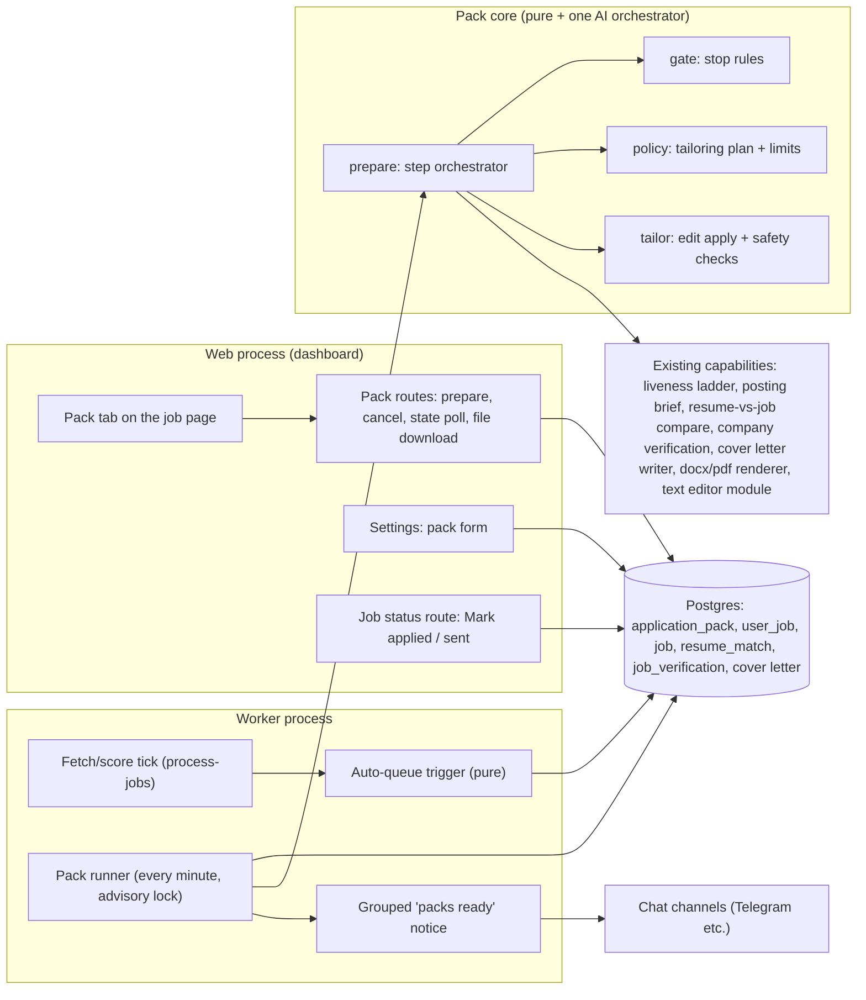

Key architectural facts:
- The web process **never prepares** a pack; it only inserts/updates a queue row. The worker's runner picks rows up within a minute, so manual and automatic packs run through identical code.
- One row per (person, posting) in the pack table is simultaneously the queue entry, the progress record and the result (including the generated file bytes).
- The tailoring "editor" is a shared plain-JS module also used by the browser Tailor page ("Apply all" / "Undo"); the server imports the very same module so unattended edits equal what a person pressing the button would get.

### 2.2 Application tracking - components

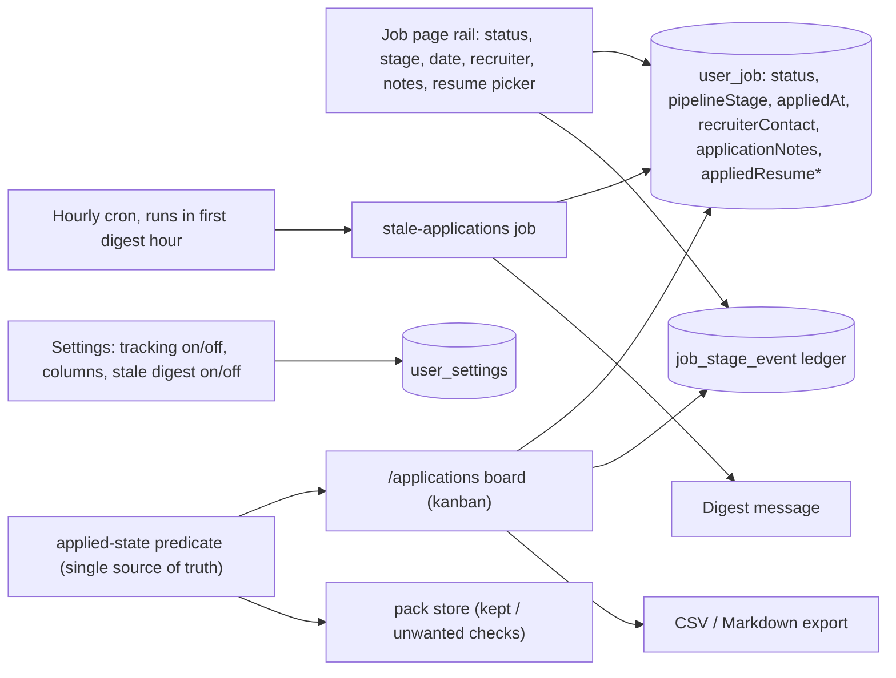

### 2.3 Employer-mode screening - components

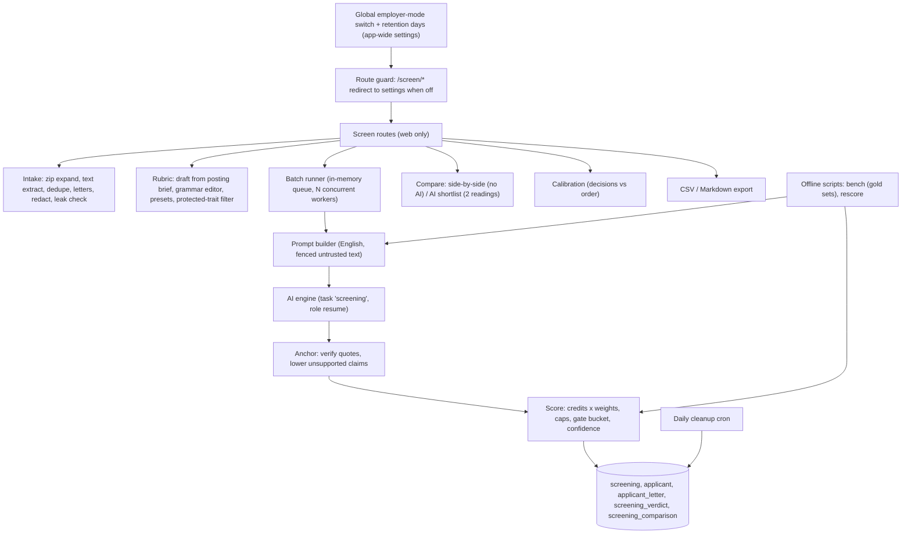

Isolation facts: the worker never imports the screening batch (it is web-only); screening tables share nothing with the job-seeker resume tables; the model only ever sees `redactedText`.

---

## 3. Key flows

### 3.1 Auto-queueing a pack (at the moment a posting is stored)

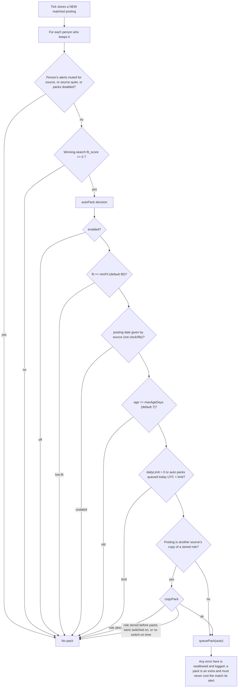

### 3.2 Runner: taking and preparing one pack

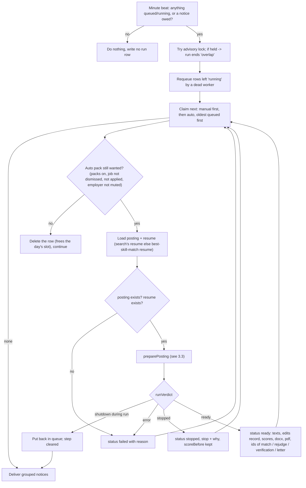

### 3.3 Preparation steps (cheapest first; each can stop the pack)

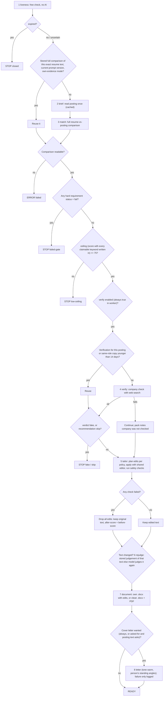

Between every step a cancel callback is checked (worker shutdown); a cancelled run reports "cancelled" and is requeued rather than judged.

### 3.4 Marking a pack file as sent (sequence)

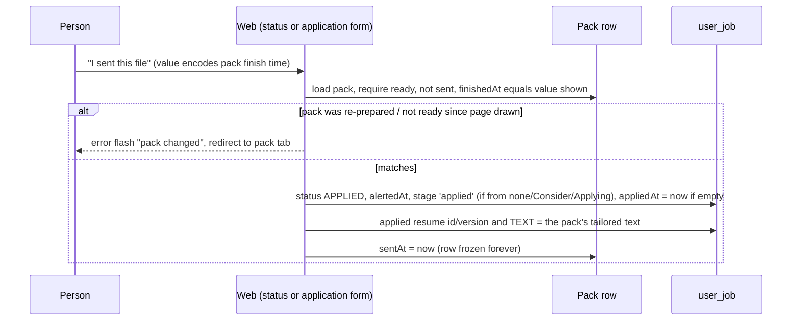

### 3.5 Employer-mode: creating a screening and ingesting applicants

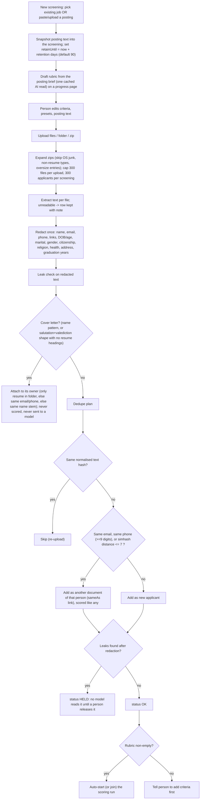

### 3.6 Scoring one applicant

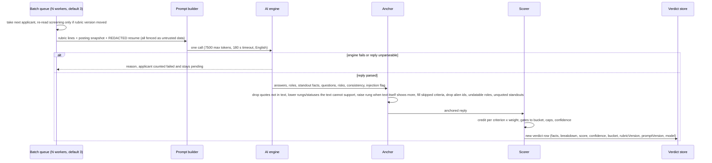

### 3.7 Shortlist comparison with AI

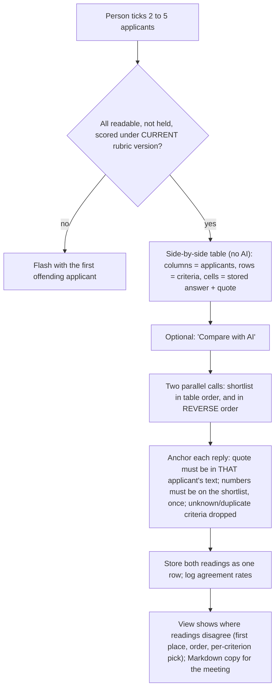

---

## 4. State machines

### 4.1 Application pack row

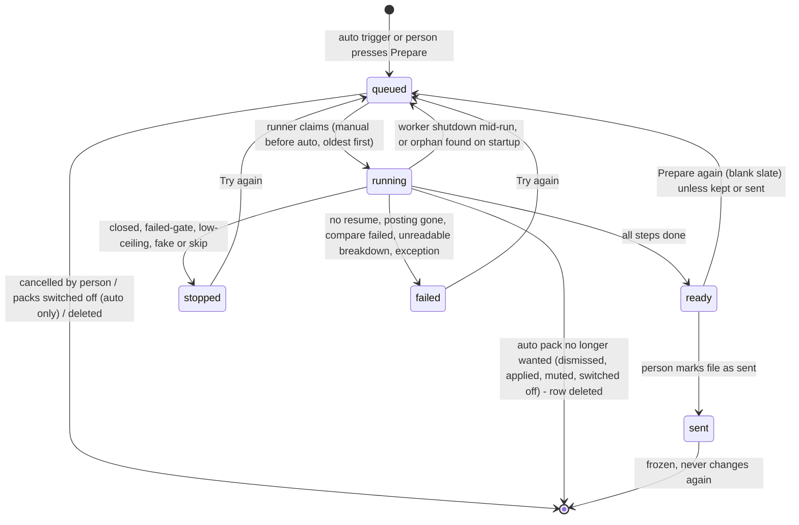
Notes: "kept" = ready pack whose job the person applied to by any route; Prepare again is refused so the file that may have gone out is not deleted. A pack restarted by the person becomes a **manual** pack (takes no daily slot, no announcement, not auto-cancelled).

### 4.2 Application / posting for one person

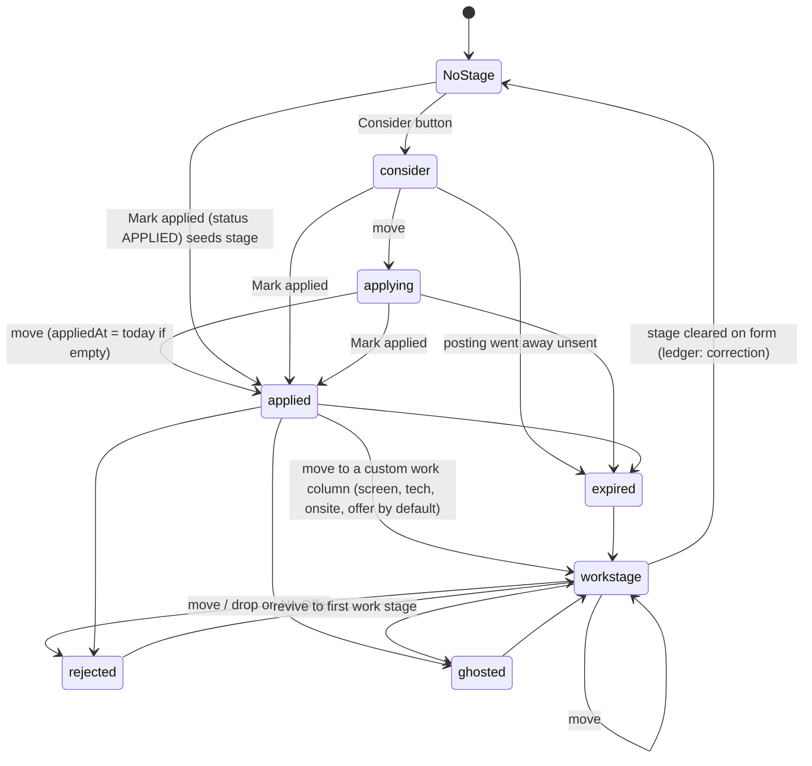
"Has applied" is true if inbox status is APPLIED, OR an applied date exists, OR the stage is anything other than Consider / Applying / Expired. Mark applied only moves the stage when it is empty, Consider or Applying; a later stage stays.

### 4.3 Screening applicant

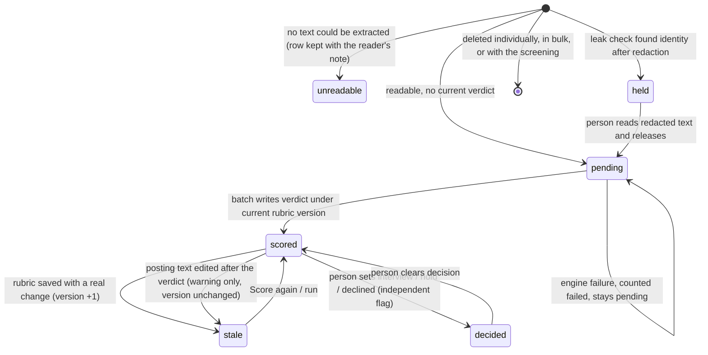

### 4.4 Screening

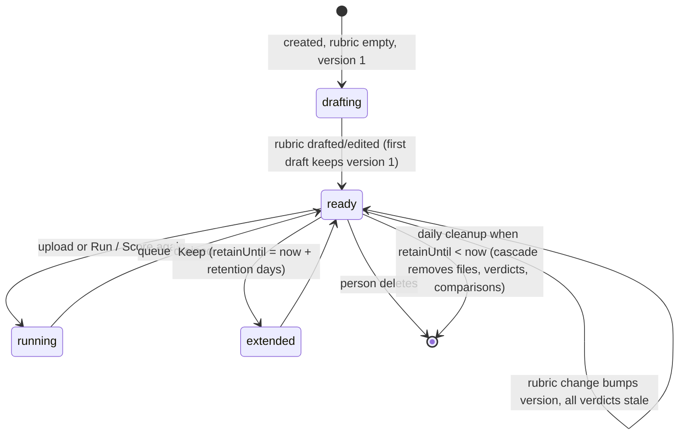

---

## 5. Feature list

### 5.A Application packs

| ID | Feature | What it does | Trigger | Key config/settings |
|---|---|---|---|---|
| PKS-01 | Pack settings (per person) | One form stores: master switch (default OFF), min classifier fit, daily limit, max posting age, cover-letter mode, tailoring policy. Unreadable/missing stored value = feature off with defaults. The form refuses out-of-range values (names the field) instead of silently replacing them. Stamps `enabledAt` when switched on (kept while on, cleared when off). | User saves form | `enabled=false`; `minFit` 50-100 default 90; `dailyLimit` 0-50 (0 = no limit) default 5; `maxAgeDays` 1-60 default 7; `coverLetter` never/asked/always default never |
| PKS-02 | Tailoring policy settings | What an unattended edit may touch: sections (subset of title, summary, skills, experience; never education/layout), max experience bullets rewritten, allow removals, allow keyword additions | User saves form | `sections` default all four; `maxBullets` 0-6 default 2; `removals` default false; `keywords` default true (also requires `skills` section) |
| PKS-03 | Auto-queue on new posting | When the tick has just stored a new matched posting, queue an auto pack per person who keeps it, subject to PKS-04..06. Only evaluated for postings stored this tick (never walks backlog; re-classify queues nothing). Source with alerts off / quiet source: never. Failure to queue is swallowed. | Event: posting stored | Settings PKS-01 |
| PKS-04 | Auto gate: fit, date, age, daily limit | Decision values: queue / off / low-fit / undated / old / limit. Undated (date supplied by clock or file) is refused so imports and new boards cannot flood. Daily limit counts auto packs queued since UTC midnight; a pack that failed before comparing anything (no match id) does not count. | Event | `minFit`, `maxAgeDays`, `dailyLimit` |
| PKS-05 | Cross-listing dedupe | One role is prepared once across sources: a copy of a stored role gets no auto pack if any sibling already has one, or if the role was stored before packs were switched on (or switch-on time unknown). Sibling set follows the cross-listing link up to 5 hops and sideways. | Event | `enabledAt` |
| PKS-06 | Manual "Prepare pack" | Person queues a pack for any posting regardless of fit/age/limit. Outcomes: queued, already waiting, busy (running), sent (refused), kept (refused). Manual packs run before auto ones. | User (job page pack tab) | none |
| PKS-07 | Prepare again / Try again | Resets the row to blank (all previous outputs cleared) and re-queues, as a manual pack; confirm dialog. Refused when sent, running, queued, or kept. | User | none |
| PKS-08 | Cancel queued pack | Deletes a still-queued row (nothing spent). Fails politely if the runner already took it. | User | none |
| PKS-09 | Switch-off cancels waiting auto packs | Turning packs off deletes the person's queued auto rows and tells them how many. | User saves form | PKS-01 |
| PKS-10 | Queue runner | Every minute (no run record written when nothing is queued and no message owed). Takes a cross-process advisory lock; re-queues orphan "running" rows; claims manual-then-auto, oldest first; processes serially; finishes by delivering notices. Records a `pack` run with counters ready/stopped/failed/requeued/dropped/notified. | Schedule (every minute) / script | lock key constant; one runner at a time |
| PKS-11 | Re-check before running auto pack | Immediately before preparing an auto pack: delete it if packs are now off, the person dismissed the job, applied by any route, or muted the employer. Settings are re-read per pack. | Runner | PKS-01; mute list |
| PKS-12 | Resume choice | Resume = the one used by the person's best-scoring search for this posting; else their primary search's resume; else the resume whose skills best match posting text. No resume = pack fails with a message. | Runner | search -> resume link |
| PKS-13 | Step: liveness | Free "is it still open" ladder first. Only a definitively expired posting stops the pack (STOP closed). Uncertain continues. | Runner | none |
| PKS-14 | Step: brief + compare (with reuse) | Reads the posting once into a cached brief, then runs a full resume-vs-posting comparison. A stored comparison of the identical resume text, same prompt version, full mode, own-evidence mode is reused (no AI). Missing/unreadable breakdown = failed. | Runner | prompt version constant |
| PKS-15 | Feasibility gate: hard requirements | Any hard requirement the posting gates on with status `fail` stops the pack (STOP failed-gate; reason = requirement + note). | Runner | none |
| PKS-16 | Feasibility gate: ceiling floor | Score ceiling = score if every keyword the resume can truthfully claim were written in. Below 75 -> STOP low-ceiling; message distinguishes "core keywords missing (n of m present)" from generic. | Runner | `DEFAULT_MIN_CEILING = 75` (constant, not user-editable) |
| PKS-17 | Step: company verification | Web-search verification of the employer/posting. Reuse a verification for this posting or any same-role same-employer copy younger than 14 days. A failed check does not stop the pack; the ready pack records "company was not checked: reason". `fake` verdict or `skip` recommendation -> STOP fake/skip. | Runner | 14-day freshness |
| PKS-18 | Tailoring plan | Converts the comparison's stored suggestions (rewrite/add cards, removals, missing keywords) into editor operations under policy. Holds back (with reason, listed for the person) any suggestion that: has no pasteable wording or is an instruction to the writer (`no-wording`); carries a "check first" note (`check-first`); would lose a number the original line had (`drops-figure`); is in a disallowed section (`section`); exceeds bullet cap (`over-limit`, ranked by priority high>medium>low, ties by report order); is a removal while removals off (`removals-off`). Duplicate target = first wins. Keywords added only when status is add, requirement is not context, is not the posting's title, and is a named skill (not a methodology/domain phrase). | Runner | PKS-02 |
| PKS-19 | Edit application | Applies plan with the same editor the Tailor page uses: cards first, then keywords onto the resulting text. Operations the text cannot take are recorded by error code (not-found, protected contact line, no-replacement). | Runner | none |
| PKS-20 | Safety checks on edits | Edits are discarded wholesale (resume stays as it was) if any check fails: `unexplained-change` (undoing every recorded change in reverse must reproduce the original exactly), `beyond-quote` (a change removed words not in its quoted span; additions removed nothing), `contact-changed` (email/phone in removed text), `score-dropped` (live score after < before). | Runner | none |
| PKS-21 | Local re-scoring | Before/after score computed with no AI from the keyword statuses on the original vs edited text, keeping the model's alignment grades and penalty fixed. This is a floor for what a new analysis would say. | Runner | none |
| PKS-22 | Re-judge tailored text | If text changed, store/reuse a model judgement of the tailored text ("draft" mode) so the Tailor page opens on it and the after-score is a real judged score (else the local floor). | Runner | none |
| PKS-23 | Document generation | Person's original .docx with edits written in (`own`; no PDF - they print their own file), else a clean re-typeset resume in .docx plus a PDF (`clean`). Bytes stored in the row so "what did I send" has one answer later. File name derived from resume name. | Runner | resume style/layout knobs |
| PKS-24 | Optional cover letter | Written after the resume when mode is `always`, or `asked` and the posting text matches cover/motivation-letter wording. Tone warm, person's standing angles. Failure is logged and the pack still completes. | Runner | `coverLetter` |
| PKS-25 | Result recording | Ready pack stores: resume id/name, ids of comparison / tailored comparison / verification / letter, base text, final text, edits record `{applied, unplaced[], held[], checks[]}` (applied=0 when checks failed), scoreBefore (comparison), scoreAfter (judged else floor), document kind, file name, optional "why" note. Stopped stores stop code + reason. Failed stores reason. | Runner | none |
| PKS-26 | Graceful shutdown | Worker stop flag: no new pack starts; the in-flight one is requeued (shutdown-cut results are never reported as a verdict about the posting). | Process signal | none |
| PKS-27 | Pack tab on job page | States: none (explains feature, whether automatic is on, link to same-role sibling's pack, Prepare button and cost hint), queued/running (live step line, Cancel while queued, auto-refresh), failed, stopped (reason heading + why), ready (score badge before->after, company verdict + recommendation badges, "prepared from <resume>", downloads, open posting, "go on in Tailor", see comparison, read letter, what changed as line diff, edits that could not be placed, "left for you" list with reasons, "stands between you and a better match" = keywords to confirm / unbacked, company summary card). | User | none |
| PKS-28 | Progress polling endpoint | Returns busy flag, localized progress sentence, and a message for "finished while you have unsaved edits". | UI poll | none |
| PKS-29 | File download | Serves the stored docx/pdf bytes unchanged, no-store, same bytes every time. | User | none |
| PKS-30 | Mark pack file as sent | Via status route or application form: records APPLIED with resume snapshot = pack text and freezes the pack. Only if pack is still the one shown (same finish time). | User | none |
| PKS-31 | Grouped "packs ready" message | One message per person for all their *auto* packs finished since last message (ready first, then stopped with reason, then failed), max 8 names per group then "+N more"; line shows "match 76 -> 100 . company legit, apply". Respects the person's alert schedule hold and Alerts-off; 15-minute retry back-off after a message every chat refused; with no chat the packs are marked told. Written in the person's language. | Runner after queue | alert schedule, alerts toggle |
| PKS-32 | "Ready to send" list | Overview card: ready, unsent packs whose job is still undecided for the person (NEW/ALERTED/SAVED) and not found closed since; count + newest few. | User (overview) | none |
| PKS-33 | pack-once script | Runs the runner now, recorded as a `pack` run. | CLI | none |
| PKS-34 | pack-dry measurement script | For already-stored postings (fit >= threshold) runs the same preparation without writing pack rows, with concurrency (default 2), `--min-fit`, `--limit`, `--only`, `--no-verify`, `--rejudge`, `--out`; resumable `records.json`; Markdown report of where postings stop, per-step seconds, and exported edits/docx per finished posting. Spends AI, writes brief/comparison/verification rows; run on a copy. | CLI | defaults 90, concurrency 2 |
| PKS-35 | Dry report (pure) | Aggregates dry-run records into stop distribution and step cost tables, to set thresholds on measurements. | Script | none |

### 5.B Application tracking

| ID | Feature | What it does | Trigger | Key config/settings |
|---|---|---|---|---|
| PKS-40 | Tracking on/off | Per-person switch. Off: board shows an explanation; stage, consider and application-form routes redirect; no ledger. Mark applied still updates inbox status. | User | `applicationTrackingEnabled` |
| PKS-41 | Applications board | Kanban of every posting the person holds a stage for: fixed Consider, Applying, Applied, then custom work columns, then one grouped "No Offer" column (cards keep Rejected/Ghosted/Expired as a badge). Cards show title, employer, fit score, recruiter contact, a time-in-stage line. Orphaned stage keys land in an "Unfiled" column. Sorted newest application first (undated first). Mobile stage jump links; collapsible No Offer column. | User | none |
| PKS-42 | Drag/drop and quick-move | Dragging (or a per-card Move select, preselected to the next stage) posts a stage change; drop on No Offer = Rejected. Writes stage + ledger event in one transaction, sets appliedAt = now only when arriving at Applied with no date. | User | none |
| PKS-43 | Custom work columns | Person edits the middle columns: add (slugged key, dedupe by label, max 10), rename (label only; key immutable so history stays readable), reorder, remove (route guards against removing columns that hold jobs; last column cannot be removed). Reserved keys cannot be used. Invalid stored config falls back to defaults. | User (settings) | `pipelineStages`; defaults screen, tech, onsite, offer |
| PKS-44 | Consider | One click adds a posting to the first column without touching inbox status or apply date. | User | tracking on |
| PKS-45 | Mark applied | Sets status APPLIED (and alertedAt). With tracking on: seeds stage `applied` only from no stage / Consider / Applying, sets appliedAt if empty, writes ledger, records resume. | User | tracking on |
| PKS-46 | Application form | On the job page: stage, applied date (backdatable), recruiter contact (<=300), notes (<=10 000), applied-resume picker. A stage change lands on a configured key (keeping a legacy key is allowed); reaching Applied dates the application if blank; blanks become null. | User | tracking on |
| PKS-47 | Applied-resume snapshot | Records resume id, version and full text at the moment of applying (resume rows are edited in place, so id alone is not enough). Picker choices: keep (field absent), clear (empty), a resume, or "the pack's file". Deleted resume still shows as "<deleted resume> vN". Prompt to record one when applied with none recorded (`needsAppliedResume`). | User | none |
| PKS-48 | Stage ledger | Append-only event per change: from, to, event day (date, not instant), recordedAt, source ui/backfill/correction. A move into Applied uses the (backdatable) applied date; clearing a stage is toStage=null/correction; an applied-date edit with no stage change writes a correction. No event when nothing changed. | Every stage write | none |
| PKS-49 | Time-in-stage / stalled marker | Card line from the latest non-backfill event into the current stage, else "applied N days ago" from appliedAt; Consider/Applying never fall back to an apply date. A non-terminal stage idle more than 14 days with a known entry day reads "stalled". Terminal stages never stall. | Page render | 14 days |
| PKS-50 | Applied-state predicate | Single definition of "has the person applied": status APPLIED or appliedAt set or stage outside {consider, applying, expired}. Used by board, pack "kept"/"unwanted" logic and resume prompt. | Everywhere | none |
| PKS-51 | Board export | CSV (BOM, formula-safe) and Markdown of the board in column order; dates are days in the dashboard time zone; always English headers; columns: Stage, Company, Source, Title, Applied on, In this stage since, Fit, Applied with, Recruiter contact, Notes, Posting. Markdown escapes inline syntax, groups by column, omits empty columns. Company and "via source" separated so an aggregator is not exported as the employer. | User | none |
| PKS-52 | Stale-applications digest | Daily (hourly cron, runs in the person's first digest hour): applications in stage `applied`, applied more than 14 days ago, no recruiter contact. One message per person, oldest first, "title @ company - applied N days ago with <resume> vN". Needs tracking on and the digest toggle on. | Schedule | `staleApplicationsDigestEnabled`; 14 days |
| PKS-53 | stale-once script | Send the digest now. | CLI | none |

### 5.C Employer-mode screening

| ID | Feature | What it does | Trigger | Key config/settings |
|---|---|---|---|---|
| PKS-60 | Employer-mode switch | One global (install-wide) switch. Off: the `/screen` section does not exist (every route redirects to the settings tab with a message) and the "screening" AI task is hidden. On: nav item (administrators only) appears. Cached in the web process. | User (settings) | `employerMode` |
| PKS-61 | Legal and applicant notice | Settings tab shows a legal note (high-risk classification of CV filtering, automated-decision rule, notice duties, regional audit laws; tool ranks and quotes, a person decides, use a processor with a data agreement or a local model) and a copy-ready applicant notice with contact placeholder and the live retention days. | User | retention days |
| PKS-62 | Retention setting and cleanup | Screening kept N days (min 7, max 365, default 90; clamped). `retainUntil` set at creation; "Keep" resets it to now + N. Daily cleanup deletes expired screenings and cascades applicants, files, letters, verdicts, comparisons. | User / schedule | `screeningRetentionDays` |
| PKS-63 | Engine warning | Detail and compare pages show which engine serves the screening task and warn when it is a personal-subscription CLI rather than keyed API/local model; warns when none can serve. | Page | AI engine config |
| PKS-64 | Create screening | Pick an existing (non-dismissed) job of the person (200 most recent; pasted postings first) or paste/upload a new posting (title required; text >= 200 chars, <= 60 000; file text extracted). Posting text is snapshotted into the screening (never written back). Title defaults "<job> - <date>". Then drafts the rubric. | User | min 200 / max 60 000 chars |
| PKS-65 | Rubric draft from posting | From the cached posting brief: gates (each classified by wording into years/authorization/language/education/certification/location/availability else custom), must keywords as weight-3 scored skills (core flag from "primary"), preferred/nice as weight 1, either/or groups merged, years row, level row (seniority folded to junior/mid/senior/lead), industry row, plus always an `impact` and an `overall` row. Posting title fragments and the sector are not skills. Own rows (`source: you`) and removed-row memory survive a redraft. First draft keeps version 1. | User / on create | brief |
| PKS-66 | Rubric model and editor | 15 criterion kinds (skill, years, level, industry, companyType, language, location, authorization, availability, education, certification, scale, impact, overall, custom); mode gate / scored / note; weight 1-5 (default 3). Max 40 criteria, 20 custom, text 200 chars, term 60, up to 8 aliases per term, 12 terms. One text field per row parsed by a small grammar (skill: `A / B within 36 months !`; years: `5+ years: area`, `0-2`; level: `senior or above`; industry: `fintech, banking: 3 years`; location: `Kyiv or remote`; education: `Bachelor: CS`; etc.). Unreadable text is refused with the grammar hint. | User | limits left |
| PKS-67 | Rubric versioning | Saving a materially different rubric (compared on kind, label, mode, weight if scored, score-relevant spec) bumps `rubricVersion`; every verdict then reads stale. Equal rubric = "unchanged". v1 rubrics convert on read; unreadable = empty. | User | none |
| PKS-68 | Protected-trait refusal | Free-text kinds (custom, scale) naming age/gender/family/origin/health words (English, Ukrainian, Russian patterns) are refused at save, with the lawful alternative. | User | none |
| PKS-69 | Rubric presets | Standard (as drafted), Junior (years gate 0-2, level junior or below, skills need >= project evidence, impact weight 1), Senior (years >= 5, level senior or above, impact 3, adds scale row), Regulated (education/certification become gates, adds if missing), Agency (company type agency/consultancy weight 4, industry weight 4). Applied on top of a fresh posting read. | User | none |
| PKS-70 | Posting editing | Edit the screening's posting snapshot (200-60 000 chars); stamps `postingUpdatedAt`; verdicts older than that are flagged with a "posting changed, score everyone again" prompt (no version bump). | User | none |
| PKS-71 | Bulk intake | Multi-file or whole-folder (and .zip) upload. Accepts pdf, docx, md, txt; ignores OS junk (`__MACOSX`, dotfiles, `~$`, Thumbs.db) and non-resume types (reported); zip entries over 5 MB skipped, archives over 2 000 entries truncated, corrupt archives reported. Caps: 300 files per upload, 300 applicants per screening, 200 MB per request. Folder path kept in the displayed file name. | User | constants |
| PKS-72 | Blind redaction | Before storage of the model-facing text: removes name (header detection; every form of it incl. reversed and surname-only), email, phone (9-15 digit runs), links (URLs and common profile domains), date of birth, age, marital/children, gender, citizenship/nationality, street address and unit, religion, health/disability fields (multilingual: EN/UK/RU/DE/PL), and blanks graduation years on education lines/degree lines. The model sees only "Applicant N" + text. City kept. Header fields are removed as segments so "Kyiv . born 1990 . married" keeps "Kyiv". An audit list of what was removed (kind, count) is stored and shown. Not switchable. | Upload | none |
| PKS-73 | Leak check and hold | After redaction, search for residual email, link, phone digits, name parts (>=3 letters). Any leak -> applicant `held` (note lists kinds only, never the text); nothing reads it until a person releases it. | Upload / viewing | none |
| PKS-74 | Release held applicant | Person reads the redacted text and releases it; only a held row moves; scoring starts if the rubric is non-empty. | User | none |
| PKS-75 | Duplicate handling | Same normalised text (NFKC, lowercase, alphanumerics) -> not added again; same email, same phone (>=9 digits) or near-identical text (simhash Hamming <= 7) -> added as another document of that person, linked and labelled, scored independently. Unreadable files are keyed by byte hash. Concurrent uploads serialized by a row lock; unique (screening, text hash). | Upload | threshold 7 |
| PKS-76 | Cover-letter attachment | Files recognised as letters (name in several languages, or salutation + valediction with no >= 2 resume headings and <= 6 000 chars) attach to their applicant (sole resume in folder; else matching email/phone incl. stored applicants; else same file-name stem), are kept for a person to read, never scored, never sent to a model. A letter-by-text file with no owner is added as a resume instead. | Upload | none |
| PKS-77 | Applicant numbering | Sequential per-screening number (the only identity the model gets), allocated inside the intake transaction. | Upload | none |
| PKS-78 | Scoring run (batch) | In-memory queue per screening, N concurrent workers; DB is the source of truth so a restart resumes from "no verdict under current rubric". A press during a run joins it; "Score again" re-queues chosen/all readable applicants regardless of existing verdict. Re-reads the screening only if its rubric version moved; refills the queue when drained. State (queued, in-flight, finished numbers, done/failed, last error) polled by the page and discarded 1 hour after finishing. Never throws: failures counted with reason and left pending. Auto-starts after upload/release. | User / upload | `AI_CONCURRENCY` 1-8 default 3 |
| PKS-79 | Per-applicant model call | One call: rubric (as fenced data lines "[id] kind: what | mode | answer as"), posting snapshot (<= 15 000 chars), redacted resume (<= 30 000 chars). Reply: summary (who/did/verdict), roles with dates and sector/company type, one answer per criterion in the shape its kind needs, up to 3 standout facts, questions (3-5), risks, consistency notes, injection flag. System text declares resume and criteria untrusted. | Run | prompt version 5; 7 500 tokens; 180 s |
| PKS-80 | Evidence anchoring | Every quote must exist in the redacted text or it is dropped. Rung above "listed" needs a located quote; a term the text never spells is `absent` whatever the model said; a term in a work sentence is at least `role`; a quote that is a list of terms supports at most `listed` (or `role` on a "Technology Stack:" line); a quote not containing the term does not support above the text's own line; status claims without a quote become `unknown`; impact `strong` without quote -> `ok`; skipped criteria are filled from the text alone; answers for unknown ids dropped; roles whose position/dates/employer are not in text dropped; standout facts without quote dropped. | Run | none |
| PKS-81 | Scoring | Per scored criterion credit x weight, normalised over criteria the text could answer (unknown leaves the denominator). Credits: rungs absent 0 / listed .3 / project .5 / role .8 / production 1; status pass 1 / partial .5 / fail 0; impact strong 1 / ok .5 / weak 0; overall exceptional 1 / strong .75 / partial .5 / weak .25 / none 0; level by distance and tolerance; years = 0.7 x share of band + 0.3 x recency (<=12 mo 1, <=36 .7, <=60 .4, else .2), 0 if above max+0.5; industry = years in matching sector / required years; company type = share of dated years; stale skill (last used beyond window) earns half. | Run | constants (see 6) |
| PKS-82 | Caps | Score = min(raw, strictest cap): no core-stack skill evidenced anywhere -> 30; level two or more rungs under -> 50 (not for "at most"); impact weak with relevant dated roles -> 60. Reason shown. | Run | caps 30/50/60 |
| PKS-83 | Gates and buckets | Gates never carry points. Bucket: `fail` if any gate failed, else `ask` if any unknown, else `pass`. Skill gate needs rung >= minRung. | Run | none |
| PKS-84 | Confidence | answered/total counted criteria (notes excluded; gate answered = pass or fail), x 0.6 if text < 900 chars; band high >= .75, medium >= .45, else low. Short resume = unread, not weak. | Run | thresholds |
| PKS-85 | Table order | Bucket (pass, ask, fail), then adjusted score desc, then confidence band, then applicant number. Groups: scored, pending/stale, held, unreadable. | Page / export | none |
| PKS-86 | Score adjustment | Person adds -30..+30 points with mandatory reason (<= 200 chars); shown beside the computed score and used for ordering; clamp to 0-100; never folded into the stored breakdown. | User | `MAX_ADJUSTMENT = 30` |
| PKS-87 | Decisions | interview / hold / declined (or cleared), per applicant or bulk; the only write the tool never makes itself; logged. | User | none |
| PKS-88 | Bulk actions | On ticked rows: set decision, clear, score again, compare, delete. | User | none |
| PKS-89 | Applicant scorecard | Redaction audit, scored rows with answer badge, detail and quote per criterion, cap explanation, summary, roles/career line, standout facts, questions to ask, risks, consistency (incl. injection warning), letters, original and redacted text, original file download, model/prompt version, stale/held/unreadable notices. | User | none |
| PKS-90 | Career trajectory | Pure facts from dated roles: roles, employers, total and relevant years (overlaps merged), average stay, in-role-now, sectors (normalised through a ~30-group vocabulary, most recent first), company types. Display only; never scored (a gap is never a criterion). | Render | none |
| PKS-91 | Date parsing | Parses resume date strings in EN/UK/RU/DE/PL month names, numeric forms, bare years (Jan for start, Dec for end), "present" words. | Scoring | min year 1960 |
| PKS-92 | Sector vocabulary | Normalises free-text sectors to group labels by whole-word membership (plural-insensitive) so industry matching and the career line are stable across runs. | Scoring | table |
| PKS-93 | Side-by-side compare | Pick 2-5 scored applicants -> columns x criteria with stored answers/quotes; no AI. | User | 2..5 |
| PKS-94 | AI shortlist comparison | Two parallel calls with applicants in table order and in reverse; per criterion ranking + why + quotes, overall order with reasons, one "decider" question. Anchored per applicant. Stored with rubric/prompt versions and model. View flags disagreements; Markdown copy; never produces a score. | User | prompt v1; 6 000 tokens; 240 s; 2-5 applicants; 12 000 chars per resume |
| PKS-95 | Calibration | Needs >= 3 decisions with at least one interview and one declined. Reports pairwise agreement (decided differently -> does table order agree; also how many pairs the person's adjustments fixed), top-k hit rate (k = number of interview picks), surprises (interview picks outside top k, declined inside, with the criteria behind the placing), and per-criterion separation (mean credit interviewed minus declined). Read-only: never edits the rubric. | Page / export | `MIN_DECISIONS = 3` |
| PKS-96 | Export | CSV (BOM, formula-safe; one row per applicant incl. gate columns, adjustment, career, standout, questions, notes) and Markdown (one section per bucket, "Not screened" list, calibration section when enough). English regardless of UI language. File name slug of the screening title. | User | none |
| PKS-97 | Original and letter file download | Serve stored bytes; letters only through their applicant. | User | none |
| PKS-98 | Delete | Delete an applicant, a batch of applicants, or a whole screening (cascade). | User | none |
| PKS-99 | Rescore script | Re-anchors and re-scores stored replies with current rules with no AI call; prints old -> new; writes only with `--write`; `--screening <id>` to scope. | CLI | none |
| PKS-100 | Screening bench | Offline harness over "gold sets" (posting, rubric, ranking, resumes, optional expected gates): runs redact -> prompt -> anchor -> score without writing the DB; reports Kendall tau vs the human order, precision@5, run-to-run stability (mean/max score delta), redaction leaks, tailoring-pair deltas, gate confusion matrix, and with `--compare` the agreement of two shortlist readings. Spends AI; never CI. | CLI | `--set`, `--runs`, `--out`, `--compare` |

---

## 6. Business rules and invariants worth preserving

**Packs**
- Defaults are conservative: packs are OFF; minFit 90; max age 7 days; daily limit 5 (counted in UTC days, auto packs only); policy edits 2 bullets, no removals, keywords yes, sections title/summary/skills/experience.
- Ceiling floor for any pack: 75 (code constant). Step order is fixed and cheapest-first: liveness, brief, match, verify, tailor, rejudge, document, letter. A stop is also what was not paid for.
- Stop reasons: closed, failed-gate, low-ceiling, fake, skip. Run verdicts: requeue (shutdown) > failed (error) > stopped > ready (needs both tailored resume and comparison, else failed).
- One pack per (person, posting) (unique key). A "sent" pack never changes again. A pack for a job the person applied to by any route is "kept": cannot be restarted.
- Manual beats auto in the claim order; oldest first within each; claim is a compare-and-set (`queued -> running`).
- Queue write protocol: create can race (unique violation = "waiting"); reset only updates rows in ready/stopped/failed and unsent.
- The unattended edit policy lives in code, not in a prompt. Edits never invent or lose figures (numbers/currency/percent/k-m-b suffix); contact lines are never touched; any failed safety check discards all edits.
- Comparison reuse: same user, job, resume, exact text, within posting-refresh time, full mode, current prompt version, own-evidence mode. Verification reuse: 14 days, includes same-role same-employer copies (an agency copy under another name is a different company and is re-checked).
- Cover-letter detection regex: `cover letter`, `motivation(al) letter`, `letter of interest/motivation`.
- Notices: only for auto packs, grouped per person; max 8 listed per group; failures remain owed and retry after 15 min; never notify when Alerts are off (leave unnotified).
- Daily-limit slot refunds: a deleted unwanted pack, or a pack that failed with no match id.
- Ready-to-send list excludes packs whose job is dismissed/applied or found closed (liveness NULL is not expired).

**Tracking**
- Stage keys: fixed `consider`, `applying`, `applied`; end states `rejected`, `ghosted`, `expired` (grouped visually as No Offer); work columns user-defined, key regex `[a-z0-9-]`, <= 40 chars, label <= 40, max 10, keys immutable on rename; `unfiled` and `no-offer` reserved.
- Stale: 14 days for both the board marker and the digest; digest additionally requires no recruiter contact and stage `applied`.
- The apply date belongs to Applied only; a move never clears or replaces one the person set; a date is kept when a card moves back.
- Ledger stores days (date), not instants; backfill rows never date a stage.
- Board quick-move writes only stage (+ date on arrival at Applied); only the full form edits date/contact/notes.
- Applied-resume snapshot keeps full text; absence of the picker field means "keep what is stored", empty means "clear".

**Screening**
- Caps: 300 applicants/screening, 300 files/upload, 200 MB/request, 5 MB per zip entry, 2 000 zip entries; posting 200-60 000 chars; criteria <= 40 (custom <= 20); weight 1-5.
- Model input is only redacted text; names/contacts live in separate columns shown to the person only. The prompt is always English (built under an English locale); exports are English.
- Rubric changes bump version only if the yardstick really changed; a version bump makes every older verdict stale and unusable for comparison.
- Scoring constants: rung credits 0/.3/.5/.8/1; status 1/.5/0; impact 1/.5/0; overall 1/.75/.5/.25/0; years share .7 + recency .3 (recency tiers 12/36/60 months -> 1/.7/.4, floor .2); stale skill factor .5; caps 30/50/60; thin text < 900 chars factor .6; confidence bands .75/.45.
- Level tolerance credits: exact (1/.5/0), one (<=1 off 1; 2 off .25), atLeast (1 / .5 one below / 0), atMost mirror.
- Unknown is neither plus nor minus (leaves denominator). Gaps and tenure are facts shown, never criteria.
- Quote anchoring uses normalised substring or fuzzy locate; comparisons anchor per applicant.
- Dedup identity: exact text hash (32 hex of sha256), email (case-insens), phone digits >= 9, simhash distance <= 7.
- Adjustment is clamped to +-30 and requires a note; final adjusted score clamped 0-100.
- Compare shortlist needs 2-5 applicants, each scored under the current rubric; second reading uses reversed order to counter position bias.
- Prompt-injection handling: fenced untrusted blocks, `injection` flag surfaced, consistency note; criteria text is data, not instructions.
- Human decision writes are always logged with the acting context; the tool never sets a decision.
- Retention: 7-365 days (default 90); expiry deletes everything by cascade.
- Employer mode is install-wide; screening tables are not scoped per user; the nav entry is admin-only.

---

## 7. External dependencies and integration contracts

| Dependency | Contract |
|---|---|
| Relational DB (Postgres) | Tables: `application_pack` (unique userId+jobId; bytes columns docx/pdf; json edits; no FKs from pack to match/verification/letter/resume on purpose), `user_job` (unique userId+jobId; status enum NEW/ALERTED/SAVED/APPLIED/DISMISSED; pipelineStage; appliedAt; recruiterContact; applicationNotes; appliedResumeId/Version/Text), `job_stage_event`, `screening`, `applicant` (unique screeningId+number and screeningId+textHash; original bytes), `applicant_letter`, `screening_verdict`, `screening_comparison`. Row lock on screening for intake numbering. Advisory lock for the pack runner. |
| AI engine abstraction | JSON-returning completion with task label, role (`resume`), max tokens, timeout, error callback; provider chain per task (`screening` task exists only when employer mode on); billing class (keyed API / local vs personal-plan CLI) drives a warning. Replies validated with a schema; unparseable = failure with reason. |
| Posting brief, resume compare, company verification, liveness ladder, cover-letter writer | Called as black boxes by packs; each persists its own rows and is cached/reused as described. Compare output must expose: score breakdown (score, ceiling, primary present/total), hard requirements `{requirement,status,note}`, keywords with status add/ask_user/cannot_claim and requirement, actions (rewrite/add cards with quote/insert_after, priority, section), removals. |
| Text editor module (shared JS) | `applyAll(text, ops)`, `addKeywords(text, terms)`, `undoEdit(text, inverse)` returning per-operation done/failed with inverse edits `{start, removed, inserted}`. Server loads the same module the browser uses. |
| Document renderer | Produces .docx (editing the person's original or a clean layout) and PDF. |
| Resume text extractor | pdf, docx, md, txt -> text; typed error with reader's note for unreadable files; zip reader with entry size cap. |
| Keyword matcher | `findTerm(text, term, aliases)` spans and `locateQuote(text, quote)` fuzzy location, used for anchoring and local scoring. |
| Notification channel | Digest/notice delivery to a person's chats, chunked; honours Alerts toggle and schedule hold; returns reached/skipped. |
| Cron/worker | Per-minute pack beat (quiet when idle), hourly stale job gated by "first digest hour", daily cleanup. |
| Web job runner | In-process "run" pages with progress for rubric drafting and AI comparisons (claim-by-key to join duplicate presses). |
| Localization | All user-facing sentences come from a message catalog; stored data strings (breakdown answers/details, held notes) are English and reworded at render; exports force English. |
| Fingerprint utility | 64-bit simhash and Hamming distance for near-duplicate texts. |

---

## 8. Known oddities and accidental complexity (candid)

1. **Name collision "pack"**: the application-pack feature and the *starter packs* (curated company/board bundles offered by `pack-offers`) are unrelated; a rewrite should name them differently.
2. **`employer-store` is not about employer mode**: it is the company mute list / re-apply window for job seekers. Likewise "employer" in packs means "who hires" vs "who lists". Keep the concepts but rename to avoid confusion with the screening product.
3. **Two sources of "applied"**: status, appliedAt and stage all imply applied, with a predicate to reconcile them. A rewrite should have one explicit application state (stage + sentAt) and derive the inbox status.
4. **Stage keys as user data with fixed ends**: the mix of fixed entry/terminal stages, a virtual "No Offer" column, a virtual "Unfiled" column and reserved keys is much machinery. A simple ordered list with a flag per stage (terminal or not) would do.
5. **Pack row doubles as queue, progress, result and file store**, with a manual/auto flag that changes counting, announcing, cancelling and cleanup. A rewrite could split queue entry from result and make "who asked" a property of the request, not the row.
6. **Pack settings and policy live in one JSON column with lenient/strict twin parsers** (stored = fall back, form = refuse). Worth keeping the behaviour, not the dual code.
7. **Unattended tailoring is very defensive** (figure-loss check, undo-replay proof, quote-containment, contact guard, score floor). The undo-replay verification is clever but heavy; a rewrite can keep the invariants (no invented/lost figures, no contact edits, no score drop, edits confined to quoted spans) with a simpler diff-based check.
8. **Server imports browser JS** for edit application (path-resolved at runtime). In a rewrite make the editor a shared library with a real package boundary.
9. **Screening is web-process-only with an in-memory run map**; a restart loses run progress (state is recoverable from the DB, but the live view is not). Moving scoring to the worker queue like packs would remove the special case and the `claimRun` page glue.
10. **Employer mode is a global switch, stored in a cached module variable** in the web process (the worker never reads it); changes via SQL need a restart. Make it ordinary settings with a proper change event, or a separate deployable.
11. **Redaction is regex heavy** and multilingual; it carries many hand-tuned guards (street word + number, demonym only beside an identity field, faith only beside a birth/family field). Reasonable but brittle; the leak check + hold is the real safety net and should be kept as a first-class requirement. Names are detected only from the header.
12. **Rubric grammar**: one free-text field per criterion parsed by regexes, plus a spec that "word readings" the grammar cannot recover (the equality function special-cases them). A structured editor per kind would remove the round-trip invariants.
13. **Stored English strings re-worded by regex at render** (`detailWords`, `answerWords`, held-note matching). Store codes + parameters instead.
14. **Sectors vocabulary is a hard-coded ~30-group table** with whole-word matching tweaks; fine, but should be data.
15. **Comparison always makes two calls** (and logs agreement) to counter position bias; there is no path to a third reading. Keep the two-order idea; the per-criterion ranking plus reverse-order check could be one setting.
16. **Fixture bench ranking is a placeholder** written by the fixtures' author, not a recruiter; the tau numbers mean little until real human rankings exist.
17. **Duplicated "mark as sent" paths**: status route and application route both implement pack-choice parsing, resume snapshot and pack freeze; consolidate into one "record application" operation.
18. **Jobs reused as screening vacancies**: a screening requires a Job row (pasted postings create a MANUAL company job with classification off). A standalone Vacancy entity would be cleaner and avoid polluting the job-seeker inbox.
19. **Ceiling floor 75 is not user-configurable** while the other thresholds are; decide intentionally.
20. **Cover-letter ask detection is a regex on posting text**; acceptable but language-limited (English only).

---

## 9. Source map

| Area | Path(s) |
|---|---|
| Pack stop rules and step list | `src/pack/gate.ts` |
| Pack tailoring policy and edit planning | `src/pack/policy.ts` |
| Pack orchestrator (steps, reuse, documents, letter) | `src/pack/prepare.ts` |
| Edit application, local score, safety checks | `src/pack/tailor.ts` |
| Pack settings parse/form/switch-on, letter-ask regex | `src/pack/settings.ts` |
| Auto-queue decision, copy rules, unwanted rules, UTC day | `src/pack/trigger.ts` |
| Pack persistence, queue claims, ready list, notices query | `src/pack/store.ts` |
| Pack presentation text, notice lines | `src/pack/view.ts` |
| Dry-run report | `src/pack/dry-report.ts`, `src/scripts/pack-dry-once.ts` |
| Pack runner (worker job) and scheduling | `src/jobs/pack-job.ts`, `src/index.ts`, `src/scripts/pack-once.ts` |
| Auto-queue call site | `src/jobs/process-jobs.ts` |
| Pack notice chunking helper | `src/notify/pack.ts` |
| Pack routes (prepare, cancel, state, files) and view loader | `src/web/routes/pack.ts` |
| Pack tab UI | `src/web/pages/application-pack-card.tsx` |
| Pack settings save + cancel queued | `src/web/routes/settings.tsx` (`/settings/pack`) |
| Starter packs (unrelated, name collision) | `src/web/pack-offers.ts` |
| Applied predicate | `src/applied-state.ts` |
| Applied resume choice/snapshot rules | `src/web/applied-resume.ts`, `src/jobs/applied-with.ts` |
| Board routes, stage move, consider, application form, exports | `src/web/routes/applications.tsx`, `src/web/applications-export.ts` |
| Board UI | `src/web/pages/applications.tsx` |
| Stage config, ledger events, time-in-stage | `src/web/stage-config.ts`, `src/web/stage-events.ts`, `src/web/stage-time.ts` |
| Mark applied (status route) | `src/web/routes/jobs.tsx` (`/jobs/:id/status`) |
| Stale digest | `src/jobs/stale-applications-job.ts`, `src/jobs/stale-applications-format.ts`, `src/scripts/stale-once.ts` |
| Tracking/pack/stale settings storage | `src/settings.ts`, `prisma/schema.prisma` (UserJob, ApplicationPack, JobStageEvent, UserSettings) |
| Employer-mode guard and cache | `src/web/employer-mode.ts` |
| Employer-mode/retention settings routes | `src/web/routes/settings.tsx`, `src/settings.ts` |
| Notice and legal text | `src/screening/notice.ts` |
| Redaction and leak check | `src/screening/redact.ts` |
| Intake (zip, dedupe, cover letters) | `src/screening/intake.ts` |
| Rubric model, grammar, presets, protected filter | `src/screening/rubric.ts` |
| Prompts and reply schemas | `src/screening/prompts.ts` |
| Anchoring | `src/screening/anchor.ts` |
| Scoring and ordering | `src/screening/score.ts` |
| Batch runner | `src/screening/batch.ts` |
| Persistence | `src/screening/store.ts`, `prisma/schema.prisma` (Screening, Applicant, ApplicantLetter, ScreeningVerdict, ScreeningComparison) |
| Dates, sectors, trajectory | `src/screening/dates.ts`, `src/screening/sectors.ts`, `src/screening/trajectory.ts` |
| AI comparison | `src/screening/compare.ts`, `src/screening/comparison.ts` |
| Calibration | `src/screening/calibration.ts` |
| Export | `src/screening/export.ts` |
| Bench math and script | `src/screening/bench.ts`, `src/scripts/screen-bench-once.ts`, `src/screening/fixtures/gold/<set>/{posting.txt,rubric.json,ranking.txt,expected.json,resumes/}` |
| Rescore script | `src/scripts/rescore-screenings.ts` |
| Screening routes | `src/web/routes/screen.tsx` |
| Screening pages | `src/web/pages/screen-list.tsx`, `screen-new.tsx`, `screen-detail.tsx`, `screen-applicant.tsx`, `screen-compare.tsx` |
| Screening view-models | `src/web/screen-view.ts`, `src/web/screen-compare.ts` |
| Retention sweep | `src/jobs/cleanup-job.ts` |
| Mute list / re-apply window (not screening) | `src/jobs/employer-store.ts` |
