# 08 - Web App, Routes, Pages and UX Structure

Derived from source only (`src/web/**`, `src/users/admin-policy.ts`, `src/i18n/**`, `package.json`). Covers the HTTP surface, page inventory, UX conventions and how long-running work reports progress. The internals of resume, screening and pack pages are only named here.

---

## 1. Purpose and scope

The web app is a server-rendered operator console for a personal job-search pipeline. One process serves every page: HTML is rendered on the server (JSX components), and every mutation is a plain HTML form POST that answers with a 303 redirect plus a one-shot "flash" message. A small set of dependency-free browser modules adds progressive enhancement: toasts, polling, drag-and-drop, live editors. Without script the pages still work.

It exposes: an Overview dashboard, a filterable Jobs list and Job detail (tabbed), an Applications board, Resumes and tailoring, a Cover-letter launcher, Companies and sources (including watchlist, folder sources, starter packs), Discovery, Runs, AI usage, Settings (8 tabs), a first-run wizard, a Users page, and an optional "employer mode" screening section. Access is gated by an optional shared-password or OpenID Connect lock, and by a two-role (admin / member) policy.

Out of scope here: scoring, fetching, AI prompt logic, resume/screening/pack page internals. They appear in the sitemap only.

---

## 2. Architecture

### 2.1 Components

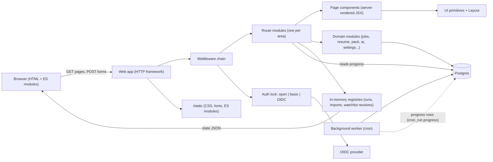

Key structural facts:

- One Hono-style app object (`app.ts`) is assembled with middleware, then 26 route modules are mounted at `/`. A separate `server.ts` only listens (so tests and the route smoke can call the app in-process).
- The worker (cron-like) is a separate process. The web process and worker share only the database. Progress of worker jobs reaches the UI through a `cron_run` row (`progress` JSON column); progress of web-started work lives in web-process memory.
- Per-request context (current user, locale, theme, display time zone, language-invite) is carried in async-local storage, not passed as arguments. Page components read it implicitly (`currentUser()`, `t()`, `currentTheme()`, `displayZone()`).
- All user-visible words come from a message catalog (`t(key, params)`); the browser modules receive the needed subset as an embedded JSON block.

### 2.2 Page composition

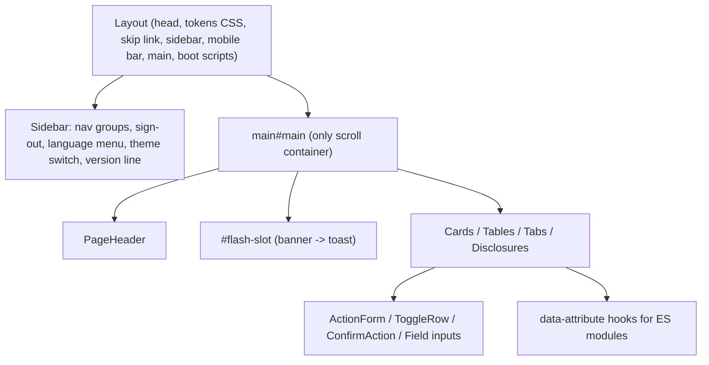

### 2.3 UI primitive inventory (`ui.tsx`, `layout.tsx`, `icons.tsx`)

| Group | Components |
|---|---|
| Scaffolding | `Layout` (props: title, active nav key, `refresh` seconds, `refreshWithoutScript`, `fill` app-frame mode), `PageHeader` (title, meta, actions, description), `Card`, `CardHeader` (title, info, action), `CardLink`, `SectionTitle` (card/section level), `Disclosure` (button or plain variant, count badge, `contents` mode), `More` ("How this works" fold), `Tabs` (link-based, `aria-current`), `Empty` (empty state with title + action) |
| Status / feedback | `Flash` (success/warn/err banner with optional Re-run / Tailor / Download actions), `Notice` (tone + role status/alert), `Badge`, `Tag`, `StatusBadge` (job status), `FitBadge` (score), `Stars`, `Hint`, `Code`, `MarkIcon`, `IconTile`, `Avatar`, `When` (relative/absolute time), `StatCard` (KPI with sparkline), `inEnglish` (lang="en" span) |
| Data display | `Table` (caption, sticky header, per-column hide classes), `Tr`, `Td`, `FilterChip`, `HistoryChip`, `CompanyName` |
| Inputs | `Field` (label + hint + "more"), `Input`, `Select`, `Textarea`, `Checkbox`, `PillCheckbox`, `Radio` (titled card radio), `TagListInput` (chip editor over a textarea), file input helper |
| Actions | `Button` (variants primary/secondary/danger/warn/violet/ghost; sizes; renders `<a>` when `href`), `ActionForm` (one-button POST form; `once` disables after press), `ConfirmAction` (button + native popover dialog containing the real POST form), `ToggleRow` (label + `role=switch` form button with On/Off words), `SUBMIT_ONCE` guard |
| Language/theme | `LanguageMenu`, `LanguageInvite`, `ThemeSwitch` |
| Charts | server-drawn SVG (`chart-svg`, `matches-chart`); hover enhancement is optional JS |

Tone vocabulary: ok, warn, danger, info, violet, neutral (violet is reserved for AI spend and the Saved status).

---

## 3. Request lifecycle

### 3.1 Middleware chain (in registration order)

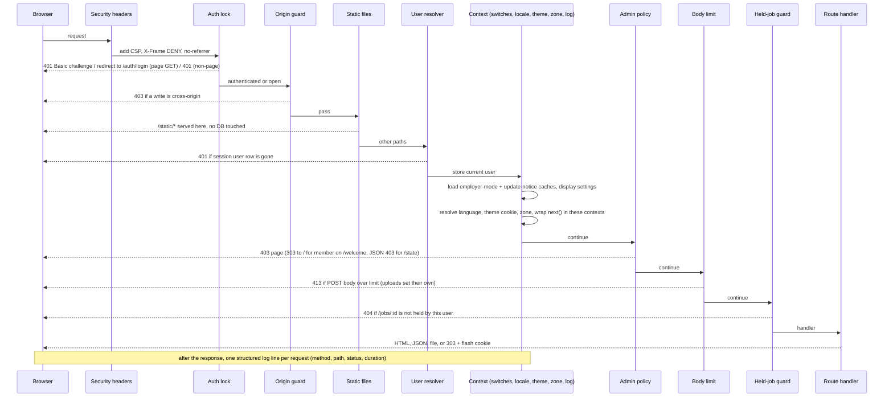

Rules worth preserving:

1. **Headers**: CSP `default-src 'self'`; scripts/styles allow `'unsafe-inline'` (inline boot scripts and the token style block); img/font also allow `data:`; `connect-src 'self'`; `X-Frame-Options: DENY`; `Referrer-Policy: no-referrer`. Nothing is loaded from a third party (a test fails the build if a CDN or font host appears).
2. **Auth plan** is decided once at start from env: `open`, `basic` (shared `user:password`), or `oidc` (sign-in; optional basic kept for `/health` only). A malformed setting aborts startup (fail closed); an unreachable identity provider at start also aborts.
3. **Origin guard** applies to every non-GET/HEAD/OPTIONS request. Decision order: `Sec-Fetch-Site` `cross-site`/`same-site` -> refuse; `same-origin`/`none` -> allow; else `Origin` host must equal effective host (first `X-Forwarded-Host`, else `Host`); opaque `Origin: null` with no fetch metadata -> refuse; else `Referer` host check; else no headers at all (curl/scripts) -> allow. Scheme is deliberately not compared. There are no CSRF tokens.
4. **`/state` cache rule**: any path ending `/state` gets `Cache-Control: no-store`. `/static/*` is `no-cache` (revalidate) except `/static/fonts/*` (7 days). `/countries.json` is cached 1 day, keyed by `?lang=`.
5. **Default body ceiling**: 2 MiB on every POST. Upload routes step aside and carry their own (resume upload 5 MB; job file import has its own import ceiling; screening applicant batch up to 200 MB; posting upload and profile fill-from-resume have their own). Over-limit answers 413 in the request language, or a flash redirect for upload forms.
6. **Held-job guard**: every `/jobs/<numeric id>/...` request checks the user holds a `UserJob` row for that posting; otherwise 404 (not 403), so postings of other users are indistinguishable from absent ones. `/jobs`, `/jobs/new`, `/jobs/import` are exempt.
7. **Error handling**: framework HTTP exceptions pass through; a malformed multipart body is a 400; anything else is a logged 500 with a generic localized message. Unknown path: localized 404 text.
8. **Database down**: employer-mode/display lookups are wrapped; failure is logged and the request continues in English with defaults; `/health` answers 503 `{ok:false, db:'down'}`.

### 3.2 Post-redirect-get and flash

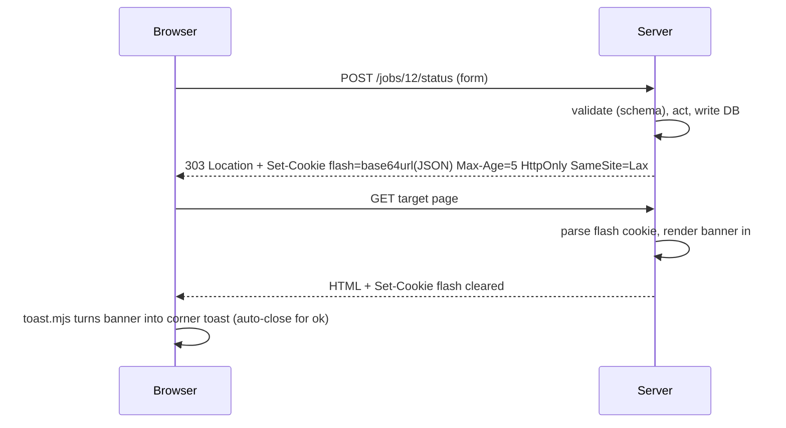

Flash contract:

- Kinds `ok` | `warn` | `err`. Payload may carry: `rerun` (+`mode`) -> "Re-run anyway"; `tailor` (only a `/jobs/<n>/target?match=<n>` path) -> "Tailor resume"; `download` (only `/resumes/<n>/download`); `field` {form action path, field name} -> page marks that field invalid and points it at the message. The parser re-validates every link and name because the cookie is browser-editable.
- Encoded as base64url JSON (not percent-encoding) because browsers silently drop cookies over 4096 bytes and non-Latin scripts bloat percent-encoding.
- TTL 5 seconds. Schema refusals are worded "field: reason" via localized zod-issue mapping, truncated at 160 chars.
- `safeBack(value, fallback)`: redirect targets from forms are accepted only if they parse (as a browser would) to the same origin, with no `//` prefix and no control characters. Treat as mandatory for any rewrite (open-redirect and header-split defence).
- Double-submit guards, three layers: (a) browser `SUBMIT_ONCE` disables buttons; (b) `onceGuard(key, back)` middleware refuses a second press in this process with a warn flash ("already running"), key TTL 10 minutes; (c) run registries `claimRun(key)` make a second POST join the in-flight run.

### 3.3 Sign-in (OIDC mode)

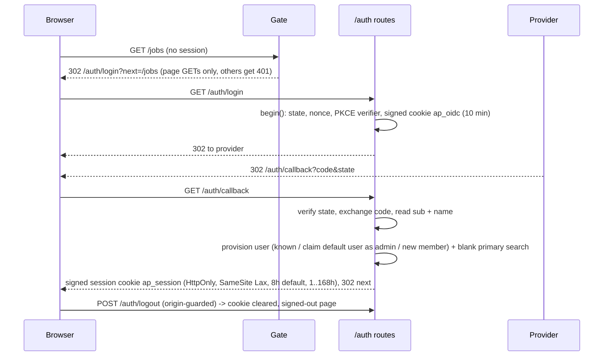

First sign-in rule: the first person to sign in inherits the pre-existing default user (id 1) and becomes admin; later new identities become members with an empty primary search.

---

## 4. Sitemap (route table)

Access legend: **open** = no user needed; **P** = personal (admin and member, scoped to own rows); **A** = admin only (members get 403 page; `/welcome` GET redirects members to `/`). An unclassified route is treated as admin-only (fail closed) and the route smoke fails the build on one. "Emp" = additionally requires employer mode on (otherwise flash-redirect to Settings > Screening).

### 4.1 System and auth

| Method | Path | Page / purpose | Access | Main actions |
|---|---|---|---|---|
| GET | `/health` | JSON `{ok, db, lastFetch{at,status}}`; 503 when DB down; only path with basic auth when OIDC is on | open | liveness for container health-check |
| GET | `/static/*` | CSS, fonts, ES modules | open | - |
| GET | `/countries.json` | Gazetteer for the country picker (`?lang=`) | P | client-side search |
| GET | `/auth/login`, `/auth/callback` | OIDC begin / finish | open | - |
| POST | `/auth/logout` | Sign out | open | - |

### 4.2 Overview and onboarding

| Method | Path | Page / purpose | Access | Main actions |
|---|---|---|---|---|
| GET | `/` | Overview dashboard (auto-refresh 30 s); admins with unfinished setup are redirected to `/welcome` | P | pause/resume pipeline, drill into jobs, chart range/stack |
| GET | `/welcome` (`?step=ai|search|profile|sources|matches`, `?resume=`, `?mode=new`) | First-run wizard | A | see 4.2.1 |
| POST | `/welcome/skip` | Mark setup complete without finishing | A | - |
| POST | `/welcome/finish` | Turn fetching on + mark complete | A | - |
| POST | `/welcome/ai/key`, `/welcome/ai/local`, `/welcome/ai/test` | Save engine key / adopt a found local model / one live test call | A | - |
| POST | `/welcome/resume` | Upload or pick resume, then scan (progress page) | A | - |
| POST | `/welcome/profile/apply`, `/welcome/profile/create`, `/welcome/profile` | Apply scan draft to primary search / create second search / save three-answer profile | A | - |
| POST | `/welcome/search` | Test search on aggregators only (optionally with typed countries) | A | - |
| POST | `/welcome/score` | Score stored-unscored jobs (batch of 10) with progress page | A | - |

### 4.3 Jobs

| Method | Path | Page / purpose | Access | Main actions |
|---|---|---|---|---|
| GET | `/jobs` | Jobs list (50/page; filters, facets, sort, status tabs) | P | filter, sort, open job |
| GET/POST | `/jobs/new` | Paste a posting manually (title, company, description min length, optional URL) | P | create + classify |
| GET | `/jobs/import` | Import-a-file page: upload, saved import sources | A | upload |
| POST | `/jobs/import` | Upload CSV/JSON/etc.; creates in-memory preview stash, redirects | A | - |
| GET | `/jobs/import/:token` | Mapping preview (3 sample rows, counts new/passing, alert choice) | A | adjust mapping |
| POST | `/jobs/import/:token/mapping` | "Update the preview" | A | - |
| POST | `/jobs/import/:token` | Run the import (progress page) | A | - |
| POST | `/jobs/import/sources/:id/delete` | Delete a saved import source | A | - |
| GET | `/jobs/:id` (`?tab=posting|match|letter|verify|pack`, `?match=`, `?letter=`) | Job detail with right rail | P (held) | see 4.3.1 |
| POST | `/jobs/:id/status` | Set status NEW/ALERTED/APPLIED/SAVED/DISMISSED (+ applied-with resume choice) | P | - |
| POST | `/jobs/:id/reclassify` | Re-score this posting (once-guarded) | P | - |
| POST | `/jobs/:id/description/refresh` | Two-step: preview diff of the company's own listing, second POST replaces text (original kept) | P | - |
| POST | `/jobs/:id/description`, `/jobs/:id/description/restore` | Save edited text / restore original | P | - |
| GET/POST | `/jobs/:id/edit` | Edit a manually-created posting (shared postings: read-only page) | P | - |
| POST | `/jobs/:id/verify` | "Is it real?" liveness + AI verification run | P | - |
| POST | `/jobs/:id/match` | Compare a resume to the posting (modes: fast / full) | P | - |
| POST | `/jobs/:id/matches/:matchId/suggestions` | Lazy second AI call on a quick check | P | - |
| POST | `/jobs/:id/matches/:matchId/condense/:step` | Condense steps for page target | P | - |
| POST | `/jobs/:id/matches/:matchId/actions/:index/rewrite` | Rewrite one suggestion through the claim gate | P | - |
| POST | `/jobs/:id/matches/:matchId/keywords` | Edit comparison keywords (inline, re-scores) | P | - |
| POST | `/jobs/:id/cover` | Generate a cover letter | P | - |
| GET | `/jobs/:id/cover/:letterId/file/:fmt` | Download letter (docx/pdf); edited text wins | P | - |
| POST | `/jobs/:id/cover/:letterId` | Save edited letter (autosave) | P | - |
| GET | `/jobs/:id/target` | Tailor-resume editor (live score, doc pane) | P | - |
| POST | `/jobs/:id/target/restart`, `/jobs/:id/target/reupload` | Start over from master / re-upload working copy | P | - |
| POST | `/jobs/:id/pack`, `/jobs/:id/pack/cancel` | Prepare / cancel-in-queue application pack | P | - |
| GET | `/jobs/:id/pack/state` | JSON poll: busy?, status line | P | - |
| GET | `/jobs/:id/pack/resume.docx`, `.pdf` | Pack files | P | - |

### 4.4 Applications

| Method | Path | Page / purpose | Access | Main actions |
|---|---|---|---|---|
| GET | `/applications` | Kanban board of application stages | P | drag/move card |
| GET | `/applications/export.csv`, `/applications/export.md` | Board as file (English headers, dates in display zone) | P | - |
| POST | `/jobs/:id/stage` | Quick-move stage (writes stage + ledger row) | P | - |
| POST | `/jobs/:id/consider` | Add posting to "Consider" column | P | - |
| POST | `/jobs/:id/application` | Save tracking card (stage, applied date, recruiter, notes, resume used) | P | - |

### 4.5 Resumes, tailoring, letters

| Method | Path | Page / purpose | Access | Main actions |
|---|---|---|---|---|
| GET/POST | `/resumes` | Resume library; upload (5 MB; pdf/docx/md/txt/Reactive-Resume json) | P | upload |
| GET | `/resumes/:id`, `/resumes/:id/download` | Resume detail (scan, strength review, tailored copies) / original file | P | - |
| POST | `/resumes/:id/replace`, `/compare-format`, `/draft`, `/props`, `/profile`, `/rescan`, `/review`, `/answers`, `/rename`, `/default`, `/delete`, `/document` | Resume actions (new version, format compare, draft, fix doc props, create search from resume, rescan, strength review, save answers, rename, set default, delete, render paragraph doc) | P | - |
| GET/POST | `/resumes/:id/render`, `POST /resumes/:id/render/shape` | Render resume as structured document (progress run) | P | - |
| POST | `/resumes/reactive/list`, `/resumes/:id/reactive/list`, `/resumes/reactive/import` | Pull from a connected Reactive Resume instance | P | - |
| GET | `/tailored/:id/download`, `/tailored/:id/reactive-sent` | Tailored copy file / sent-state | P | - |
| POST | `/tailored/:id/delete`, `/promote`, `/reactive-send` | Delete copy / promote as next resume version / send to Reactive Resume | P | - |
| POST | `/settings/reactive-resume`, `/settings/reactive-resume/remove` | Connect/disconnect Reactive Resume | P | - |
| GET/POST | `/letter` | Cover-letter launcher (job picker, resume, tone, 4 angle fields, optional match/verify) | P | - |
| POST | `/facts`, `/facts/delete` | Remember "I have / don't have this skill" answers; re-scores a comparison when `matchId` given | P | - |
| GET | `/target/runs/:id`, `/target/runs/:id/state` | Generic progress page + JSON for comparison/letter/scan/score/import runs | P (own runs) | - |

### 4.6 Companies, sources, discovery

| Method | Path | Page / purpose | Access | Main actions |
|---|---|---|---|---|
| GET | `/companies` | Admin: sources table + watchlist + packs + folders + muted; Member: muted-companies list only | P (admin sees more) | - |
| POST | `/companies/mutes`, `/companies/mutes/delete` | Mute / unmute an employer by name | P | - |
| POST | `/companies/new` | Add one company (name, ATS, token, career URL) | A | - |
| POST | `/companies/:id/toggle-active`, `/reprobe`, `/delete` | Enable/disable, re-probe token, delete (confirm shows jobs/applications/comparisons/letters impact) | A | - |
| POST | `/companies/suggested`, `/companies/suggested/all` | Add one / enable all suggested sources for the person's searches | A | - |
| POST | `/companies/starter-pack`, `/starter-pack/import`, `/starter-pack/enable` | Preview, import and enable a curated company pack | A | - |
| POST | `/companies/watchlist` | Paste company URLs; starts resolve run | A | - |
| GET | `/companies/watchlist/:id`, `/:id/state` | Resolve progress, then preview with ticks | A | - |
| POST | `/companies/watchlist/add` | Confirm picked rows (check interval, alert policy) | A | - |
| POST | `/companies/:id/watch`, `/unwatch`, `/check-now`, `/paste` | Watch toggle; check one now; paste page text for browser-only pages | A | - |
| POST | `/companies/folder/check`, `/folder/inbox`, `/folder` | Folder source: dry check, create app-owned inbox (local install), save | A | - |
| GET/POST | `/companies/:id/files`, `/files/reread` | Per-file outcomes of a folder source; re-read misfits | A | - |
| GET | `/discovery` | Candidate boards (pending / promoted / ignored / dead) | A | toggle auto-discovery, HN parser |
| POST | `/discovery/toggle`, `/hn-parser-toggle`, `/hn-run`, `/probe-now`, `/:id/promote`, `/:id/ignore`, `/:id/delete` | Discovery actions (manual runs are single-flight per process) | A | - |

### 4.7 Runs, AI usage, users, screening

| Method | Path | Page / purpose | Access | Main actions |
|---|---|---|---|---|
| GET | `/runs` | Last 100 runs (install-wide + own), funnel, source yield, "Running now" card | P (read-only) | - |
| GET | `/runs/running` | Fragment: running-card HTML, empty when none | P | polled |
| POST | `/runs/fetch-now` | Start/join a manual fetch run, redirect to progress | A | - |
| GET | `/runs/fetch-now/:id`, `/:id/state` | Fetch-now progress page / JSON | P | - |
| GET | `/runs/:id`, `/runs/:id/card` | Single run status page / running block fragment | P | - |
| GET | `/ai` (`?period=7d|month|last-month|year`) | AI usage and spend, hints, engine plan | A | - |
| GET | `/users`; POST `/users/:id/role`, `/users/:id/delete` | User list; promote/demote; remove (refuses self, last admin, no-change) | A | - |
| GET | `/screen`, `/screen/new` | Screening list / launcher (Emp, A) | A + Emp | - |
| * | `/screen/:id/*` (posting, run-all, rubric, redraft, preset, applicants, bulk, adjust, release, run, compare, compare/ai, decision, delete, export.csv/.md, retain, state) | Screening detail workflow (named only) | A + Emp | - |

### 4.8 Settings and integrations

| Method | Path | Purpose | Access |
|---|---|---|---|
| GET | `/settings?tab=profile|sources|notifications|applications|automation|ai|general|screening` | Tabbed settings; admin-only tabs sources/ai/screening fall back to `profile` for members | P |
| POST | `/settings/fetching-toggle` | Pause/resume pipeline (`back=/` from Overview) | A |
| POST | `/settings/schedule` (`part=fetch|alerts|zone`) | Schedule forms | P (fetch part admin-only effect) |
| POST | `/settings/telegram-toggle`, `/stale-digest-toggle`, `/source-health-toggle` | Alerts master switch / daily stale-application digest / source-health lines | P / P / A |
| POST | `/settings/targets`, `/targets/:id/toggle|delete|test` | Telegram/Discord destinations (a real test message goes out before saving) | P |
| POST | `/settings/profiles/new|active|activate|delete`, `/profiles/:id/save`, `/profiles/:id/fill-from-resume` | Searches (profiles) CRUD, activation, resume fill | P |
| POST | `/settings/application-tracking-toggle`, `/stages/add|:key/remove|:key/move|:key/rename`, `/reapply` | Tracking switch, board columns, re-apply window | P |
| POST | `/settings/pack` | Application pack automation (whole form) | P |
| POST | `/settings/theme`, `/settings/locale` | Theme cookie / stored language | P |
| POST | `/settings/ai/enable|budget|move|models|tasks|local|openai-base|key|test`, `/settings/classifier-mode` | AI engines, order, models, task routing, keys, budget, classifier mode | A |
| POST | `/settings/sources`, `/settings/sources/key` | Source-family switches / optional source API keys | A |
| POST | `/settings/login-item`, `/update-check-toggle`, `/employer-mode-toggle`, `/screening-retention` | Local-install autostart, weekly update check, employer mode, screening retention | A |
| GET/POST | `/gmail/connect`, `/gmail/callback`, `/gmail/label`, `/gmail/check`, `/gmail/disconnect` | Per-person Gmail job-lead integration | P |

---

## 5. Navigation structure

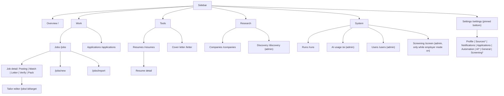
`*` admin tabs.

Layout behaviour:

- Desktop (lg): 240 px sidebar with labels; tablet (md): 64 px icon rail (labels hidden, group hairlines); mobile (<md): off-canvas sidebar toggled by a hamburger (`aria-expanded`), closed by backdrop click, Escape, or tapping any link.
- Current page: `aria-current="page"` plus a left bar, bold weight and accent text (never fill alone).
- Sidebar footer: Settings, signed-in name + Sign out (only when sign-in is enabled), language menu, theme switch, optional language invitation, "runs locally" line, version line (with "newer version available" link when the weekly check saw one; cached one hour).
- The window itself never scrolls: `html, body` are `overflow:hidden`; `main` scrolls. `fill` pages (Jobs list, Applications) cap the column at viewport height so the table/board owns its scroll.
- Admin-only menu entries are simply omitted for members (the routes also refuse them).

---

## 6. Job list model (filter, sort, tab)

### 6.1 Query parameters of `GET /jobs`

| Param | Values | Meaning |
|---|---|---|
| `status` | missing/empty = `NEW`; `all`; `NEW|ALERTED|APPLIED|SAVED|DISMISSED`; anything else = 400 | Status tab (row-level, the person's own status) |
| `page` | int >= 1 | 50 rows/page |
| `q` | text | Case-insensitive contains on title OR description OR location |
| `minFit` | int | Score floor |
| `profile` | search id | Narrow to one search; then fit floor and "open to me" read that search's own score row |
| `country` | comma list of country codes, region codes, `unknown` | Place facet (OR across selection) |
| `workplace` | comma list of workplace codes | Remote/hybrid/onsite/etc. facet |
| `posted` | `24h|7d|30d` | Posted within window (1/7/30 days) |
| `verified` | `1` | Only postings with at least one verification |
| `open` | `1` | Only rows a search says the person can take (location match) |
| `watched` | `1` | Only companies on the watchlist |
| `muted` | `1` | Also show muted employers' postings (hidden by default) |
| `sort` | `<key>_<asc|desc>` | See below; unknown = default |
| `panel` | `1` | Keep filter disclosure open after a panel link |

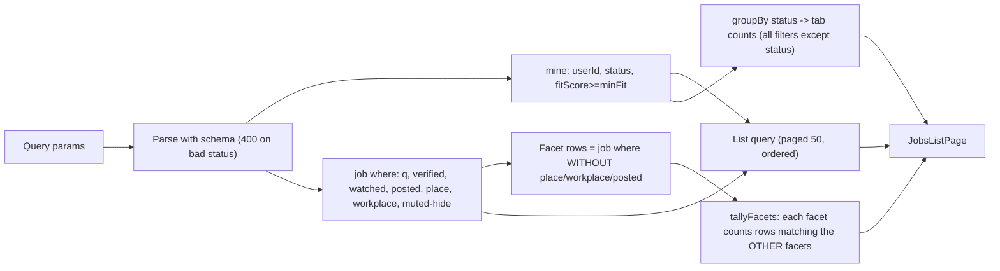

### 6.2 Rules

- Rows are the person's `UserJob` rows joined to the shared posting. Status, fit score, tech match are per person; the rest is the posting's.
- **Tab counts** ignore the status filter itself but honour every other filter; the "All" total is the sum. A tab's count equals what the tab would show.
- **Facet counts** (standard faceting): each facet's chip count respects the other two facets' selections but never its own, so a chip's number is what clicking it would produce. Place chips sort by count desc, then label; the top 8 plus every selected one show, the rest sit behind "More". Workplace chips always list every code (count 0 allowed). A posting with no country or region counts under `unknown`.
- **Active filters row** above the table lists each selected panel filter as a removable chip (search, places, workplaces, posted, verified, watched, open, muted). Status, sort, `q` and fit floor are not chips (their controls are visible). "Clear all" lifts panel filters only. The Filters button shows the count.
- **Muted**: postings of muted employers stay stored but are hidden by default; a hint line shows how many are hidden with a link to reveal them. A posting naming no employer is never hidden.
- **Sort**: columns `title, company, fitScore, salary, status, fetchedAt` have header links; `postedAt` is menu-only. Default `fetchedAt_desc`. First click direction: text columns ascending; fit, salary, fetched, posted descending; the next click flips. Nulls always last; row id is the final tie-break so paging never repeats or skips. Company sort = employer (nulls last) then board name. Fit = person's best score across searches. Status sorts in enum declaration order. `aria-sort` is set on the sorted header.
- **Row shows**: title (link), "closed" flag with reason tooltip when liveness found it gone, star for watched company, company (employer, via board), location/place chips, fit badge, salary, status badge, fetched time.
- Empty states differ: filtered-to-nothing (offer "clear all filters") vs. no jobs at all (offer "Fetch now").
- A banner appears when the active search is blank (no required stack or role types).

### 6.3 Job detail tab model

`/jobs/:id?tab=` is link-based: the server renders one tab's cards; the right rail (status actions, details, application tracking, mute-company, classifier info, per-search scores, cross-listings) is on every tab.

- Tabs: `posting` (default), `match`, `letter`, `verify`, `pack`. Default tab is omitted from URLs.
- Back-compat: no `tab` but `?match=` -> `match`; `?letter=` -> `letter`; unknown -> `posting`. All POSTs carry a hidden `tab` read through the same resolver, so only a known tab reaches a redirect.
- Tab labels carry facts: "Resume match - 72" (score, hidden when 0/none), "Cover letter - N", "Is it real? - <verdict>", "Application pack - <fact>".
- The shown comparison is the requested one, else the latest that is not a pack-made draft, else any.
- Rail actions: Consider (adds to board column), Mark applied (picker "applied with": a resume, none, or the pack's file), Save, Dismiss, back to New/Alerted; applied marking seeds the pipeline stage and a ledger event when tracking is on.

---

## 7. State machines

### 7.1 Job status (per person)

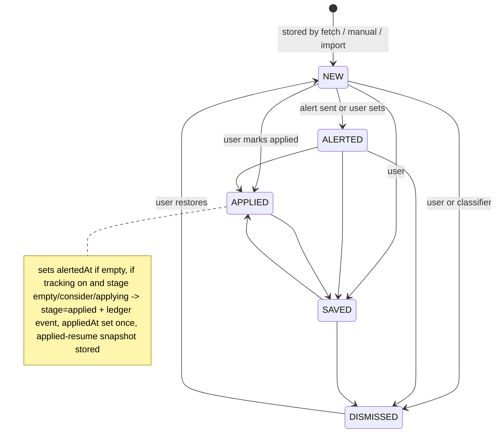
The status form accepts any of the five values from any state; the diagram shows the usual paths. Dismissed postings are deleted by a cleanup after 30 days (per the Overview stats note).

### 7.2 Application pipeline stage (board)

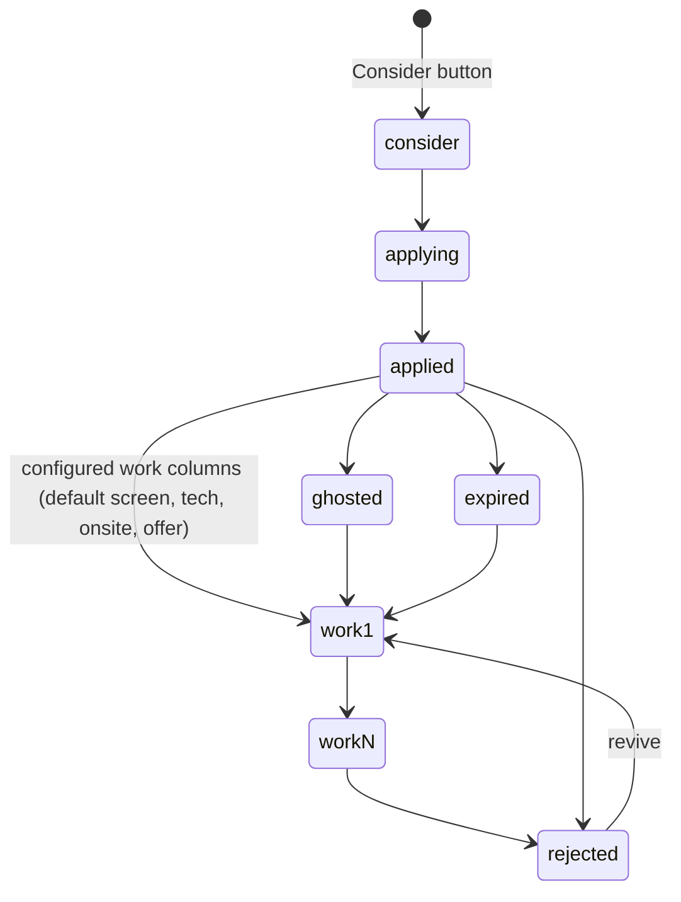
- Fixed entry stages: consider, applying, applied. Fixed end states: rejected, ghosted, expired, shown together in a collapsible "No Offer" column (a card keeps its own end state as a badge; dropping on No Offer sets `rejected`). Work columns are user data: max 10, key = slug (`[a-z0-9-]`, <= 40, unique, reserved keys excluded), label <= 40 chars, case-insensitive unique labels. Defaults: Screen, Tech, Onsite, Offer.
- Removing a column is refused while any of the person's jobs sit in it; the last work column cannot be removed (empty list would resurrect defaults). Stranded stages show in an "Unfiled" column.
- Every stage change writes a ledger row (`JobStageEvent`: from, to, day, source `ui|backfill|correction`) in the same transaction. Reaching `applied` dates the application today unless a date exists; an edit of the date alone writes a `correction` row.
- Quick-move default: next column forward; last work column -> rejected; end state -> first work stage.

### 7.3 Web-process run (compare / letter / scan / score / import / render)

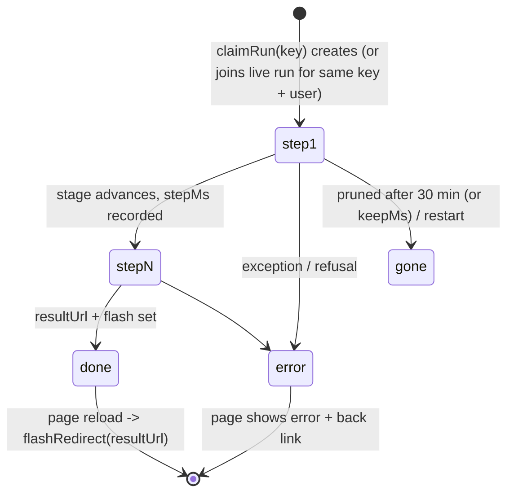
Steps vocabulary: liveness, fetch, extract, brief, scan, structure, keywords, match, suggestions, cuts, wording, verify, letter, review, score, compare, import.

### 7.4 Fetch-now run

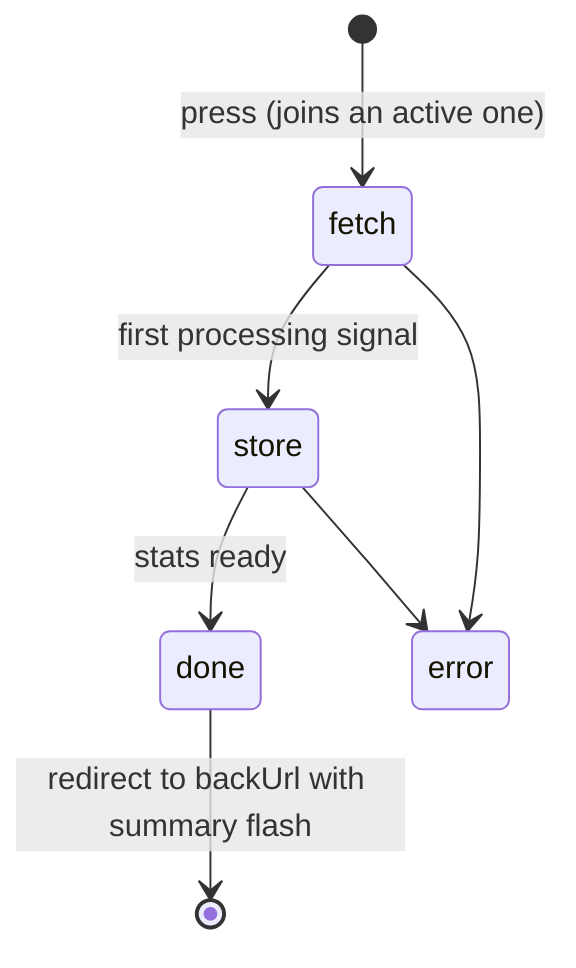
At most one live per web process. Live runs are believed for 6 h; finished ones kept 30 min. While the pipeline is paused the run still fetches but stores unscored (no AI spend).

### 7.5 Worker run shown on /runs

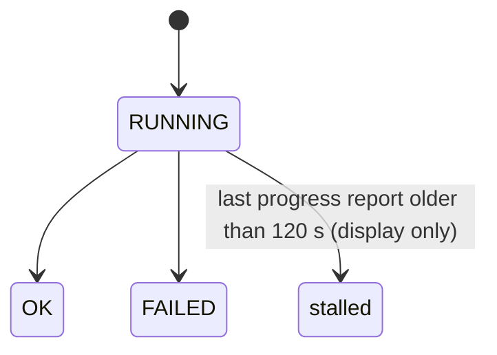

### 7.6 Setup wizard (derived, not stored)

Step done-ness is computed from data each time; only "setup completed" is stored.

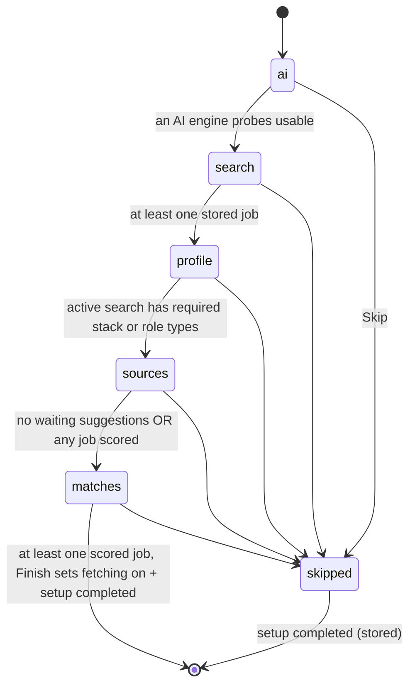

### 7.7 Discovery candidate

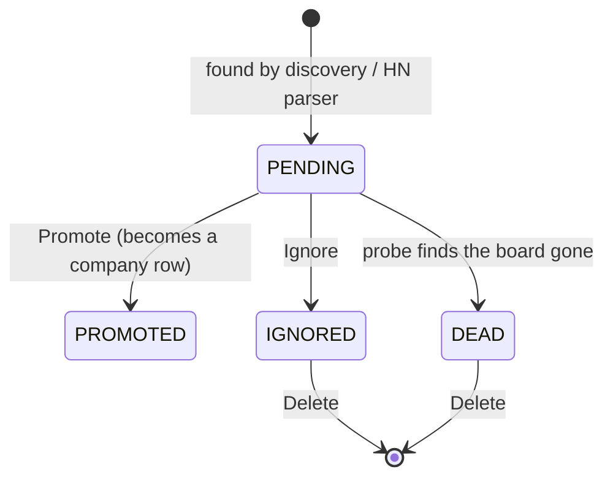

### 7.8 Import stash

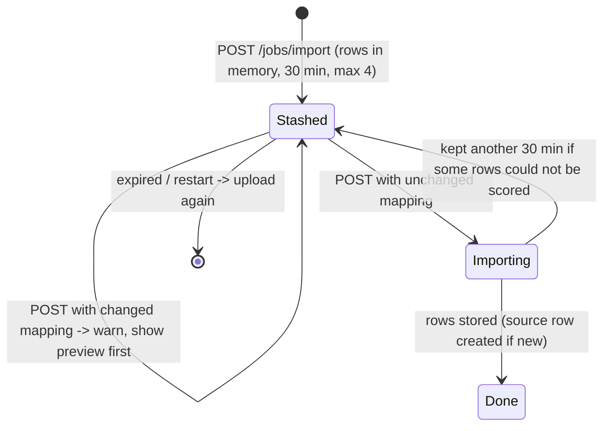

---

## 8. Onboarding flow

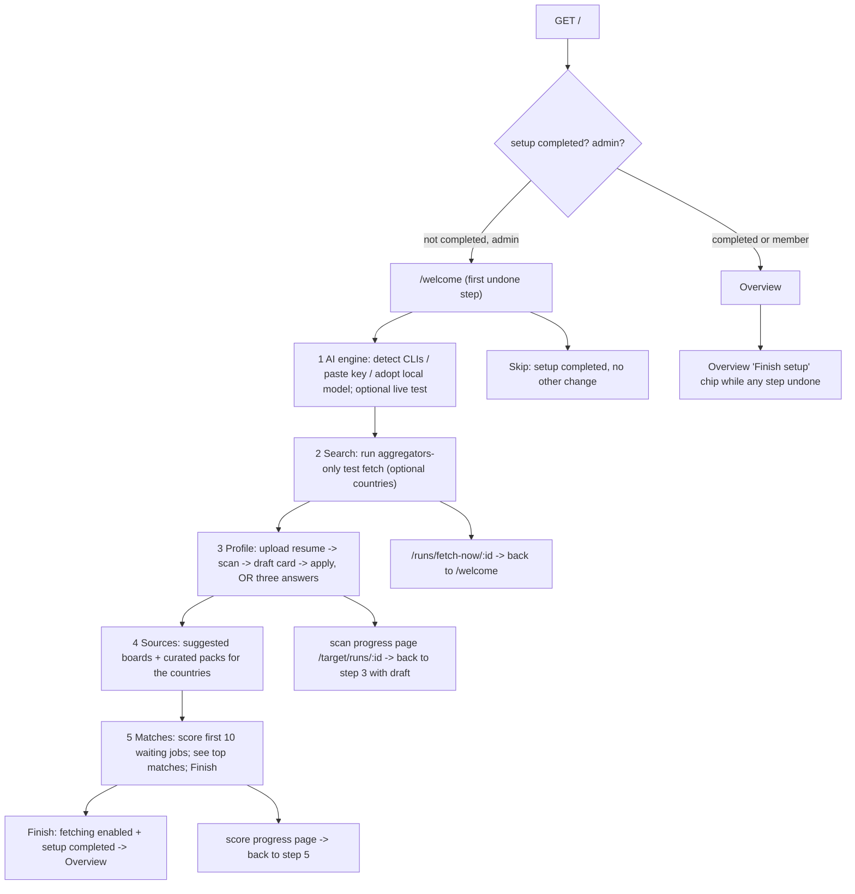

Rules:

- `?step=` overrides the current step (any step is reachable); otherwise the first undone step.
- Step 1 guards: a key must be non-empty and at most 500 chars; a local model must be a local address and appear in the server's own model list. A detected local server not yet in the engine list is shown as an offer, not as "connected".
- Scoring in step 5 refuses early (flash back to the right step) when the profile is not ready or no engine answers, instead of failing item by item.
- The language of a first run follows the browser's `Accept-Language` when offered; finishing setup stores it.
- A second resume can draft a new, inactive search ("A second search") rather than overwrite the primary.
- The wizard is an admin-only surface; members never see it (they go to `/`).

---

## 9. Long-running work and progress reporting

No SSE, no websockets. Everything is **polling a small JSON/HTML endpoint** or a **full-page meta refresh**.

| Work | Started by | State lives in | Reader | Interval |
|---|---|---|---|---|
| Comparison, letter, verification, resume scan/review/render, import, wizard score | POST -> `claimRun` -> 303 `/target/runs/:id` | Web-process map (`TargetRun`), per user | `target-run.mjs` polls `/target/runs/:id/state` | 2 s poll; copy rotates every 9 s; reload on `done`/`error`; 404 -> reload |
| Fetch now | POST `/runs/fetch-now` | Web-process map (`FetchRun`) + durable `cron_run` row | same module polls `/runs/fetch-now/:id/state` | 2 s |
| Watchlist resolve | POST `/companies/watchlist` | Web-process map | `watchlist.mjs` polls `/companies/watchlist/:id/state` | 1.5 s; then preview page |
| Application pack | POST `/jobs/:id/pack` | DB pack row | `pack-tab.mjs` polls `/jobs/:id/pack/state` | 8 s; reloads only when done and never over an unsaved edit |
| Screening run | POST `/screen/:id/run` | DB / process | `screen.mjs` polls `/screen/:id/state` | 2 s |
| Worker jobs (fetch tick, digest, cleanup, scoring) | cron | `cron_run.progress` JSON | Running-now card (`running.mjs`) polls `/runs/running` fragment | 5 s; swaps HTML; empty answer removes the card and reloads page |
| Overview | - | - | `<meta refresh=30>` | 30 s |
| Runs / run-status without script | - | - | `<noscript><meta refresh>` | only while something runs |

Progress payload (worker): stage, label (catalog key), unit (catalog key), done, total, counters (kept, setAside, classified, errors, listings in that fixed order), timestamps, rate samples. Writer throttle: at most one write per 5 s inside a stage; a new stage writes at once. ETA: from a 12-sample window taken at least 30 s apart; none before 20 items done; shown only when a total exists. A report older than 120 s marks the run "stalled". Postgres reorders JSON keys, so the view re-sorts counters into the fixed order.

Failure and edge behaviour:

- A poll that returns a redirect or non-card body (e.g. sign-in page) keeps the old card and retries.
- A restart forgets in-memory runs: their pages answer "gone" (404 JSON, flash on the next load); the durable `cron_run` row survives.
- Run keys prevent duplicates: a second identical POST (same job + resume + tone + options, or same scan text hash) joins the live run.
- Unfinished-run retention: 30 min default; individual runs can extend (imports of hundreds of rows on a CLI engine); fetch runs 6 h.
- `Cache-Control: no-store` on all `/state` endpoints and the fragments.
- Navigation bar (`progress.mjs`): a 3 px accent bar appears 150 ms after a tracked click/submit, creeps asymptotically to 90 % (never completes; the new document replaces it), resets on bfcache restore, ignores new-tab, download, modified-click and anchor-only links.

---

## 10. Settings section map

Eight tabs, link-based (`?tab=`), one raised surface per tab with hairline-separated sections. Admin-only tabs: Sources, AI, Screening. Each POST redirects back to its own tab/anchor.

| Tab | Section (anchor) | Controls and what they change |
|---|---|---|
| Profile ("Job search") | Job fetching (`#schedule`) | Pipeline Running/Paused switch (install-wide); schedule form: check every `hour|2h|4h|day`, window from/to hour (inclusive), day pills (empty set falls back to every day); note that "Fetch now" ignores the schedule |
| | Searches (`#searches`) | Up to 8 active searches; per search: running/paused, primary marker, blank flag, one-line summary; New, Activate/Pause, Make primary, Delete, Edit link |
| | Gmail (`#gmail`) | Connect Google, pick label, Check now, Disconnect |
| | Reactive Resume (`#reactive-resume`) | Connect/remove an external resume-builder instance (key stored, never echoed) |
| | Search editor (`#edit`) | Name; resume linked; role types (chips); seniority (junior, mid, senior, staff, lead, principal); required stack; nice-to-have stack; excluded stack; workplace pills; countries (picker over gazetteer) and region pills; residence; relocation; min fit score 0-100; min salary USD; on-site cities; notification destination; notes; priority rules; "Fill from a resume" card; "Save & re-classify" action |
| Sources (admin) | Job sources | Per-family pill checkboxes (aggregators default on; keyed ones flagged "needs a key"; HN parser off notes), grouped disclosures, Save |
| | Extra sources with a free key (`#source-keys`) | Per-source API key fields (stored in DB, source shown, value never shown) |
| Notifications | Messages (`#messages`) | Alerts master switch (per person); source-health alerts (admin); stale-applications daily digest |
| | Where alerts go (`#destinations`) | Table of Telegram / Discord destinations; add forms (test message sent first; duplicates refused); enable/disable, test, delete |
| | Send alerts (`#alerts`) | Alert mode `instant|window|digest`; window hours/days; scheduled-message times (up to 4 hours of day); held-alerts line |
| Applications | Application tracking | Switch for board and tracking card; when off, the board explains and POSTs redirect |
| | Re-apply window (`#reapply`) | Skip repeat postings of an employer applied to within 30/60/90/180 days, or off |
| | Board columns (`#stages`) | Add, rename, move up/down, remove work columns (rules in 7.2) |
| Automation | Application packs (`#packs`) | Enable; min fit 50-100 (fallback 90); daily limit 0-50 (0 = none, fallback 5); max posting age 1-60 days (fallback 7); cover letter mode; edit policy: sections (title, summary, skills, experience), max bullets 0-6, keywords, removals. Turning off cancels queued automatic packs |
| AI (admin) | AI engines | Ordered list of engines (CLIs, API-key engines, local, OpenAI-compatible): enable, reorder, per-task models (classifier / resume / cover), per-engine task routing (all ticked = "takes anything new"), keys, local URL and context window, OpenAI-compatible base, Test; plan summary table and billing notes |
| | Monthly budget (`#budget`) | USD ceiling on billed calls (0-100000; stored as cents; blank = none) |
| | Classifier | Single-stage vs two-stage (cheap yes/no prefilter) |
| General | Appearance | System / Light / Dark (cookie, 1 year) |
| | Language | `en`, `uk` ready; `es`, `fr` beta; pseudo-language internal only |
| | Time zone | Zone for schedules and every displayed date |
| | Resumes | List with default / not-scanned badges, link to library |
| | Start with this computer (`#login`, admin, local install only) | Login-item toggle |
| | Updates (`#updates`, admin) | Weekly new-version check toggle (one request/week) |
| Screening (admin) | Employer mode | Master switch (adds Screening to nav) |
| | Retention | Days to keep a screening: 7-365, default 90 |
| | Engine | Read-only note of which engine reads applicants and whether it is a subscription CLI |
| | Notice for applicants | Copyable disclosure text |

---

## 11. Overview page composition

- Header: last-checked time, pipeline status pill (Running / Paused / "Sleeping until <next>" when the person's schedule excludes this hour), Pause/Resume button, "Finish setup" chip while any wizard step is undone, active fetch-run indicator.
- Four status cards (NEW, ALERTED, APPLIED, SAVED): count, "+N in last 24 h" (moment = alert time for alerted, applied time for applied, found time otherwise), 14-day UTC-day sparkline; each links to `/jobs?status=`.
- Totals line (includes dismissed).
- Matches chart: range `7d|30d|90d|180d` (default 30d; 90d/180d bucket by 3/6 days, <= 30 points), optional technology filter (`?stack=`, only on ranges the retained jobs cover = last 30 days), total + trend vs previous equal range (percent shown only when the base >= 10).
- Pipeline health: latest `fetch`, `digest`, `cleanup` run each with status badge; "failing N" badge.
- Recent activity (24 h): fetched, matches, alerts, plus watchlist summary (watched companies, new postings, pages to paste).
- By stack (top 8) and by source (top 8; all per-company vendor boards collapse into one "Company boards" bar), bars scaled to the top item.
- Recent alerts: 8 newest ALERTED/NEW rows.
- Ready application packs (8 shown, total count).
- "Next three things" coaching until the first comparison exists.
- Numbers exclude muted employers (they link to /jobs, which hides them).

---

## 12. Feature list

| ID | Feature | What it does | Trigger | Key config/settings |
|---|---|---|---|---|
| WEB-01 | Server-rendered shell | Every page rendered on the server with shared layout, skip link, sidebar, flash slot; works without script | user (any GET) | - |
| WEB-02 | Grouped navigation | Overview, Work (Jobs, Applications), Tools (Resumes, Letter), Research (Companies, Discovery), System (Runs, AI, Users, Screening*), Settings pinned | user | role, employer mode |
| WEB-03 | Responsive sidebar | Full / icon rail / off-canvas by breakpoint; Escape and backdrop close | user | - |
| WEB-04 | Security headers and self-contained assets | CSP, frame denial, no-referrer; no third-party fetches | every response | - |
| WEB-05 | Access lock modes | Open, shared basic password, or OIDC sign-in; `/health` stays reachable | startup env | `WEB_BASIC_AUTH`, OIDC issuer/client/secret/session secret/hours, public URL |
| WEB-06 | OIDC sign-in/out | Authorization-code with state, nonce, PKCE; signed session cookie; safe `next` return; POST logout | user | session 8 h default (1-168) |
| WEB-07 | User provisioning | First sign-in claims the default user as admin; later identities become members with a blank primary search | event (callback) | - |
| WEB-08 | Role gate | Route table classifies every route open/personal/admin; members get a 403 page; unlisted = admin | every request | user role |
| WEB-09 | User management page | List users, promote/demote, remove; refuses self-change, removing the last admin, no-op | user (admin) | - |
| WEB-10 | Cross-origin write guard | Header-based same-origin check on all writes, no tokens | every non-GET | - |
| WEB-11 | Body size limits | 2 MiB default; per-route upload ceilings; localized 413 | every POST | upload limits (resume 5 MB; batch 200 MB) |
| WEB-12 | Per-request context | User, locale, theme, display zone, language invite carried implicitly | every request | - |
| WEB-13 | Request log line | One structured line per request | every request | - |
| WEB-14 | Health endpoint | DB ping + last fetch run summary; 503 when down | docker/health-check | - |
| WEB-15 | Flash messages | One-shot ok/warn/err via cookie across PRG; may carry re-run, tailor, download, invalid-field | event (POST) | TTL 5 s |
| WEB-16 | Toasts | Banner becomes corner toast; auto-close success 4-12 s (40 ms/char), sticky for warn/err/actionable; close button; polite live announce | event | - |
| WEB-17 | Field-level error marking | A refused form field is marked invalid and tied to the message | event | - |
| WEB-18 | Safe redirects | `back` fields sanitized to same-origin paths | event | - |
| WEB-19 | Double-submit protection | Browser disable, per-process once-guard, run joining | user | key TTL 10 min |
| WEB-20 | Navigation progress bar | Creeping top bar for slow loads | user (click/submit) | show delay 150 ms, ceiling 90 % |
| WEB-21 | Inline (no-reload) form posts | `data-inline` forms post by fetch, swap `[data-region]`s, keep focus and editor state | user | - |
| WEB-22 | Confirm popovers | Destructive actions use a native popover dialog containing the real POST form (works without script) | user | - |
| WEB-23 | Switch rows | Accessible `role=switch` toggle forms with word states | user | - |
| WEB-24 | Theme (system/light/dark) | Cookie-based, applied on first paint; WCAG-AA-tested token sets for both | user | `theme` cookie 1 year |
| WEB-25 | Language selection | Sidebar menu, Settings, wizard; stored per person; one-time invitation line offering the browser's language | user | locale en/uk/es/fr |
| WEB-26 | Pseudo-locale smoke | Internal pseudo-language marks every catalog string so untranslated English fails the build | CI | - |
| WEB-27 | Display time zone | All dates in the person's schedule zone; zone name shown in table headers | every request | timezone setting |
| WEB-28 | Update notice | Sidebar shows a newer release when weekly check saw one | event | update check switch |
| WEB-29 | Overview dashboard | KPI cards with sparklines, matches chart, pipeline health, activity, by stack/source, recent alerts, ready packs, next-steps; 30 s refresh | user | range, stack |
| WEB-30 | Pipeline pause/resume quick control | Header button on Overview and Settings | user (admin) | fetching enabled |
| WEB-31 | Finish-setup chip | Overview chip links to wizard while a step is undone | event | - |
| WEB-32 | First-run wizard | 5 derived steps with skip/finish | first visit (admin) | setup completed flag |
| WEB-33 | Wizard AI step | Detect engines, paste key, adopt local model, live test | user | key <= 500 chars |
| WEB-34 | Wizard test search | Aggregators-only fetch with typed countries | user | countries |
| WEB-35 | Wizard profile step | Resume upload + scan -> reviewable draft -> apply/create, or three-answer form | user | seniority levels |
| WEB-36 | Wizard sources step | Suggested boards and starter packs for the countries | user | - |
| WEB-37 | Wizard score step | Score 10 waiting jobs with progress; show top matches | user | batch 10 |
| WEB-38 | Jobs list | Paged (50) table with search, fit floor, sort menu, status tabs with counts | user | - |
| WEB-39 | Jobs filter panel | Search/place/workplace/posted facets with live counts; verified, watched, open-to-me, muted toggles; active-filter chips; clear all | user | query params |
| WEB-40 | Column sorting | Six sortable columns plus posted-date; deterministic null-last/tie-break | user | default `fetchedAt_desc` |
| WEB-41 | Muted-company hiding | Hidden by default with count and reveal link | event | mute rules |
| WEB-42 | Job detail with tabs | Posting, Match, Letter, Verify, Pack tabs with fact-bearing labels; persistent rail | user | `tab` |
| WEB-43 | Job status actions | Save/Dismiss/Restore/Mark applied/Alerted, with applied-with resume or pack-file choice | user | tracking setting |
| WEB-44 | Per-search scores | Rail lists each of the person's searches' score, best/paused, location reason | view | - |
| WEB-45 | Re-classify one job | Re-score against active searches (once-guarded) | user | - |
| WEB-46 | Description refresh/restore/edit | Diff preview of company's own listing, replace keeping original, restore, manual edit | user | - |
| WEB-47 | Manual job paste | Paste title/company/URL/description; classified immediately; dedupes to existing | user | min description chars |
| WEB-48 | Edit manual job | Edit own pasted posting; shared postings read-only | user | - |
| WEB-49 | Cross-listing links | Shows near-duplicate postings (annotation only) | view | - |
| WEB-50 | Closed-posting flag | Liveness result shown on list and detail with reason | view | - |
| WEB-51 | Mute company from job | Mute/unmute employer with optional reason from the job rail | user | reason <= 300 chars |
| WEB-52 | Job verification run | "Is it real?" run with progress page and stored verdict history | user | - |
| WEB-53 | Resume comparison launcher | Start a fast or full comparison from the Match tab; join duplicate runs; "Re-run anyway" flash | user | match mode |
| WEB-54 | Tailor editor entry | Flash and tab links open the live editor for a comparison; start over / re-upload working copy | user | - |
| WEB-55 | Skill-fact memory | Remember have/don't-have/unsure answers; re-score affected comparison inline | user | note <= 300 |
| WEB-56 | Cover letter tab and launcher | Generate, edit with autosave (900 ms debounce, backoff to 15 s), download docx/pdf, copy | user | tone, 4 angle fields saved per person |
| WEB-57 | Application pack tab | Prepare/cancel, live status line, download docx/pdf, mark sent | user | pack settings |
| WEB-58 | Applications board | Kanban of stages with drag-and-drop, per-card move form (keyboard/no-JS path), time-in-stage line, collapsible No Offer column (remembered per browser), mobile stage chips | user | stage config |
| WEB-59 | Tracking card | Stage, applied date (backdatable), recruiter contact, notes, resume used | user | tracking enabled |
| WEB-60 | Applications export | CSV and Markdown of the board (English headers, zone dates) | user | - |
| WEB-61 | Board column editor | Add/rename/reorder/remove work columns | user | max 10 |
| WEB-62 | Stage ledger | Every stage change recorded with day and source | event | - |
| WEB-63 | Resume library | Upload (5 MB), default flag, rename, delete, new version, rescan, strength review, doc-property fix, format compare | user | accepted types |
| WEB-64 | Resume to search | Create/fill a search from a scanned resume | user | - |
| WEB-65 | Tailored copies | Download, delete, promote to next resume version, send to Reactive Resume | user | - |
| WEB-66 | Reactive Resume integration | Connect, list, import, send | user | stored key |
| WEB-67 | Resume render | Structured render run with progress | user | - |
| WEB-68 | Companies/sources table | Health dot, streak, jobs, alerted, last fetch, active toggle, delete with impact counts | user (admin) | quiet = failing >= 3 consecutive failures or silent >= 14 days |
| WEB-69 | Quiet-source panel | Lists failing/silent sources with re-probe | view | thresholds above |
| WEB-70 | Add company | Manual add with ATS type, token, career URL | user | - |
| WEB-71 | Suggested sources | Per-search suggestions: add off or enable; "Enable all N" | user | - |
| WEB-72 | Starter packs | Preview, import, enable curated packs | user | - |
| WEB-73 | Watchlist | Paste URLs, resolve with progress, preview with ticks and editable names, add with check interval and alert policy | user | interval hour/day/week; policy matches/all; 1 s between companies |
| WEB-74 | Watch controls | Watch/unwatch, check now (fetch-run scoped to one company), paste page text for browser-only pages | user | - |
| WEB-75 | Folder sources | Check (dry), save with mapping, app-owned inbox, per-file outcomes, re-read misfits | user | include pattern, holds rows/postings, alerts |
| WEB-76 | Muted companies | Mute by name from page or job; unmute; members see only this | user | - |
| WEB-77 | Discovery page | Auto-discovery switch, HN who-is-hiring parser switch, manual probe/HN run (single flight), promote/ignore/delete candidates by status | user (admin) | discovery settings |
| WEB-78 | File import | Upload, auto-detect mapping, adjustable mapping preview, counts, alert choice, progress run, saved import sources | user (admin) | stash 30 min, 4 max |
| WEB-79 | Runs page | History (100), funnel, source yield, running card, detail page per run | user | - |
| WEB-80 | Running-now card | Live worker progress with fraction, ETA, counters, stalled flag | auto (5 s poll) | thresholds in 9 |
| WEB-81 | Fetch-now | Manual run of every source with live progress and summary flash | user (admin) | pipeline paused -> unscored |
| WEB-82 | Generic progress page | Step list, per-step timing, rotating activity copy, results lines, error with back link | auto | 2 s poll |
| WEB-83 | AI usage page | Spend by period/model, hints, engine plan, recent failures | user (admin) | periods 7d, month, last-month, year (UTC) |
| WEB-84 | Search editor | Full profile form with chip editors, country picker, regions, priority rules, fill-from-resume | user | max 8 active searches |
| WEB-85 | Schedule editor | Fetch cadence/window/days; alert mode/window/digest times; time zone | user | see 10 |
| WEB-86 | Notification destinations | Telegram/Discord add with live test, toggle, test, delete | user | - |
| WEB-87 | AI engine admin | Order, enable, models, tasks, keys, local URL, OpenAI-compatible base, test, budget, classifier mode | user (admin) | budget <= 100000 USD |
| WEB-88 | Source family switches and keys | Enable/disable families; optional API keys | user (admin) | - |
| WEB-89 | Pack automation settings | Whole-form save with field-level refusal | user | limits in 10 |
| WEB-90 | Re-apply window | Skip employers applied to recently | user | 30/60/90/180 days |
| WEB-91 | Employer mode and screening | Optional section, retention, engine note, applicant notice; admin only | user (admin) | retention 7-365 (90) |
| WEB-92 | Gmail leads | Connect/label/check/disconnect per person | user | - |
| WEB-93 | Local-install helpers | Login-item toggle, inbox folder creation (local only) | user (admin) | - |
| WEB-94 | Country picker data | `/countries.json` localized gazetteer for client search | auto | cache 1 day |
| WEB-95 | Server-drawn charts with hover | SVG charts; hover/arrow-key tooltip is optional enhancement | view | - |
| WEB-96 | Clipboard helpers | Copy buttons with fallback and live-region announce | user | - |
| WEB-97 | Select-commit autosave | Self-saving selects commit on settle, not per arrow key | user | - |

---

## 13. Business rules and invariants

Numbers below are the actual constants in code.

- **Paging and caps**: jobs list 50/page; runs page last 100; picker lists max 150 jobs; Overview recent alerts 8, ready packs 8; stack/source bars 8, stack filter options 12; top place chips 8; active searches max 8; board work columns max 10; digest times max 4.
- **Job statuses**: NEW (default tab), ALERTED, APPLIED, SAVED, DISMISSED. Unknown `status` query -> 400.
- **Posted windows**: 24h = 1 day, 7d, 30d. **Chart ranges**: 7/30/90/180 days with steps 1/1/3/6; the by-technology view reads only the last 30 days because dismissed jobs are purged after that; the daily rollup table (never pruned) supplies the long ranges. Percent change shown only when the baseline >= 10.
- **Days are UTC** for stats and AI spend periods; displayed dates use the person's zone.
- **Marking applied** sets `alertedAt` if empty, `appliedAt` once (never overwritten), snapshots the chosen resume (id, version, text) because resume bytes are replaced in place by new versions, and (tracking on, stage empty/consider/applying) moves stage to `applied` with a ledger row. Choosing "the pack's file" fails with a flash if the pack was re-prepared since the page was drawn, and freezes the pack as sent.
- **Application date belongs to Applied**: only a move into `applied` dates a card; other moves never clear or replace it.
- **Tracking off**: stage/consider/application POSTs redirect without writing.
- **Stage keys** immutable once created (history stays readable); renames change labels only. Stage removal and the in-use count run under one write lock.
- **Held-job rule**: unknown or not-held job -> 404, everywhere under `/jobs/<id>`; runs are readable only by their creator (a second person's identical request starts its own run).
- **Run registry**: keyed join (key includes job, resume, tone, option flags, hash of angle text); lookup+insert are synchronous with no await between (the whole concurrency guarantee in a single-threaded runtime); prune before claim.
- **Fetch-now**: one live per process; a press joins it; scope `every`, `aggregators`, or one company; wizard test uses aggregators because they need no company rows and return hundreds of postings.
- **Watchlist resolve**: server-side re-read of the resolution on confirm (never trusts the round-tripped form); only name and ticks come from the user; names truncated to 100.
- **Import**: stash 30 min, 4 max, memory only; the import re-computes the preview facts before writing and refuses what the preview would refuse (no searches usable, nothing passing, scoring off etc.); a changed mapping at press time shows the new preview first and stores nothing; a source row created by an import that stores nothing is taken back.
- **Source health**: quiet streak 3 consecutive failures; silent 14 days without a posting; sources that never post by design (career-page watch, manual, browser page, import, Gmail, folder) are never "silent".
- **Settings validation**: pack minFit 50-100, dailyLimit 0-50, maxAgeDays 1-60, maxBullets 0-6; invalid input stores nothing (not even the switch) and flash names the field. Screening retention 7-365. AI budget 0-100000 USD, stored as cents. AI key <= 500 chars. Re-apply choices 30/60/90/180.
- **Ids**: only 1-9 digit positive integers accepted; anything else is NaN -> 400/404 (prevents DB errors on `1.5`, `1e2`).
- **Schedule**: an empty day set saves as every day; fetch cadence options hour, 2h, 4h, day; alert modes instant, window, digest.
- **Cache**: employer-mode switch cached in the web process (writer is the same process); update notice cached 1 h; engine probe cached 1 min so the 30 s Overview refresh does not spawn CLIs.
- **Language resolution**: stored choice always wins; with none and setup unfinished -> browser language if offered; with none and setup done -> English plus a one-line invitation until answered. Userless pages (sign-in) are never localized to a user. Members are treated as setup-complete.
- **Data files** (exports, downloads) are written in English regardless of UI language.
- **Member visibility**: Runs page shows install runs plus their own recaps; Companies shows only their mutes; settings hides install-wide sections.

---

## 14. External dependencies and integration contracts

| Dependency | Contract |
|---|---|
| Postgres | Prisma models used directly by routes: job, user_job, company, profile, resume, resume_match, cover_letter, cron_run (incl. `progress` JSON), job_stage_event, user_settings, settings, users, notification targets, candidates, pack rows, verifications |
| OIDC provider | Discovery at startup (must succeed); auth-code + PKCE; claims `sub` and name; redirect URI = public URL + `/auth/callback` |
| Worker process | Writes `cron_run` rows and progress; web reads them; schedule and settings are shared via DB |
| AI engines | Probed for the wizard and AI page; test endpoint does one tiny live call |
| Telegram / Discord | Real test message at add-time and on demand |
| Google (Gmail) | OAuth connect/callback; label read |
| Reactive Resume | Instance URL + key; list/import/send |
| Browser | ES modules from `/static`; `Accept-Language`, `Sec-Fetch-Site`, `Origin`, `Referer`, `X-Forwarded-Host`, `X-Forwarded-Proto` headers consumed |
| Reverse proxy | Supported via forwarded host/proto for origin check and secure cookies |
| Static assets | Prebuilt Tailwind CSS (committed, versioned `?v=<app version>`), bundled Inter + Noto Sans Devanagari fonts, vendored `docx-preview` and `jszip` for the document pane |

HTTP contract notes: writes answer 303 (never 200 HTML after POST), except a few direct renders (folder check preview, form-error pages). JSON appears only on `/state` endpoints, `/health`, `/countries.json`, `/jobs/:id/pack/state`. File downloads set `Content-Disposition: attachment`.

---

## 15. Client-side JavaScript, CSS, theming, accessibility

**JS approach**: no framework, no bundler. About 35 small dependency-free ES modules served as-is from `/static`, each exporting pure functions (unit-tested under the Node test runner with no DOM) plus a thin DOM boot. Pages opt in via `data-*` attributes (`data-inline`, `data-region`, `data-commit`, `data-copy`, `data-drop-stage`, `data-collapsible`, `data-ai-plan`) and embed boot data as JSON blobs. Layout boots three inline scripts: `data-js` flag (so toast position is right on first paint), nav toggle, and module imports for progress bar and toast. Catalog strings for the browser are embedded as an `application/json` block for non-English locales (English is built into the modules).

Modules by role:

| Role | Modules |
|---|---|
| Chrome | `progress`, `toast`, `copy`, `inline-post`, `select-commit`, `i18n`, `i18n-en` |
| Polling | `running`, `target-run`, `fetch-run`, `watchlist`, `pack-tab`, `screen` |
| Pages | `board` (drag-and-drop), `column-collapse`, `chart`, `chips`, `countries`, `launcher`, `settings-models`, `cover-letter` |
| Live tailor editor | `target-page`, `target`, `score`, `evidence`, `length`, `title-keyword`, `text-edits`, `apply-all`, `line-diff`, `change-sheet`, `doc-pane` |

**Mirror rule**: four browser modules are line-for-line copies of server logic (score, evidence, length, title-keyword) so the live editor's number equals the server's; each has a test asserting equality over one table. A rewrite should share one implementation instead.

**CSS**: Tailwind (3.x) built to a committed minified file; semantic color tokens as CSS variables on `:root` (surface, surface-raised, surface-overlay, surface-selected, line, line-strong, ink, ink-muted, ink-faint, accent, accent-strong, accent-deep, ok, warn, danger, info, violet, on-accent, shadow-ink, scrim). Light and dark sets are separate records; dark applies via `prefers-color-scheme` unless `data-theme="light"`, or by `data-theme="dark"`. A test holds every text color to WCAG AA on every surface it can sit on, in both sets. A type ladder of named steps (title, kpi, section, entity, body, label, note, meta) is enforced by a test that fails on raw sizes. Brand: emerald accent, "AP" mark, Inter for UI, mono only for machine values.

**Accessibility conventions evident in code**:

- Skip link to `#main`; landmark `nav` with label, grouped with `role=group` + `aria-labelledby`; `aria-current="page"`.
- Visible `:focus-visible` outline; reduced-motion media query collapses all transition/animation durations and iteration counts.
- Never color alone: switches state words ("Running"/"Paused"), nav current marker is bar + weight + color, status badges carry text, `sr-only` text for icon-only states, sort uses `aria-sort`, disclosures show counts.
- Tables always have captions; hidden columns via responsive classes.
- Switch toggles are real `<button role="switch" aria-checked>` inside a POST form (work without JS).
- Destructive actions: native popover dialog with Cancel autofocused.
- Live regions: errors use `role=alert`; success announcements go to one polite live region; toasts never take focus.
- Pages that rely on JS state keep a no-script path (`<noscript>` save buttons, meta refresh fallbacks, forms that submit normally).
- Language attributes: `lang` on `<html>`, `lang="en"` on English-only snippets, `translate="no"` on data (job titles, names, versions).
- Drag-and-drop board keeps a per-card move form as the keyboard path.
- Document-level: Chrome-specific select-change quirks handled (commit on settle).

---

## 16. Known oddities and accidental complexity

1. **Hand-rolled run registries in three flavors** (target runs, fetch runs, watchlist runs) plus an import stash and a once-guard map, all in-memory in the web process. A restart loses live state, and multi-instance deployment would break joining. A rewrite should use one job/run abstraction backed by the DB (the worker already has `cron_run.progress`) and one state endpoint shape.
2. **Polling plus meta-refresh everywhere** with five different intervals. A single SSE stream or one polling client would remove most of `*-run.mjs`.
3. **Duplicated logic in browser and server** (score, evidence, length, title keyword). Share code or compute server-side via an endpoint.
4. **Cookie-based flash with sanitizing parser** is clever but heavy (base64 JSON, link re-validation, field marking). A modern stack would use session flash or toast events from an API.
5. **Route-access table duplicates the route list** (admin-policy lists vs. route files). Annotating routes with their access level, or a router-level guard, removes the drift risk (currently caught only by the smoke test).
6. **Process-level caches that assume a single web process** (employer mode, update notice, once-guards, run maps). Fine for local use, a trap for scale-out.
7. **Settings page is 2,470 lines in one component** with tab conditionals repeated per section (`activeTab === ... &&` for every section). Split per tab.
8. **Mixed idioms for mutations**: HTML forms with 303, a few inline fetches (`board`, `inline-post`, autosaves), JSON state endpoints, and fragment endpoints. A rewrite could pick one: server-rendered forms + HTMX-style fragment swaps, or a JSON API + SPA.
9. **Link-based tabs and facet chips** generate many URL variants and back-compat shims (`match=`/`letter=` implying tabs, `panel=1` to keep a `
` open). Acceptable, but the shims can be dropped in a clean rewrite.
10. **Roles retrofitted**: personal vs. install-wide data is mixed in one `settings` page and some pages draw less for members. A rewrite should model "install settings" and "my settings" as distinct areas.
11. **Embedded design "direction contract" HTML comment** in every page and a generated DESIGN-style comment block: documentation in the output; drop it.
12. **Several near-duplicate progress/launcher pages** (comparison, letter, scan, score, import, render, verify) differ only in step lists and copy; they share one page but the call sites each hand-build long config objects.
13. **`/screen` family** is an entire second product (employer-side applicant screening) behind a flag; consider splitting it from the job-seeker app.
14. **Error strings for HTTP failures are plain text** (`400/404/413/500` as bare text), inconsistent with the styled 403 page.
15. **Static JS modules fetched uncached** (`no-cache` by design after a stale-module incident): fine locally, wasteful behind a CDN; use content-hashed filenames instead.

---

## 17. Source map

| Area | Path |
|---|---|
| App assembly, middleware, error handling | `src/web/app.ts`, `src/web/server.ts` |
| Layout, nav, theme tokens | `src/web/layout.tsx`, `src/web/tokens.ts`, `src/web/theme.ts`, `src/web/theme-switch.tsx`, `src/web/icons.tsx` |
| UI primitives | `src/web/ui.tsx`, `src/web/language-menu.tsx` |
| Security and request guards | `src/web/origin-guard.ts`, `src/web/same-origin.ts`, `src/web/body-limits.ts`, `src/web/admin-guard.tsx`, `src/web/job-guard.ts`, `src/web/once-guard.ts`, `src/web/inflight.ts`, `src/web/params.ts` |
| Auth and users | `src/web/oidc/*`, `src/web/current-user.ts`, `src/users/admin-policy.ts`, `src/users/identity.ts`, `src/users/store.ts`, `src/web/routes/users.tsx` |
| Flash / redirects | `src/web/flash.ts` |
| Language, zone, locale | `src/web/language.ts`, `src/web/display-zone.ts`, `src/i18n/*`, `src/web/browser-messages.ts` |
| Overview | `src/web/routes/overview.tsx`, `src/web/pages/overview.tsx`, `src/web/overview-numbers.ts`, `src/web/overview-stats.ts`, `src/web/stats-series.ts`, `src/web/pages/matches-chart.tsx`, `src/web/chart-svg.ts`, `src/web/next-things.ts` |
| Wizard | `src/web/routes/welcome.tsx`, `src/web/pages/welcome.tsx`, `src/web/welcome-steps.ts`, `src/web/welcome-facts.ts`, `src/web/source-suggestions.ts` |
| Jobs list model | `src/web/routes/jobs.tsx`, `src/web/pages/jobs-list.tsx`, `src/web/job-facets.ts`, `src/web/job-sort.ts`, `src/web/job-tabs.ts`, `src/web/job-pick.ts` |
| Job detail and actions | `src/web/pages/job-detail.tsx`, `src/web/pages/job-new.tsx`, `src/web/pages/job-edit.tsx`, `src/web/routes/pack.ts`, `src/web/routes/facts.ts`, `src/web/routes/keywords.ts`, `src/web/routes/letter.tsx` |
| Applications board | `src/web/routes/applications.tsx`, `src/web/pages/applications.tsx`, `src/web/stage-config.ts`, `src/web/stage-events.ts`, `src/web/stage-time.ts`, `src/web/public/board.mjs`, `src/web/public/column-collapse.mjs` |
| Resumes, tailoring | `src/web/routes/resumes.tsx`, `src/web/routes/resume-render.tsx`, `src/web/routes/resume-document.ts`, `src/web/routes/reactive-resume.ts`, `src/web/pages/resume*.tsx`, `src/web/pages/target.tsx`, `src/web/upload.ts` |
| Companies, watchlist, folders, discovery | `src/web/routes/companies.tsx`, `src/web/routes/watchlist.tsx`, `src/web/routes/folders.tsx`, `src/web/routes/discovery.tsx`, matching `pages/*`, `src/web/watchlist-runs.ts`, `src/fetchers/source-health.ts` |
| Import | `src/web/routes/jobs-import.tsx`, `src/web/pages/job-import.tsx`, `src/web/import-stash.ts` |
| Runs and progress | `src/web/routes/runs.tsx`, `src/web/pages/runs.tsx`, `src/web/pages/running-card.tsx`, `src/web/running-view.ts`, `src/web/fetch-runs.ts`, `src/web/fetch-now.ts`, `src/web/target-runs.ts`, `src/web/routes/target.tsx`, `src/jobs/run-progress.ts`, `src/web/public/{progress,running,target-run,fetch-run,watchlist,pack-tab,screen,toast,inline-post}.mjs` |
| AI usage | `src/web/routes/ai-usage.tsx`, `src/web/pages/ai-usage.tsx`, `src/web/ai-plan.ts`, `src/web/usage-hints.ts` |
| Settings | `src/web/routes/settings.tsx`, `src/web/pages/settings.tsx`, `src/web/public/settings-models.mjs`, `src/web/public/chips.mjs`, `src/web/public/countries.mjs`, `src/web/routes/countries.ts`, `src/user-schedule.ts`, `src/pack/settings.ts` |
| Screening (named only) | `src/web/routes/screen.tsx`, `src/web/pages/screen-*.tsx`, `src/web/employer-mode.ts` |
| Health | `src/web/routes/health.ts` |
| Browser-side live editor | `src/web/public/{target-page,target,score,evidence,length,title-keyword,text-edits,apply-all,line-diff,change-sheet,doc-pane,cover-letter}.mjs` |
| Build/styling | `package.json` (`css` script, `smoke:routes`), `tailwind.config.js`, `src/web/tailwind.css`, `src/web/public/fonts/*` |
