# 09 - Platform, Runtime, Auth, i18n & Deployment

Derived from source only (`src/`, `prisma/`, `scripts/`, `Dockerfile`, `docker-compose.yml`, `package.json`, `.github/workflows/`, `site/`, `wrangler.jsonc`). Behaviour is described implementation-neutrally; a source map is at the end.

---

## 1. Purpose & scope

This area is everything that is not a product feature but makes the product run: how the application is installed and started (a single-user "local launcher" with a bundled Postgres, or a multi-container server install), the two-process model (web dashboard + background worker), configuration and secrets, authentication (none / shared password / OpenID Connect), the cross-origin write guard and other request-level security controls, role-based route access, the interface-language (i18n) system, observability (logs, health, heartbeat, run history), backup/snapshot and data-import tooling, the CLI/maintenance script inventory, the CI test strategy, and the public marketing site.

Out of scope: job fetching, AI scoring, resumes, packs, notifications (other areas); this document only describes the shell they run inside.

Key product-level facts a rewrite must preserve:
- Two deployment topologies share one codebase and one database schema: **local** (`npm start`, bundled Postgres, loopback only) and **server** (Docker compose: postgres + worker + web).
- The worker never serves HTTP; the web never schedules cron jobs. They coordinate only through Postgres (rows + one advisory lock).
- Default posture is "closed by default": loopback bind, unclassified routes are admin-only, half-written auth config refuses to start.

---

## 2. Architecture

### 2.1 Process / component view

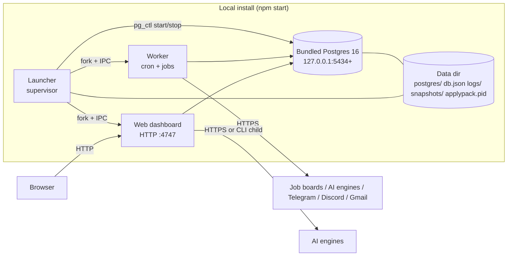

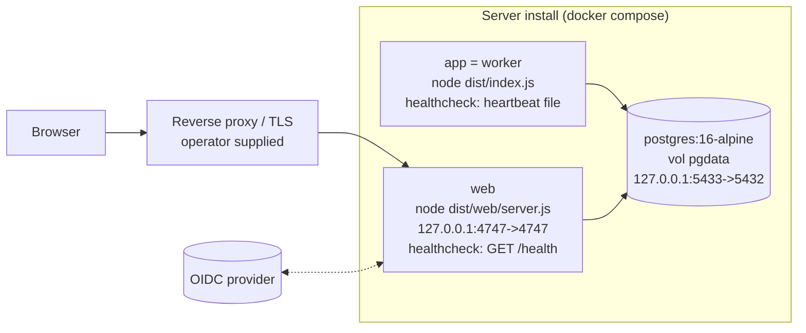

### 2.2 Layering inside each process

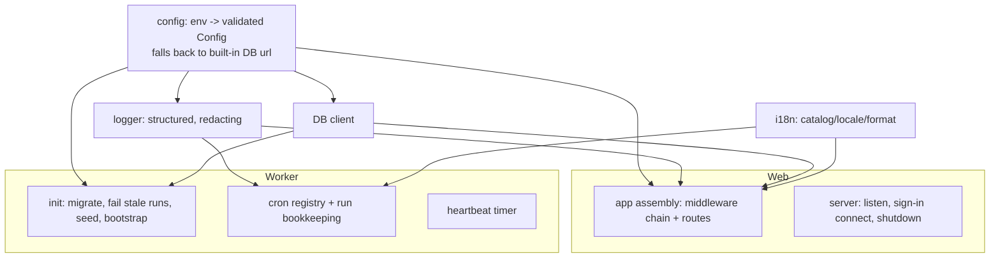

---

## 3. Key flows

### 3.1 Local launcher start / stop

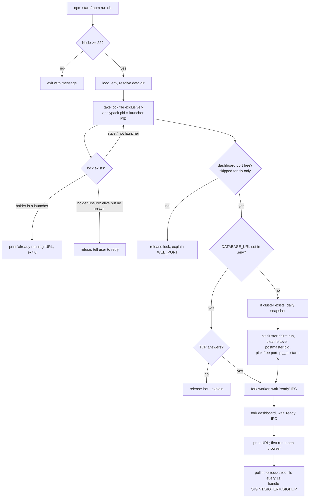

Stop path: signal or `stop-requested` file -> stop children **in parallel** (send IPC `shutdown`, SIGKILL after 70 s) -> `pg_ctl stop -m fast` -> remove lock + stop request -> exit. A second Ctrl+C SIGKILLs children immediately. `npm run stop` writes the `stop-requested` file and waits up to 90 s for the lock to disappear.

Child crash handling: a child that dies **before** announcing ready aborts the whole start; after ready it is restarted with exponential delay 1 s, 2 s, 4 s ... capped 30 s; 5 crashes within a 120 s window stops everything (exit 1).

### 3.2 Worker startup and shutdown

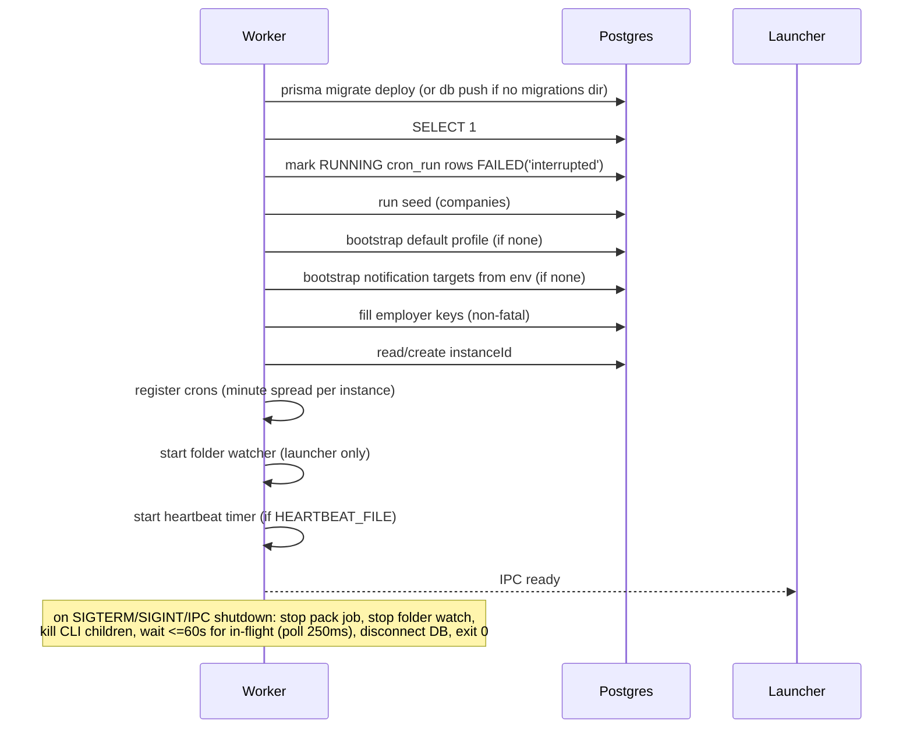

### 3.3 Web request pipeline (order matters)

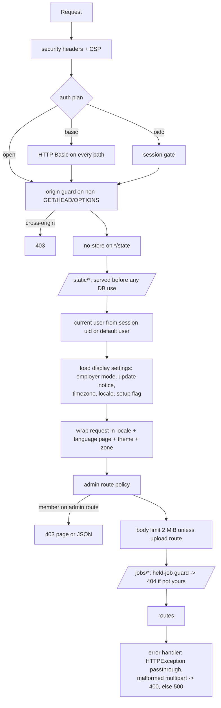

### 3.4 OIDC sign-in

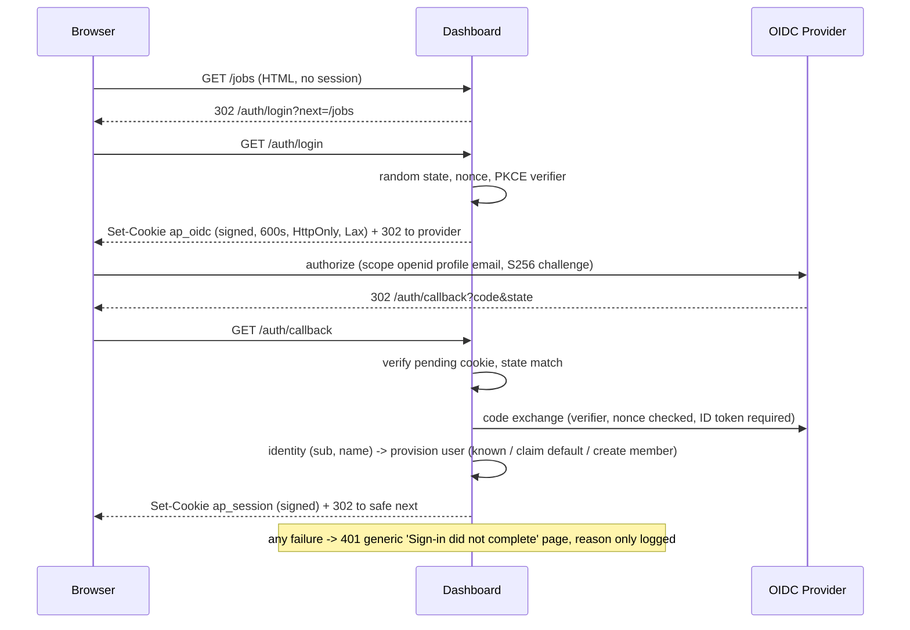

Non-HTML requests without a session (POST, polls, curl) get `401` plain text rather than a redirect.

### 3.5 Language resolution per request

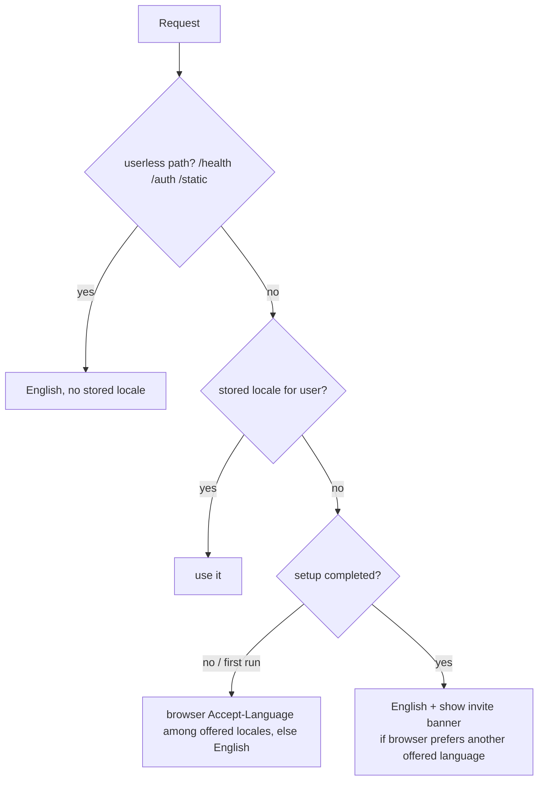

### 3.6 Worker cron tick wrapper

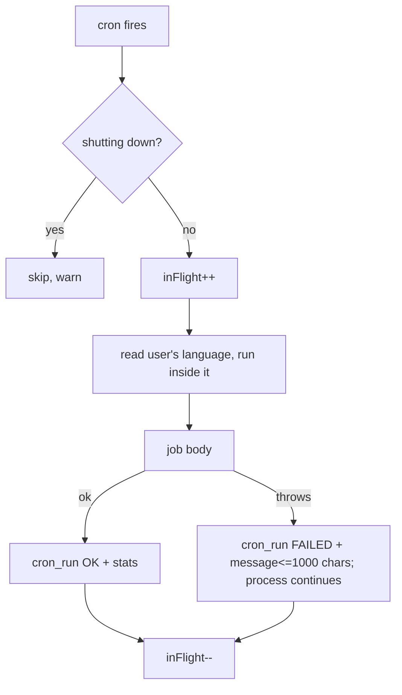

---

## 4. State machines

### 4.1 Launcher lock holder classification

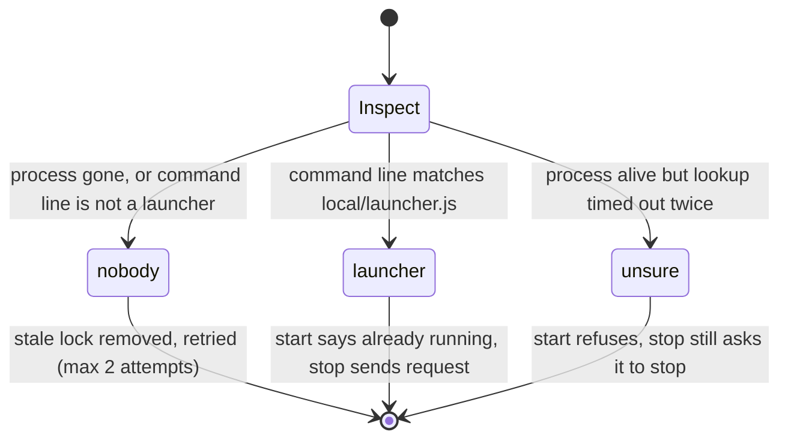

### 4.2 Built-in database lifecycle

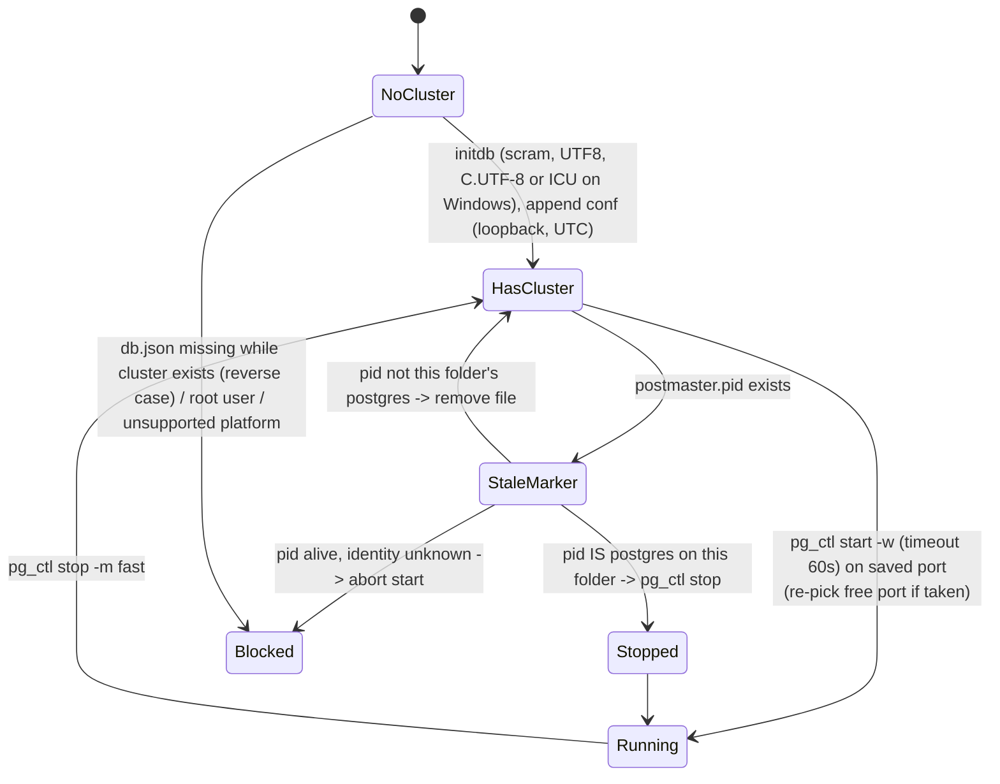

### 4.3 Run record (cron_run)

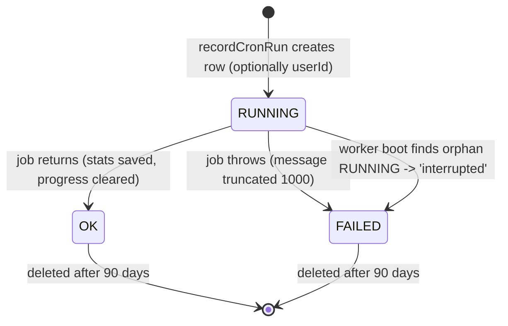
(RUNNING rows are never swept by cleanup.)

### 4.4 OIDC session

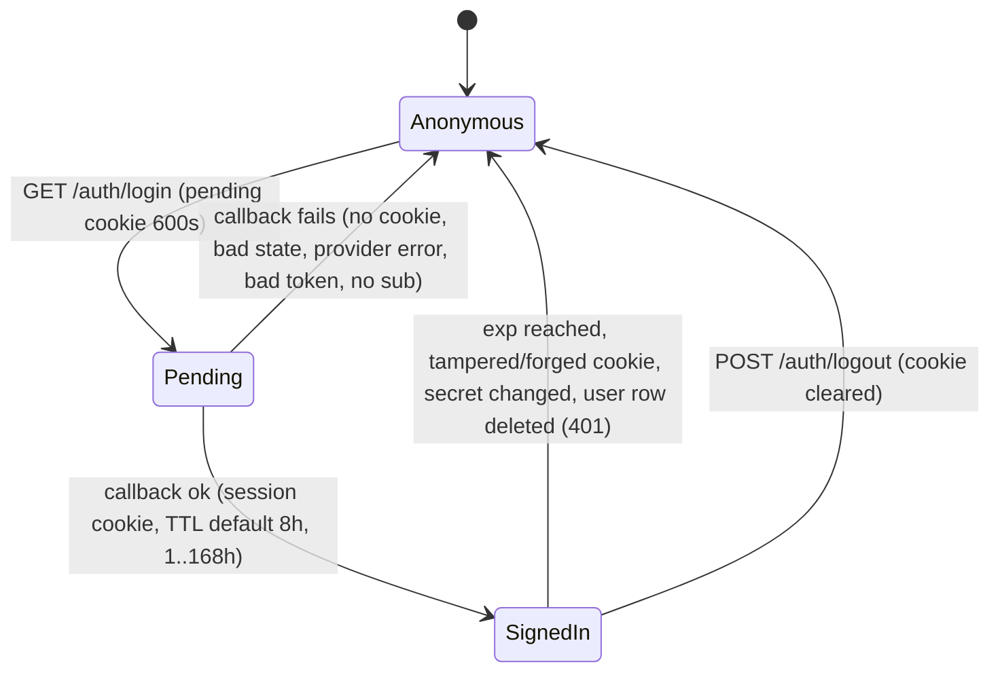

### 4.5 User role

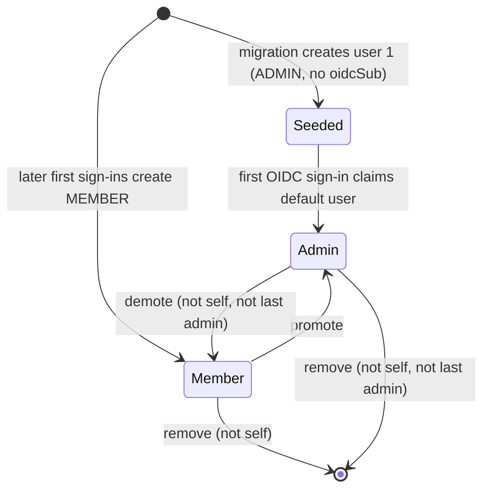

### 4.6 Locale stage

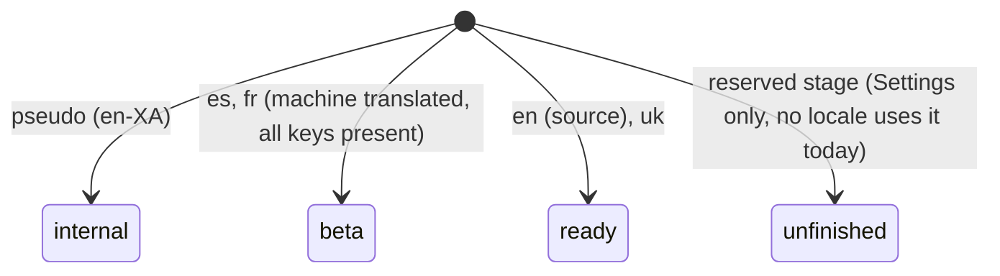

---

## 5. Feature list

| ID | Feature | What it does | Trigger | Key config / settings |
|---|---|---|---|---|
| PLT-01 | Local launcher (`start`) | Starts bundled DB, then worker, then dashboard; waits for each child's IPC `ready`; prints dashboard URL and data dir | user: `npm start` | `WEB_PORT`, `WEB_HOST`, `DATABASE_URL`, `APPLYPACK_DATA_DIR` |
| PLT-02 | Database-only mode (`db`) | Runs just the bundled Postgres (for dev watchers and scripts); refuses if `DATABASE_URL` is set | user: `npm run db` | - |
| PLT-03 | Graceful stop command | Writes a stop-request file in the data dir; the running launcher polls it every 1 s and shuts down; waits up to 90 s | user: `npm run stop` | - |
| PLT-04 | Single-instance lock | `applypack.pid` created exclusively; stale locks cleared by inspecting the PID's command line (PowerShell on Windows, `ps` elsewhere, 15 s timeout, 2 attempts) | event: start | - |
| PLT-05 | Process supervision | Restart crashed children with 1 s doubling to 30 s; give up after 5 crashes in 120 s; child dying before ready aborts startup | event | constants only |
| PLT-06 | Signal handling | SIGINT/SIGTERM/SIGHUP -> orderly stop; second signal force-kills children | user/OS | child grace 70 s |
| PLT-07 | Bundled Postgres management | Locates platform binary package (darwin arm64/x64, linux arm64/x64, win32 x64), repairs library symlinks, `initdb` once, clears leftover pid file, starts/stops with `pg_ctl` | event: start | - |
| PLT-08 | Cluster bootstrap settings | scram-sha-256 auth, user `applypack`, db `postgres`, UTF8, locale C.UTF-8 (ICU `und` on Windows), listen 127.0.0.1 only, no unix socket, UTC; random 32-byte base64url password | event: first run | `db.json` mode 0600 |
| PLT-09 | Port selection | Preferred DB port 5434; if busy picks any free port and persists it in `db.json` | event: start | - |
| PLT-10 | Connection state file | `db.json` {port,user,password>=16 chars} lets dev watchers/scripts find the DB; written atomically (tmp + rename); missing while cluster exists = hard error | event | - |
| PLT-11 | Daily snapshot | Before starting an existing cluster, copy `postgres/` to `snapshots/YYYY-MM-DD/postgres` (skips `postmaster.pid/.opts`), at most one per local calendar day, keep newest N, delete rest; failure is a warning | event: start | `APPLYPACK_SNAPSHOTS` (0-30, default 3, 0 = off) |
| PLT-12 | External-DB mode | If `DATABASE_URL` is set the launcher skips the bundled DB but TCP-probes it (5 s) and refuses to start if nothing answers | event | `DATABASE_URL` |
| PLT-13 | Data directory resolution | Win `%APPDATA%\ApplyPack`; macOS `~/Library/Application Support/ApplyPack`; Linux `$XDG_DATA_HOME or ~/.local/share/applypack`; override env; created mode 0700 | event | `APPLYPACK_DATA_DIR` |
| PLT-14 | Browser auto-open | On first run only, opens dashboard (`open`/`explorer.exe`/`xdg-open`), suppressed in CI or by flag | event: first run | `APPLYPACK_NO_OPEN`, `CI` |
| PLT-15 | Port pre-check | Refuses start if dashboard port is taken, suggests next port | event | `WEB_PORT` |
| PLT-16 | IPC child protocol | `ready` and `shutdown` messages; child exits when launcher disconnects; without IPC (Docker/dev) calls are no-ops | event | - |
| PLT-17 | Start-at-login entry | Settings (admin) writes/removes a launchd agent (mac), systemd user unit (Linux, + daemon-reload/enable), or Startup `.cmd` (Windows) that runs the launcher from this checkout with stable Node path, current PATH, no-browser flag, data dir | user: settings toggle | only offered when running under the launcher |
| PLT-18 | Local-install detection | "Local install" = launched by launcher OR found built-in DB via `db.json`; used to relax folder-source path rules | event | - |
| PLT-19 | Data import from Docker install | Parses a `pg_dump --data-only --inserts --column-inserts` file with its own SQL splitter; with `--yes`, truncates every public table (except migrations) with restart identity and replays statements in one transaction (30 min timeout); superuser gets `session_replication_role=replica`; refuses while a launcher with a worker is running | user: `npm run db:import -- file --yes` | - |
| PLT-20 | Worker process | Cron-driven jobs; no HTTP server; per-install minute spreading | event: start | `TZ` |
| PLT-21 | Web process | Hono server, listens on host/port, announces ready | event: start | `WEB_HOST`, `WEB_PORT` |
| PLT-22 | Worker init: schema | Runs `prisma migrate deploy` when migrations dir exists; else `db push --accept-data-loss` | event: worker start | - |
| PLT-23 | Worker init: interrupted runs | Marks leftover `RUNNING` run rows `FAILED('interrupted')` | event: worker start | - |
| PLT-24 | Worker init: seeding | Seeds company/source catalog (no employer board active), default "My profile" profile if none, active profile set | event: worker start | `MIN_FIT_SCORE`, `MIN_SALARY_USD` |
| PLT-25 | Notification bootstrap from env | If no notification targets exist, import Telegram (token+chat) and/or Discord webhook (validated) and enable alerts; afterwards env is ignored | event: first boot | `TELEGRAM_*`, `DISCORD_WEBHOOK_URL` |
| PLT-26 | Instance identity | Persistent `instanceId` in app settings; used to spread shared-source cron minutes | event | - |
| PLT-27 | Cron registry | Hourly `fetch` (:05), `gmail` (:35), per-minute `gmail-requests`, hourly `digest`/`stale-applications` (:00), weekly `cleanup` (Sun 03:00), monthly `hn-hiring` (1st 06:00), weekly `discovery` (Sun 04:00), per-minute `pack` | schedule | `TZ`; minute replaced per instance for fetch/hn-hiring/discovery |
| PLT-28 | Overlap protection | node-cron no-overlap per job in-process; cross-process fetch exclusivity via Postgres advisory lock | schedule/event | lock key `0x41504b46` |
| PLT-29 | Fetch lock wait | Hourly tick retries lock every 60 s for up to 50 min; stops on shutdown; one-shot scripts try once (waitMs 0) | schedule | constants |
| PLT-30 | Run bookkeeping | Every job run recorded as a run row (name, status, stats, error, progress, optional user) | schedule/event | retention 90 d |
| PLT-31 | Per-person scheduled jobs | Digest and stale-nudge beat hourly; each user's own schedule decides if due; a run row and language per user; one user's failure doesn't stop the next | schedule | per-user alert schedule |
| PLT-32 | Quiet beats | Minute-level beats log at debug and write no run row unless they did work | schedule | - |
| PLT-33 | Graceful worker shutdown | Stops pack job and folder watcher, kills CLI engine children, waits up to 60 s for in-flight (poll 250 ms), disconnects DB | signal/IPC | - |
| PLT-34 | Folder watcher | Local-install only: watches enabled saved-posting folders, settles ~ (scan settle + 2 s), re-lists every 60 s, retries busy 60 s | event | launcher only |
| PLT-35 | Heartbeat | Worker touches `HEARTBEAT_FILE` every 60 s; write failures logged once per streak | schedule | `HEARTBEAT_FILE` |
| PLT-36 | Healthcheck CLI | `health-check web|worker`: web = GET `/health` (5 s timeout, Basic Auth header if configured); worker = heartbeat file age <= 180 s | docker | `WEB_BASIC_AUTH`, `HEARTBEAT_FILE` |
| PLT-37 | `/health` route | Unauthenticated-by-session; `SELECT 1`; 503 `{ok:false,db:'down'}` on failure (error detail only logged); else `{ok,db:'up',lastFetch:{at,status}|null}` | docker/monitor | - |
| PLT-38 | Config loading and validation | `.env` -> process env -> schema validation; aggregate error list at startup; empty string = absent for optional text | event | see section 6.1 |
| PLT-39 | Built-in DB fallback for tools | No `DATABASE_URL` -> read `db.json` and inject URL into env (also for Prisma CLI) | event | - |
| PLT-40 | Structured logging | JSON lines in production, pretty in terminals; ISO timestamps; no pid/hostname | always | `LOG_LEVEL`, `NODE_ENV` |
| PLT-41 | Log redaction | Fields `apiKey, api_key, botToken, webhookUrl, client_secret, clientSecret, password, authorization, Authorization, resumeText` censored to `[redacted]` at depth 0-2 | always | - |
| PLT-42 | Request log | One info line per web request: method, path, status, duration | web | - |
| PLT-43 | Secure headers | CSP default-src self; script/style self + inline; img/font self + data:; connect self; frame DENY; referrer none | web | - |
| PLT-44 | Auth: open | No auth when no Basic/OIDC configured (safe only on loopback) | config | default |
| PLT-45 | Auth: shared Basic password | `WEB_BASIC_AUTH=user:password` (password may contain colons) protects every path including `/health`; malformed value refuses start | config | `WEB_BASIC_AUTH` |
| PLT-46 | Auth: OIDC sign-in | Authorization-code + PKCE(S256) + state + nonce, ID token required; scopes `openid profile email`; discovery at server start (unreachable provider -> exit 1) | config | `OIDC_*`, `WEB_PUBLIC_URL` |
| PLT-47 | OIDC + Basic combined | With OIDC on, Basic guards `/health` only (so healthcheck still works); if Basic absent `/health` is open | config | - |
| PLT-48 | Fail-closed auth config | Partial OIDC settings or invalid Basic value -> log error and exit rather than serve open | startup | - |
| PLT-49 | Session cookie | Signed JSON {sub,name,uid,exp}; HttpOnly, SameSite=Lax, Path=/, Secure when public URL is https; old sessions lacking uid rejected | auth | `OIDC_SESSION_SECRET`, `OIDC_SESSION_HOURS` |
| PLT-50 | Safe redirect target | `next` must be a local path; rejects `//`, `/%2f`, backslashes, control chars, `/auth*` | auth | - |
| PLT-51 | Sign-out | POST `/auth/logout` clears cookie, shows signed-out page; POST so the origin guard covers it | user | - |
| PLT-52 | Auth gate behaviour | Open paths: `/health`, `/auth/*`, `/static/*`. HTML GET -> 302 to login; everything else -> 401 text | auth | - |
| PLT-53 | User provisioning | First sign-in: known `oidcSub` -> reuse; else claim unclaimed default user (becomes admin, inherits legacy data); else create MEMBER with blank primary profile; unique-violation race resolved by re-reading | auth | - |
| PLT-54 | Current-user context | Request-scoped user (async context); no session -> default user 1; DB down -> built-in fallback admin; missing user row with session -> 401 | web | - |
| PLT-55 | Route access policy | Every route classified open/personal/admin; most specific pattern wins; unlisted = admin; HEAD treated as GET | web | table in code |
| PLT-56 | Admin guard | Member hitting admin route -> 403 localized page (JSON for `/state`); old `/welcome` GET redirects member home (303) | web | - |
| PLT-57 | User administration | List users with counts and last activity; promote, demote, remove; rules: no self-demote/remove, never last admin, judged inside a transaction under the global settings row lock; removal also deletes the user's run rows | admin | - |
| PLT-58 | Cross-origin write guard | For non-GET/HEAD/OPTIONS: decide by `Sec-Fetch-Site` (same-origin/none ok; cross-site/same-site refuse), else `Origin` host vs effective host (first `X-Forwarded-Host`, else `Host`), else `Referer`, else allow (non-browser) ; opaque `null` origin without fetch metadata refused; scheme ignored | web | - |
| PLT-59 | Body size limits | 2 MiB default on POST; named upload routes bring their own (5 MB resume, 200 MB applicant batches, etc.); over limit -> 413 localized | web | constant |
| PLT-60 | Double-submit guard | In-process "once" per key for AI/row-creating actions; second press gets a flash warning; key expires after 10 min | web | - |
| PLT-61 | Flash messages | One-shot message in a 5 s cookie across POST-redirect-GET; kinds ok/warn/err; schema errors echo truncated to 160 chars | web | - |
| PLT-62 | Static asset caching | `/static/*`: `no-cache` (revalidate); bundled fonts 1 week; `*/state` endpoints `no-store`; static served before any DB access | web | - |
| PLT-63 | Error handling | Framework HTTP errors pass through; malformed multipart -> 400; unexpected -> logged + generic 500; unknown path -> 404 | web | - |
| PLT-64 | Theme preference | Cookie `theme` = light/dark; system = no cookie; 1 year; applied from first byte | user | - |
| PLT-65 | Display time zone | Per-user timezone wraps request so every date renders in it; default `TZ` | web | user setting, `TZ` |
| PLT-66 | Update notice (optional) | Weekly (cleanup job) and on toggle: one GET to the public releases API; stores latest plain `X.Y.Z` tag; sidebar shows if newer; cached 1 h in web; off by default; never self-updates | schedule/user | settings toggle |
| PLT-67 | App version/UA | Version read from package manifest; HTTP User-Agent `applypack/<major.minor>` + repo URL | always | - |
| PLT-68 | Outbound HTTP defaults | 10 s timeout, retries at 1 s then 3 s, honours 429 Retry-After only if <= 10 s | always | constants |
| PLT-69 | i18n catalog | One flat JSON per language, English is the key source; 4310 keys per language today; typed keys; missing translation falls back to English | always | `src/i18n/catalog/*.json` |
| PLT-70 | Message syntax | Subset of ICU MessageFormat: `{arg}`, `{n, number}`, `plural` (`=N`, zero/one/two/few/many/other, `#`), `select`, inline tags `<x>..</x>`/` `, apostrophe quoting only before `{ } < #` | always | - |
| PLT-71 | Locale registry | en (ready), uk (ready), es/fr (beta), pseudo en-XA (internal); each carries a formatting tag with Latin digits forced | always | - |
| PLT-72 | Language resolution | Stored user choice wins; else first-run uses Accept-Language (q-weighted, region ignored, max 20 entries); else English + invite banner if browser prefers another offered language | web | per-user locale |
| PLT-73 | Language switcher / setting | Switcher offers ready+beta locales; settings POST accepts any non-internal locale; wizard stores locale only if it was not English | user | - |
| PLT-74 | Locale formatting module | Numbers, dates (zone from caller), ranges (thin space normalised, year-crossing handled), list joiners, weekday names, region names (CLDR; English uses gazetteer names) | always | - |
| PLT-75 | Place/workplace names | Localized country, region-group and workplace labels; underlying stored labels remain English | web | - |
| PLT-76 | Worker-run locale | Each cron tick/once-script reads the user's language fresh; messages (alerts, recaps) arrive in it | schedule | - |
| PLT-77 | Browser-side i18n | Page modules use mirrored message engine; English module generated from `browser.*` keys (committed); other languages embedded as JSON in the page (`<` escaped) | web | `npm run i18n:browser` |
| PLT-78 | Pseudo-locale audit | Renders English wrapped in markers; hardcoded-English detector reads rendered HTML (skips code/svg/pre/`translate=no`/`lang=en`, reads title/aria-label/placeholder/alt) and counts leftovers | CI | - |
| PLT-79 | Posting-language detection | Stop-word counting over first 4000 chars for 11 languages; needs >= 8 hits; Ukrainian vs Russian disambiguated by letters; used to show a "not English" notice | web | - |
| PLT-80 | Folder-source path policy | A folder source may be read if inside a named root; else only on local installs, inside home, not hidden, not `Library`/`AppData`, not overlapping the data dir; links resolved first | admin | `APPLYPACK_INBOX_ROOTS` |
| PLT-81 | Blocked posting hosts | Never requested: linkedin, indeed, glassdoor, workday/myworkdayjobs, wellfound, dice (incl. subdomains) | always | constant list |
| PLT-82 | Retention cleanup | Weekly: dismissed rows > 30 d (never with pipeline stage), orphan postings, AI ledger > 400 d, expired screenings (cascade), runs > 90 d (not RUNNING) | schedule | constants |
| PLT-83 | Script: fetch-once | One fetch tick as a "fetch-now" run | user | - |
| PLT-84 | Script: digest-once | Recap for every user now | user | - |
| PLT-85 | Script: stale-once | Stale-application nudge for every user now | user | - |
| PLT-86 | Script: cleanup-once | Retention job now | user | - |
| PLT-87 | Script: gmail-once | Read every connected mailbox now | user | - |
| PLT-88 | Script: hn-once | Monthly HN pull now | user | - |
| PLT-89 | Script: discovery-once | Discovery re-probe now | user | - |
| PLT-90 | Script: pack-once | Application-pack queue now | user | - |
| PLT-91 | Script: test-telegram | `getMe` check + test messages | user | `TELEGRAM_BOT_TOKEN` |
| PLT-92 | Script: backfill-descriptions | Re-clean stored descriptions with markup (dry-run supported; suspicious-shrink guard 200/1000 chars) | user | `--dry-run` |
| PLT-93 | Script: backfill-fingerprints | Fingerprint stored jobs, link cross-listings, annotation only | user | `--dry-run` |
| PLT-94 | Script: backfill-apply-link-flags | Append red-flag tags for unusable apply links, idempotent | user | `--dry-run` |
| PLT-95 | Script: backfill-locations | Derive workplace/countries/regions from location strings for old rows; skips structured/AI-sourced | user | `--dry-run` |
| PLT-96 | Script: refetch-descriptions | Re-pull each board and rewrite descriptions only, 1 s polite delay, skips manual/import/folder/gmail | user | `--dry-run` |
| PLT-97 | Script: reanchor-matches | Flip `cannot_claim` terms spelled in snapshot to `present` and rescore; no AI | user | `--dry-run` |
| PLT-98 | Script: rescan-resumes | Re-run resume scan for all (or `--only id`) | user | `--only` |
| PLT-99 | Script: rescore-screenings | Re-score employer-mode screenings from stored replies, prints old->new, writes only with `--write` | user | `--write --screening` |
| PLT-100 | Script: ai-spend-report | Per UTC day/engine/model spend table for reconciling with vendor invoices | user | `--from --to` |
| PLT-101 | Script: keyword-audit | Read-only audit of keyword matcher against stored comparisons | user | - |
| PLT-102 | Script: priority-rules-dryrun | Show which stored jobs the active profile's priority rules would match | user | - |
| PLT-103 | Script: bench/compare family | `resume-bench`, `screen-bench`, `verify-brief`, `match-matrix`, `match-variance`, `churn`, `pack-dry`: hand-run quality measurements that spend AI and write rows; never in CI | user | various flags |
| PLT-104 | Script: dead-exports | Fails (exit 1) on dead or over-exported symbols; tests-only exports allowed | CI | - |
| PLT-105 | Script: i18n-browser | Regenerates committed English browser module | dev | - |
| PLT-106 | Script: route-smoke | In-process request of every route plus fixture flows (see 7.4) | CI/dev | throwaway DB only |
| PLT-107 | Script: health-check | See PLT-36 | docker | - |
| PLT-108 | Script: archive-traffic.sh | Snapshots repo stats/traffic via the GitHub CLI into dated JSON (traffic retained 14 days upstream) | maintainer | `REPO` |
| PLT-109 | Docker image | Multi-stage (deps -> build -> runtime) on Node 24 alpine; lockfile install; prune dev deps; delete bundled-DB binaries; tini as PID 1; runs as `node`; three pinned CLI engines globally installed | build | `CLAUDE_CODE_VERSION`, `GEMINI_CLI_VERSION`, `CODEX_VERSION` args |
| PLT-110 | Compose stack | postgres + app(worker) + web with healthchecks and restart policies | ops | `.env` |
| PLT-111 | CI pipeline | Jobs `test`, `docker`, `local-start` (see 7.3) | push/PR | - |
| PLT-112 | Dependency policy | `npm audit --omit=dev --audit-level=high` gate; `overrides` for unpatched transitive; weekly dependency PRs (minor/patch grouped, majors separate) | CI/schedule | - |
| PLT-113 | Generated stylesheet gate | CSS is generated and committed; CI rebuilds and fails on diff | CI | - |
| PLT-114 | Schema/migration parity gate | `migrate deploy` then `migrate diff --exit-code` between DB and schema; schema validate + format check | CI | - |
| PLT-115 | Env-example parity test | Every config key documented in the example env; every documented key read somewhere; every direct env read documented or excused | CI | - |
| PLT-116 | Marketing site | Static site served by an assets-only edge worker config; single landing page with demo, tour video, employers page, sitemap/robots; demo runs real scoring modules on a fixture | deploy | `wrangler.jsonc` |
| PLT-117 | Fetch-lock helper | Dedicated single-connection DB client holding a session advisory lock so pooled connections cannot release it; crash frees lock automatically | event | - |
| PLT-118 | Unique-violation retry | Writes that race on unique keys retry once with a fresh transaction | event | - |

---

## 6. Business rules & invariants

### 6.1 Environment variables (all, with defaults and validation)

Parsed by one schema; failure aborts startup with a bulleted list. Empty value = "absent" only for the fields marked (E).

| Variable | Default | Rule / use |
|---|---|---|
| `DATABASE_URL` | none | required (min 1 char) unless built-in DB's `db.json` exists; set by launcher/compose |
| `AI_PROVIDER` | `anthropic_api` | enum of known engine ids; only seeds the default (runtime setting overrides) |
| `ANTHROPIC_API_KEY` | none | optional on purpose (UI can supply; failing here would lock the user out of the UI) |
| `CLAUDE_MODEL` | `claude-haiku-4-5-20251001` | classifier model |
| `CLAUDE_MODEL_RESUME`, `CLAUDE_MODEL_COVER` | `''` | empty = engine's own default for the role |
| `CLAUDE_CODE_BIN`, `GEMINI_CLI_BIN`, `AGY_CLI_BIN`, `CODEX_CLI_BIN` | `claude`, `gemini`, `agy`, `codex` | CLI engine executables |
| `OPENAI_API_KEY` | none | optional |
| `OPENAI_BASE_URL` | `https://api.openai.com/v1` | any `/chat/completions` server |
| `OPENAI_MODEL` | `''` | default model for empty slot |
| `OLLAMA_URL` | `http://127.0.0.1:11434` | local model server (UI can override) |
| `LOCAL_MODEL` | `''` | model for empty slot |
| `AI_CONCURRENCY` | 3 | int 1..8 |
| `TELEGRAM_BOT_TOKEN`, `TELEGRAM_CHAT_ID`, `DISCORD_WEBHOOK_URL` | none | first-boot bootstrap only |
| `LOG_LEVEL` | `info` | fatal/error/warn/info/debug/trace/silent |
| `TZ` | `UTC` | cron timezone and default display zone |
| `MIN_FIT_SCORE` | 70 | int 0..100; seeds first profile |
| `MIN_SALARY_USD` | 0 | int >= 0; seeds first profile (0 = off) |
| `WEB_PORT` | 4747 | int 1..65535 |
| `WEB_HOST` | `127.0.0.1` | loopback by default; compose sets `0.0.0.0` in the web container only |
| `WEB_BASIC_AUTH` (E) | none | `user:password` |
| `OIDC_ISSUER` (E) | none | turns sign-in on; https required (http only for localhost/127.0.0.1/[::1]) |
| `OIDC_CLIENT_ID`, `OIDC_CLIENT_SECRET` (E) | none | required with issuer |
| `OIDC_SESSION_SECRET` (E) | none | >= 32 chars; changing it signs everyone out |
| `OIDC_SESSION_HOURS` (E) | 8 | integer 1..168 |
| `WEB_PUBLIC_URL` (E) | none | origin only (no path/query/hash); required with issuer; redirect URI = origin + `/auth/callback`; `https` => Secure cookies |
| `GOOGLE_CLIENT_ID`, `GOOGLE_CLIENT_SECRET` (E) | none | both set = Gmail feature on |
| `NODE_ENV` | `development` | `production` => JSON logs |
| `HEARTBEAT_FILE` | none | worker heartbeat path; unset = nothing written |
| `APPLYPACK_INBOX_ROOTS` | `''` | PATH-style list of absolute folder roots a folder source may read |
| Read outside the schema | | `APPLYPACK_DATA_DIR`, `APPLYPACK_NO_OPEN`, `APPLYPACK_SNAPSHOTS` (launcher); `CI`; `PATH`; `GEMINI_API_KEY`, `CLAUDE_CODE_OAUTH_TOKEN`, `CLAUDE_CONFIG_DIR`, `GOOGLE_GENAI_USE_VERTEXAI`, `GOOGLE_GENAI_USE_GCA` (passed through to CLI children) |

Auth-plan rules (checked together at web start):
- A `WEB_BASIC_AUTH` without a colon, empty user, or empty password -> refuse.
- Any `OIDC_*`/`WEB_PUBLIC_URL` set while `OIDC_ISSUER` empty -> refuse ("switch it on or remove the others").
- Messages name the setting but never print values.

### 6.2 Launcher constants

- Minimum Node major 22 (image uses 24).
- Child stop grace 70 s; stop-command wait 90 s; stop poll 1 s; pg_ctl wait 60 s; TCP probe 5 s; process lookup 15 s x 2.
- Restart: window 120 s, max 5, delay `min(1000 * 2^recentCrashes, 30000)` ms.
- Bundled DB: user `applypack`, db `postgres`, preferred port 5434, password 32 random bytes; files `db.json`, `applypack.pid`, `stop-requested`, `logs/postgres.log`, `snapshots/`, `postgres/`.
- Refuses to run Postgres as root (non-Windows).
- Snapshot dir names must match `YYYY-MM-DD`; anything else in the folder is left alone.
- `db.json` and data dir permissions: 0600 / 0700.
- Leftover `postmaster.pid`: stop only if the PID's command line contains this exact data folder (path-normalised, case-insensitive); otherwise delete the stale file; indeterminate -> abort.

### 6.3 Security rules

- Dashboard default bind is loopback; never publish publicly without auth or a TLS proxy. Compose publishes to `127.0.0.1` only (both DB 5433 and web 4747).
- Origin guard rules are order-sensitive (Sec-Fetch-Site > Origin > Referer > none); `same-site` is refused deliberately; `X-Forwarded-Host` first value wins; no CSRF token by design.
- Session cookie and pending-sign-in cookie: HttpOnly, SameSite=Lax, Path `/`; pending TTL 600 s; clear options mirror Secure flag.
- Sign-in failure reveals nothing to the client (one generic 401 page); reason logged at warn.
- Route classification is exhaustive: the smoke test fails the build if a registered route is in zero lists or two lists. A member must be refused every admin route without changing install state.
- Body ceiling 2 MiB for all POST except enumerated upload routes.
- Log redaction list (PLT-41); stored AI keys are max 500 chars, single line, never logged or rendered unmasked; CLI stderr scrubbed.
- Gmail/OIDC secrets only via env; AI keys may be stored in DB (settings table), env fallback.
- Folder reads: real paths only (symlinks resolved), never the data dir, never hidden or OS-application folders; servers read only named roots.
- Never-fetched hosts list (PLT-81).
- Fetch-time politeness: per-install minute spread for shared-source jobs (`fetch`, `hn-hiring`, `discovery`) via hash of `instanceId:jobName` mod 60; `digest`, `stale-applications`, `cleanup` keep their fixed minutes so user-chosen digest hours are met.

### 6.4 Roles & access

- Roles: ADMIN, MEMBER. User id 1 is the default user, created by migration as ADMIN; the first OIDC sign-in claims it.
- Admin-only: setup wizard, sources/companies/watchlist/folders/discovery/import, fetching toggles, AI engine settings, employer mode & screening, login item, update check, source health toggle, users page, manual fetch.
- Personal (member OK): own jobs, applications, resumes, letters, packs, facts, mutes, own settings tabs (schedule, targets, profiles, locale, theme, Gmail), read-only run history.
- Without sign-in everyone is the default user (ADMIN).

### 6.5 Retention & limits

- Dismissed rows 30 d (only when no pipeline stage); AI ledger 400 d; run history 90 d; screening per-record `retainUntil`; daily funnel rollup never pruned.
- In-process double-submit TTL 10 min; flash 5 s; update-notice cache 1 h; heartbeat stale after 180 s.
- Fetch-lock wait 50 min / retry 60 s for the hourly tick.
- Digest: up to 4 digest hours per user; fetch cadence options hour/2h/4h/day with 5 min tolerance.

### 6.6 i18n rules

- Interface only: prompts, model output, resumes, letters, logs, CSV values are never translated.
- Parity rule: every language must carry every key (enforced by test); English fallback is a safety net only.
- Digits always Latin; Ukrainian and others formatted via `Intl` tags.
- Accept-Language: ignore region, ignore `q=0`/non-numeric weights, sort by weight then position.
- Posting-language detection is informational (affects advice/letter language notice), not translation.
- Browser mirror must stay behaviour-identical to server message formatter (parity test over every message of every catalog).

---

## 7. External dependencies & integration contracts

### 7.1 Runtime dependencies

| Dependency | Role | Contract |
|---|---|---|
| PostgreSQL 16 | only datastore | UTC timezone; UTF8; advisory locks; row lock on single settings row for global writes |
| Embedded Postgres binary packages | local mode | initdb/pg_ctl executables per platform; symlink repair when install scripts skipped |
| Prisma | ORM + migrations | `migrate deploy` at worker boot; CI checks schema == migrations (113 migration folders) |
| Hono + node-server | HTTP | middleware as in 3.3 |
| openid-client | OIDC | discovery; allowInsecureRequests only for http localhost issuer |
| node-cron | scheduling | timezone = `TZ`, noOverlap, custom logger |
| pino / pino-pretty | logging | see PLT-40/41 |
| zod | validation | all env and external data |
| Tailwind (build-time) | CSS | output committed |

### 7.2 Integration contracts

- **OIDC provider**: must expose discovery, support code flow, PKCE S256, RS256 (or library-negotiated) ID tokens with `sub`; claim use: `sub` (required), `name` > `preferred_username` > `email` for display. Client secret via POST or Basic (library chooses). Redirect URI: `<WEB_PUBLIC_URL>/auth/callback`.
- **Reverse proxy**: should forward `Host`/`X-Forwarded-Host` unchanged from the browser; TLS terminated upstream; set `WEB_PUBLIC_URL` to the public https origin.
- **Docker orchestrator**: healthchecks as in 5 (web 30 s interval/60 s start; worker 60 s/120 s start, 3 retries); `tini` init; volumes optional for CLI credentials (`~/.claude`, `~/.gemini`, `~/.codex`) and read-only inbox mount; `host.docker.internal` mapped to host gateway for local model servers.
- **Update check**: `GET https://api.github.com/repos/<owner>/<repo>/releases/latest`, reads only `tag_name`, accepts `v?X.Y.Z`.
- **Login-item OS interfaces**: launchd plist (`io.applypack.launcher`, RunAtLoad), systemd user unit (`applypack.service`, `WantedBy=default.target`), Windows Startup `ApplyPack.cmd`.
- **Dump format for import**: `pg_dump --data-only --inserts --column-inserts`.
- **Static site hosting**: assets-only edge worker serving `site/public`; custom domains configured in the host dashboard, not in code.

### 7.3 CI contract (three jobs)

1. **test** (Ubuntu, Node 24, Postgres 16 service): `npm ci` -> `npm audit --omit=dev --audit-level=high` -> `prisma validate` -> `prisma format --check` -> `tsc --noEmit` -> unit tests (`tsx --test "src/**/*.test.ts"`, Node built-in runner) -> dead/over-exported export audit -> regenerate CSS and require clean git diff -> `migrate deploy` -> `migrate diff --exit-code` -> build -> route smoke (engine forced to a CLI engine so background scans fail fast).
2. **docker**: build the image, never push.
3. **local-start** (matrix: Ubuntu Node 22 & 24, macOS 24, Windows 24): `npm start` with a temp data dir and no-open flag in background; poll up to 240 s until `GET /` returns **303** (redirect to setup wizard); run the route smoke against the bundled DB; `npm run stop`; verify the lock file and `postmaster.pid` are gone ("stopped cleanly").

Only pure modules are unit tested (no Prisma / AI SDK in tests); wiring is covered by the route smoke; AI quality by hand-run bench scripts.

### 7.4 What the route smoke asserts (behavioural summary)

- **Coverage**: every registered GET route (plus query-variant URLs: every jobs filter combined, tabs including an invalid one, AI-usage periods, wizard steps) gets one in-process request with a same-origin header; acceptable = 200/302/303; 404 allowed only for a short list of "subject not yet created" routes.
- **First-run writes** succeed with the right redirects: pasted job, resume upload (starts a scan that must fail fast), duplicate resume upload deduped to the existing row, format comparison page, applicant batch upload for employer mode (counts of added / duplicate / held-for-look / unreadable / letters attached / left out), fetching toggle, Gmail card says "not set up" without Google client.
- **Security**: cross-origin POST -> 403 (including on import and sign-in routes); upload routes reject hostile fields; body limits.
- **Concurrency**: same posting pasted twice at once -> both succeed (unique-key race handled); manual fetch while lock is held -> accepted but records an "overlap" no-op.
- **Isolation**: a second user cannot see/modify first user's jobs, resumes, notification targets, or any personal data; shared postings with per-user scores stay separate.
- **Roles**: every route belongs to exactly one access list; a member is refused all admin routes and the install fingerprint is unchanged afterwards; user-management rules (last admin, self) hold.
- **Import flow**: CSV upload -> preview token -> mapping -> import -> list -> delete source deletes its jobs; foreign-origin refused.
- **Folder sources**: outside-root refused; add switched off; check-now on disabled refused; re-read finds nothing new; deleting source deletes its jobs but leaves files; saved-posting HTML previews.
- **Overview page** after skipping setup renders its chart with seeded funnel data under every range/technology variant including invalid values.
- **Pack/engine trouble cards** render; cancel/queue-again behaviours.
- **Pseudo-language pass**: every page re-requested in the pseudo-locale; a page containing English outside the catalog markers fails like a 500; a ranked report of leftovers is printed.
- Exit code 1 on any failure.

---

## 8. Known oddities / accidental complexity

1. **Two deployment modes, one codebase** doubles the platform surface (launcher + embedded Postgres supervision, symlink repair, PID-file forensics via PowerShell/ps) in addition to Docker. A rewrite should decide if both are truly needed; a single self-contained binary with SQLite/embedded DB would remove most of `src/local/*`. If Postgres is kept, the launcher's careful "unsure" lock/pid logic exists only because process inspection on Windows is slow.
2. **Worker and web as separate processes with only the DB between them** leads to duplicated state caches (update notice 1 h cache, employer-mode lookup per request) and the Postgres advisory lock that exists because "Fetch now" runs in the web process. Running everything in one process (with a job queue table) would delete the cross-process lock and heartbeat file; the cron tick is just a table scheduler.
3. **Heartbeat via file** is a Docker-healthcheck workaround; a status row or tiny internal HTTP port would be simpler.
4. **Cron minute spreading** via hashed `instanceId` is a politeness feature for public boards; real value only at scale.
5. **Request-scoped context** (user, locale, theme, zone, language page) via four nested async-local wrappers is heavy; one request-context object would do.
6. **Route access lists by string patterns** with custom matcher, plus a smoke check, instead of per-route declared access metadata. Attaching access to the route definition would make the classification check unnecessary.
7. **i18n ships a hand-written ICU subset twice** (TypeScript and a browser `.mjs` mirror) plus a parity test, because the static folder has no build step. A real build step or a standard ICU library would remove the mirror. 4310 keys x 4 languages (~1.8 MB) with 179 browser keys; the `unfinished` stage and the pseudo-language scanner are tooling for a migration that is nearly done.
8. **Config values bootstrap-then-ignore** (Telegram/Discord/MIN_FIT_SCORE/MIN_SALARY_USD, AI provider default) create two sources of truth; document or drop env seeding.
9. **Basic auth + OIDC hybrid** (Basic kept for `/health` only) exists just for container healthchecks; a dedicated unauthenticated liveness path would be simpler.
10. **No CSRF token** is intentional but relies on browser fetch-metadata headers; non-browser clients with no headers are always allowed, so safety depends on the dashboard not being network-exposed without auth.
11. **Old DB credentials** (`jobhunter`/`jobhunter`) retained in compose to avoid migration; the DB is only reachable on loopback.
12. **`prisma db push --accept-data-loss` fallback** at boot when no migrations folder - dangerous, only reachable in a stripped image; a rewrite should always migrate forward.
13. **Package script `pack:dry`** is referenced by a script's own usage text but not defined in the manifest; several `*-once` scripts duplicate the same bootstrap boilerplate (run, disconnect, exit).
14. **Docs/UX strings in package description** advertise "33 sources, 7 backends" - counts come from other areas and drift.
15. **Update check** is an opt-in outbound call while the product otherwise emphasises privacy; feature is small but touches settings, cleanup job, sidebar and version parsing.
16. **Login item** per-OS file writers are rarely used; candidate to cut or reduce to docs.
17. The local-start CI expects HTTP 303 on `/` as the readiness signal (first run redirects to the wizard) - brittle coupling between CI and onboarding.

---

## 9. Source map

| Concern | Path |
|---|---|
| Launcher (start/db/stop, lock, snapshot, supervision) | `src/local/launcher.ts` |
| Supervisor rules (restart, lock holder) | `src/local/supervise.ts` |
| IPC child helpers | `src/local/child.ts` |
| Data dir + file layout | `src/local/data-dir.ts` |
| DB connection state (`db.json`) | `src/local/db-state.ts` |
| Bundled Postgres I/O | `src/local/postgres.ts` |
| Bundled Postgres args/decisions | `src/local/postgres-setup.ts` |
| Snapshot rules | `src/local/snapshots.ts` |
| Local-install predicate | `src/local/install.ts` |
| Login item generation / IO | `src/login-item.ts`, `src/web/login-item-io.ts` |
| Config schema + env loading | `src/config.ts`, `src/env-load.ts`, `.env.example` |
| Logger | `src/logger.ts` |
| Worker entry, cron registry, shutdown | `src/index.ts` |
| Worker init (migrate/seed/bootstrap) | `src/init.ts`, `src/seed.ts` |
| Cron schedule spreading | `src/schedule.ts` |
| Per-user schedule gate | `src/user-schedule.ts` |
| Run bookkeeping | `src/jobs/cron-run.ts`, `src/jobs/for-each-user.ts` |
| Fetch lock + waiting | `src/jobs/fetch-lock.ts`, `src/jobs/lock-wait.ts`, `src/db-url.ts`, `src/jobs/fetch-tick.ts` |
| Folder watcher | `src/jobs/folder-watch.ts`, `src/jobs/folder-watch-plan.ts` |
| Retention | `src/jobs/cleanup-job.ts` |
| Heartbeat + health check | `src/heartbeat.ts`, `src/scripts/health-check.ts`, `src/web/routes/health.ts` |
| Update check / version | `src/update-check.ts`, `src/versions.ts`, `src/app-version.ts`, `src/web/update-notice.ts` |
| Web assembly + server | `src/web/app.ts`, `src/web/server.ts` |
| OIDC | `src/web/oidc/*` (`settings`, `client`, `routes`, `gate`, `mount`, `session`, `cookies`, `next-path`, `pages`, `runtime`, `enabled`) |
| Origin guard | `src/web/origin-guard.ts`, `src/web/same-origin.ts` |
| Body limits, once guard, flash | `src/web/body-limits.ts`, `src/web/once-guard.ts`, `src/web/inflight.ts`, `src/web/flash.ts` |
| Users, roles, access | `src/users/*`, `src/web/admin-guard.tsx`, `src/web/current-user.ts` |
| Theme, zone | `src/web/theme.ts`, `src/web/display-zone.ts` |
| i18n core | `src/i18n/{catalog,locale,message,format,places,pseudo,t}.ts`, `src/i18n/catalog/*.json` |
| i18n web/run glue | `src/web/language.ts`, `src/web/language-menu.tsx`, `src/web/browser-messages.ts`, `src/web/public/i18n*.mjs`, `src/run-locale.ts`, `src/text-language.ts` |
| Folder path policy / blocked hosts | `src/datasets/folder-path.ts`, `src/jobs/blocked-hosts.ts` |
| HTTP defaults | `src/http.ts` |
| Data import | `src/scripts/db-import.ts`, `src/sql-dump.ts` |
| Script inventory | `src/scripts/*.ts`, `scripts/archive-traffic.sh`, `package.json` (scripts) |
| Route smoke | `src/scripts/route-smoke.ts`, `src/scripts/route-smoke-env.ts` |
| Export audit / env-example test | `src/scripts/dead-exports.ts`, `src/env-example.test.ts` |
| Container build/run | `Dockerfile`, `docker-compose.yml` |
| CI | `.github/workflows/test.yml` (and dependency update config in `.github/`) |
| Marketing site | `site/public/*`, `wrangler.jsonc` |
| Schema / migrations | `prisma/schema.prisma`, `prisma/migrations/*` |
