# 10a - UI Flows: First Run and Daily Job Search

Derived from source only (`src/web/routes/*`, `src/web/pages/*`, `src/web/*.ts`, `src/web/public/*.mjs`, the route access table, and the job modules the routes call). It adds screen-level flow diagrams on top of `08-web-app-and-ux.md`, which holds the sitemap, the middleware chain and the generic state machines. Where this file contradicts 08, this file was checked against the code line by line (see section 14, "Corrections to 08").

The target reader is a team rebuilding the UI from scratch. Every diagram is a user-visible journey: nodes are screens, states or decisions, edges are clicks and submits.

## 0. Reading guide

Conventions used in every diagram and table.

| Notation | Meaning |
|---|---|
| Rectangle node | A screen or a state of a screen |
| Diamond node | A decision made by the server or by the page (data-dependent) |
| Edge label `Control (METHOD /path)` | The control the user presses and the request it sends |
| `303 -> /x` | Post-redirect-get. Every mutation answers 303 with a one-shot flash message; the next page shows it as a banner that script turns into a toast |
| `flash ok / warn / err` | Success / caution / refusal message. `err` and `warn` toasts stay until closed, `ok` auto-closes |
| Admin / Member | Admin runs the install (sources, fetching, AI, wizard, import, discovery, users). Member sees only their own searches, jobs and settings. A member who opens an admin route gets a 403 page (the wizard route redirects a member to `/`) |
| Polling | No sockets. Progress pages poll a JSON endpoint every 2 s (watchlist 1.5 s, running card 5 s, pack tab 8 s) and reload when the run ends |

State vocabulary for the inventories: **empty** (nothing to show yet), **loading** (a poll or a progress page is on screen), **error** (refused, failed or gone), **success** (done or populated).

### Journey index

| ID | Journey | Who | Entry points | Main routes | Section |
|---|---|---|---|---|---|
| J1 | First-run wizard (5 derived steps, skip, finish) | Admin | Redirect from `/` while setup is open, "Finish setup" chip on Overview, direct `/welcome?step=` | `/welcome`, `/welcome/*`, `/target/runs/:id`, `/runs/fetch-now/:id` | 1 |
| J2 | Overview dashboard, pause, Fetch now | All (pause and Fetch now are admin) | `/` (sidebar, wizard exit) | `/`, `/settings/fetching-toggle`, `/runs/fetch-now` | 2 |
| J3 | Jobs list: tabs, filters, facets, sort, paging | All | Sidebar, Overview cards, job rail links | `/jobs` | 3 |
| J4 | Job detail: tabs and every rail/tab action | All | Jobs list row, Overview, wizard top matches | `/jobs/:id` and its POSTs | 4 |
| J5 | Add a job: paste, edit, file import | Paste/edit all, import admin | Jobs list header buttons | `/jobs/new`, `/jobs/:id/edit`, `/jobs/import*` | 5 |
| J6 | Companies: add with probe, enable/disable, delete, reprobe, mute | Admin (member sees mutes only) | Sidebar | `/companies`, `/companies/*` | 6 |
| J7 | Starter packs (and suggested sources) | Admin | Companies "Add sources", wizard step 4 | `/companies/starter-pack*`, `/companies/suggested*` | 7 |
| J8 | Discovery candidates | Admin | Sidebar | `/discovery*` | 8 |
| J9 | Watchlist (career-page watch) | Admin | Companies "Watch specific companies" | `/companies/watchlist*`, `/companies/:id/watch\|check-now\|paste` | 9 |
| J10 | Folder source | Admin | Companies "A folder on this computer" | `/companies/folder*`, `/companies/:id/files*` | 10 |
| J11 | Runs, run status, fetch-now and generic progress pages | All (start is admin) | Sidebar, Overview, any long action | `/runs*`, `/target/runs/:id` | 11 |
| J12 | Settings: shell and Job search tab (schedule, searches, editor, fill from resume) | All | Sidebar, banners | `/settings?tab=profile` | 12.1 |
| J13 | Settings: Notifications | All | `/settings?tab=notifications` | targets, alert timing | 12.2 |
| J14 | Settings: AI and costs | Admin | `/settings?tab=ai` | `/settings/ai/*` | 12.3 |
| J15 | Settings: Sources | Admin | `/settings?tab=sources` | `/settings/sources*` | 12.4 |
| J16 | Settings: General (appearance, language, time zone, resumes, login item, updates) | All (two cards admin) | `/settings?tab=general` | `/settings/theme\|locale\|schedule` | 12.5 |
| J17 | Settings: Applications and Automation tabs (summary) | All | `/settings?tab=applications\|automation` | tracking, columns, packs | 12.6 |
| J18 | Gmail connect (card on Job search tab) | All | `/settings?tab=profile#gmail` | `/gmail/*` | 12.7 |
| J19 | Users page (there is no Account tab) | Admin | Sidebar | `/users` | 12.8 |

---

## 1. J1 - First-run wizard

**Who and when.** Only an admin ever sees it. `GET /` redirects an admin to `/welcome` (303) while "setup completed" is empty. A member who opens `/welcome` is sent to `/`. Nothing else is blocked while setup is open: the sidebar still works, and the Overview shows a warning "Finish setup" chip as long as any step is undone.

**What is stored and what is derived.** Only one fact is stored: "setup completed at" (set by Skip or Finish). The five steps are derived from data each time the page loads. `?step=` overrides the current step, so every step is reachable at any time from the stepper.

| Step | Title (English) | Done when |
|---|---|---|
| 1 `ai` | Connect an AI | at least one AI engine probes as usable |
| 2 `search` | Test the search | at least one job is stored |
| 3 `profile` | Tell us about you | the active search has a required stack or role types |
| 4 `sources` | Turn on the boards for your countries | no suggested source is waiting, or any job has been scored |
| 5 `matches` | See your first matches | at least one job has a score |

The page header holds the language menu (only while setup is open) and a ghost "Skip" button (only while setup is open). The stepper is five links in a grid; the state is shown by a check (done), accent fill (active, `aria-current=step`) or number (pending).

### 1.1 Entry, stepper, skip and finish

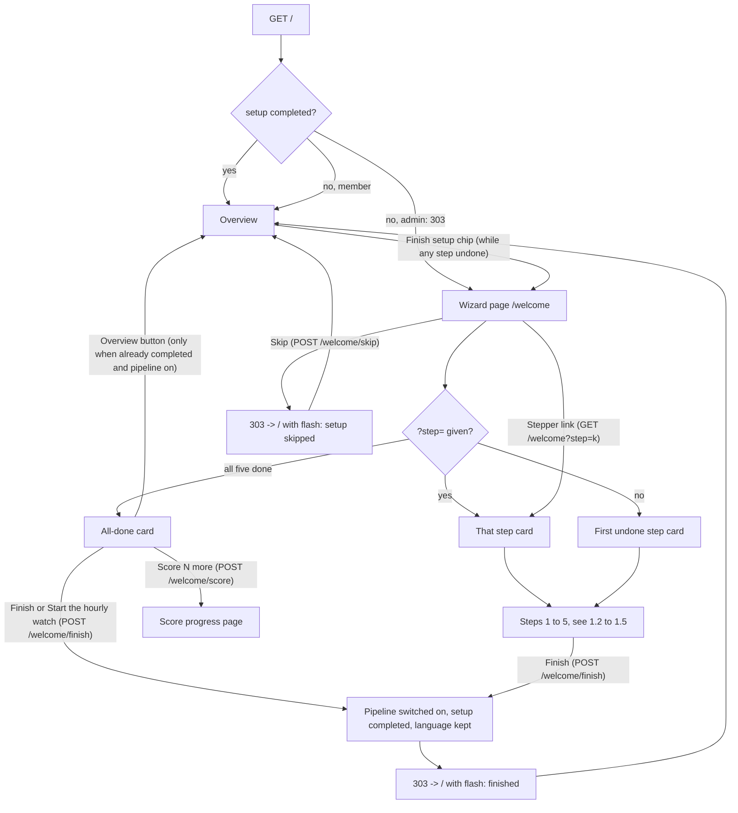

Notes:

- Skip changes nothing except the completed flag (and keeps the language the page was shown in as the person's stored language when none was stored).
- Finish does two writes: pipeline switched on (`fetchingEnabled = true`), then the completed flag. The "Finish" label reads "Start the hourly watch" while the pipeline is still off.
- A fresh install is paused by default, so a wizard run always stores its test-search jobs unscored; step 5 scores them.

### 1.2 Step 1 - Connect an AI

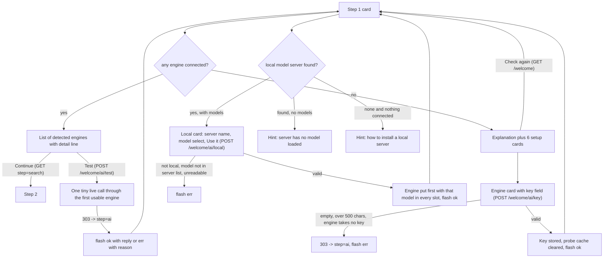

Rules visible in the UI:

- The six setup cards are: Claude subscription (CLI), Anthropic API key, Gemini key, Google Antigravity, OpenAI-compatible (OpenAI/OpenRouter/Groq), ChatGPT subscription (CLI). Cards for engines that take a key show a password field and "Save key"; CLI engines show instructions only. Each card names the env var an operator could use instead.
- A detected local server that is not yet the first engine appears as an offer ("Use it"), never as "connected". Only step 1 asks the machine for local servers (one request per default address).
- The test button is violet (it spends AI) and carries a hint about cost. With no usable engine it flashes an error instead.

### 1.3 Steps 2 and 3 - Test the search, tell us about you

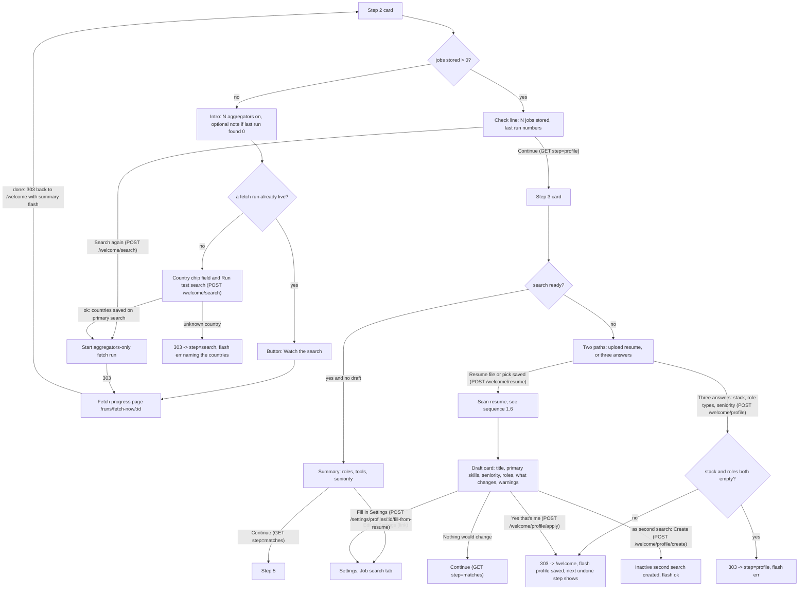

Details:

- The test search runs the aggregator sources only (they need no company rows and return hundreds of postings). It is the same background run as "Fetch now" (section 11), recorded as a `fetch-now` run. Countries typed here are written to the primary search before the run so country-aware boards narrow by place.
- Step 3's resume path is also reachable for "a second search": the section under the summary posts with `mode=new`, and the draft card then offers "Create" (an inactive second search, so the first keeps running) instead of "Apply".
- "Apply" is replaced by Continue when the draft would change nothing.
- `profile/apply` also links the resume to the search (`resumeId`) and lists the changed fields in the flash.
- Empty/error states: scan failure shows the progress page error with a back link ("Back to setup"); upload refusals (type, size over 5 MB, empty) flash back to step 3.

### 1.4 Steps 4 and 5 - Boards and first matches

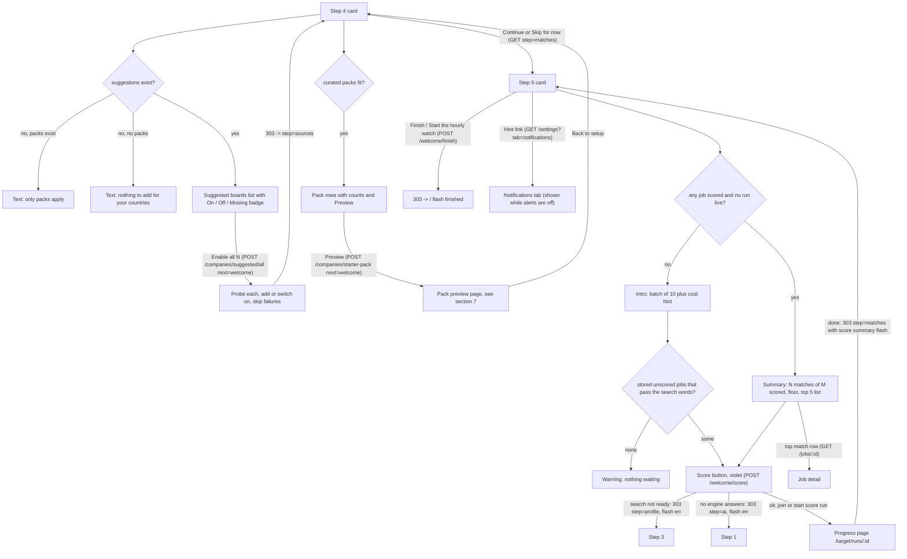

Notes:

- Step 4 is skippable by design: it counts as done once nothing is waiting or once any job is scored, so it never nags a US-only search.
- Step 5's "Watch" variant: when a score run is live, the button becomes "Watch the scoring" and links to its progress page.
- The score summary flash lists scored, matches, why the rest did not match, jobs set aside by the base filter, failures and what remains (batch of 10 per press).

### 1.5 Screen inventory (J1)

| Screen | Route | Key controls | Data shown | States |
|---|---|---|---|---|
| Wizard shell | `GET /welcome[?step=ai\|search\|profile\|sources\|matches][&resume=n][&mode=new]` | Stepper (5 links), language menu, Skip | Step done ticks, flash banner | success: any step; empty: none; error: flash err |
| Step 1 | `?step=ai` | Test, engine key forms, local model form, Check again, Continue | Detected engines + detail, local servers + models | empty: no engine (setup cards); success: connected list; error: key/local refusals |
| Step 2 | `?step=search` | Country chip field with picker, Run test search, Watch, Search again, Continue | Aggregators count, jobs stored, last run (fetched, sources, failed, stored, duration) | empty: intro; loading: Watch link when a run is live; error: unknown country, "nothing found" warning |
| Step 3 | `?step=profile` | File input, saved-resume select, three-answer form, Apply, Create, Fill in Settings, Continue | Draft card (title, skills, seniority, roles, changed list, warnings), summary | empty: two paths; loading: scan progress page; error: upload/scan refusal |
| Step 4 | `?step=sources` | Enable all N, Preview per pack, Continue/Skip | Suggested boards with reason and state, packs with count and tracked | empty: two text variants; success: all On |
| Step 5 | `?step=matches` | Score (N), Watch, Finish, Score more | Matches summary, top 5, waiting count | empty: nothing waiting warning; loading: score run live; success: summary |
| All done | `/welcome` with all steps done | Finish, Overview, Score more | Scored count, pipeline state text | success |
| Scan progress | `/target/runs/:id` | Back to setup | Single "scan" step, elapsed time | loading/error/gone (see section 11) |

### 1.6 Sequence - resume scan and first score

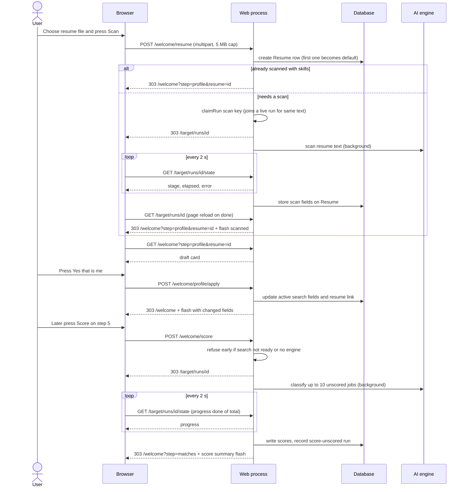

### 1.7 What the wizard seeds

| Wizard action | Data written |
|---|---|
| Paste key | AI key stored in settings, engine probe cache cleared |
| Use local model | Local or OpenAI-compatible base URL stored, engine order puts that engine first with the chosen model in each task slot, the earlier list stays as fallback |
| Test search | Typed countries on the primary search, jobs stored (unscored while paused), one `fetch-now` run row |
| Resume upload | Resume row (first becomes default), scan fields on it |
| Apply / three answers | Primary search: required stack, role types, seniority, linked resume |
| Create second search | New inactive search drafted from the resume |
| Suggested boards / pack enable | Company rows (suggested: switched on after a probe, pack imports: off until "Enable all") |
| Score | Scores on up to 10 jobs per press, one `score-unscored` run row |
| Finish | Pipeline on, setup completed, browser language stored if none was |

---

## 2. J2 - Overview dashboard

**Who and entry.** Everyone. Admins with unfinished setup are redirected away (J1). The page is `GET /` with `?range=7d|30d|90d|180d` (default 30d) and `?stack=<term>`. `<meta refresh=30>` reloads the page every 30 s, so the page has no polling code of its own. There is **no live "Running now" card on the Overview**: a live manual run shows only as a header button that links to its progress page. The Running-now card lives on `/runs` and `/runs/:id` (section 11).

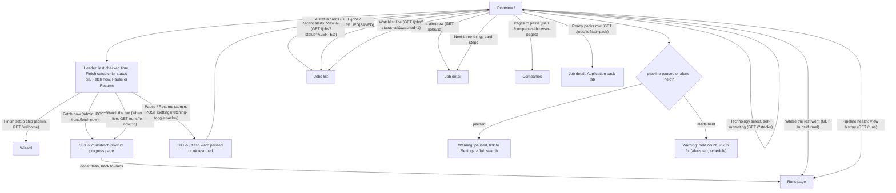

### 2.1 Card inventory

| Block | Contents | Rules / states |
|---|---|---|
| Header pill | Running (green), Paused (neutral) or "Sleeping until <next check>" (neutral, when the person's schedule excludes this hour) | Pill and button flip together; button is admin only |
| Warning notices | Paused notice with link to Settings > Job search; held-alerts notice with link to the setting that holds them | Held notice only while the pipeline is on |
| 4 status cards | NEW, ALERTED, APPLIED, SAVED: count, "+N in 24 h" or "no change", 14-day sparkline | Each card links to the Jobs list on that status tab; counts exclude muted employers |
| Totals line | Total and dismissed count | |
| Next three things | Coaching list: open the best match, compare with a resume, tailor it | Shown only until the person has any resume comparison; hidden when no scored match |
| Ready application packs | Up to 8 rows with link to the pack tab and a total | Hidden when none |
| Matches chart | Range links, technology select, SVG chart with hover or arrow-key tooltip, total and trend, funnel link | Technology filter is offered only for ranges the retained jobs cover |
| Recent alerts | 8 newest ALERTED/NEW rows with avatar, title, company, place, fit | Empty state "No alerts yet" with "See all jobs" |
| Pipeline health | Latest `fetch`, `digest`, `cleanup` run: dot, status badge when not OK, time and duration, "failing N" badge | "never ran" when absent |
| Recent activity | Fetched, matches, alerts in 24 h; watchlist line (watched companies, new postings, pages to paste) | |
| By stack / By source | Top 8 bars; all per-company boards collapse into "Company boards" | Stack row toggles the chart's technology filter |

### 2.2 Sequence - Fetch now (shared with the wizard test search)

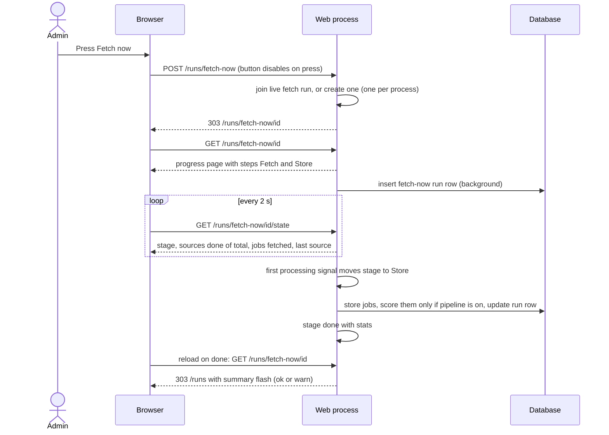

If the run is gone after a restart, the poll answers 404 and the page reloads into a redirect to `/runs` with an error flash. If the run fails, the page shows a red notice with a back link (to `/runs`, or to setup when the wizard started it).

---

## 3. J3 - Jobs list

**Who and entry.** Everyone, own rows only. `GET /jobs` with query parameters (the panel is plain links, so every state is a URL). Default tab is New. The page is a "fill" page: the window does not scroll, the table does.

**Header.** "Import a file" (`/jobs/import`, admin) and "Paste a job" (`/jobs/new`) buttons. A warning notice appears when the active search is blank, with a link to Settings > Job search. Muted employers' postings are hidden; a hint line with counts offers "show them" and "manage".

**What the list has and does not have.** One row per posting. The row is a link; there are **no per-row action buttons and no bulk selection**. All actions happen on the job detail page.

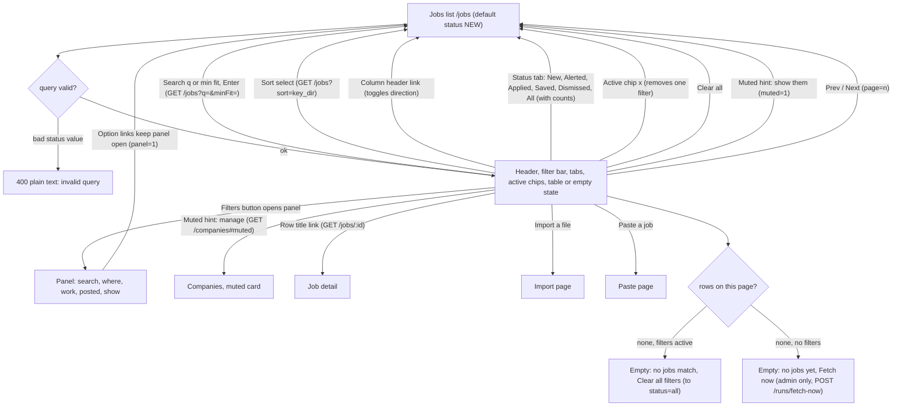

### 3.1 Filter panel (disclosure titled "Filters" with a count badge)

| Row | Control | Behaviour |
|---|---|---|
| Search | "Any" plus one link per running search (`profile=id`) | With a search chosen, the fit floor and "open to me" read that search's own score, and the fit column shows that search's score |
| Where | Place chips (countries, regions, "unknown") with counts; top 8 plus selected shown, rest behind "More" | Multi-select (OR), comma list in `country=` |
| Work | One chip per workplace code, always listed (count 0 allowed) | Multi-select in `workplace=` |
| Posted | 24h, 7d, 30d chips | Single choice, click again to clear |
| Show | Verified only, Watched companies, Open to me (a search says the location fits), Show muted | Each toggles a flag |

Facet counts follow the standard rule: each facet's counts honour the other facets' selections but never its own, so a chip's number is what clicking it would produce. Tab counts honour every filter except the status itself.

### 3.2 Screen inventory (J3)

| Screen | Route | Key controls | Data shown | States |
|---|---|---|---|---|
| Jobs list | `GET /jobs` | Search box, min-fit box, sort select, Filters disclosure, 6 status tabs, chips, pager, header buttons | Table columns: Title (plus "closed" flag, tech tags), Company (star if watched, "via source"), Location line, Fit badge, Salary, Status badge (plus verifier verdict badge), Fetched (relative) | empty (two variants above), success, error (400 on bad status) |
| Blank-search banner | same | link to Settings > Job search | | shown when active search has no stack or roles |
| Muted hint | same | show / manage links | count of hidden postings | shown when count > 0 |

Responsive: a phone keeps title and fit; salary, status and fetched columns join as width grows.

---

## 4. J4 - Job detail

**Who and entry.** Everyone who holds the posting (otherwise a plain 404, indistinguishable from a missing posting). Entry from the Jobs list, Overview, wizard, pack links, flash links. `GET /jobs/:id?tab=posting|match|letter|verify|pack`. The default tab (`posting`) is left out of URLs. Old links with `?match=` or `?letter=` open their tab.

**Layout.** Header block (back link "All jobs", title, company and place, watched star, place chips as links into the list facet, fit badge, status badge, "Closed" badge, **Open posting** external button). Flash banner area (may carry **Tailor resume** or **Re-run anyway** buttons). Cross-listing notice. Tab bar with fact-bearing labels. Then a two-column layout: tab content on the left, a 340 px rail on the right (first in the DOM on small screens). The rail appears on every tab.

### 4.1 Rail and status actions

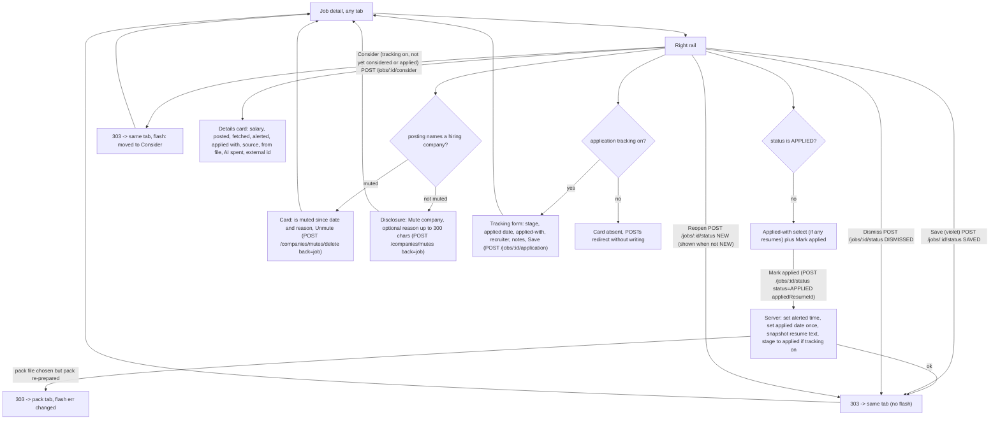

Rules:

- The status buttons shown are all of {Save, Dismiss, Reopen} except the one matching the current status; "Mark applied" is hidden once applied. Any status can be set from any state (see the state machine in 08).
- Applied date and the stage move happen only when tracking is on; the date is set once and never overwritten.
- The applied-with select offers "do not record", the pack's file (when a pack is ready), or a saved resume; for an already applied job the same select moves into the tracking card.
- Closing-state: a posting found gone by the liveness check shows a "Closed" badge with a tooltip giving the reason code and date.

### 4.2 Tabs and tab actions

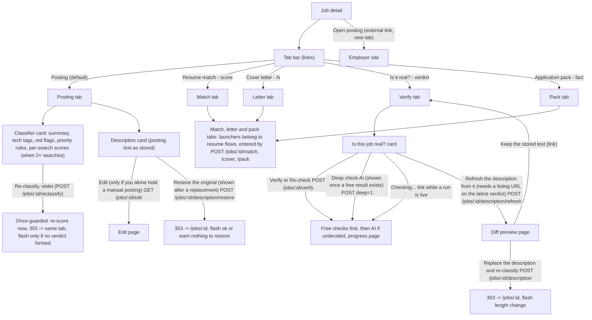

#### Verify tab outcomes (`POST /jobs/:id/verify`)

| Press | Steps shown on the progress page | Outcomes |
|---|---|---|
| Verify / Re-check | Liveness, then Verify | Free rung decisive: flash ok "live" or warn "closed" with the method, back to the Verify tab. Undecided: continues to the AI research step |
| Deep check | Verify only | AI research always |
| Pasted posting (no URL) | Only AI step is available; the card says the free checks have nothing to ask | |
| Success | | Flash with verdict, confidence, recommendation, back to `?tab=verify#verification` |
| Failure | | Error notice with what is safe and what to do next, "Back to the job" button |

A second press while a run is live joins it (button turns into a "Checking..." link). The card lists badges (live/closed/uncertain, verdict, recommendation, confidence, time, number of runs), summary, red flags, an evidence list (signal badge, check type, finding, optional link), a company snapshot, and the company's own listing link.

#### Description refresh (two-step)

1. `POST /jobs/:id/description/refresh` reads the listing found by the verifier and builds a line diff. If the listing is unreadable or missing: flash warn back to the Verify tab. If nothing differs: flash ok. Otherwise the **diff preview page** renders (deleted lines struck red, inserted lines green, unchanged folded).
2. The preview's second button posts the new text in a hidden textarea to `POST /jobs/:id/description` (text min length and max length enforced, else flash warn). The old text is kept, and the job is re-classified.

### 4.3 Screen inventory (J4)

| Screen | Route | Key controls | Data shown | States |
|---|---|---|---|---|
| Job detail, Posting tab | `GET /jobs/:id` | Rail actions, Re-classify, Edit, Restore, Open posting, Mute | Description, classifier summary, flags, tech, per-search scores | empty: "not scored yet" with Re-classify; success; error: 404 if not held, 400 bad id |
| Verify tab | `?tab=verify` | Verify, Deep check, Refresh description | Liveness and verdict badges, evidence, snapshot | empty: "not checked yet"; loading: run link; error: flash warn/err |
| Description refresh preview | `POST /jobs/:id/description/refresh` renders it | Replace and re-classify, Keep stored text | Summary of change, diff rows | success only (other outcomes redirect with flash) |
| Match, Letter, Pack tabs | `?tab=match\|letter\|pack` | Launchers (other area) | | The pack tab polls `/jobs/:id/pack/state` every 8 s only while a pack is queued or running; without script it reloads every 8 s |
| Rail | all tabs | status buttons, tracking form, mute | details | tracking card absent when tracking off |

---

## 5. J5 - Add a job

There are two ways in, both from Jobs list header buttons. **There is no URL-import flow**: the optional URL field on the paste page is metadata (used by the "Is it real?" free checks), never fetched on save.

### 5.1 Paste a job (`/jobs/new`)

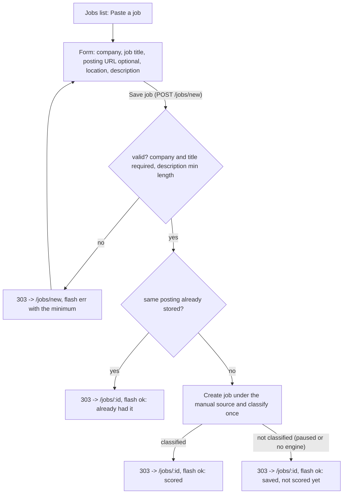

Screen: header with back link "All jobs", card with a two-column form (description spans both columns, 18 rows, browser-validated minimum length 200), hint "runs the classifier once". States: empty form, flash error after refusal.

### 5.2 Edit a pasted job (`/jobs/:id/edit`)

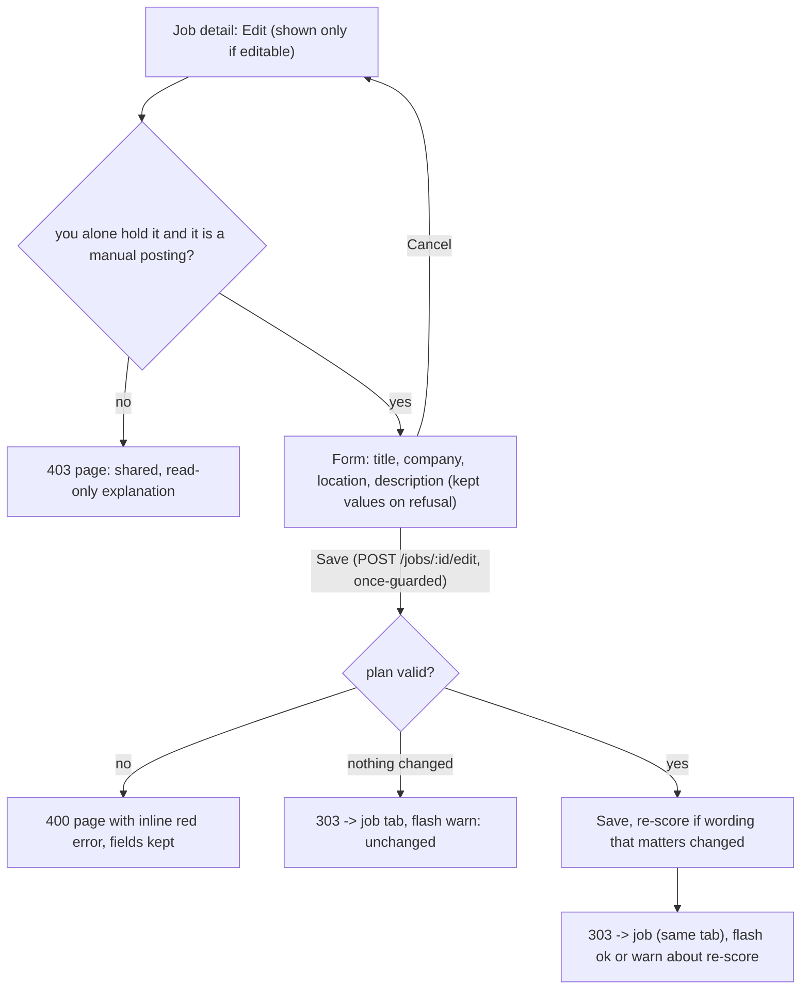

### 5.3 File import (admin) - three screens

Screen 1 `/jobs/import`: card with a file input (CSV, TSV, JSON, JSONL, up to 5 MB and 2000 rows), "Add to" select (existing import sources, shown only if some exist), source name field (required when there are no sources), **Preview rows** button. Below, a table of saved import sources with job counts, last import and a delete confirm that states the impact (jobs, applications, comparisons, letters).

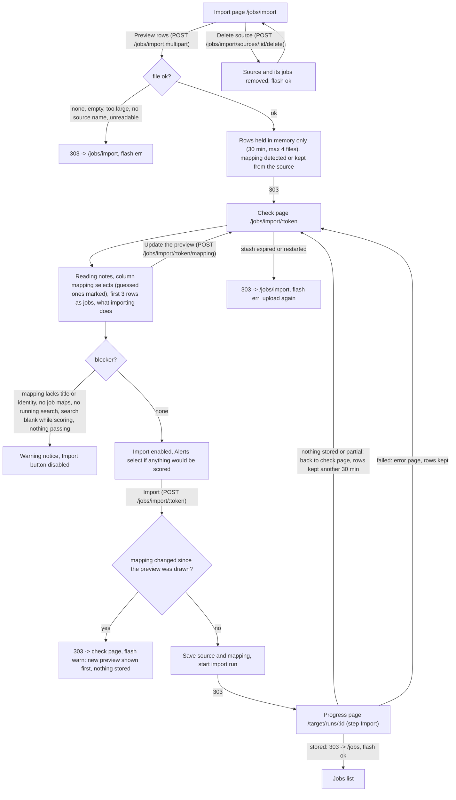

Notes:

- The check page preview and the import compute the same facts, and the import refuses what the preview refuses, so a stale tab leaves nothing behind.
- The Alerts choice (matches, off) is offered only when something would be scored; the default is quiet for large files. The page says in words how many messages would go out and how many packs.
- A source created by an import that stores nothing is removed again.
- A second press on Import while the first stores joins the live run.

### 5.4 Sequence - file import

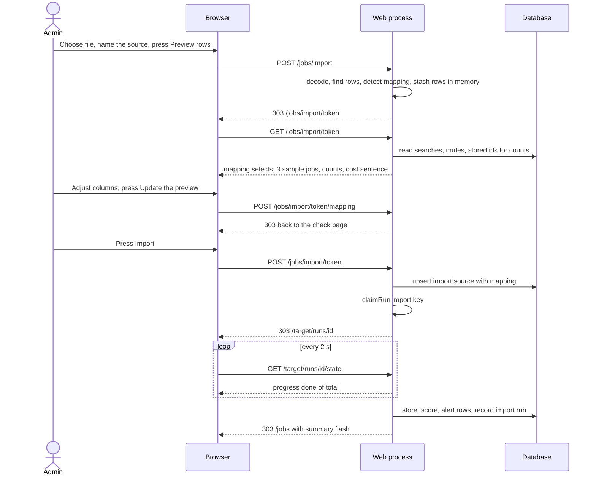

### 5.5 Screen inventory (J5)

| Screen | Route | Key controls | Data shown | States |
|---|---|---|---|---|
| Paste a job | `GET/POST /jobs/new` | 5 fields, Save job | none | empty form, error flash |
| Edit a job | `GET/POST /jobs/:id/edit` | 4 fields, Save, Cancel | current values | success, 400 inline error, 403 shared page |
| Import upload | `GET /jobs/import` | File, Add to, Source name, Preview rows, Delete source | Import sources table | empty (no sources table), error flash |
| Import check | `GET /jobs/import/:token` | Mapping selects, Update the preview, Alerts select, Import | Sample rows, counts (rows, usable, stored, passing, turned away), cost, over-limit and non-row notices | loading: none; error: blocker notice, gone token |
| Import progress | `/target/runs/:id` | Back | Step Import, counts | loading, error, done |

---

## 6. J6 - Companies (sources)

**Who and entry.** Admin sees the full page; a member sees only the "Muted companies" card. Sidebar "Companies". Everything is on one page. Source rows are the boards the hourly search reads. Pasted-job, import and Gmail sources are not listed here.

Page order: header (count), flash, Watchlist section (J9), Quiet sources card, Folder sources section (J10), the sources table or an empty state, "Add sources" disclosure buttons, Muted companies card, "How coverage works" fold.

**There is no edit-company screen.** The only mutations on a source row are: switch active on or off, delete, and re-probe (offered only from the Quiet sources card). Name, token and URL cannot be changed after adding; delete and add again.

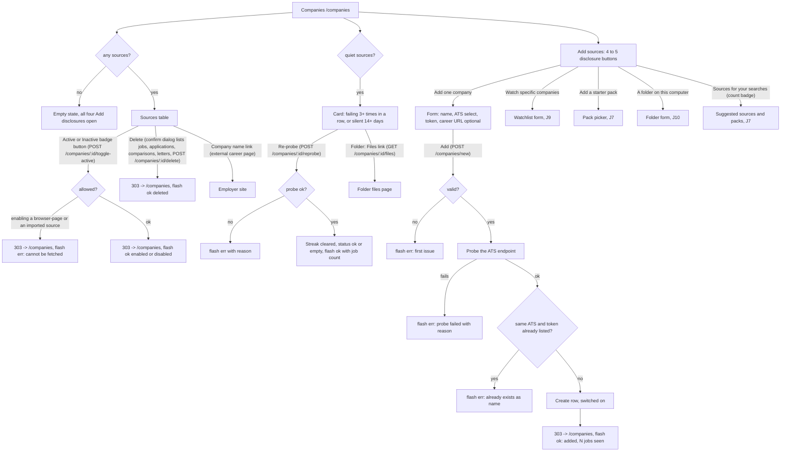

### 6.1 Mutes (all roles)

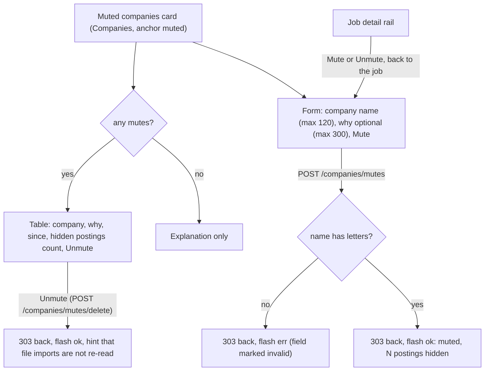

A mute turns away new postings of that employer before any AI runs, and hides stored ones from the list, the Overview counts and the wizard; it never changes a status.

### 6.2 Screen inventory (J6)

| Screen | Route | Key controls | Data shown | States |
|---|---|---|---|---|
| Companies (admin) | `GET /companies` | Active badge button per row, Delete confirm, Add disclosures, Re-probe | Table: name (link), source tag, token, health dot with words and streak, jobs, alerted, last fetch, active | empty: message and open Add forms; success; error flash |
| Quiet sources card | same | Re-probe or Files | Failing/silent badge with last-ok text | hidden when none |
| Companies (member) | same | mute form, Unmute | muted table | empty: explanation |

Health dot values (words, never colour alone): ok, empty, failing with N-in-a-row streak, never fetched; kinds that never post by design (watch, manual, browser page, import, Gmail, folder) are never "silent".

---

## 7. J7 - Starter packs and suggested sources

**Entry.** Companies > "Add a starter pack" (checkbox pills per pack, "Preview pack"), Companies > "Sources for your searches", wizard step 4. Packs are curated lists of company boards. Adding is a three-page wizard that threads `next=welcome` so a first-run user returns to setup.

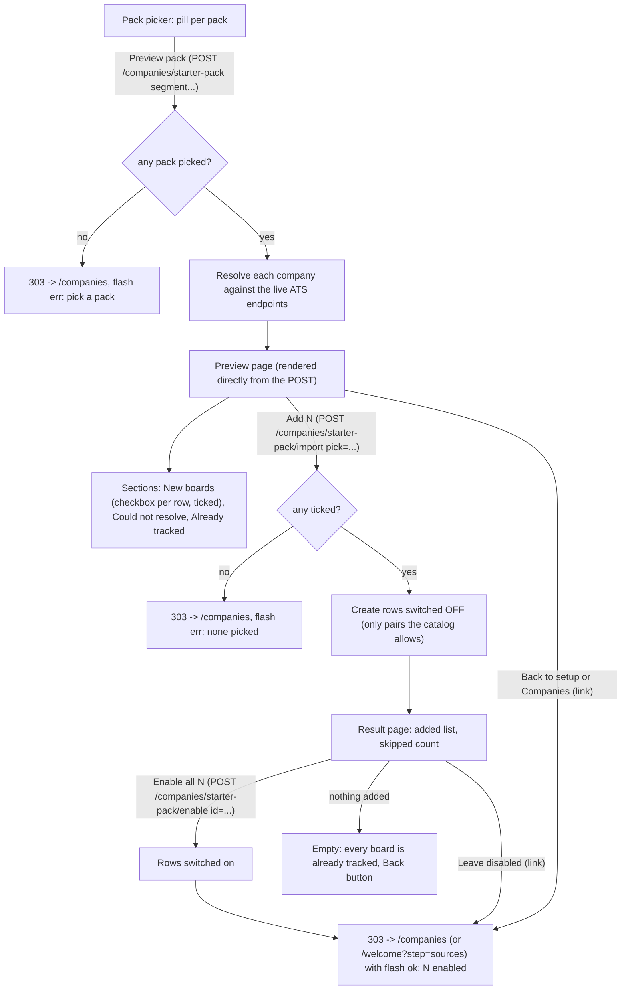

Rules: pack rows are added **off** on purpose, so a whole pack cannot flood the next hourly tick. The server re-validates every ticked row against the catalog (the form is not trusted). A unique conflict (added from another tab meanwhile) counts as skipped.

### 7.1 Suggested sources ("Sources for your searches")

Computed from the running searches' countries and stacks. Each row shows name, reason, token and a state:

| State | Control | Request |
|---|---|---|
| missing | "Add (off)" | `POST /companies/suggested`: the pair must still be among today's suggestions; the feed is probed first; row created off |
| off | "Enable" | `POST /companies/:id/toggle-active` |
| on | badge "On" | none |

"Enable all N" (shown when 2+ wait, and in wizard step 4 when 1+ wait) posts `POST /companies/suggested/all`: each missing one is probed and added **on**, each off one switched on, failures named in the flash and left out. Below the list, the "Company packs for your searches" block previews the fitting packs in one press.

### 7.2 Screen inventory (J7)

| Screen | Route | Key controls | Data shown | States |
|---|---|---|---|---|
| Pack picker | Companies page | Pills, Preview pack | pack labels | error flash if none picked |
| Pack preview | `POST /companies/starter-pack` (200 HTML) | Row checkboxes, Add N | Board name, ATS, open-jobs count, "guessed" badge, reasons | empty: "nothing new in this pack"; success |
| Pack result | `POST /companies/starter-pack/import` (200 HTML) | Enable all N, Leave disabled | Added rows | empty: "nothing was added" |

---

## 8. J8 - Discovery

**Who and entry.** Admin only, sidebar Research > Discovery. Candidates are boards found by the automatic discovery probe or the "Ask HN: Who is hiring" parser, waiting for a human decision.

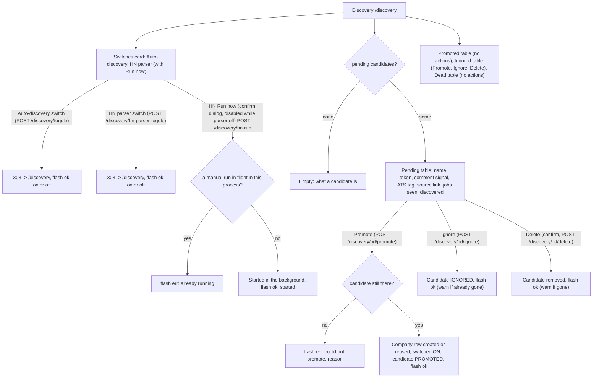

Notes:

- There is no "probe now" button on the page in the current markup, but the route `POST /discovery/probe-now` exists (single flight per process; flash err if one is running, flash ok "started" otherwise). The two manual runs are recorded as `discovery` and `hn-hiring` runs.
- A reload with the same `back` flash shows results; the run's own outcome appears on `/runs`.
- Promote switches the new company **on** immediately (unlike packs), so the next tick fetches it.

| Screen | Route | Key controls | Data shown | States |
|---|---|---|---|---|
| Discovery | `GET /discovery` | Two switch rows, Run now, per-row Promote/Ignore/Delete | Four sections with counts: pending, promoted, ignored, dead | empty: pending empty state; sections for other statuses hidden when empty; success/err via flash |

---

## 9. J9 - Watchlist (career-page watch)

**Who and entry.** Admin. Companies page > Watchlist section (table of watched rows) and the "Watch specific companies" form. The user pastes company or career-page URLs; the server resolves each one to the best way to watch it.

Resolution outcomes (a verdict line per URL): an ATS board with N jobs, a feed with N items, "page changes only" (change watch on a career page), "needs browser" (page drawn in the browser, user pastes text), "watch only"/"refused" (not addable, reason shown).

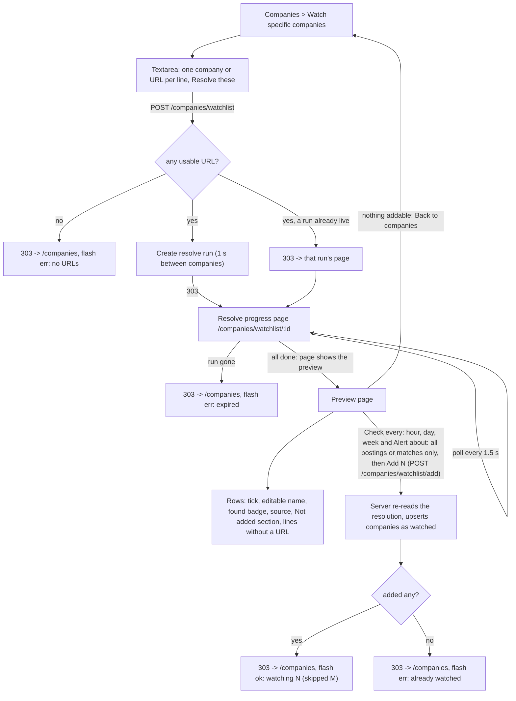

### 9.1 Managing a watched row (Watchlist table)

| Control | Request | Result |
|---|---|---|
| Interval select (hour, day, week) per row | `POST /companies/:id/watch` | flash ok updated; a changed interval makes the row due on the next tick |
| Alert-policy select (all postings / matches only) | same | same |
| Check now | `POST /companies/:id/check-now` | If the company is off: flash err. If no fetch is live: starts a one-company fetch run and redirects to `/runs/fetch-now/:id` (back to `/companies` when done). If a fetch is live: marks it due on the next tick, flash ok |
| Open | external link to the page | |
| Unwatch | `POST /companies/:id/unwatch` | star dropped, row stays as a plain source |
| Remove (confirm) | `POST /companies/:id/delete` | company deleted |
| Paste the page (only rows of kind "browser page") | `POST /companies/:id/paste` | text read into lines, compared with the last paste, new role lines listed, ones matching your search badged; empty text flash err |

Row cell states: next check ("next tick" or relative time), new postings link (to `/jobs?status=all&q=<name>`), "changed notice waiting" or "watching" for a change-watch row, "not pasted yet" for a browser page, an "Off" badge when the row is inactive.

### 9.2 Sequence - watchlist resolve

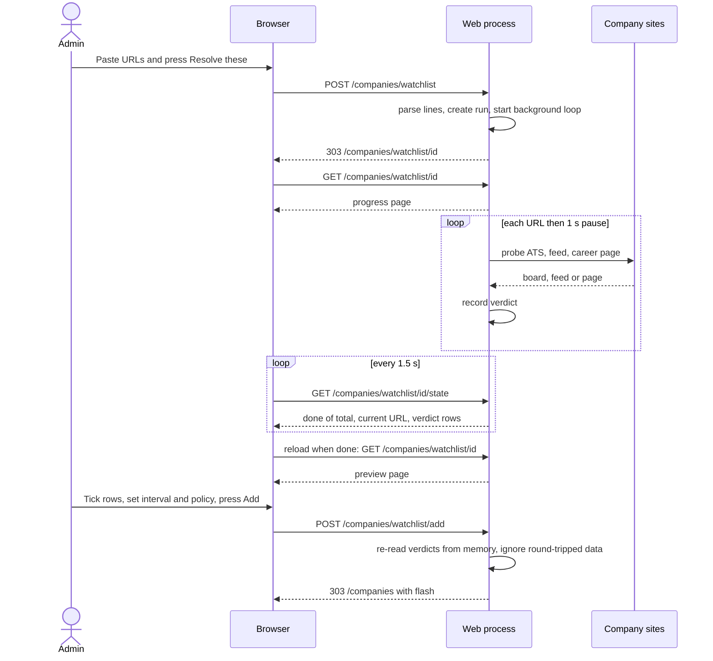

### 9.3 Screen inventory (J9)

| Screen | Route | Key controls | Data shown | States |
|---|---|---|---|---|
| Watch form | Companies page | Textarea, Resolve these (or "Resolving k of n" link) | | empty; error flash |
| Resolve progress | `GET /companies/watchlist/:id` | none (auto) | progress k of n, per-URL verdicts | loading; gone redirect |
| Preview | same URL when done | Row ticks, name edit, Check every, Alert about, Add N | verdict badge and reason, not-added list, rejected lines | empty: "nothing to watch at those addresses"; success |
| Watchlist table | Companies page | selects, Check now, Open, Unwatch, Remove, paste form | per-row status cells | empty: section hidden |

---

## 10. J10 - Folder source

**Who and entry.** Admin. Companies > "A folder on this computer". A folder is a source whose "jobs" are files the user saves into a directory: either postings (pages, PDFs, documents; read with code, plus the AI engine only when code cannot read a file) or files of rows (CSV, JSON...). On a server install the card is closed (warning) unless the operator allowed inbox roots; on a local install an app-owned "Inbox" folder can be created in the home directory.

```mermaid
flowchart TD
  A["Add folder card: path, name optional, name filter optional"] -->|"Check the folder (POST /companies/folder/check)"| R{"path allowed and readable?"}
  R -->|"no"| E["303 -> /companies, flash err: not checked, reason"]
  R -->|"yes"| PV["Check page rendered from the POST (no state kept)"]
  A -->|"Create an Inbox folder (local install only) POST /companies/folder/inbox"| In{"local install and home writable?"}
  In -->|"no"| E
  In -->|"yes"| PV
  PV --> K{"folder holds"}
  K -->|"postings"| PP["Postings preview: file kinds, newest 5 read by code, plan, alerts select"]
  K -->|"rows"| RP["Rows preview: mapping selects, 3 sample jobs, counts, misfits, notes, alerts select"]
  RP -->|"blocker: no row files, mapping unusable, no job maps"| Dis["Save button disabled with the reason"]
  PP -->|"Add off or Save (POST /companies/folder)"| Sv["Source saved OFF if new, mapping and filter saved if existing"]
  RP -->|"Add off or Save (POST /companies/folder)"| Mp{"mapping from the form accepted by this sample?"}
  Mp -->|"no"| Re["Check page again, flash err: not saved"]
  Mp -->|"yes"| Sv
  PV -->|"Check again (formaction /companies/folder/check)"| PV
  Sv --> OK["303 -> /companies#folders, flash ok added or saved"]
```

### 10.1 Folder rows on Companies and the files page

| Control | Request | Result |
|---|---|---|
| Active badge | `POST /companies/:id/toggle-active` | on or off |
| Files | `GET /companies/:id/files` | per-file outcomes page |
| Check (hidden form with the saved path/name/filter) | `POST /companies/folder/check` | dry check page |
| Check now (once-only button) | `POST /companies/:id/check-now` | one-company fetch run progress, back to `/companies` |
| Read every file again (rows folders only, files page) | `POST /companies/:id/files/reread` | flash ok N files put back to be read, or warn none |

Files page states: empty (two variants depending on whether the folder is active), table with each file's outcome and the job it became (links to `/jobs/:id` for postings the person holds).

---

## 11. J11 - Runs, run status and progress pages

**Who and entry.** Everyone reads; only admins start runs. Sidebar System > Runs, Overview links, flash links, any long action.

### 11.1 Runs page and run detail

```mermaid
flowchart TD
  R["Runs /runs"] --> H["Header: Fetch now or Watch link, last N runs count"]
  R --> Fu{"anything read in 30 days?"}
  Fu -->|"yes"| Fc["Funnel card (7 and 30 days) and source yield"]
  R --> Rn{"runs in flight?"}
  Rn -->|"yes"| Rc["Running now card"]
  Rn -->|"no"| Nr["No card"]
  Rc -->|"poll GET /runs/running every 5 s"| Rc
  Rc -->|"answer is empty: card removed and page reloads"| R
  R --> Hs{"any runs stored?"}
  Hs -->|"no"| E["Empty: the worker writes a row each time it runs"]
  Hs -->|"yes"| T["Table: job name, started (zone), duration, status badge, what happened"]
  T -->|"Live status (running rows) GET /runs/:id"| S["Run status page"]
  T --> Ea["Fold: earlier runs (opens itself if any failed)"]
  S --> Sv{"running?"}
  Sv -->|"yes"| Sb["Running block: label, fraction, ETA, counters, stalled flag, poll /runs/:id/card every 5 s"]
  Sb -->|"empty answer: run over"| S
  Sv -->|"no"| Oc["Outcome card: badge, time, duration, outcome lines, note that the run ended"]
  S -->|"Back (GET /runs)"| R
  R -->|"unknown or not yours: GET /runs/:id"| Gn["303 -> /runs, flash err: run gone"]
```

A running block shows: stage label, done of total with a progress bar, ETA (only after 20 items and 30 s of samples), counters in a fixed order (kept, set aside, classified, errors, listings) and a "stalled" flag when the last progress report is over 120 s old. Without script both pages reload every 30 s while a run is going.

### 11.2 Progress pages (fetch-now and generic)

| Property | Fetch-now page `/runs/fetch-now/:id` | Generic page `/target/runs/:id` |
|---|---|---|
| Started by | Fetch now buttons, wizard test search, per-company Check now | Wizard scan/score, verification, comparison, letter, import, resume actions |
| Steps | Fetch, Store (store step renamed Score while the pipeline is on) | Per run kind (scan, score, import, liveness, verify, letter, ...) |
| Poll | `/runs/fetch-now/:id/state`, 2 s | `/target/runs/:id/state`, 2 s |
| Extra | Narration of each source as it answers, elapsed counter, hint that the page can be closed | Rotating activity copy every 9 s, per-step timing, results lines per step |
| Done | Reload into 303 to the back URL with a summary flash | Reload into 303 to the result URL with the run's flash (may carry a Tailor or Download action) |
| Error | Red notice, Back button (runs or setup) | Red notice, Back button, "Open the saved job" when relevant |
| Gone (restart) | 404 poll then redirect to `/runs` with flash err | 404 poll then redirect to `/jobs` with flash err |
| Visibility | One live run per process, joined by a second press | Visible only to the creator |

### 11.3 Screen inventory (J11)

| Screen | Route | Key controls | Data shown | States |
|---|---|---|---|---|
| Runs | `GET /runs` | Fetch now / Watch link, Live status links, earlier fold | Funnel, source yield, run rows | empty: no runs; loading: Running card; error: flash |
| Running fragment | `GET /runs/running` | none | card HTML | empty body = nothing running |
| Run status | `GET /runs/:id` | Back | running block or outcome | loading, success, gone redirect |
| Run card fragment | `GET /runs/:id/card` | none | block HTML | empty body = run ended |
| Fetch progress | `GET /runs/fetch-now/:id` | Back (on error) | steps, narration, elapsed | loading, error, gone |
| Generic progress | `GET /target/runs/:id` | Back, Open saved job | steps, timings | loading, error, gone |

---

## 12. J12 to J19 - Settings and related account pages

### 12.0 Settings shell

`GET /settings?tab=<tab>` renders one tab. The tab bar is a vertical rule on wide screens and a segmented control on narrow ones. A member does not see the admin tabs (Sources, AI & costs, Employer tools); a link to one lands on the first tab.

| Tab key | Label | Admin only | Sections (anchors) |
|---|---|---|---|
| `profile` | Job search | no (pause switch and fetch schedule effect are admin) | Job fetching (`#schedule`), Searches (`#searches`), Gmail (`#gmail`), Reactive Resume (`#reactive-resume`), Search editor (`#edit`, `#fill`) |
| `sources` | Sources | yes | Job sources family pills, Extra sources with a free key (`#source-keys`) |
| `notifications` | Notifications | no (source-health switch admin) | Messages (`#messages`), Where alerts go (`#destinations`), Send alerts (`#alerts`) |
| `applications` | Applications | no | Tracking switch, Re-apply window (`#reapply`), Board columns (`#stages`) |
| `automation` | Automation | no | Application packs (`#packs`) |
| `ai` | AI & costs | yes | AI engines, Monthly budget (`#budget`), Classifier |
| `general` | General | no (two cards admin) | Appearance (`#appearance`), Language (`#language`), Time zone (`#timezone`), Resumes, Start with this computer (`#login`), Updates (`#updates`) |
| `screening` | Employer tools | yes | Employer mode switch, retention, engine note, applicant notice (outside this document's scope) |

Every settings POST answers 303 back to its own tab and anchor with a flash. All switches are `role=switch` buttons inside a POST form (they work without script) and show the state in words (Running/Paused, On/Off). Forms are never autosaved except the AI model/task cards (see 12.3) and the "self-saving" selects.

### 12.1 J12 - Job search tab

```mermaid
flowchart TD
  T["Settings > Job search"] --> Sc["Job fetching section"]
  Sc -->|"Pipeline switch, admin only (POST /settings/fetching-toggle)"| Fp{"turned on?"}
  Fp -->|"off"| F1["303 -> tab, flash warn: paused"]
  Fp -->|"on, active search has stack or roles"| F2["flash ok: resumed"]
  Fp -->|"on, search blank"| F3["flash warn: resumed but the gate is empty"]
  Sc -->|"Schedule form: check every hour/2h/4h/day, from, to (inclusive), day pills, Save schedule (POST /settings/schedule part=fetch)"| Sd{"admin?"}
  Sd -->|"member"| Sx["flash err: admin only"]
  Sd -->|"admin, invalid"| Sy["flash err naming the field"]
  Sd -->|"admin, ok"| Sz["flash ok: schedule sentence plus held-alerts line (empty day set saves as every day)"]
  T --> Se["Searches section: list, up to 8 running"]
  Se -->|"New search (POST /settings/profiles/new)"| Nw["Blank search created inactive, 303 -> editor of it"]
  Se -->|"Edit link (GET ?profile=id#edit)"| Ed["Search editor"]
  Se -->|"Run or Pause (non-primary, disabled when blank) POST /settings/profiles/active"| Ra["flash ok, or err if blank or at the cap"]
  Se -->|"Make primary (non-primary, disabled when blank) POST /settings/profiles/activate"| Mp["flash ok: primary changed"]
  Se -->|"Delete (non-primary, confirm) POST /settings/profiles/delete"| Dl["flash ok deleted"]
  Ed --> Fr["Fill from a resume card"]
  Fr -->|"Pick saved resume or upload a file, Fill (POST /settings/profiles/:id/fill-from-resume)"| Fl{"scanned?"}
  Fl -->|"not scanned"| Sn["Scan inline, fail: flash err"]
  Fl -->|"nothing would change"| Fn["flash ok: already matches"]
  Fl -->|"draft"| Dd["Editor re-rendered in place with a Draft notice listing changed fields and warnings, nothing saved yet"]
  Ed -->|"Save profile (POST /settings/profiles/:id/save)"| Sv{"valid?"}
  Sv -->|"no: schema, priority rule line, unknown country, resume or target gone"| Se2["flash err, field marked invalid"]
  Sv -->|"yes"| So["Saved, first real content on a blank search starts it running, flash ok plus waiting-sources hint plus folders-read-once hint"]
  Ed -->|"Save and re-classify (same POST with action)"| Rc["Saved, then background re-score of all jobs, flash says started or joins a live one, warn if search paused"]
  Dd --> Ed
```

The search editor fields (one form, sticky save bar with an unsaved-changes indicator): name; linked resume; role types (chips); seniority pills (junior, mid, senior, staff, lead, principal); required stack (chips); nice-to-have stack (chips); workplace pills; countries (chip field with gazetteer picker) and region pills; residence select and relocation; min fit score 0-100; min salary USD; excluded stack; notes; on-site cities; notification destination select; priority rules (one per line, parsed with line-numbered errors).

A new search is **born inactive**; the first save that gives it real content activates it. The primary search cannot be paused or deleted from the list (the server also refuses).

States: no search selected shows an empty message; every search blank shows a warning above the list (with a wording that depends on whether any resume exists).

The Gmail card (J18, 12.7) and the Reactive Resume card sit between the list and the editor.

### 12.2 J13 - Notifications tab

```mermaid
flowchart TD
  N["Settings > Notifications"] --> Ms["Messages section: three switches"]
  Ms -->|"Alerts master (POST /settings/telegram-toggle)"| A1["flash ok on (with held-alerts line) or off"]
  Ms -->|"Source-health alerts, admin (POST /settings/source-health-toggle)"| A2["flash ok"]
  Ms -->|"Stale-applications digest (POST /settings/stale-digest-toggle)"| A3["flash ok"]
  N --> Ds["Where alerts go"]
  Ds --> Ex{"any destinations?"}
  Ex -->|"no"| Em["Empty: an alert has nowhere to go"]
  Ex -->|"yes"| Tb["Table: name, channel, masked destination, last used, active badge button, Test, Delete confirm"]
  Tb -->|"Active badge (POST /settings/targets/:id/toggle)"| Tb
  Tb -->|"Test (POST /settings/targets/:id/test)"| Tt["Real message sent, flash ok or err with reason"]
  Tb -->|"Delete (POST /settings/targets/:id/delete)"| Td["flash ok"]
  Ds -->|"Add a Telegram target: name, chat id, bot token (POST /settings/targets kind=telegram)"| Ad{"valid, not a duplicate, test message delivered?"}
  Ds -->|"Add a Discord webhook: name, webhook URL (POST /settings/targets kind=discord)"| Ad
  Ad -->|"no"| Er["flash err: invalid / already exists / test failed with reason"]
  Ad -->|"yes"| Ok["Saved after a real test message, flash ok (bot name for Telegram)"]
  N --> Tm["Send alerts: mode instant, window or digest, window from/to and day pills, up to 4 scheduled message times"]
  Tm -->|"Save alert timing (POST /settings/schedule part=alerts)"| Sv["flash ok: saved plus held-alerts line, or err naming the field"]
```

Secrets (bot token, webhook URL) are password inputs and are shown masked in the table. The add form is guarded against a double press. The two add forms are disclosure buttons that are closed by default.

### 12.3 J14 - AI and costs tab (admin)

```mermaid
flowchart TD
  A["Settings > AI & costs"] --> Pl["Plan summary table and billing notes, skipped-engines notice"]
  A --> Eg["Engine rows in priority order (one row per engine)"]
  Eg -->|"Move up (POST /settings/ai/move)"| M["flash ok: moved to position n (or already at top)"]
  Eg -->|"Enable or Disable (POST /settings/ai/enable)"| En{"allowed?"}
  En -->|"it is the only engine"| W1["flash warn: cannot disable the only one"]
  En -->|"disabled the last, fallback to env engine"| W2["flash warn: falls back to default"]
  En -->|"enabled but not usable"| W3["flash warn: enabled but unusable, detail"]
  En -->|"billed engine behind plan engines"| W4["flash warn: money spent when plan capacity runs out"]
  En -->|"ok"| Ok["flash ok with position"]
  Eg -->|"Test, violet (POST /settings/ai/test)"| Ts["Tiny live call, flash ok reply or err"]
  Eg --> Cn["Connection disclosure: key field with Save or Remove (POST /settings/ai/key), local URL and context size (POST /settings/ai/local), OpenAI-compatible base URL (POST /settings/ai/openai-base)"]
  Eg --> Mt["Models and tasks disclosure: classifier, resume, cover model ids (POST /settings/ai/models), task checkboxes (POST /settings/ai/tasks)"]
  Mt -->|"saves on change by fetch, JSON reply, redraws plan block"| Eg
  A --> Bd["Monthly budget: USD number, Save budget (POST /settings/ai/budget)"]
  Bd --> Bv{"0 to 100000?"}
  Bv -->|"no"| Be["flash err with the max"]
  Bv -->|"yes"| Bo["flash ok: set (blank or 0 removes it)"]
  A --> Cm["Classifier: single stage or two-stage radios, Save mode (POST /settings/classifier-mode)"]
  A -->|"Which model did what (GET /ai)"| U["AI usage page"]
```

Rules: keys are stored but never echoed back to the browser; a key over 500 characters is refused; a model id is checked against the engine's family; the OpenAI-compatible base accepts a local or remote URL (the wizard's local offer accepts only local ones); every task checkbox ticked is stored as "no list" so the engine takes tasks added later.

### 12.4 J15 - Sources tab (admin)

```mermaid
flowchart TD
  S["Settings > Sources"] --> Fm["Source family pills in groups: job boards, your own sources, per-company platforms (folded)"]
  Fm -->|"Save sources (POST /settings/sources)"| Sv["Everything unticked becomes disabled, flash ok: all enabled, or list of disabled"]
  Fm -->|"Own source kind with zero companies"| Ad["Link: Add one on Companies instead of a pill"]
  Fm -->|"Pill says needs a key"| K["Anchor #source-keys"]
  Fm -->|"HN pill says parser off"| D["Link to Discovery"]
  S --> Ky["Extra sources with a free key: per keyed source card with signup link, terms link, per-field password input"]
  Ky -->|"Save or Remove a field (POST /settings/sources/key)"| Kv{"valid and at most the max length?"}
  Kv -->|"no"| Ke["flash err"]
  Kv -->|"yes"| Ko["Stored (value never shown again, masked), flash ok, source unlocks in the Add company ATS select"]
```

### 12.5 J16 - General tab (Display / language / time zone)

| Card | Control | Request | Result |
|---|---|---|---|
| Appearance | System / Light / Dark switch | `POST /settings/theme` | Cookie set (or cleared for System), 303 back; no flash (the new look is the answer) |
| Language | Select (ready languages; beta ones labelled) and "Use" | `POST /settings/locale` | Stored per person; flash worded in the chosen language; unknown value flash err |
| Time zone | Select (hint says when it is only the browser's guess) and Save | `POST /settings/schedule part=zone` | Flash ok with zone; all dates and the schedule now use it |
| Resumes | List with Default and Not scanned badges, link to the library | links | Empty: "no resumes yet" message |
| Start with this computer | Switch (admin, local install only) | `POST /settings/login-item` | flash ok or err with reason |
| Updates | Weekly check switch (admin) | `POST /settings/update-check-toggle` | Turning on checks at once, flash says newer/latest/no answer; line with last check time |

The language menu in the sidebar and the one-time language invitation post to the same `/settings/locale` route. The wizard's header menu does too.

### 12.6 J17 - Applications and Automation tabs (summary)

| Control | Request | Notes |
|---|---|---|
| Tracking switch | `POST /settings/application-tracking-toggle` | When off, board and tracking card are hidden and related POSTs redirect without writing |
| Re-apply window select (30/60/90/180 days or off) | `POST /settings/reapply` | flash err on a value not offered |
| Board columns: add, rename, move up/down, remove | `POST /settings/stages/add\|:key/rename\|:key/move\|:key/remove` | Remove refused while any job sits in it, and for the last work column; max 10 |
| Application packs form (enable, min fit 50-100, daily limit 0-50, max age 1-60 days, cover letter mode, edit policy: sections, max bullets 0-6, keywords, removals) | `POST /settings/pack` (one form) | Invalid input stores nothing, even the switch; flash names the field; turning off cancels queued automatic packs |

### 12.7 J18 - Gmail connect

A card in the Job search tab (`#gmail`), per person. It reads a Gmail label for job-lead mails.

```mermaid
flowchart TD
  G["Gmail card"] --> St{"state"}
  St -->|"unconfigured: install has no Google client"| U["Hint only, no controls"]
  St -->|"disconnected"| C["Connect button (GET /gmail/connect)"]
  C --> Cfg{"Google client configured?"}
  Cfg -->|"no"| E0["303 -> card, flash err: not set up"]
  Cfg -->|"yes"| Go["Create PKCE state, 302 to Google consent"]
  Go --> Ggl["Google consent screen (external)"]
  Ggl -->|"GET /gmail/callback?code&state"| Cb{"denied or state invalid or exchange fails?"}
  Cb -->|"denied"| E1["303 -> card, flash err: denied"]
  Cb -->|"failed"| E2["303 -> card, flash err: failed"]
  Cb -->|"ok: account email read, refresh token stored"| Ok["303 -> card, flash ok: connected"]
  Ok --> Cn["Connected view"]
  St -->|"connected or ended"| Cn
  Cn --> Info["Account address, status line (ok or warning: access ended, label missing, no engine, error), last check line"]
  Cn -->|"Save label (POST /gmail/label)"| L["flash ok saved, err if invalid label"]
  Cn -->|"Check now (POST /gmail/check) disabled while queued"| Q["flash ok: queued, worker reads it within a minute"]
  Cn -->|"Reconnect (when access ended)"| C
  Cn -->|"Disconnect (confirm, POST /gmail/disconnect)"| Dx["Token revoked best-effort, row deleted, flash ok"]
```

A token never appears in a flash, log line or redirect. The one-time state is spent on first use whatever Google answered.

### 12.8 J19 - Users page (there is no Account tab)

Admin only, sidebar System > Users. Table of people with role badge; per row an admin gets "Promote"/"Demote" and "Remove" (confirm). A notice appears when sign-in is not enabled (the install is single-user). Server refusals come back as flash err: cannot change yourself, cannot remove the last admin, nothing to change, not found. Success: flash ok with the name. Sign-out lives in the sidebar footer (`POST /auth/logout`).

### 12.9 Settings screen inventory

| Screen | Route | Key controls | Data shown | States |
|---|---|---|---|---|
| Job search tab | `GET /settings?tab=profile[&profile=id]` | pipeline switch, schedule form, searches list actions, editor, fill card, Gmail, Reactive Resume | schedule sentence with next check, search one-line summaries, editor values | empty: no search selected; warning: all searches blank; draft notice after fill |
| Notifications tab | `?tab=notifications` | 3 switches, 2 add forms, target actions, alert timing form | targets table, held-alerts line | empty: no targets |
| AI tab | `?tab=ai` | per-engine controls, budget, classifier mode | plan table, billing notes, spend this month | warnings for skipped or unusable engines |
| Sources tab | `?tab=sources` | pills, Save sources, key forms | counts per source kind | locked pills say "needs a key" |
| General tab | `?tab=general` | theme, language, zone, login item, updates | resumes list, version line | empty: no resumes |
| Applications / Automation tabs | `?tab=applications\|automation` | see 12.6 | | |
| Gmail card | in Job search tab | see 12.7 | | unconfigured / disconnected / connected / ended |
| Users | `GET /users` | Promote, Demote, Remove | people list | flash refusals |

---

## 13. Cross-cutting UI behaviours seen in these journeys

| Behaviour | Where | Detail for a rebuild |
|---|---|---|
| Post-redirect-get + flash | Every POST | Result message survives one redirect (5 s cookie). Success toasts auto-close, warn/err stay. A flash can mark one form field invalid and can carry a Re-run or Tailor action |
| Double-submit protection | All action forms | Button disables on press; some routes also refuse a second press in the same process ("already running"); runs are keyed so a second POST joins the live one |
| Progress pages | scan, score, import, verify, fetch-now, watchlist | Poll every 2 s (1.5 s watchlist), reload on done to a redirect that carries the flash; 404 on poll reloads into an error flash |
| Confirm dialogs | Delete company, delete source, delete target, disconnect Gmail, Run now (HN), delete search, delete candidate | Native popover containing the real POST form; works without script; cancel focused |
| Switches | Pause pipeline, alerts, auto-discovery, tracking, login item, updates | `role=switch` button in a form, state in words |
| Disclosure add-forms | Companies, Notifications, Settings Sources | Closed by default, open when the list is empty |
| Role-aware controls | Fetch now, Pause, Import, Companies, Discovery, AI | Absent (not disabled) for a member; the route also returns 403 |
| Cost hints | Test button, Score, Verify, Import | Controls that spend AI are violet and carry an approximate cost sentence |
| Muted data | Jobs list, Overview, Companies | Hidden by default, with a count and a way to reveal |

---

## 14. Corrections to 08 found while checking against code

1. **Overview has no live running card.** 08 section 11 lists polling for the Overview; in code, the Overview only reloads every 30 s and shows the Fetch now button, which turns into a "Watch the run" link when a manual run is live. The Running-now card (5 s poll) is on `/runs` and `/runs/:id`.
2. **Fetch now always returns to `/runs`.** `POST /runs/fetch-now` uses `/runs` as the back URL even when pressed on the Overview or from the Jobs list empty state. Only the wizard test search (back to `/welcome`) and per-company Check now (back to `/companies`) return elsewhere.
3. **Jobs list has no bulk or per-row actions.** The row is a title link; statuses are changed on the job detail rail.
4. **No URL-import for jobs.** The only additions are the paste form (URL optional, metadata only) and the file import.
5. **No company edit screen.** Rows can be enabled/disabled, deleted and (from the Quiet card) re-probed; there is no rename or token change.
6. **Discovery:** "Promote" creates the company **active**, not merely "a company row"; Ignored candidates keep Promote/Ignore/Delete; Promoted and Dead tables have no actions (08's diagram shows Delete from Dead, which the UI does not offer); there is a route `POST /discovery/probe-now` but no button for it on the page.
7. **Settings has no Users or Account tab**; Users is its own admin page. The tab key `profile` is labelled "Job search", `ai` is "AI & costs", `screening` is "Employer tools".
8. **Refresh description** is reachable only from the Verify tab and only when the latest verification recorded a listing URL.
9. **Wizard step 3** replaces the Apply button with Continue when the draft changes nothing, and offers a separate "second search" path (inactive search) from the same page.
10. **Wizard test search** starts an aggregators-only run and returns to `/welcome` (first undone step), not to `/runs`.

## 15. Source map

| Area | Files |
|---|---|
| Wizard | `src/web/routes/welcome.tsx`, `src/web/pages/welcome.tsx`, `src/web/welcome-steps.ts`, `src/web/welcome-facts.ts` |
| Overview | `src/web/routes/overview.tsx`, `src/web/pages/overview.tsx`, `src/web/pages/matches-chart.tsx`, `src/web/next-things.ts` |
| Jobs list and detail | `src/web/routes/jobs.tsx`, `src/web/pages/jobs-list.tsx`, `src/web/pages/job-detail.tsx`, `src/web/pages/verification-card.tsx`, `src/web/pages/description-refresh.tsx`, `src/web/job-tabs.ts`, `src/web/routes/applications.tsx` (consider, application) |
| Add job | `src/web/pages/job-new.tsx`, `src/web/pages/job-edit.tsx`, `src/web/routes/jobs-import.tsx`, `src/web/pages/job-import.tsx`, `src/web/import-stash.ts`, `src/datasets/preview.ts` |
| Companies, packs, discovery, watchlist, folders | `src/web/routes/companies.tsx`, `src/web/pages/companies.tsx`, `src/web/pages/starter-pack.tsx`, `src/web/routes/discovery.tsx`, `src/web/pages/discovery.tsx`, `src/web/routes/watchlist.tsx`, `src/web/pages/watchlist.tsx`, `src/web/routes/folders.tsx`, `src/web/pages/folder-source.tsx` |
| Runs | `src/web/routes/runs.tsx`, `src/web/routes/target.tsx`, `src/web/pages/runs.tsx`, `src/web/pages/run-status.tsx`, `src/web/pages/fetch-run.tsx`, `src/web/fetch-now.ts`, `src/web/fetch-runs.ts`, `src/web/running-view.ts`, `src/web/public/target-run.mjs`, `src/web/public/running.mjs` |
| Settings and accounts | `src/web/routes/settings.tsx`, `src/web/pages/settings.tsx`, `src/web/routes/gmail.ts`, `src/web/pages/gmail-card.tsx`, `src/web/routes/users.tsx`, `src/web/pages/users.tsx`, `src/users/admin-policy.ts` |
