# 10b - UI Flows: Resume and Application Journeys

Derived from source only (`src/web/routes/*`, `src/web/pages/*`, `src/web/public/*.mjs`, and the `src/resume/**` and `src/pack/**` modules those routes call). This file shows how a person moves between screens. The sitemap, middleware, flash contract and the generic progress-page machinery are in `08-web-app-and-ux.md`. They are only recalled here where a flow depends on them.

## 0. Conventions used in every diagram

- Every mutation is a plain HTML form POST that answers `303` to a GET page. The result message is a one-shot flash banner that the browser turns into a toast. In the diagrams, "flash ok/warn/err" means that banner.
- A "run" is a web-process job (`/target/runs/:id`). The POST returns immediately with a 303 to the progress page. The page polls `GET /target/runs/:id/state` every 2 s. On `done` it reloads, and the server redirects to the run's result URL with a flash. On `error` it shows the error and a back link. A second identical POST joins the live run (same key). Unknown or expired run: redirect to `/jobs` with an error flash.
- Buttons that call the AI are violet. Buttons that are free (code-only re-scoring, saving) are primary or secondary. This is a deliberate cue.
- Edge labels carry `METHOD /path` in quotes. Dotted edges are no-reload `fetch` calls or browser-only behaviour.
- Node shapes: rectangles are screens, rounded nodes are user actions, diamonds are decisions.

## 1. Journey index

| # | Journey | Who / entry points | Section |
|---|---|---|---|
| J1 | Resumes library: upload, default, duplicates, confirmed facts | Sidebar "Resumes", `/resumes` | 2 |
| J2 | Resume detail: parsed view, scan, issues, search-from-resume, versions, tailored copies, delete | Row link on `/resumes`, any "resume name" link | 3 |
| J3 | Resume strength review and answers | Card at top of resume detail, `#resume-strength` | 4 |
| J4 | Resume match card on a job (run match, compare, keywords, facts, suggestions) | Job detail, tab "Resume match" | 5 |
| J5 | Tailor editor (suggestions, apply, live score, working resume, save, no-reload edits) | "Tailor resume" button, `/jobs/:id/target` | 6 |
| J6 | Condense (page target, cuts, wording, refresh) | Panel inside the Tailor editor | 7 |
| J7 | Working resume per job, document pane, downloads | Tailor editor, resume detail "Tailored copies" | 8 |
| J8 | Verification ("Is this job real?") and fact-check gates | Job tab "Is it real?" | 9 |
| J9 | Cover letter (job tab and `/letter` launcher) | Job tab "Cover letter", sidebar "Cover letter" | 10 |
| J10 | Clean version / Render and download (DOCX, PDF, format compare, knobs) | Resume detail, Tailor editor hint | 11 |
| J11 | Reactive Resume (connect, import, link, send/writeback, failures) | Settings, `/resumes`, resume detail, Tailor editor | 12 |
| J12 | Application pack (auto-prepare, view, send) | Job tab "Application pack", Settings automation | 13 |
| J13 | Applications tracker (stages, applied-resume snapshot, export, stale nudges) | Job rail, `/applications`, Settings | 14 |

---

## 2. J1 - Resumes library (`/resumes`)

Who: the signed-in person (admin or member), scoped to their own resumes. Entry: sidebar "Resumes", post-upload redirect, flash links. The page is a list plus an "upload" fold plus a "pull from Reactive Resume" fold plus a "Confirmed facts" card.

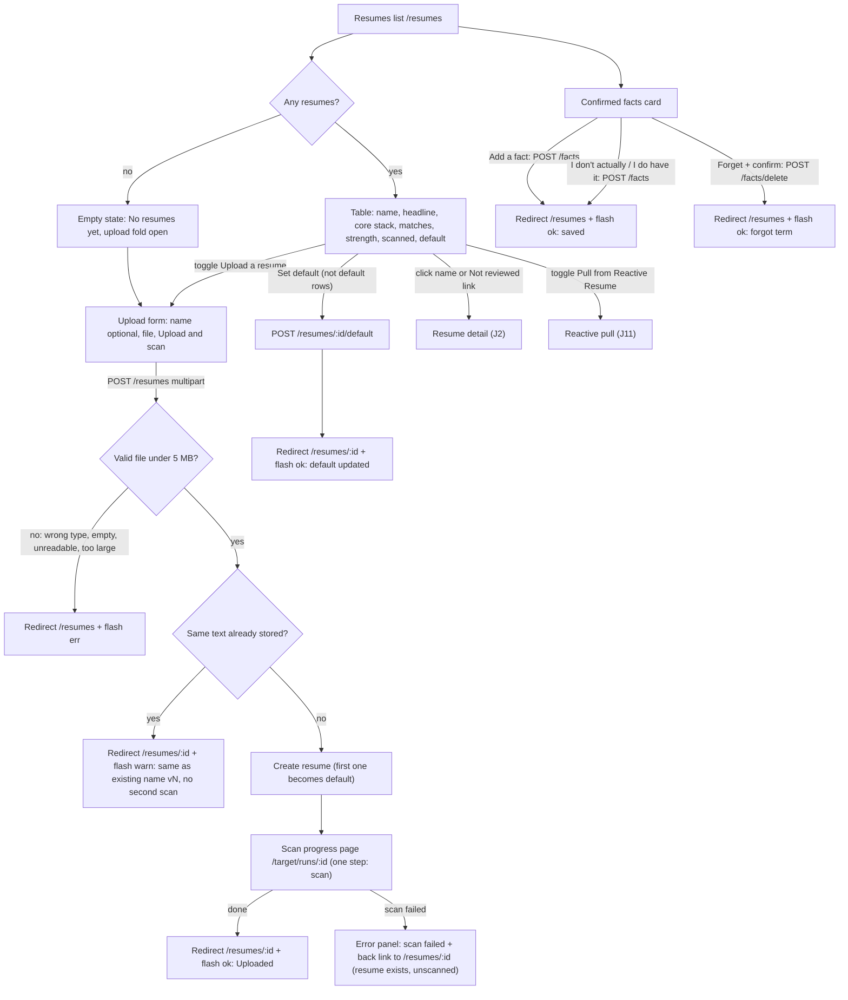

Notes that change the rebuild:

- A repeated upload is detected by comparing extracted text, not file bytes. It never costs a second scan and lands on the existing resume with a warn flash.
- The upload and the Reactive pull share one path, so a pulled duplicate behaves the same way. It also attaches the remote origin to the existing resume.
- An unscanned resume shows a warn badge "Not scanned" in the Scanned column and "-" in stack and headline.
- A strength review older than the current version shows a small warn "vN" badge beside the score.
- Responsive: Name, Matches and Set default always show. Headline, Core stack, Strength and Scanned drop out at narrower widths.
- Facts have three states: confirmed ("I have this"), denied ("I don't"), unknown ("Not sure"). Confirmed ones sort first. A fact row toggles between confirmed and denied with one button.

### Screen inventory

| Screen | Route | Key controls | Data shown | States |
|---|---|---|---|---|
| Resumes list | `GET /resumes` | Upload fold, Reactive fold, Set default, row link, fact add / flip / forget | Name, version badge, default badge, filename, scan headline, primary skills (first 3 and "+N"), best match score and run count, strength score, scanned time, facts | empty (upload fold open), populated, unscanned row, review-behind badge, flash |
| Upload form | on `/resumes` | Name (optional, 100 chars), file (pdf, docx, md, txt, Reactive Resume .json), Upload and scan | Accepted types and size limit hint | submit disabled after first press; error via flash; 413 becomes flash redirect |
| Scan progress | `GET /target/runs/:id` | none (auto) | One step "scan" with a measured time band, elapsed seconds | running, done (redirect), error (message and back link) |

---

## 3. J2 - Resume detail (`/resumes/:id`)

Who: owner. Entry: list row, flash links ("same as existing"), match card's resume name, Tailor editor links. The page is a stack of cards. Order: header actions, Strength review card (J3), two-column Scan summary and Issues, Search profile, Upload a new version, Comparisons history, Tailored copies, Missing across postings, Template check, Clean version, "What the ATS sees". Several cards appear only when they have content.

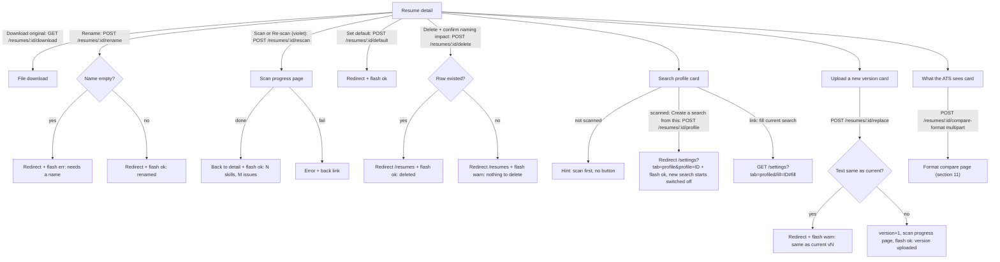

Cards that are conditional:

| Card | Appears when | Content and actions |
|---|---|---|
| Strength review | always | See J3. |
| Scan | always | Not scanned: empty block "Not scanned yet". Scanned: headline, scan time, summary, tag rows for domains, roles, skills. |
| Issues to fix for any job | always | No issues: hint (differs if not scanned). With issues: list of section badge, issue and fix. When a review of the **current** version exists, the list folds behind "Scan flagged N" and the review supersedes it. |
| Search profile | always | Linked searches (links to settings), and the exact draft a click would save (name, required tech, roles, seniority, warnings). |
| Comparisons | always | Empty state "No comparisons yet" with "Open your jobs". Otherwise one row per posting, grouped: job link goes to the Tailor editor, history chips of every earlier score, company, version (or "vN draft"), score badge and delta, date. |
| Tailored copies | there are copies | Per-job table. Download, Send to Reactive Resume (only when resume came from a v6 instance and a connection exists), Promote, Delete. When the resume is v6 but no connection exists: a hint that sending needs one. |
| Missing across postings | at least 5 compared postings | Keywords the latest comparisons asked for and the text lacks. Per row: missing in N of M, count as must-have, and a "what closes it" sentence that is one of three kinds: unwritten (evidence exists, add the word), unconfirmed (link to `/resumes#facts`), not on resume (cannot claim). |
| Template check | resume is a .docx | Kind badge (flow, structural, unsupported), sentences on what Save can rewrite. If the file's author or title names someone else, "Fix document properties" form (`POST /resumes/:id/props`, bytes only, version and scan unchanged). |
| Clean version in your typeface | always | Button to render page (section 11). Primary variant when the file cannot be patched in place (PDF, text, structural docx). |
| What the ATS sees | always | Parsed view of extracted text, parse-warning badges (or "extraction looks clean"), compare-format form, extracted text fold. |

Tailored-copy actions:

- **Promote** (confirm): the copy becomes the next version of the resume, and the text is scanned in the background. Flash ok.
- **Delete** (confirm): the copy is removed. Flash ok, or err "gone" if it was already deleted.
- **Download**: `GET /tailored/:id/download`.

### Screen inventory

| Screen | Route | Key controls | Data shown | States |
|---|---|---|---|---|
| Resume detail | `GET /resumes/:id` | Header actions, rename inline form, cards above | Name, filename, version, origin badge ("from Reactive Resume vN"), default badge, seniority, years | 404 text if not owned, populated, unscanned, flash |
| Delete confirm | native popover on detail | Confirm / cancel | Impact sentence: comparisons, letters, reviews deleted, searches unlinked, applications keep text but lose the name | confirm shown only on press |
| Fix properties | form on Template check | One button | Current creator, last editor, title found in the file | hidden when file names the candidate |

---

## 4. J3 - Strength review and answers

Who: owner. The review is **on demand only**, one AI call, and never runs by itself. Before the first run the card explains what it checks and what it costs. After a run it shows score, grades per dimension with the person's own lines as evidence, advice, strengths, and a delta line against the previous run.

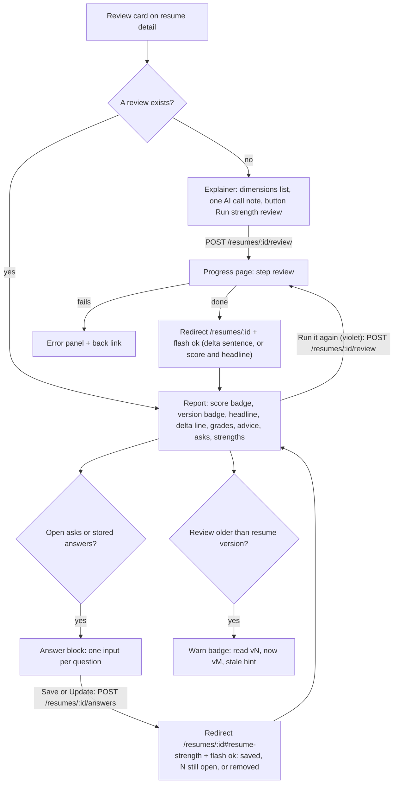

Rules:

- Saving an answer costs nothing and does not re-run the review. The stored answer is read into the **next** run, and the copy says so. An empty answer removes the stored one.
- The run key includes the resume version and a hash of the answers, so correcting a figure starts a new run, while a double press joins the live one.
- Advice cards show priority, dimension, issue, why, fix, an optional quoted line, an optional rewrite, or an "only you can answer" ask that appears in the answer block.
- A score cap, when applied, is explained in a warn line.
- Grade tones: strong is green, ok is amber, weak is red.

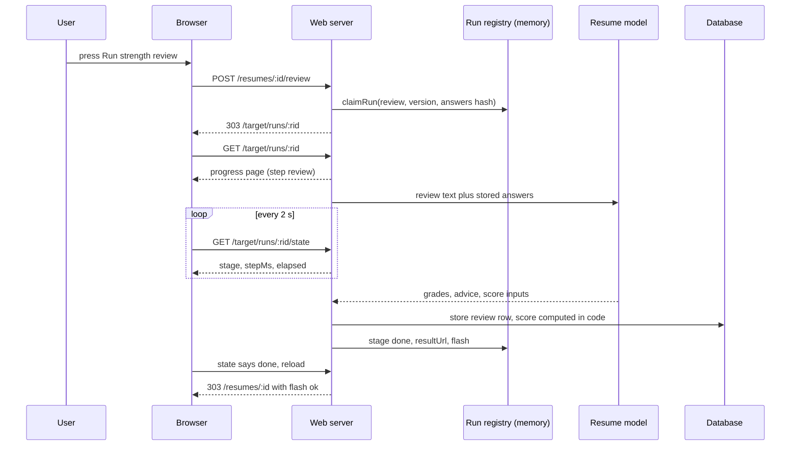

### Screen inventory

| Screen | Route | Key controls | Data shown | States |
|---|---|---|---|---|
| Review card | `#resume-strength` on `/resumes/:id` | Run / Run again, answer inputs | Score, version, time, model, headline, delta moves, cap line, grades with points out of weight, advice, strengths | empty (explainer), populated, stale, error via run page |

---

## 5. J4 - Resume match card (job tab "Resume match")

Who: owner of the job row. Entry: job detail `?tab=match` (also `?match=ID`), progress-page redirect, flash "Tailor resume" action, pack card links. The tab label carries the latest score. Related cards on the same page: a one-line verification hint at the top, a posting-language notice, and the comparison history chips at the bottom.

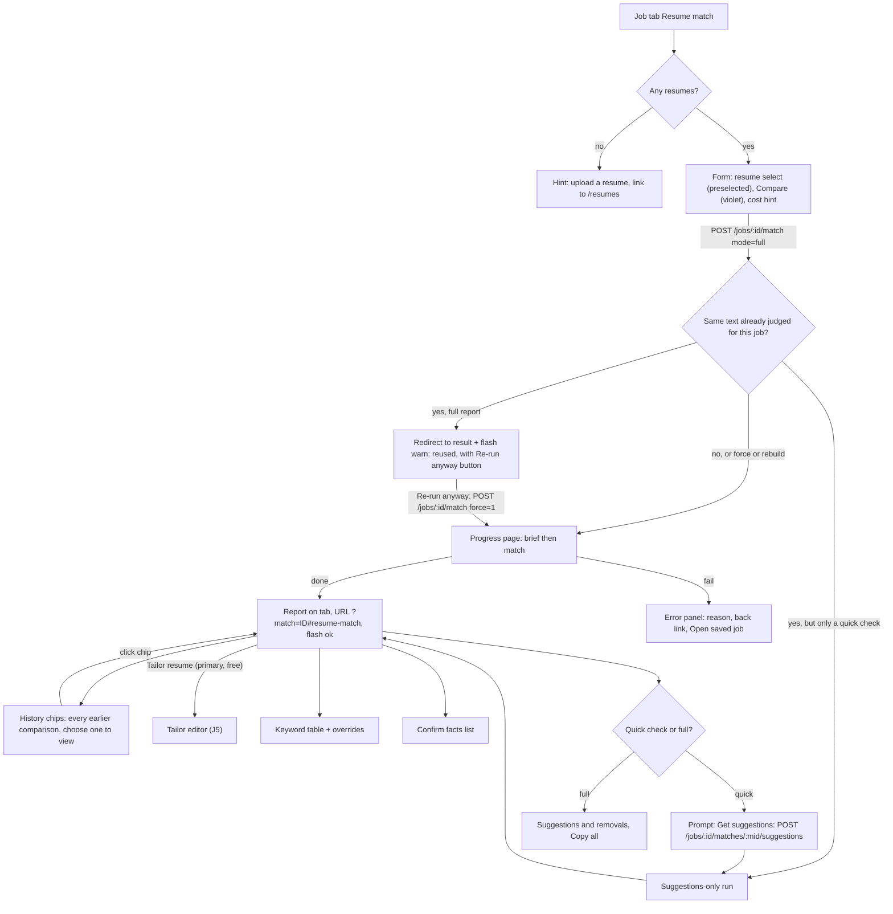

What the report shows, top to bottom:

1. Score badge, delta badge versus the previous run of the same resume (hidden when the keyword frame was rebuilt because the two numbers are not comparable, in which case a "not comparable" note appears), resume name (links to its strength card), version, time, model, draft marker, and the **Tailor resume** button.
2. The model's summary. A hint if the file was judged on its own text rather than the person's.
3. "Why this score": scored lines, "not counted" lines and the ceiling line (what honest editing could reach).
4. Hard requirements (pass, unknown, fail) with notes. Red flags, cautions (the verifier's findings ride along), strengths.
5. Confirm facts (only when the evidence is the person's own).
6. Suggestions grouped by section (summary, skills, experience and so on), each with Copy. Then removals. For a quick check, the Get suggestions prompt replaces both.
7. Keyword table.

### Keyword management and overrides (no AI)

```mermaid
flowchart TD
  K["Keyword table"]
  K --> N["Needs attention rows (not present)"]
  K --> M["Matched fold"]
  K --> IG["Ignored fold, rows dimmed"]
  N -->|"change level select commits on change"| P["POST /jobs/:id/matches/:mid/keywords op=level"]
  N -->|"Ignore"| P2["op=ignore"]
  IG -->|"Restore"| P3["op=restore"]
  N -->|"Reset (own override) or Remove (added by you)"| P4["op=reset"]
  K -->|"Add a keyword form, default level preferred"| P5["op=add"]
  P --> OUT
  P2 --> OUT
  P3 --> OUT
  P4 --> OUT
  P5 --> OUT{"Edit valid?"}
  OUT -- "no: duplicate, empty, unknown" --> E["Flash err"]
  OUT -- "comparison predates scoring data" --> W["Flash warn: edit kept, score not recomputed"]
  OUT -- "yes" --> OK["Score recomputed in code, flash ok: term, level, score moved before to after"]
  K -->|"Rebuild keywords"| RB["POST /jobs/:id/match rebuild=1: reads the posting again, user edits are re-applied"]
```

- Levels are must, preferred and nice. Status badges: present, add the word (resume already shows evidence), ask you (unknown until answered), cannot claim.
- Extra badges: primary stack, count of repeats in the posting, "yours" (override), group, "listed only" (name on a skills line), "measured" (a number near it), alias-only, "not in posting", dated-role usage line (amber after 36 months).
- On the Tailor page, these forms are `data-inline`: they post with `fetch`, follow the redirect, and replace only `[data-region]` blocks (score ring, advice, keyword table, delta box) so the live editor text, focus and scroll survive. Focus returns to the same control, or the add field. If the answer is not the same page or lacks a region, the browser navigates normally.

### Confirm facts (the person answers a keyword question)

- Rows: **I have this** (with optional note, up to 300 chars), **I don't**, **Not sure**. All post `POST /facts` with `matchId` and `back`.
- Terms the model could not back sit behind a fold "N terms the resume doesn't show", because that list can reach 25 items.
- Outcome flashes: saved and score moved (before to after), saved and score unchanged, saved and "recheck", "not sure" (stops asking), or plain saved.

### Compare resumes and comparison mode

- The card runs one comparison per press. To compare two resumes, press Compare again with a different resume selected. The history chips at the bottom list each (score, resume name, version, "draft" marker, time) and switch the report. The resume detail "Comparisons" table groups the same history by job.
- Mode: the hidden `mode` field is always `full` from this card. The quick check (`fast`) still exists in data and displays the "Get suggestions" prompt. It arises only from older rows or the cached fast result.
- A draft comparison (edited text from the Tailor page) is marked "draft".

### Sequence: run a comparison

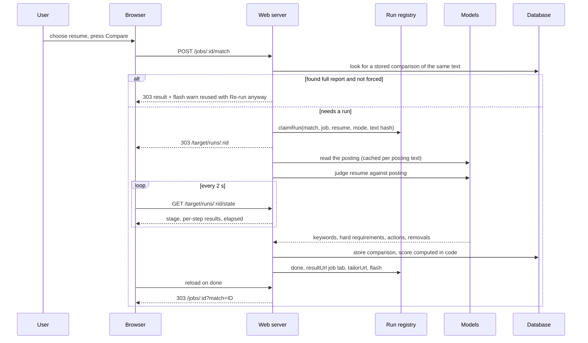

### Screen inventory

| Screen | Route | Key controls | Data shown | States |
|---|---|---|---|---|
| Resume match tab | `GET /jobs/:id?tab=match` | Resume select, Compare, history chips, Tailor resume, keyword and fact forms, Get suggestions, Rebuild keywords, Copy all, per-card Copy and Rewrite | Score, delta, summary, score lines, hard requirements, flags, cautions, strengths, suggestions, removals, keyword table, verification hint line | no resumes (hint), no comparison yet (hint), quick check (prompt), full, reused (warn flash), error (via run), non-English posting notice |
| Suggestion rewrite | `POST /jobs/:id/matches/:mid/actions/:i/rewrite` | "Rewrite" on a card | New wording through the same claim gate. The score does not move. | flash ok (rewritten), warn (refused with reason), err (call failed). One press at a time per card. |
| Comparison run page | `GET /target/runs/:id` | none | Steps brief and match (or suggestions), time band per lane, elapsed | running, error, gone |

---

## 6. J5 - Tailor editor (`/jobs/:id/target`)

Who: owner. Entry: "Tailor resume" button (job match card, flash action, resume detail comparison row), pack card "Go on and tailor", progress-page redirects with `?match=ID`. Without any comparison the route redirects to the job's match tab with an error flash (needs a comparison).

Layout, top to bottom: breadcrumb (Jobs / job title / Tailor), flash (with **Re-run anyway** when reused), title and company line, run-history chips (latest 2 with the rest in a "N older runs" fold), verification line, a **score card**, a confirm-facts card (when there are asks), a view switch (tabs: Side by side, Suggestions, Job description) with a "show matched" checkbox, three panes, and a sticky "dirty" bar that appears once the text is edited.

- Score card: ring with the AI score (hover for help), the model summary, the main-advice sentence and ceiling line, the live length meter, "Ready to apply" (only when no open edits or unconfirmed gates remain and the score is at least the ok floor), an edits-count link that switches to the Suggestions view, and **Apply all** (appears after the script counts what it can do). On the right: a "Upload new version" menu and a "..." menu (Analyse again, Save as tailored copy, copy status, Start over from master, Send to Reactive Resume). Also the orientation block, thin-posting notice, domain mismatch notice and hard-requirements digest.
- Left pane: the job description with keyword highlights. Colours show have (green), must-have gap (red), preferred gap (amber), nice-to-have gap (grey), and dashed underline for "unproven".
- Right pane: your resume. Switch between **Document** (the file drawn as it would be, with page guides) and **Plain text** (a highlight-backed textarea). Missing-keyword chips, a bulk "add all missing" list, expand/reset buttons.
- Changes pane (Suggestions view): delta box, Condense panel (J6), Copy all / Copy my changes / Rewrite all, Apply-all bar, the suggestion cards, signals, keyword fold.

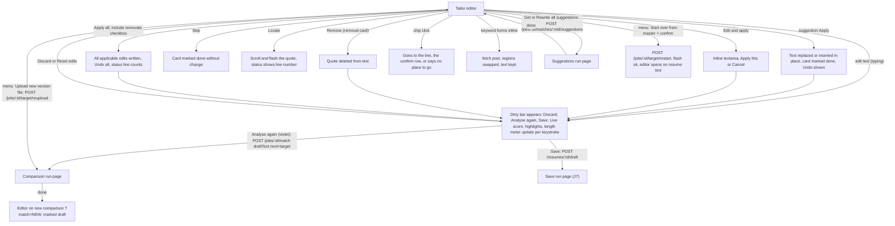

Behaviour details a rebuild must reproduce:

- **Nothing is saved until Save.** Edits are local to the page, and the browser keeps a draft per comparison in `localStorage` (`target-draft:<match id>`), so a reload or a failed run does not lose them. Nothing asks before leaving the page. Analyse again, Save, Shorter wording and Refresh send the editor text; Find cuts, Rewrite and Rewrite all do not. The page text is the stored copy if one exists, else the comparison's own snapshot, else the resume's text. If a tailored copy exists, the editor opens on the copy no matter which comparison was asked for (one working resume per job).
- **Live score.** The ring and number are re-drawn in the browser from the keyword levels and the fixed AI frame (alignment, flags, penalty). The AI score is the honest score. After keyword edits the server re-scores the stored row (no AI). "Analyse again" sends the edited text for a fresh AI judgement.
- **Cards** (suggestion cards) have a stable key so applied and skipped marks survive reloads. Apply is only offered if the model gave a quote or an insert-after anchor and a proposed wording. A card the claim gate refused keeps only "Edit and apply" with the text prefilled.
- **Fast comparisons** (quick check) show the Get suggestions prompt in place of Condense and cards.
- **Narrow screens**: the editor comes first and starts short with an Expand button. Dropdown panels render in flow. Keyword fold opens by default only on wide screens.
- **Accessibility** details: the score has an `aria-live` region, the length meter has a live region, and the dirty bar writes a live announcement when it appears.
- **Re-upload** a file: always a full comparison against the new text. The resume row is untouched and the new comparison is a "draft" of the same version.

### Screen inventory

| Screen | Route | Key controls | Data shown | States |
|---|---|---|---|---|
| Tailor editor | `GET /jobs/:id/target?match=ID` | See above | Score ring, summary, advice, length meter, JD with highlights, editor, doc pane, suggestions, removals, keyword table | no comparison (redirect + err flash), fast (Get suggestions prompt), full, dirty, reused (warn flash with Re-run anyway), copy exists (saved date, download, start over) |
| Document pane | in-page | Document / Plain text switch, Download DOCX, Download PDF | Draft drawn from the same text, notice about the basis | hidden until script runs, draws after each Apply, error text in status |
| Dirty bar | sticky, in-page | Discard, Analyse again, Save | Reminder that edits are not saved | hidden when text equals stored text |

---

## 7. J6 - Condense (two phases plus refresh)

A collapsible panel at the top of the Suggestions view. It is **open** when the text is over the page target or a step already has output. Otherwise it is closed but still available. The heading carries the state: "over the target", "within the target", "no target", or "started".

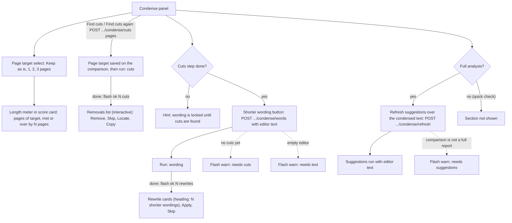

Rules:

- The order is the person's: cuts, then wording of what is left, then optional refresh. Each step is reviewed before the next. Each is its own progress page that returns to the editor (`backUrl` = the editor).
- The page target is stored on the comparison at the moment Find cuts is pressed. The editor's meter follows the choice immediately in the browser. The same value is carried to a later comparison of the edited copy, along with cuts that still apply to the new text.
- Number of cuts and rewrites asked for scales with how far over the target the text is. A page is about 3,500 characters.
- Messages: "no cuts found" and "no shorter wording found" appear as hints inside the panel.
- Edge: older comparisons that stored removals before Condense existed show them with an "older" hint while the stage is still "none".

### Sequence: Condense cuts

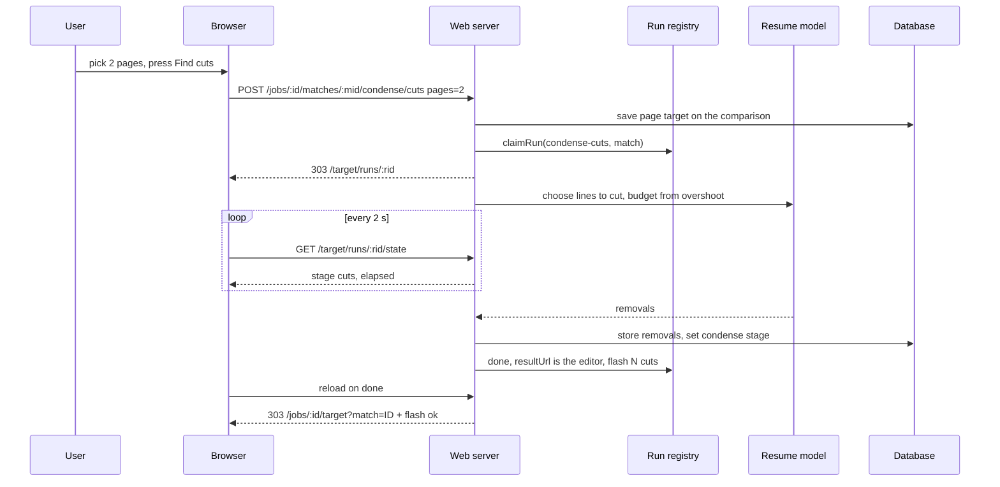

### Screen inventory

| Screen | Route | Key controls | Data shown | States |
|---|---|---|---|---|
| Condense panel | `#condense` on Tailor editor | Page select, Find cuts, Shorter wording, Refresh suggestions | Stage state, removals, rewrites, hints | closed/open, stage none / cuts / rewrites, no-results hints, locked wording |
| Condense run page | `/target/runs/:id` | none | One step (cuts or wording) | running, error (reason), done (redirect) |

---

## 8. J7 - Working resume per job, save, document pane, downloads

There is **one working resume per job per resume**: the tailored copy. Saving never changes the master resume.

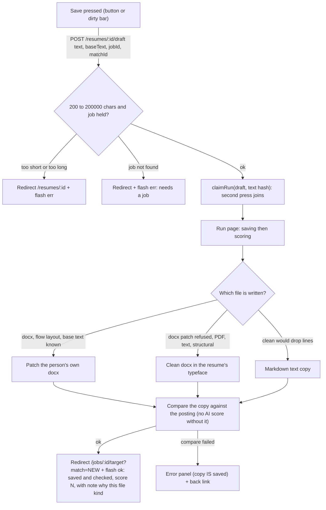

- The flash note explains the file kind in plain words: patched N changed / N added / N removed, or why a clean version was used (PDF, no base text, unsupported layout, patch refused).
- The copy is shown in the editor header as "Saved <date>" with Download, Start over from master (confirm), and Send to Reactive Resume (when allowed).
- Re-saving updates the same copy for that job. If the editor started from the copy, edits patch the copy's file, not the master's.
- Cuts found on the comparison you were editing but not accepted carry to the new comparison when still applicable.
- The master resume text is **not rescanned** when a copy is saved. Only **Promote** (from resume detail) turns a copy into a new master version and rescans.

Document pane (no reload):

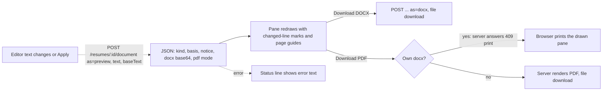

- Size limits for the document call: text between 1 and 200,000 characters.
- Document kind `own` means the person's own docx with the edits written in. Otherwise the clean version is drawn.

### Screen inventory

| Screen | Route | Key controls | Data shown | States |
|---|---|---|---|---|
| Save run page | `/target/runs/:id` | none | steps keywords (saving) then scoring | running, error (copy saved but check failed), done |
| Tailored copy download | `GET /tailored/:id/download` | none | .docx or .md file | 404 text if gone |
| Document call | `POST /resumes/:id/document` | none (script) | JSON or file | 400 text size, 404, 409 print |

---

## 9. J8 - Verification card ("Is it real?") and fact-check gates

Who: owner. Entry: job tab `?tab=verify`, links from match card, letter card, pack card. The tab label shows the verdict. Cost hints are drawn from the AI ledger and shown before pressing.

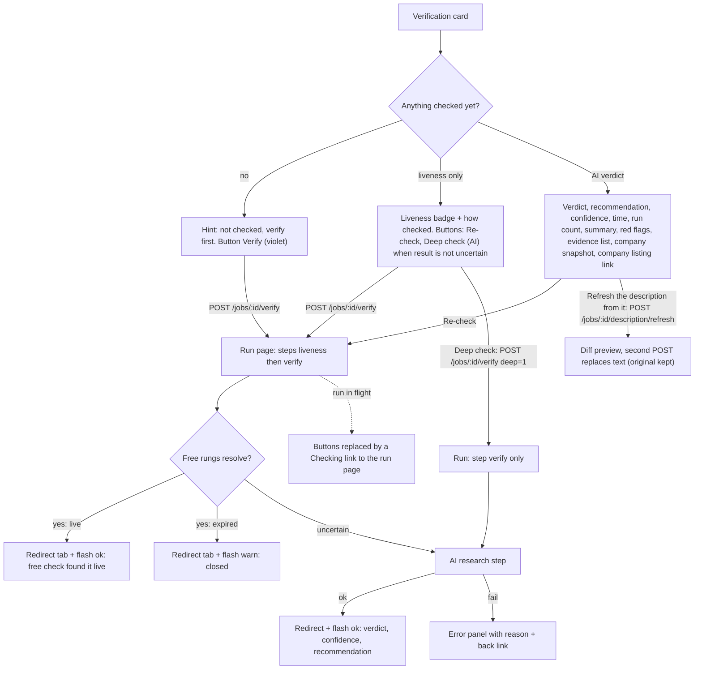

Key rules:

- A run key per job: a second press, another tab, or a reload sees the live run through a "Checking since ..." link.
- A pasted posting without a URL skips the free page checks and says so in the run subtitle.
- Evidence signals: legit, ghost, scam, neutral, unverified. Checks: careers page, LinkedIn, reputation, posting age, salary, named humans, posting quality, other. Verifier words are shown as written, in English.
- The verification feeds other screens as **text only, never scored**: a one-line hint and cautions on the match card and Tailor page, the letter's addressee prefill (a named human), the letter's company facts, and the pack's company card.

Fact-check gates (where invented claims are refused):

| Place | Gate | Visible outcome |
|---|---|---|
| Suggestions and rewrites | Each proposed wording is checked against the resume text and the person's confirmed facts. Refused wording keeps no replacement text. | On the card, only "Edit and apply" remains. A rewrite shows flash warn with the reason. |
| Keyword statuses | "Add the word" needs evidence in the resume. "Cannot claim" is shown in red and not offered as an edit. | Badges and the "N terms the resume doesn't show" fold. |
| Cover letter generation | Fact check of the draft against resume, posting, company snapshot and facts. | Gate badge (pass, warn, block). A letter blocked twice is never shown or saved. |
| Cover letter manual edit | Re-checked on every save. Never blocks the user. | Badge and notes update, status text says flagged. |
| Application pack | Same claim gate applied to the pack's edits. | Held edits list and checks-failed notice (section 13). |

### Screen inventory

| Screen | Route | Key controls | Data shown | States |
|---|---|---|---|---|
| Verification tab | `GET /jobs/:id?tab=verify` | Verify, Re-check, Deep check, Refresh description | Liveness, verdict, evidence, snapshot | never checked, free result only, AI verdict, run in flight, no URL hint |
| Verify run page | `/target/runs/:id` | none | steps liveness, verify with per-step result line | running, error, done (redirect) |

---

## 10. J9 - Cover letter

Two entries. The **job tab** is the main place (resume, tone, addressee, angles, history of letters). The **`/letter` launcher** is for starting from a picker without opening the job first.

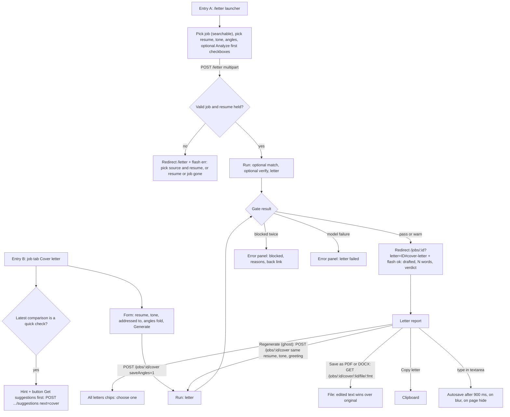

Form details:

- Tone select: neutral, warm (default), direct. The addressee input is prefilled from a named human found by verification, with a hint showing the finding. A name greets that person. Blank means "the team".
- Angles (collapsible, opens when saved values exist): why this company, what problem you would solve, your approach, and a notes box for things every letter should mention. A form with `saveAngles=1` saves them as prefill for the next letter. A bare Regenerate reuses the saved values.
- The hint notes whether company research is available. Without a stored company snapshot it links to the verify tab.
- Optional checkboxes on the launcher: "score this resume against the posting first" and "research the company first". Both are skipped by default so the common path is one model call. Match runs in full mode so strengths exist. Verify is skipped if a snapshot already exists.
- Run key includes job, resume, tone, which enrichers, and a hash of angles and addressee, so a different tone is new work.
- A failed optional match or verify adds a warning to the result flash and the letter still runs; only the letter step itself can end the run in an error.

Autosave states shown in a status line: "unsaved", "saving", "saved" (or "saved, flagged" for warn/block), "failed". Failure retries with exponential backoff capped at 15 s and reveals the Save button as the fallback. A `sendBeacon` posts on page hide. Without script the Save edit button posts the form normally. The word counter updates as you type.

On save the server re-runs the fact check on the edited text and stores the verdict. If the text equals the original, the edited copy is cleared ("restored" message). Empty text: 400 JSON or flash err. Over the limit: 400 JSON or flash err.

### Sequence: generate a letter

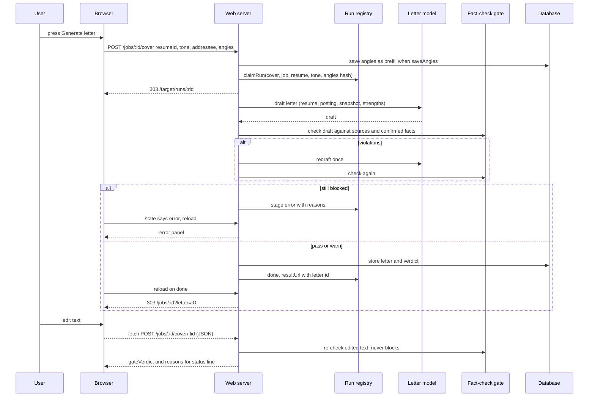

### Screen inventory

| Screen | Route | Key controls | Data shown | States |
|---|---|---|---|---|
| Cover letter tab | `GET /jobs/:id?tab=letter` | Resume, tone, addressee, angles fold, Generate, Regenerate, Copy, PDF, DOCX, chips | Letter text in editable textarea, gate badge, resume and version, tone, edited badge, model, keywords worked in, gaps conceded, company-facts source line, gate notes | no resumes (hint), no letter yet, quick-check hint, blocked (via run), saving states |
| Letter launcher | `GET/POST /letter` | Job picker, resume select, tone, angles, two checkboxes, Write the letter | Saved angles prefill | no jobs (link to add a job), no resumes (link to upload), form errors via flash |
| Letter run page | `/target/runs/:id` | none | steps (match), (verify), letter | running, error (blocked reasons or failed), done |
| Letter file | `GET /jobs/:id/cover/:lid/file/:fmt` | none | docx or pdf of edited (else original) text | 400 bad format, 404 |

---

## 11. J10 - Render and download (clean version, format compare, knobs)

Entry: "Clean version in your typeface" card on resume detail, or the "clean version" link in the Tailor editor hint (shown when the file cannot be patched in place). The render route has **no AI by default**: everything is derived from the stored resume on each request.

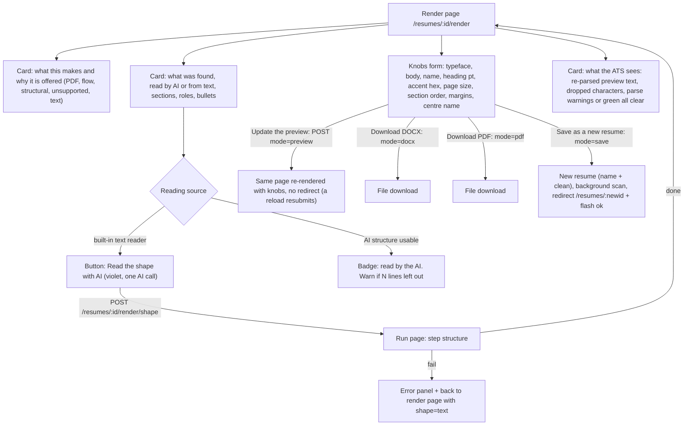

- The preview is the real output read back: the DOCX is built and run through the same text reader as an upload, so the "What the ATS sees" block is literally what a parser gets.
- Knobs are prefilled from the person's own file (typeface and sizes read off a DOCX or PDF). The style note says where they came from (docx, pdf, or "file said nothing").
- Characters the bundled font cannot draw are listed as dropped.
- A bare GET never spends a model call. The AI reading is started only by the button.
- Two submit channels are used on purpose: with script, a hidden `mode` field is set on click because a disabled submitter does not post. Without script the button's own `submitMode` value posts. The server reads `submitMode` first.
- "Save as a new resume" keeps the original untouched and creates a one-version DOCX resume with the knobs applied.

Format compare (resume detail "What the ATS sees" card):

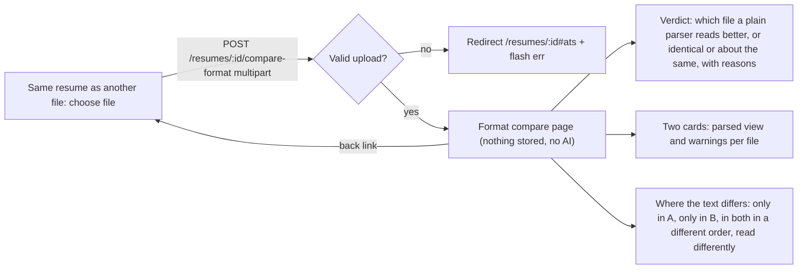

### Screen inventory

| Screen | Route | Key controls | Data shown | States |
|---|---|---|---|---|
| Render page | `GET/POST /resumes/:id/render` | Knobs, Update preview, Download DOCX, Download PDF, Save as new resume, Read the shape with AI | Reason sentence, typeface note, structure counts, preview text, dropped chars, warnings | AI vs built-in reading, lost-lines warning, flash after shape run |
| Shape run | `/target/runs/:id` | none | step structure | running, done, error with engine reason |
| Format compare | `POST /resumes/:id/compare-format` | none | Verdict, two parsed views, diff lists ("and N more" when long) | identical (no diff card), same lines (hint), differs |

---

## 12. J11 - Reactive Resume (connect, import, link, send, failures)

An optional link to the person's own Reactive Resume instance (a resume builder). The saved connection is an address plus an API key. The key is **never echoed** in a flash, log, redirect or page, and the key field always starts empty.

### 12.1 Connect and disconnect (Settings, Job search tab, `#reactive-resume`)

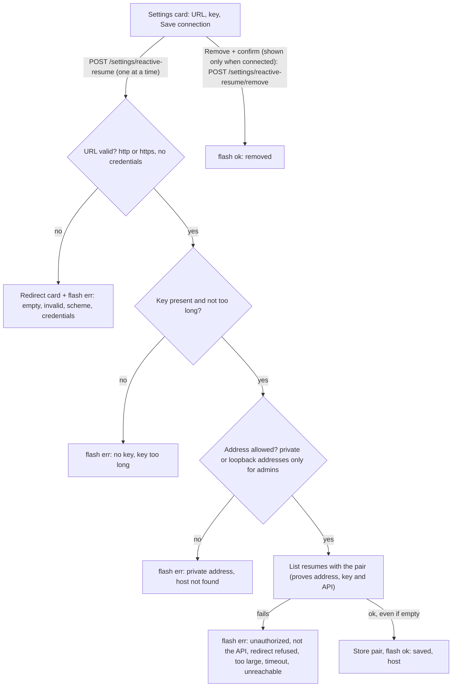

When connected, the card says "Connected to <host>" and offers a replace form with a hint. Remove is a danger-styled confirm.

### 12.2 Import / link a resume

Entry points are the "Pull from Reactive Resume" fold on `/resumes` (a **new** resume) and the "Upload a new version" card on resume detail (the **next version** of that resume). When not connected, both show a pointer sentence linking to the settings card.

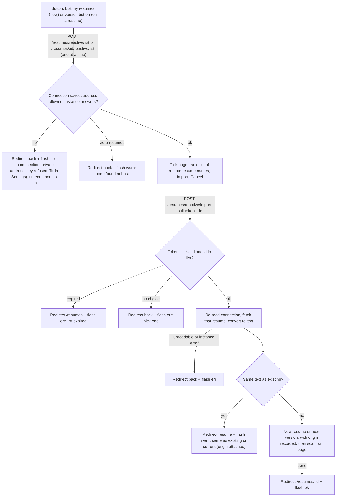

- The list is stashed server-side for a limited time and holds only ids (no address, no key). It is consumed whatever the outcome.
- The connection, name and the person's standing are re-checked at import time.
- Origin: the resume detail header shows "from Reactive Resume <generation>" (read-only for older generation). Only a **v6** resume can be sent back.
- Import-by-file works too: a Reactive Resume `.json` export is accepted in the normal upload.

### 12.3 Send a tailored copy back (writeback)

Buttons: "Send to Reactive Resume" on each row of the resume detail "Tailored copies" card (back = resume) and in the Tailor editor menu (back = target with match). It is shown only when the copy exists, the resume came from a v6 instance, and a connection is saved.

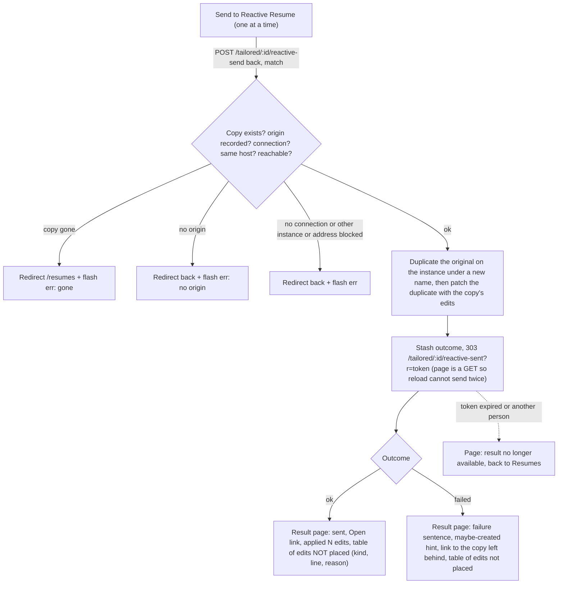

- The original on the instance is only read. A new resume is always created.
- Reasons an edit could not be placed: no field, assembled line, misaligned, new section, label changed. Failure codes include unauthorized, not API, redirect refused, too large, timeout, unreachable, locked, conflict, bad patch, wrong generation, original changed since import (stale), original not found, nothing applied.
- The result page has a back link to where the person pressed the button (the resume's tailored section, or the Tailor editor on the same comparison).

### Sequence: send a copy

```mermaid
sequenceDiagram
  participant U as User
  participant B as Browser
  participant W as Web server
  participant K as Connection store
  participant X as Reactive Resume instance
  U->>B: press Send to Reactive Resume
  B->>W: POST /tailored/:id/reactive-send
  W->>K: read base address and key for this person
  W->>X: check reachability of the address
  W->>X: GET original resume by remote id
  W->>X: duplicate original as new resume
  X-->>W: new remote id
  W->>X: PATCH new resume with edits that can be placed
  X-->>W: ok or failure code
  W-->>B: 303 /tailored/:id/reactive-sent?r=token
  B->>W: GET result page
  W-->>B: sent, applied count, not-placed table, Open link
```

### Screen inventory

| Screen | Route | Key controls | Data shown | States |
|---|---|---|---|---|
| Settings card | `/settings?tab=profile#reactive-resume` | URL, key (password), Save, Remove | Connected host | not connected, connected, flash errors |
| Pick page | result of `POST .../reactive/list` (200 HTML, a reload resubmits) | Radio list, Import, Cancel | Remote resume names, host | zero results become flash warn, expired token |
| Send result | `GET /tailored/:id/reactive-sent?r=` | Open on instance (new tab), back link | Outcome, count, not-placed table | ok, failed, maybe-created, expired |

---

## 13. J12 - Application pack

A pack is a prepared bundle for one job: a tailored resume file (DOCX and PDF), optional cover letter, a company check and a list of what was held back. The dashboard **never prepares a pack itself**. It puts a row in a queue and the worker's runner takes it (within about a minute). Packs asked for by hand and packs the worker queues automatically use the same code.

### 13.1 Auto-prepare settings (Settings, Automation tab, `#packs`)

One form, saved at once. Enable switch, minimum fit, daily limit (0 = no limit), maximum posting age (days), cover-letter policy (never, asked, always), a section policy for what may change (title, summary, skills, experience), maximum bullets, and options for keywords and removals. Invalid values store nothing (not even the switch) and the flash names the field. Switching it off cancels queued automatic packs and says how many.

### 13.2 Pack tab (`/jobs/:id?tab=pack`)

```mermaid
flowchart TD
  T["Pack tab"]
  T --> H{"A pack row exists?"}
  H -- "no" --> NP["Empty card: what it does, automatic on or off line, same-role link to another source's pack, Prepare (violet), cost hint"]
  NP -->|"POST /jobs/:id/pack"| Q{"Queue outcome"}
  Q -- "queued" --> F1["Redirect tab + flash ok: queued"]
  Q -- "waiting or busy" --> F2["flash ok: already queued or running"]
  Q -- "sent or kept" --> F3["flash warn: sent pack is not redone, or kept because applied"]
  H -- "yes" --> ST{"Status"}
  ST -- "queued" --> QD["Notice with live line + Cancel button"]
  ST -- "running" --> RN["Notice with step sentence (no cancel)"]
  ST -- "failed" --> FA["Danger notice: why. Try again (confirm)"]
  ST -- "stopped" --> SP["Warn notice: stop title + why. Try again (confirm)"]
  ST -- "ready" --> RD["Ready view"]
  QD -->|"Cancel: POST /jobs/:id/pack/cancel"| CN{"Still queued?"}
  CN -- "yes" --> CNO["flash ok: cancelled, row removed, empty card again"]
  CN -- "no" --> CNW["flash warn: too late to cancel"]
  QD -.->|"poll GET /jobs/:id/pack/state every 8 s"| PL{"busy?"}
  RN -.-> PL
  PL -- "still busy" --> UPD["Rewrite the one sentence in place"]
  PL -- "finished or row gone" --> UN{"Unsaved typing in the page?"}
  UN -- "no" --> RL["Reload page"]
  UN -- "yes" --> WT["Show: finished, reload when you are done. Page left alone"]
```

Ready view contents:

- Header badges: match score before to after (or single), company verdict and recommendation, "sent <time>" if frozen, "prepared from <resume> <time>".
- Buttons: Download DOCX, Download PDF (files exist), Open posting (safe link, new tab). Warn notices: stored `why`, checks that failed, a hint when the file is a clean version rather than the person's own.
- **Mark as sent** form (shown when the pack is ready and unfrozen): `POST /jobs/:id/status` with status APPLIED and the pack's choice value. It records the pack's text as the resume that went out and **freezes** the pack.
- Footer buttons: Go on in the Tailor editor (ready), See the comparison (not ready), Read the letter (if a letter exists), Prepare again or Try again (confirm). Hidden once sent or kept.
- Extra cards: Company (verdict summary, snapshot, link to evidence), "What stands between you and a better match" (asks to answer and terms the resume cannot back), "What changed" line diff (was and now, taken out, put in, unplaced-line notes), "Left for you" (held edits with section, where, reason, and a hint).

Rules:

- Pack downloads (`/jobs/:id/pack/resume.docx` and `.pdf`) always return the same bytes the pack kept, whatever happened to the resume since. `Cache-Control: no-store`.
- While a pack is busy, a no-script fallback uses a meta refresh every 8 s. With script, the poll replaces it.
- `POST` with `status=APPLIED` and a stale pack (prepared again since the page was drawn) answers a redirect to the pack tab with an error flash "changed" rather than recording the wrong file.
- Only the person's own pack row is visible. State returns 404 JSON `{gone:true}` when absent.

### Sequence: pack lifecycle

```mermaid
sequenceDiagram
  participant U as User
  participant B as Browser
  participant W as Web server
  participant DB as Database queue
  participant K as Worker runner
  participant AI as Models
  U->>B: press Prepare
  B->>W: POST /jobs/:id/pack
  W->>DB: queuePack manual
  W-->>B: 303 /jobs/:id?tab=pack + flash ok queued
  loop every 8 s while busy
    B->>W: GET /jobs/:id/pack/state
    W-->>B: busy true and the progress sentence
  end
  K->>DB: take queued row within about a minute
  K->>AI: verify company, compare, edit through claim gate, optional letter
  K->>DB: write files, edits, held list, status ready
  B->>W: GET state
  W-->>B: busy false
  B->>B: reload unless typing is unsaved
  U->>B: Download DOCX or Mark as sent
  B->>W: POST /jobs/:id/status APPLIED with pack value
  W->>DB: record applied resume snapshot, freeze pack
  W-->>B: 303 tab
```

### Screen inventory

| Screen | Route | Key controls | Data shown | States |
|---|---|---|---|---|
| Pack tab | `GET /jobs/:id?tab=pack` | Prepare, Cancel, Try again, Download, Mark as sent, links | See 13.2 | none, queued, running, failed, stopped, ready, sent (frozen), kept (job applied before ready) |
| Pack state poll | `GET /jobs/:id/pack/state` | none | `{busy, line, wait}` | 200, 404 gone, 400 bad id |
| Pack settings | `/settings?tab=automation#packs` | Whole form | Rules above | saved, refused with field flash, off with cancelled count |

---

## 14. J13 - Applications tracker (`/applications`) and the applied-resume snapshot

Who: owner, only while "application tracking" is on in Settings (Applications tab). With tracking off the page shows an empty state with "Turn it on in Settings", and the job-page tracking card and the board posts become no-ops that redirect back.

### 14.1 Board and moving cards

```mermaid
flowchart TD
  B["Board /applications"]
  B --> TR{"Tracking on?"}
  TR -- "no" --> OFF["Empty: tracking is off, button to Settings"]
  TR -- "yes" --> EM{"Any cards?"}
  EM -- "no" --> EMP["Empty hint: mark a job applied in Jobs, columns still drawn"]
  EM -- "yes" --> COL["Columns: Consider, Applying, Applied, work columns, then No Offer (rejected, ghosted, expired), plus Unfiled if some stage has no column"]
  COL -->|"drag card to a column (fine pointer)"| MV["POST /jobs/:id/stage toStage"]
  COL -->|"quick-move select + Move (touch, keyboard, no script)"| MV
  MV -->|"redirect /applications + flash ok: moved to stage"| COL
  COL -->|"click card"| JD["Job detail"]
  COL -->|"CSV or Markdown (when any cards)"| EX["File download, English headers, dates in display zone"]
  COL -->|"Edit columns"| SET["/settings?tab=applications#stages"]
  COL -->|"No Offer collapse chevron (desktop)"| FOLD["Column folds to a rail, count stays"]
```

- Drop on "No Offer" sets `rejected`. A card already in that group stays as is. Each card in No Offer wears a badge naming its end state.
- Mobile: columns stack, and a chip row jumps to each column with its count.
- Card content: title, company, an "in stage" time line (amber and bold when stale = no movement for over 14 days, never for end states), recruiter name, fit badge, quick-move form. With drag active on desktop the quick-move form collapses until hover or focus. Pre-apply stages show no "no apply date" text.
- Every stage change writes a history row in the same transaction. Reaching Applied sets today's date unless one exists. Moves to other stages leave the date alone.
- The header meta counts active cards and No Offer cards. Unfiled is not counted.

### 14.2 Job page rail (where stages, dates and the resume are recorded)

```mermaid
flowchart TD
  R["Job detail right rail (every tab)"]
  R --> A1["Consider (tracking on and not in Consider and not applied): POST /jobs/:id/consider"]
  A1 --> A1R["Stage consider, redirect same tab + flash ok moved to Consider. Status and date untouched"]
  R --> A2["Mark applied with 'Applied with' select"]
  A2 --> CH{"Select value"}
  CH -- "none" --> N1["Record no resume"]
  CH -- "a resume (preselected: the one compared, else linked or overlap)" --> N2["Snapshot resume id, version, full text"]
  CH -- "pack file (when a ready unfrozen pack exists)" --> N3["Snapshot the pack's text, freeze pack"]
  N1 --> ST
  N2 --> ST
  N3 --> ST["POST /jobs/:id/status APPLIED"]
  ST --> SE{"Tracking on and stage is none, consider or applying?"}
  SE -- "yes" --> SEED["Stage becomes applied, history row, applied date set once"]
  SE -- "no (later stage or end state)" --> KEEP["Stage stays where the person put it"]
  R --> A3["Save, Dismiss, Reopen"]
  R --> A4["Application tracking card: stage, applied on, applied with, recruiter, notes, Save application"]
  A4 -->|"POST /jobs/:id/application"| SAVE["Stage change writes history, date correction writes a correction row, unchanged resume choice is not re-snapshotted"]
```

- **Applied-resume snapshot**: stored as id, version, and the **full text** at the moment of applying. This answers "which words did I send?" even after the resume gets a new version. The job rail shows "Applied with <name> vN" (a deleted resume reads as such), and a fold "Text that went out (N characters)".
- After the job is applied, the **Applied with** field in the tracking card asks "which did you send?" if nothing was recorded (for example a card dragged into Applied on the board, which has no picker). It never preselects a guess, but its hint names the suggested one. If something was recorded, the hint says it is kept as it was.
- When the form posted has no resume picker field at all, the stored value is kept. An empty value clears it. A pack value is only honoured if the pack is still ready, unfrozen, and prepared at the moment the page was drawn.
- Reapply window setting: an optional number of days in Settings, Applications tab, `#reapply`. Invalid value gives a flash err.

### 14.3 Stale nudges and export

- **On the board**: a stalled card turns its time line amber and bold ("stalled" wording) after 14 days without movement in a non-end stage.
- **Digest**: a daily stale-applications message is sent by the worker to the person's destinations (Telegram or Discord). The toggle is in Settings, Notifications tab (`POST /settings/stale-digest-toggle` flashes enabled or disabled). The Applications tab repeats its state in a one-line hint with a link.
- **Export**: `GET /applications/export.csv` and `export.md` (one row per application in column order; company and source split apart; applied date, stage since, fit, resume label, recruiter, notes, URL). Filenames carry the day. Buttons only show when the board has cards.
- **Columns**: add, rename, move, remove (refused while jobs are in it, and the last work column cannot go) live in Settings, Applications tab. A removed-but-still-used stage files its jobs under Unfiled and appears in the job's select as "removed column".

### Screen inventory

| Screen | Route | Key controls | Data shown | States |
|---|---|---|---|---|
| Board | `GET /applications` | Drag, Move select, CSV, Markdown, Edit columns, column links | Cards by stage, counts, stale flags | tracking off, empty board, populated, unfiled panel, flash moved |
| Job rail | on every `/jobs/:id` tab | Consider, Mark applied + picker, Save, Dismiss, Reopen, tracking form, mute | Facts, applied-with row, stage, dates, notes, sent text fold | tracking off (card hidden), applied (picker hidden, field shown), removed column option |
| Exports | `GET /applications/export.csv` / `.md` | none | File | always available on route (buttons hidden when board is empty) |
