# 10c - UI Flows: Employer Screening, Auth and Admin, AI Usage, Global Chrome

Derived from source only (`src/web/**`, `src/screening/**`, `src/users/**`, `src/ai-*.ts` where routes call them). It complements `08-web-app-and-ux.md` (sitemap, middleware, flash contract, run state machines) and does not repeat them. Every screen below is server-rendered HTML. Each mutation is a plain form POST that answers 303 plus a one-shot flash message (shown as a corner toast when script runs, as a banner otherwise). Where a control only works with script, the text says so.

Notation used in the diagrams:

- Rectangles are screens. Rounded nodes `( )` are user actions or outcomes. Diamonds are decisions.
- Edge labels give the control name, then `METHOD path` in small text.
- "flash ok / warn / err" means the one-shot message after the redirect (kinds and TTL are in doc 08).
- Role words: **open** (no sign-in needed), **personal** (admin and member), **admin** (admin only). A member who asks for an admin route gets the 403 page.

---

## Journey index

| # | Journey | Who | Entry points | Section |
|---|---|---|---|---|
| A1 | Switch employer mode on or off, and what changes | Admin | Settings > Screening tab, toggle | 1 |
| A2 | Start a new screening (pick or paste a position) | Admin, employer mode on | Sidebar "Screening" > "New screening" | 2 |
| A3 | Screening workspace: posting, criteria (rubric), presets, redraft | Admin | `/screen/:id` cards 1 and 2 | 3 |
| A4 | Applicant intake (files, zip, folder) and the scoring run | Admin | `/screen/:id` card 3, results card | 4 |
| A5 | Results table, bulk actions, decisions, calibration | Admin | `/screen/:id` cards 4 and 5 | 5 |
| A6 | Applicant detail: scorecard, redaction view, trajectory, held and unreadable states | Admin | Click a name in the table | 6 |
| A7 | Compare (side by side and "Compare with AI") | Admin | Bulk bar "Compare" | 7 |
| A8 | Export, keep longer, delete | Admin | Header buttons on `/screen/:id`, list page | 8 |
| B1 | OIDC sign-in, sign-out, failure pages, first-run admin claim | Anyone | Any page when sign-in is configured | 9 |
| B2 | Access denied (403) and role gating | Member | Any admin URL | 10 |
| B3 | Users admin: role change, remove, last-admin protection | Admin | Sidebar "Users" | 11 |
| B4 | Account and profile settings (what exists) | Admin, member | Sidebar "Settings" | 12 |
| B5 | Start at login (login item) and update check | Admin, local install | Settings > General | 13 |
| C1 | Language menu, language invitation, theme switch | Anyone | Sidebar foot, Settings > General | 14 |
| C2 | Flash/toast, navigation progress bar, mobile nav, skip link | Anyone | Every page | 15 |
| C3 | AI usage page, period tabs, hints, plan card | Admin | Sidebar "AI usage" | 16 |
| C4 | AI engine test, enable/disable, priority, budget and budget alerts | Admin | Settings > AI tab | 17 |
| C5 | Banners and guidance: paused, held alerts, finish setup, next three things, update notice | Anyone | Overview, sidebar foot | 18 |
| D1 | Global navigation map with role gating | All | - | 19 |

---

## 1. Employer mode: switching it on and what changes (A1)

**Who / entry.** Administrators only. The switch is Settings > Screening tab (`/settings?tab=screening`), a row with a On/Off switch. The tab is listed in the Settings tab strip for admins only (members never see Sources, AI or Screening, and a direct `?tab=screening` falls back to the Profile tab).

**What the switch changes.**

- The sidebar System group gains a "Screening" entry (last, admin only). The entry appears from the next request after the toggle (the flag is cached in the web process and updated by the toggle itself).
- All `/screen` routes start working. With the mode off, any `/screen` or `/screen/...` URL redirects to Settings > Screening with a warn flash saying the section is off and how to turn it on.
- The AI plan (Settings > AI engines table, and the plan card on `/ai`) gains a "Screening" task row, and each engine card gains a Screening tick box. With the mode off the row and box are hidden (an engine that already lists Screening keeps it).
- Nothing changes on Overview, Jobs or Applications. Existing screenings are not deleted when the mode is turned off: the hint reads "N screenings are kept, hidden until you turn this on".

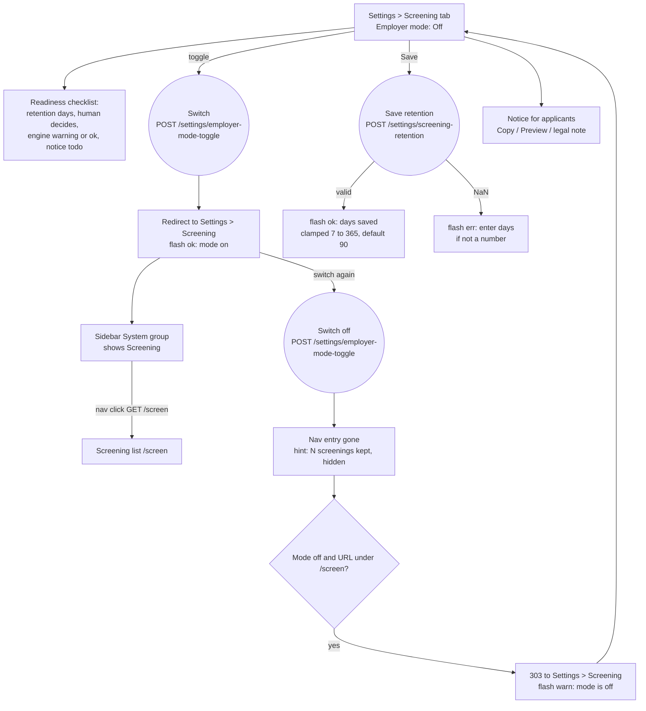

### Screen inventory (employer-mode switch)

| Screen | Route | Key controls | Data shown | States |
|---|---|---|---|---|
| Settings > Screening | `GET /settings?tab=screening` | Employer-mode switch (`POST /settings/employer-mode-toggle`), retention select + Save (`POST /settings/screening-retention`), "Copy notice" button (script copies text), "Preview notice" and "What this means legally" disclosures | Switch state, hint (link to `/screen` when on, "N kept, hidden" when off with data, plain hint otherwise), readiness checklist (retention, human decides, engine, notice todo), engine in use with badge "personal subscription" (warn) or "API or local" (ok), retention choices (7 to 365 days, recommended 90) | Off, on, off-with-kept-data. Admin only. Notice and legal text are English in every language |
| Bounce | any `/screen*` while off | - | warn toast | Redirect only |

---

## 2. New screening (A2)

**Who / entry.** Admin, employer mode on. Sidebar "Screening" (`/screen`) > "New screening" button, or `/screen/new` directly.

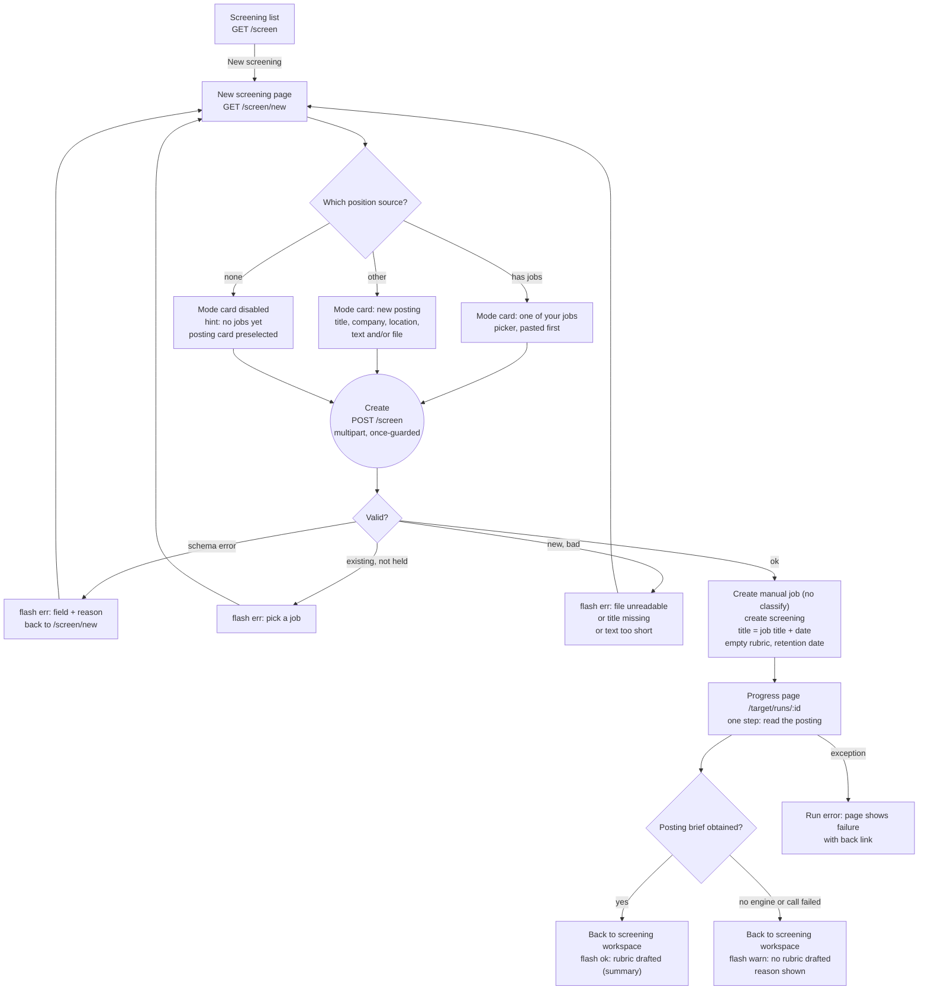

Notes:

- The job picker lists up to 200 of the person's non-dismissed jobs, pasted postings first, then newest. Each option shows title, employer and age. The right-hand card lists the four next steps (read the posting, edit the criteria, drop in resumes, score). It also holds the Create button and a hint.
- A file for the posting accepts the resume-file formats (up to 5 MB); text from the file replaces the pasted text.
- The rubric draft is one AI call ("posting brief"), cached against the posting text. If it was done before for a comparison it costs nothing and the progress page says it was reused.
- A second press while the first is running is refused with a warn flash (once-guard), and a second identical rubric run joins the live one.
- After the first draft the screening exists even if the draft failed. The person then clicks "Read the posting again" on the workspace.

### Screen inventory (new screening)

| Screen | Route | Key controls | Data shown | States |
|---|---|---|---|---|
| Screening list | `GET /screen` | "New screening" button, row link (title), job link, per-row Delete (confirm dialog, `POST /screen/:id/delete`) | Count, intro sentence (tool ranks, a person decides), table: screening, position (job + company), applicants (+ "N not scored"), scored badge (all scored = ok, "x of y" = neutral, dash if none), created (relative), kept until, retention hint | Empty ("no screenings yet" with explanation), populated, flash |
| New screening | `GET /screen/new` | Radio mode cards, job picker, title/company/location inputs, description textarea, file input, Create | Position sources, 4-step explainer | Default, jobs-empty (picker card disabled, posting card checked), flash err, double-press warn |
| Run progress | `GET /target/runs/:id` (+ `/state` poll, see doc 08) | back link | Heading "reading the position", subtitle with job title, one step "brief" | Running, done (redirect with flash), error, gone (restart) |

---

## 3. Screening workspace: posting and criteria (A3)

**Who / entry.** Admin. `GET /screen/:id` (from the list, after creating, after any action). The page is four numbered cards plus a calibration card: 1 Position, 2 Criteria, 3 Applicants, 4 Results, 5 Calibration. Cards 3 to 5 are in sections 4 to 5.

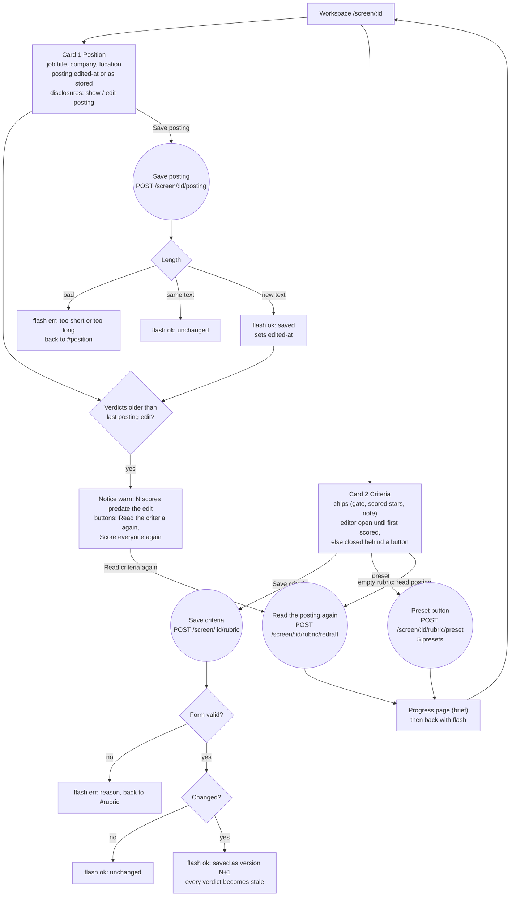

Criteria editor details:

- A table row per criterion: kind (skill, experience, and so on; the two fixed kinds "impact" and "overall" show a label instead of an input), the words (text input, max 200), answer type for custom ones (yes/no or how much), mode select (gate, scored, note), weight select (1 to 5 stars, `MAX_WEIGHT`), source ("from the posting" or "from you"), and a Remove checkbox. A last "add" row has kind, text, answer type, mode, weight.
- Modes: **gate** (pass / ask / fail bucket, never points), **scored** (weighted points), **note** (shown, never scored).
- Presets: Standard screen, Junior hire, Senior / lead hire, Regulated role, Agency / client work. A preset reads the posting again and bends the draft. The person's own rows survive.
- A redraft over an edited rubric is saved as a new version. The very first draft keeps version 1.
- A saved change that alters the rubric raises its version number, so every existing verdict is "stale" until scored again. The Results header then reads "N waiting to be scored".

### Screen inventory (workspace, cards 1 and 2)

| Screen / card | Route | Key controls | Data shown | States |
|---|---|---|---|---|
| Header | `GET /screen/:id` | CSV and Markdown download buttons, "Keep for N days", Delete (confirm) | Title, applicant count, kept-until date, intro line | Normal, flash |
| Card 1 Position | same, anchor `#position` | Show / hide posting, edit disclosure with textarea (14 rows) and Save | Job title, company, location, link to the job page, edited-ago or "as stored", posting text | Pristine, edited, stale-warning notice |
| Card 2 Criteria | anchor `#rubric` | Show / hide editor, row inputs, Save criteria, 5 preset buttons, "Read the posting again" (only when empty) | Chips (max 40 then "N more"), summary (counts per mode), version number | Empty rubric (hint "no draft", button), populated, editor open (default until first scored result), closed |

---

## 4. Applicant intake and the scoring run (A4)

**Who / entry.** Admin, card 3 "Applicants" on `/screen/:id`. Limits shown as bullet facts under the form: accepted formats plus `.zip`, up to 300 applicants per screening, up to 200 MB per upload, 5 MB per file (and per zip entry), redaction before any model reads, repeated and revised files are recognised.

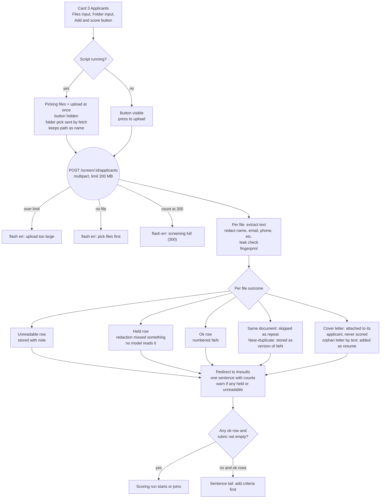

The flash sentence is built from clauses in a fixed order: "N added", "N as a new version", "N repeats skipped", "N unreadable", "N cover letters attached", "N letters left unattached", "N not resumes", "N bad archives", "N too large", "N zip entries not read", "N past the 300 room", "N held". The tail says scoring has started or tells the person to add criteria.

### Scoring run (long-running action)

The run lives in web-process memory. The database is the real state: a verdict is written the moment it arrives, so a restart resumes from what is missing. The live queue accepts additions: an upload during a run refills the queue, and "Score again" during a run joins it at the back.

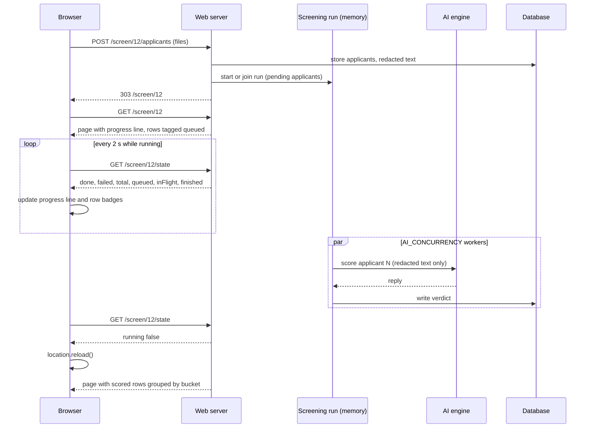

Progress UI: the results header line reads "Scoring, 2 of 5 - now reading N3, N4 - 1 queued". Each row gets a badge in the Score cell: queued (neutral), scoring (info), scored (ok), and the old number is dimmed and prefixed "was". Poll interval 2 s. A poll failure retries on the next tick. A non-OK poll or `running:false` reloads the page. Without script the page does not update by itself and the person reloads.

After a run ends with failures the line reads "Last run: x done, y failed" plus the last engine reason. Per-applicant failures leave the row pending.

### Screen inventory (intake and run)

| Screen / card | Route | Key controls | Data shown | States |
|---|---|---|---|---|
| Card 3 Applicants | `GET /screen/:id` | File input (multiple, accepts resume formats and `.zip`), Folder input (directory pick), "Add and score" button (hidden with script), selected-count live text | Six fact bullets (formats, limits, redaction, repeats) | Idle, uploading ("Uploading N files", all buttons and inputs disabled), flash after redirect |
| Card 4 Results header | same, `#results` | Score button (violet): "Score N" / "Score" / "Scoring..." (disabled while running, when nothing pending, or when the rubric is empty) | Progress line (running / last run failed / N waiting / all scored by engine / add applicants), engine line ("runs on X", or a warn link to Settings > Screening when it is a personal-subscription CLI) | Empty rubric, pending, running, all scored, last-run failed |
| Upload error flashes | redirect to `/screen/:id` | - | See flows | too large, pick first, full |

---

## 5. Results table, bulk actions, decisions, calibration (A5)

**Who / entry.** Admin. The results card on `/screen/:id`.

Table columns: checkbox, number, name (link to the applicant, filename, letters count, notes), gates (a glyph per gate criterion), score, confidence badge, must-have (covered / total plus strong), years, level, decision select. Groups, in order: three score buckets "Priority to talk to" (pass), "Ask first", "Did not pass a gate" (each sorted by adjusted score, then confidence), then "Scoring" or "Not scored yet" (pending or stale), "Held" and "Could not read". Optional badges: "version of N" (same person), "injection" (resume tried to steer the model). A stale verdict shows "scored earlier: N" and the row sits in the pending group.

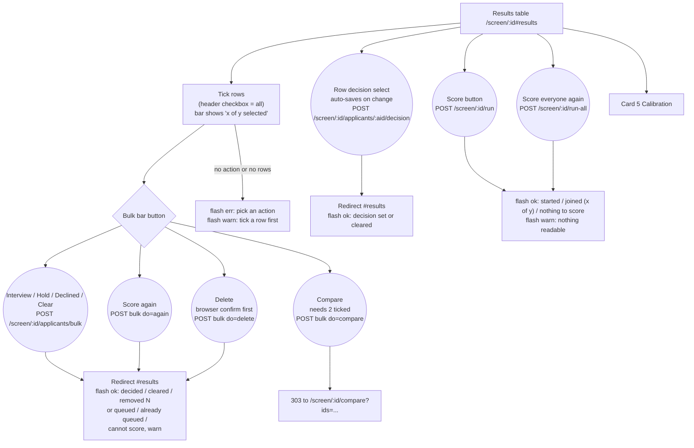

Behaviours worth keeping:

- Compare button is disabled until two rows are ticked (`data-min="2"`). The server then validates the pick (see section 7).
- The decision select saves itself on change (script). Without script a Save button appears per row via `noscript`. A decision exists only for readable (ok) rows. Held rows show a "Read first" link. Unreadable rows show "tick and delete".
- The per-row decision forms are separate hidden forms outside the table so a select does not post with the bulk form.
- Decisions are the person's alone: the tool never writes one, and every decision change is logged.

**Calibration card (card 5).** Measured, never acted on: it compares the person's decisions against the table order.

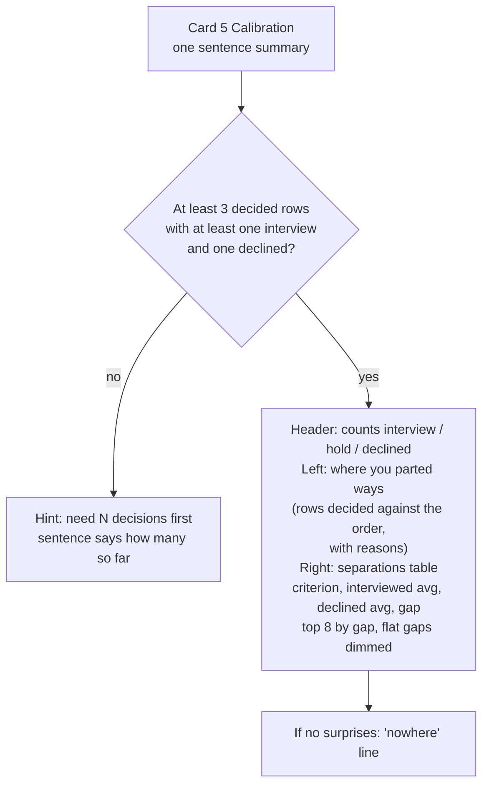

### Screen inventory (results and calibration)

| Screen / card | Route | Key controls | Data shown | States |
|---|---|---|---|---|
| Results table | `GET /screen/:id` | Header checkbox, row checkboxes, bulk bar (Interview, Hold, Declined, Clear, Compare, Score again, Delete), row decision select | Grouped rows as above, run badges | Empty (title "no applicants" + body), populated, running (badges, progress), stale rows, all groups optional |
| Bulk outcomes | redirect `#results` | - | flash text | err (no action), warn (tick first, cannot score), ok |
| Calibration | `#calibration` | none (read-only) | summary sentence, counts, surprises, separations | Not enough, enough with surprises, enough without |
| Footer | same | - | "Created ..." line, "How the buckets work" fold | - |

---

## 6. Applicant detail: scorecard, redaction view, trajectory (A6)

**Who / entry.** Admin. `GET /screen/:id/applicants/:aid` from the table name link, the compare page column header, or a redirect after a decision, an adjustment, a release.

The page header shows "N3 - Name" (or just the number when no name), a back link to the screening, the source file, email and phone (as the reader sees them), a line saying the model saw "Applicant N3", scored date, model and rubric version, a bucket badge, adjusted score out of 100 (with "computed x, adjusted +y") and a confidence label. Action: "Download file" (`GET .../file`, the original).

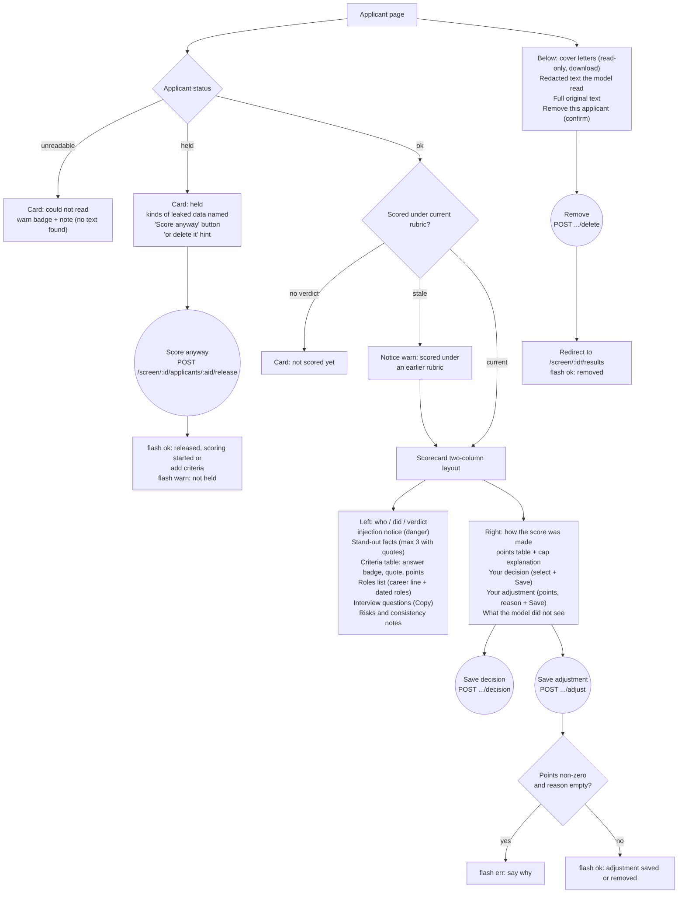

Details:

- **Redaction view.** Two collapsed cards: "the text the model read" (redacted, with `Applicant N` in place of names) and "the full text" (original). The "What the model did not see" card lists what was removed (counts per kind) and whether the leak check found anything left. For a held applicant the first card is titled "the text it would read".
- **Trajectory.** The "Roles" card opens with the career line, for example "9.8 years across 3 employers, average stay 3.3 years, in a role now, fintech, e-commerce". The role list shows position, employer, dates (range parsed, or raw text, or "no dates"), sector and company type, and a reason. Roles the model judged irrelevant are dimmed with "not counted: why". The career is a fact, never a penalty.
- **Notices.** Duplicate/revision notice ("another document of applicant N", link back to the table), stale notice, injection notice, held card, unreadable card. Old verdicts from an older prompt show a different stand-out hint ("scored before stand-out facts existed").
- **Adjustment** is clamped to plus or minus 30 points, needs a reason (max 200 chars) when non-zero, and 0 removes it.
- Rescoring from here: there is no per-applicant rescore button. Use the table: tick the row and "Score again", or "Score everyone again".
- Redirects after POSTs carry a `back` hidden field, re-validated server-side (`safeBack`), so they return to this page.

### Screen inventory (applicant)

| Screen | Route | Key controls | Data shown | States |
|---|---|---|---|---|
| Applicant scorecard | `GET /screen/:id/applicants/:aid` | Download file, Copy questions (script), decision select + Save, adjustment inputs + Save, Score anyway (held only), Remove (confirm) | See above | Unreadable, held, not scored, stale, scored, duplicate, injection, flash |
| Original file | `GET /screen/:id/applicants/:aid/file` | - | attachment download | 404 text when gone |
| Cover letter file | `GET /screen/:id/applicants/:aid/letters/:lid/file` | - | attachment download | 404 when the letter belongs to another applicant |
| Gone applicant | any | - | - | Redirect to `/screen` with err flash "applicant is gone" |

---

## 7. Compare (A7)

**Who / entry.** Admin. Bulk bar "Compare" with 2 to 5 ticked rows, which redirects to `GET /screen/:id/compare?ids=a,b,c`. The same URL is bookmarkable.

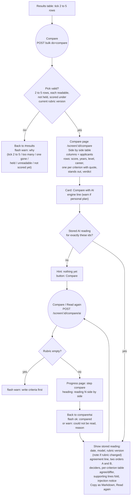

Notes:

- Side-by-side needs no AI: it prints stored answers. Each applicant header links to that applicant's page. Cells show an answer badge, points and the quote, or the detail text when no quote.
- "Compare with AI" reads the shortlist head to head twice (readings A and B, in different orders) and shows where the two readings differ. It stores the result, so reopening the page shows it. Applicants may be ranked differently by criterion, and the page says whether the orders and first places agree.
- The run is a normal progress page (`/target/runs/:id`, key per screening + ids), so a second press joins the live run.

### Screen inventory (compare)

| Screen | Route | Key controls | Data shown | States |
|---|---|---|---|---|
| Compare | `GET /screen/:id/compare?ids=` | Back link, column links, "Compare" / "Read again" (violet), "Copy as Markdown" (script), supporting-lines disclosure | Side-by-side grid, AI reading | Invalid pick (redirect), no AI reading yet, reading present, rubric changed since reading, injection notice, flash |
| Compare progress | `GET /target/runs/:id` | - | heading, subtitle with applicant numbers | Running, done, error, gone |

---

## 8. Export, keep longer, delete (A8)

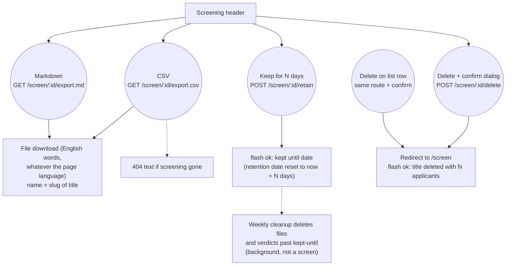

The export contains one row per applicant (order of the table) with gates, score, confidence, decision, adjustment, and for Markdown the calibration sentence. Words written into the file (bucket names, calibration line) are always English. Retention days come from the Screening tab.

| Screen | Route | Key controls | Data shown | States |
|---|---|---|---|---|
| Export | `GET /screen/:id/export.csv`, `.md` | Header buttons | attachment | success, 404 |
| Keep | `POST /screen/:id/retain` | "Keep for N days" ghost button with tooltip | flash | ok, gone (err flash to list) |
| Delete | `POST /screen/:id/delete` | Confirm dialog (native popover form) | flash with title and applicant count | ok, gone |

---

## 9. Sign-in, sign-out, failure, first-run claim (B1)

**Who / entry.** Anyone, only when sign-in (OpenID Connect) is configured. With no lock the app is open and there is one implicit admin ("Default user"). With a shared Basic Auth lock the browser shows its native credential prompt and there is no sign-in UI. With sign-in on, the sidebar shows the signed-in name and a "Sign out" button; otherwise neither is drawn.

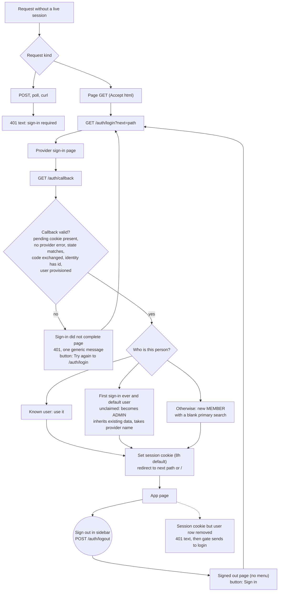

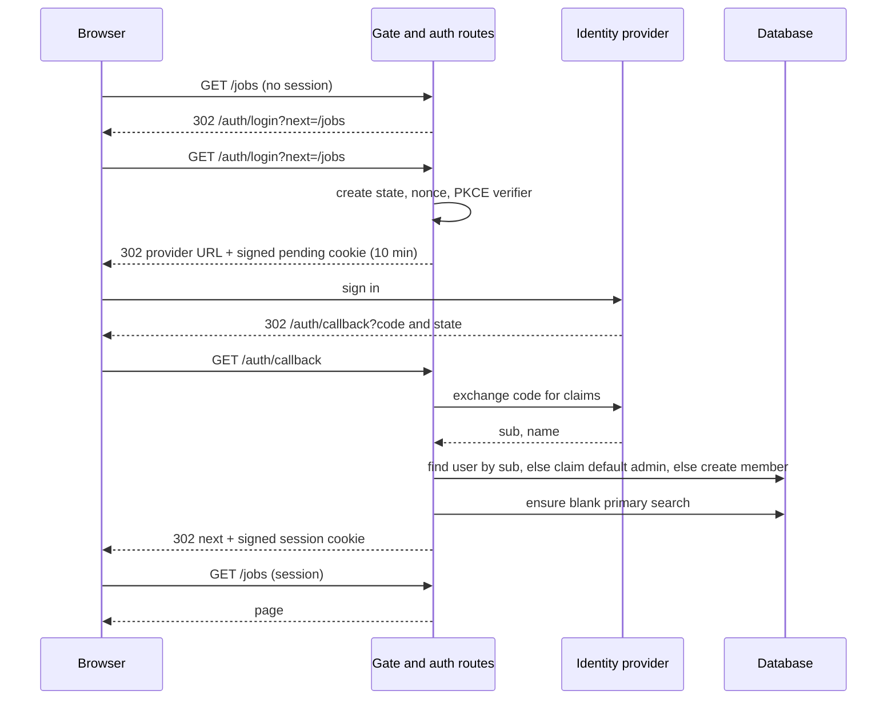

Rules the rebuild must keep:

- `next` is validated to a local path before use. Any failure (no pending cookie, provider error, state mismatch, exchange failure, no id, provisioning error) shows the same generic page. The reason goes to the log only.
- The sign-in pages are plain templates (no sidebar, so the menu does not name pages to someone who may not enter) and use the theme cookie but not a user's stored language (English unless the request language machinery resolves another).
- The first admin is created by sign-in, not by a form: there is no "claim" screen. The first person to sign in inherits the default user (id 1) and becomes admin. Each later new identity is a member.
- Access to `/health`, `/auth/*` and `/static/*` is open. With sign-in on and a Basic credential configured, `/health` alone is protected by Basic Auth.

### Screen inventory (auth)

| Screen | Route | Key controls | Data shown | States |
|---|---|---|---|---|
| Provider hop | `GET /auth/login` | - | redirect | - |
| Callback | `GET /auth/callback` | - | redirect or failure page | success, failure |
| Sign-in failed | callback (401) | "Try again" link | title, one-line body | single state |
| Signed out | `POST /auth/logout` response | "Sign in" link | title, body | single state |
| Sidebar identity | every page | "Sign out" form button | user name (truncated, no-translate) | only when sign-in is on |
| 401 text | non-page requests | - | one localized line | - |

---

## 10. Access denied and role gating (B2)

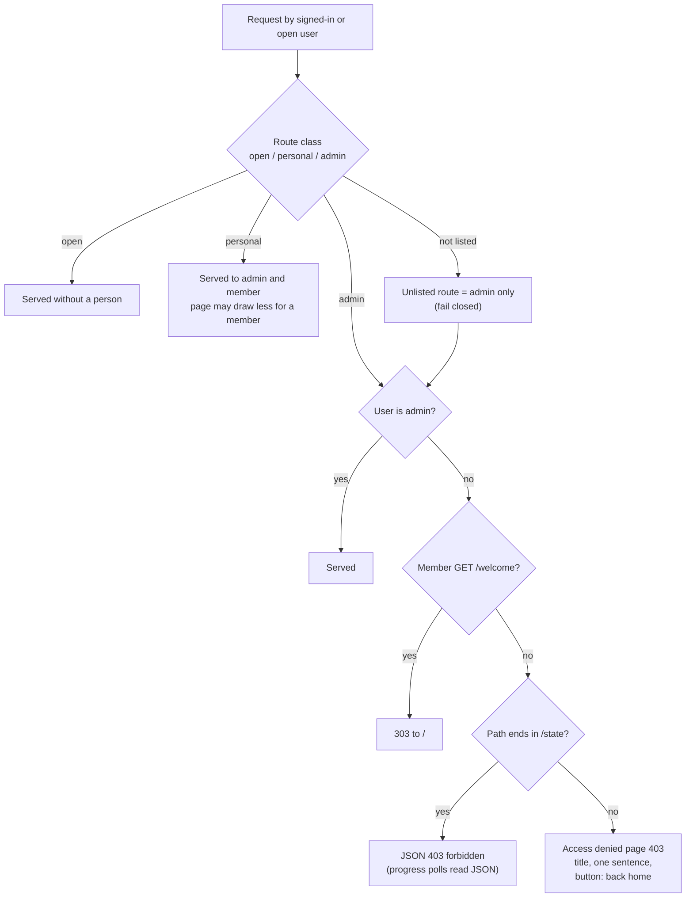

What a member does not see (menu omission, tab omission, and the route refusal behind each): Discovery, AI usage, Users, Screening (sidebar); Settings tabs Sources, AI, Screening; Settings sections for login item, update check, fetch pipeline switch (the schedule and pause controls are admin-only in effect); the Overview "Finish setup" chip and the pause/resume button; on Companies, everything except the mute list. A member is never walked through the first-run wizard and gets the stored language rule as an admin whose setup is complete.

| Screen | Route | Key controls | Data shown | States |
|---|---|---|---|---|
| Access denied | any admin route for a member | "Back home" button | title + body, in the full layout (with menu) | 403 only |

---

## 11. Users admin (B3)

**Who / entry.** Admin. Sidebar System > Users (`GET /users`).

There is **no invite flow** in the UI: people appear the first time they sign in through the identity provider (as members). The page offers only two actions per row, and the server refuses unsafe changes.

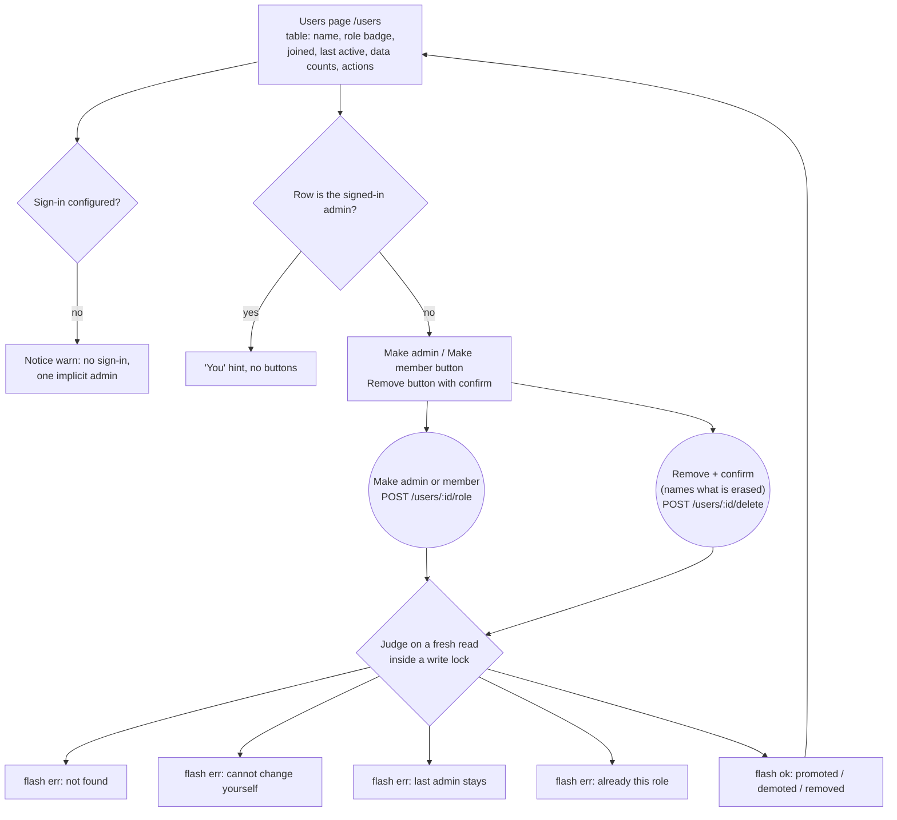

Rules (pure, from the policy table):

- Promote an admin or demote a member is a "no change" refusal.
- Nobody may demote or remove themselves (checked after the no-change check).
- The last remaining admin can never be demoted or removed. The check is made on a fresh read under the global write lock so two admins acting at once cannot remove each other.
- Removing a user erases their searches, held postings (with status), resumes and everything on them, comparisons, letters and alert destinations, and their run recaps. The shared posting catalog stays. The confirm dialog names the counts.
- Redirects always go back to `/users`.

| Screen | Route | Key controls | Data shown | States |
|---|---|---|---|---|
| Users | `GET /users` | Per row (not self): role-change form button, Remove (confirm popover) | name, role badge (ok for admin), joined date, last active (relative or "never"), data line (postings, resumes). Columns collapse on small widths | No-sign-in notice, normal, flash ok/err |

---

## 12. Account and profile settings (B4)

There is no separate "account" or "profile" page. What a person can change about themselves is spread across Settings (`/settings`) tabs, plus two global-chrome controls:

| What | Where | Route |
|---|---|---|
| Name shown | Comes from the identity provider on first sign-in, read-only in the sidebar footer | - |
| Role | Changed by another admin on Users | `/users/:id/role` |
| Job searches ("profiles"): up to 8, make primary, activate/pause, delete, fill from a resume | Settings > Profile tab | `/settings/profiles/*` |
| Notification destinations, alert schedule, stale-digest | Settings > Notifications | `/settings/targets`, `/settings/schedule`, `/settings/stale-digest-toggle` |
| Application tracking, board columns, re-apply window | Settings > Applications | `/settings/application-tracking-toggle`, `/stages/*`, `/reapply` |
| Application packs automation | Settings > Automation | `/settings/pack` |
| Appearance (theme), language, time zone, resumes shortcut | Settings > General | `/settings/theme`, `/settings/locale`, `/settings/schedule` (part=zone) |
| Gmail, Reactive Resume connections | Settings > Profile | `/gmail/*`, `/settings/reactive-resume` |

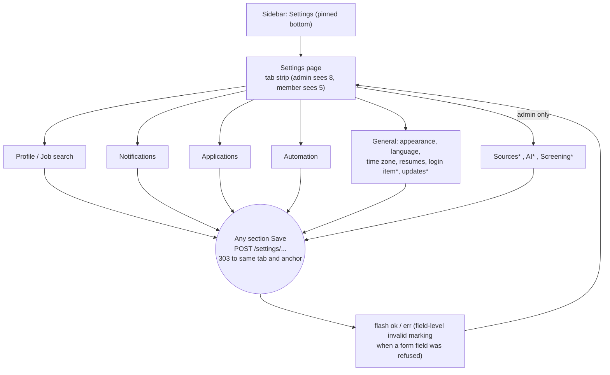

`*` admin only. Each tab opens with a one-line description (`settings.tabDesc.<tab>`). Below `lg` the tab strip is a segmented row, from `lg` it is a sticky left column with the current tab marked.

---

## 13. Start at login and update check (B5)

Both live in Settings > General and are admin-only. The login-item section appears only when the app was started by the local launcher on a supported system (Docker and dev runs get no section).

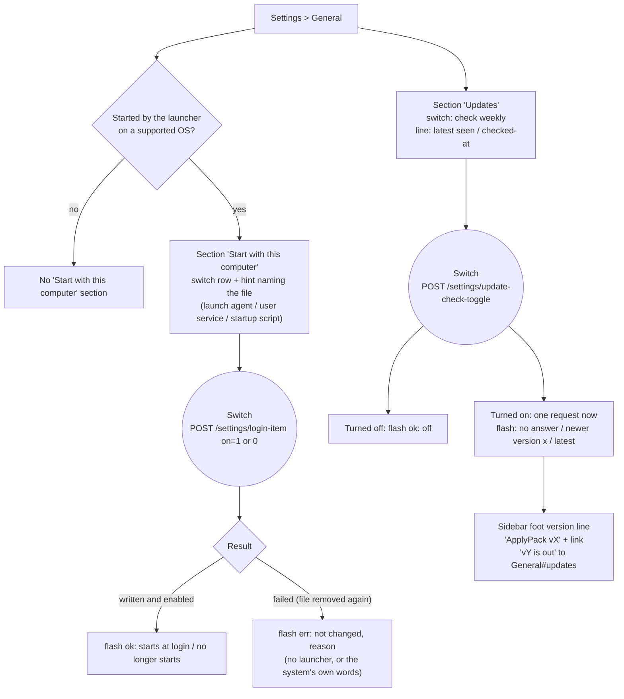

Turning the login item off disables the system entry even if someone already disabled it by hand, then removes the file. The update notice in the sidebar is cached for one hour in the web process and refreshed immediately when the switch is toggled. It is shown only when the check is on and the stored latest version is newer.

| Screen / section | Route | Key controls | Data shown | States |
|---|---|---|---|---|
| General > Start with this computer | `GET /settings?tab=general#login` | Switch (label "Starts at login" when on) | Hint with file path | Hidden (not available), off, on, flash err with reason |
| General > Updates | `#updates` | Switch (checking weekly / off) | current version, last-check line | Off, on-no-answer, on-up-to-date, on-newer |

---

## 14. Language menu, invitation, theme switch (C1)

**Who / entry.** Anyone. Controls at the foot of the sidebar (and at the foot of the mobile off-canvas menu), and a language picker plus theme switch in Settings > General.

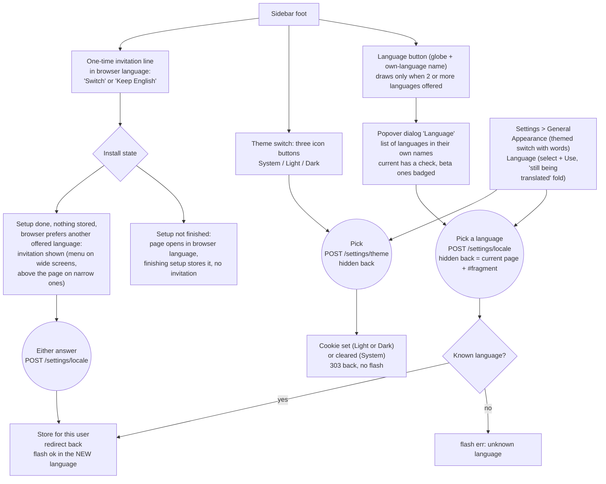

Rules:

- Resolution order for the page language: stored choice wins; with none stored and setup not finished, the browser's `Accept-Language` if offered; with none stored and setup finished, English plus the invitation (stored either way once answered). The sign-in pages are not worded in a user's language.
- Languages are always shown by their own name with a globe icon, never a flag. Languages still being translated are offered only inside a fold on Settings, and a language in use that is unfinished stays in the menu.
- The `back` field carries the current path and query. A script adds the URL `#fragment` on submit so Settings > General > Language returns to its section. Without script the fragment is lost.
- Theme: Light and Dark set an HttpOnly cookie (one year-like max age, `Secure` when the request is HTTPS or forwarded as HTTPS), System deletes it. An unknown value changes nothing. The page draws `data-theme` on `<html>` only for a forced theme. No flash is shown after a theme change: the new look is the answer.
- The language menu popover is a native popover: Escape and an outside click close it. Opening focuses the current language.

| Control | Location | Route | States |
|---|---|---|---|
| Language menu | Sidebar foot (globe + name, icon only on rail) | `POST /settings/locale` | Hidden when fewer than 2 choices, open/closed, current marked, beta badge |
| Language invitation | Sidebar (wide) and above main (narrow) | `POST /settings/locale` | Shown or not, two buttons |
| Language picker | Settings > General > Language | `POST /settings/locale` | Select with Use button, unfinished fold (open when current is unfinished) |
| Theme switch | Sidebar foot and Settings > General > Appearance | `POST /settings/theme` | Three states, current has `aria-current` |

---

## 15. Flash/toast, progress bar, mobile nav (C2)

Page chrome behaviours that apply on every page. The flash contract itself is in doc 08.

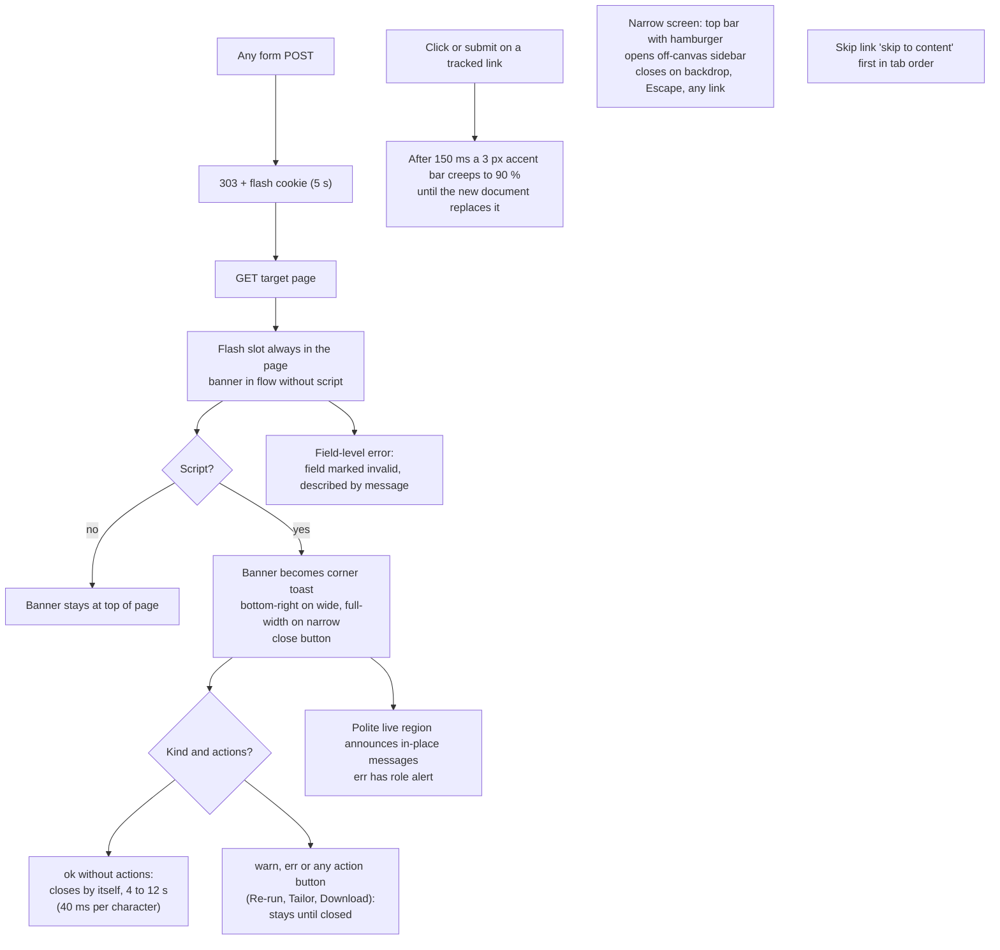

Frame facts: the window never scrolls, only `main` does; the sidebar is 240 px wide on large screens, a 64 px icon rail on medium (labels hidden, hairlines between groups), off-canvas below medium. Pages that update by themselves set a meta refresh (Overview, 30 s) or a `noscript` refresh for browsers without script. Progress bar ignores new-tab, download, modified and anchor-only clicks and resets when the page returns from the back/forward cache.

---

## 16. AI usage page (C3)

**Who / entry.** Admin. Sidebar System > AI usage (`GET /ai`, optional `?period=7d|month|last-month|year`, default 7d). Header action: link "AI engines" to Settings > AI tab.

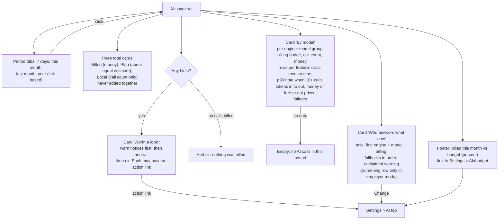

Hint kinds, in the order they are computed, then sorted warn, neutral, ok:

1. An engine in the list (or first for a task) whose recent calls fail (warn, link to engines). Said whatever the period holds.
2. Budget pace: no budget but billed money in the period (neutral, link "Set a budget"). With a budget: from a set day of the month, if the projected month total exceeds it and it is not already exceeded (warn).
3. Most of the bill went to one task while a plan or local engine is ready: tells which switches to make (warn).
4. Calls that fell over to a billed engine because the first did not answer (warn).
5. A feature that fails repeatedly on an engine, pricey scoring, volume on a plan (warn / neutral).
6. If nothing else and no billed engine used: "nothing was billed" (ok).

The `engine-test` calls are excluded from hints but appear in the ledger.

### Screen inventory (AI usage)

| Screen | Route | Key controls | Data shown | States |
|---|---|---|---|---|
| AI usage | `GET /ai?period=` | Period tabs, "AI engines" link, per-hint action link, "Change" link, budget link | See diagram. Money formatting: bill as is, plan as "about" estimate | Empty period, populated, flash (from other page), no hints |

---

## 17. AI engine test, engine setup, budget and budget alerts (C4)

**Who / entry.** Admin. Settings > AI tab (`/settings?tab=ai`).

The tab has: engine list (one row per engine with priority badge, availability badge, billing badge, failing badge, last-resort badge), a plan summary and table, the **Monthly budget** section (`#budget`), and the classifier mode radio. Per engine: Priority (move up one step), **Test**, Enable/Disable, connection (address and key forms inside a fold when the engine is not in use), models and tasks fold (classifier, resume and cover-letter model pickers, task tick boxes that save on change by script).

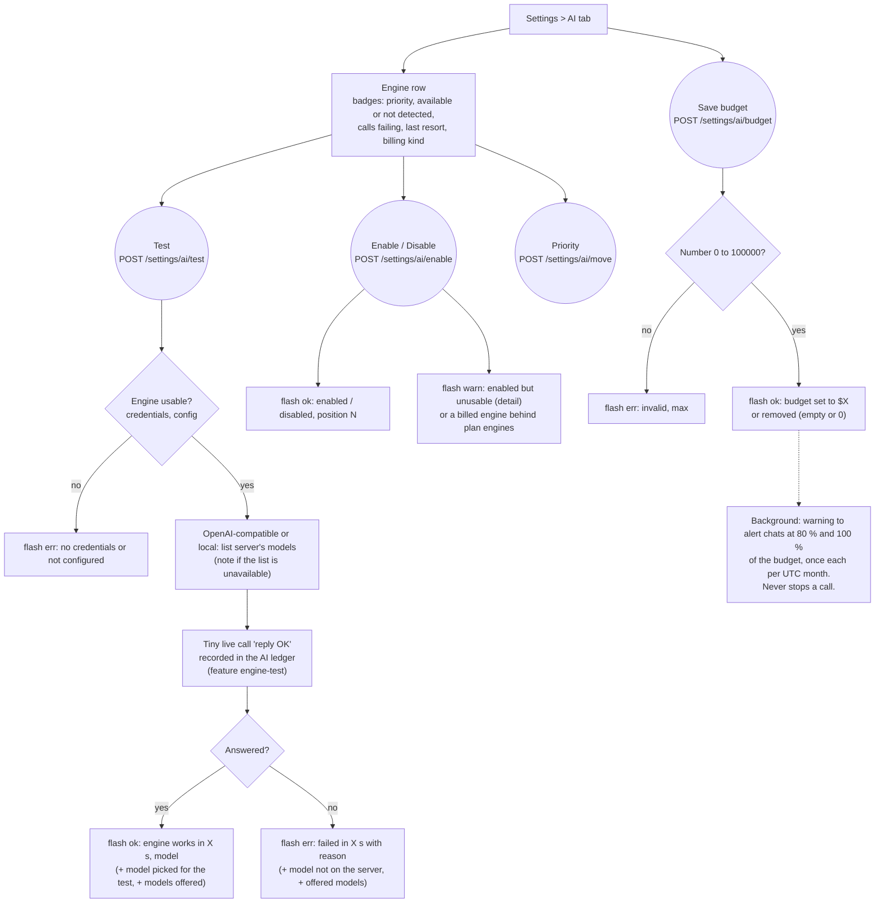

```mermaid
sequenceDiagram
  participant B as Browser
  participant S as Web server
  participant E as Engine (CLI, API or local server)
  participant L as AI ledger
  B->>S: POST /settings/ai/test provider=x
  S->>S: check credentials and config
  S->>E: list models (API or local only)
  E-->>S: model list or reason
  S->>E: complete "Reply with exactly OK" (short timeout)
  E-->>S: text or failure reason
  S->>L: record call (engine-test, outcome, cost)
  S-->>B: 303 /settings?tab=ai + flash ok or err
```

The test is synchronous: the browser waits on the POST (the button is a once-press form) and there is no progress page. A test is a real call on the person's money for billed engines, and appears in `/ai` totals.

Budget semantics: dollars typed, stored as cents. The Settings tab shows a hint "billed $x of $y (z %)". `/ai` hints warn when the month's pace will pass the budget. Alert messages go to the person's alert chats (80 % and 100 %, once each per UTC month). Nothing is ever blocked.

### Screen inventory (AI tab)

| Screen / section | Route | Key controls | Data shown | States |
|---|---|---|---|---|
| Engines and plan | `GET /settings?tab=ai` | Priority, Test, Enable/Disable, key and address forms, model pickers, task ticks | per-engine badges, plan table, billing warnings, skipped-engines notice | Available, not detected, failing (danger badge + notice), last resort, disabled (dimmed) |
| Monthly budget | `#budget` | Number input + Save | billed-so-far hint | No budget, budget set, over 80 percent |
| Classifier | same | Radio single / two-stage + Save | - | - |

---

## 18. Banners and "next things" guidance (C5)

Cross-page guidance that the chrome or Overview adds. It is all derived from data on each request.

```mermaid
flowchart TD
  OV["Overview /"]
  FIN{"Admin and setup steps undone?"}
  CHIP["Header chip warn 'Finish setup' to /welcome"]
  PIPE["Header badge: Pipeline running /<br/>paused / sleeping until time"]
  PN{"Fetching paused?"}
  PNB["Notice warn: paused, link to Settings > Profile"]
  HELD{"Matches held back?"}
  HNB["Notice warn: N matches waiting<br/>reason: alerts off / no destination /<br/>next check / outside the window<br/>link to the setting that fixes it"]
  NX{"Top match exists and<br/>no comparison ever stored?"}
  NXC["Card 'Next three things':<br/>1 Open the best match (link to job)<br/>2 Compare with your resume<br/>(link to Resumes if none, else job#match + cost line)<br/>3 Tailor the resume (no link yet)"]
  NXG["Card disappears after the first comparison"]
  SB["Sidebar foot"]
  VER["Version line 'ApplyPack vX'<br/>+ link 'vY is out' when the optional check saw one"]
  LOC["'Runs locally' line"]
  OV --> FIN
  FIN -->|"yes"| CHIP
  OV --> PIPE
  OV --> PN
  PN -->|"yes"| PNB
  OV --> HELD
  HELD -->|"yes, and not paused"| HNB
  OV --> NX
  NX -->|"yes"| NXC
  NXC --> NXG
  SB --> VER
  SB --> LOC
```

Other health signals shown in the UI (not banners): the `/health` JSON (liveness for containers: `ok`, `db`, last fetch), "stalled" tag on the Runs page for a run whose last progress report is older than 120 s, per-engine "calls failing" badges on the AI tab and warn hints on `/ai`, source-health labels (e.g. "Slug not found, 3 ticks in a row") on Companies, a warn notice on the Jobs list when the active search is blank, and employer-mode engine warnings on the Screening pages. When the database is down pages still render in English with defaults and no employer-mode link.

---

## 19. Global navigation map with role gating (D1)

```mermaid
flowchart TB
  subgraph CHROME["Global chrome (every page)"]
    BRAND["Brand mark to /"]
    FLASHN["Flash and toast slot"]
    PROGB["Navigation progress bar"]
    MOBN["Mobile hamburger"]
    LANGN["Language menu"]
    THEMEN["Theme switch"]
    VERN["Version line + update link"]
    SIGNO["Name + Sign out (sign-in only)"]
  end
  subgraph PERS["Personal: admin and member"]
    OVN["Overview /"]
    JOBN["Jobs /jobs"]
    JDN["Job detail /jobs/:id"]
    APPN["Applications /applications"]
    RESN["Resumes /resumes"]
    LETN["Cover letter /letter"]
    COMN["Companies /companies<br/>(member: mute list only)"]
    RUNN["Runs /runs"]
    SETN["Settings /settings<br/>(member: Profile, Notifications,<br/>Applications, Automation, General)"]
  end
  subgraph ADMN["Admin only"]
    DISN["Discovery /discovery"]
    AIN["AI usage /ai"]
    USN["Users /users"]
    WELN["Setup wizard /welcome"]
    IMPN["Import jobs /jobs/import"]
    SETA["Settings tabs: Sources, AI, Screening<br/>General: login item, updates"]
  end
  subgraph EMPN["Admin and employer mode on"]
    SCRN["Screening list /screen"]
    SCNW["New screening /screen/new"]
    SCDT["Screening workspace /screen/:id"]
    SCAP["Applicant /screen/:id/applicants/:aid"]
    SCCM["Compare /screen/:id/compare"]
  end
  subgraph OPENN["Open (no sign-in)"]
    HLTH["/health JSON"]
    AUTH["/auth/login, /auth/callback, sign-out"]
    STAT["/static assets"]
  end
  FORB["403 Access denied"]
  OVN --> JOBN
  OVN --> APPN
  OVN --> RESN
  OVN --> LETN
  OVN --> COMN
  OVN --> RUNN
  OVN --> SETN
  OVN -->|"admin: Finish setup chip"| WELN
  OVN -->|"admin"| DISN
  OVN -->|"admin"| AIN
  OVN -->|"admin"| USN
  JOBN --> JDN
  JOBN -->|"admin: Import"| IMPN
  SETN --> SETA
  SETA -->|"Screening tab toggle"| SCRN
  SCRN --> SCNW
  SCRN --> SCDT
  SCNW -->|"Create"| SCDT
  SCDT --> SCAP
  SCDT --> SCCM
  SCCM --> SCAP
  SCDT -->|"job page link"| JDN
  AIN -->|"AI engines"| SETA
  AUTH -.-> OVN
  FORB -.->|"member to admin URL"| OVN
  CHROME -.-> PERS
```

Sidebar order and gating (from the code):

| Position | Entry | Route | Shown to |
|---|---|---|---|
| Top, alone | Overview | `/` | all |
| Group Work | Jobs, Applications | `/jobs`, `/applications` | all |
| Group Tools | Resumes, Cover letter | `/resumes`, `/letter` | all |
| Group Research | Companies | `/companies` | all |
| | Discovery | `/discovery` | admin |
| Group System | Runs | `/runs` | all |
| | AI usage | `/ai` | admin |
| | Users | `/users` | admin |
| | Screening | `/screen` | admin and employer mode on |
| Pinned foot | Settings | `/settings` | all |
| Foot | Name + Sign out | `/auth/logout` | only when sign-in is configured |
| Foot | Language menu, theme switch, invitation, local line, version line | - | all (language menu only with 2 or more languages) |

Not in the sidebar but reachable: `/welcome` (Overview "Finish setup" chip, admin), `/jobs/new` and `/jobs/import` (Jobs page buttons), the progress pages `/target/runs/:id` and `/runs/fetch-now/:id`, the Tailor editor `/jobs/:id/target`, `/jobs/:id/edit`, `/resumes/:id`, `/resumes/:id/render`, `/companies/watchlist/:id`, `/companies/:id/files`.

Active nav marking: `aria-current="page"` plus a left bar, bold text and accent color (never fill alone). All screening pages mark "Screening" active. Settings and AI usage mark their own entries.
