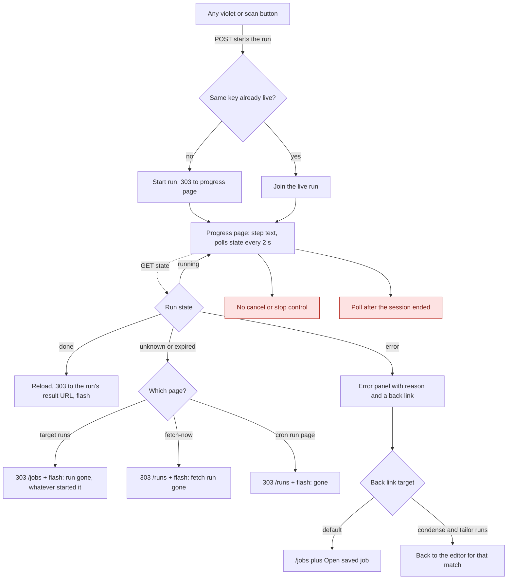
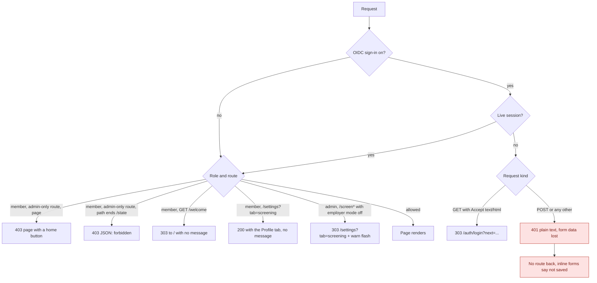
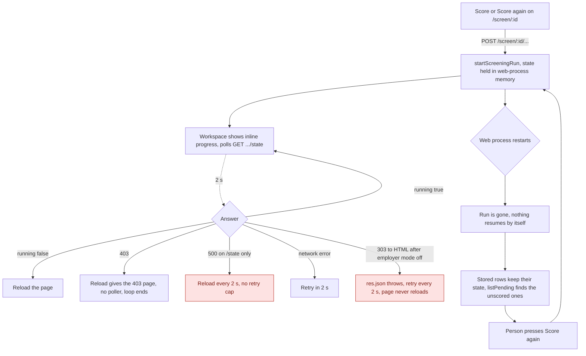
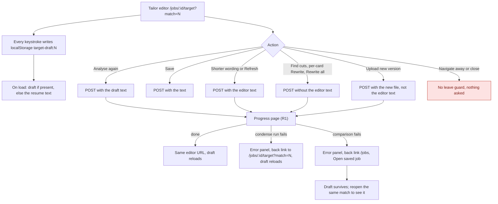
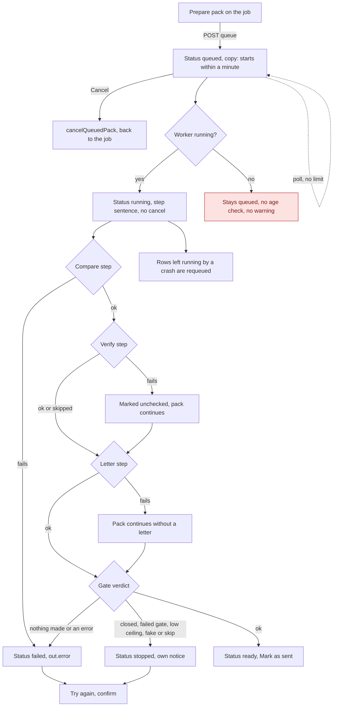
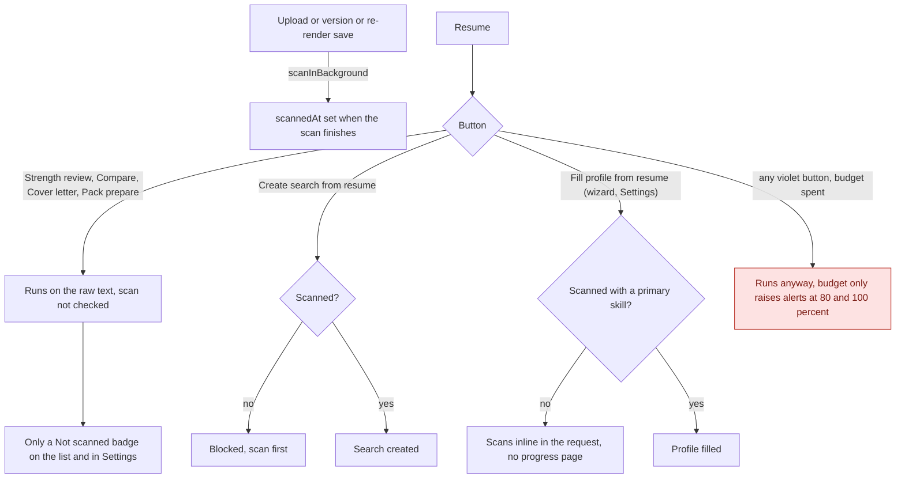

# 11a - Redrawn Flows

The six journeys from `10a`-`10c` that [11-flow-audit.md](./11-flow-audit.md) found weakest, redrawn with the branches the originals left out. Each branch comes from the source as the audit's checking pass read it. Finding numbers (F1, F2, ...) point to the audit table.

## Conventions

- Same as `10b` section 0: rectangles are screens, rounded nodes are user actions, diamonds are decisions, solid edges carry `METHOD /path`, dotted edges are no-reload `fetch` calls or browser-only behaviour.
- **Red nodes (`gap`) are places where the app has no behaviour.** They are not proposals. They mark the missing branch so a rewrite or a fix can decide what goes there.
- A note under each diagram lists what changed against the original and which finding it comes from.

---

## 1. R1 - A run on the progress page (replaces the repeated run fragments in 10a J11, 10b J1/J4/J5/J6/J9, 10c A2/A7)

Changed: the "gone" redirect is split by page (F13), the missing cancel is drawn (F1), and the back link target is shown as two kinds. The poll after session expiry is a gap because the `/state` answer for a signed-out session was not checked.

---

## 2. R2 - Sign-in gate and every denial (replaces 10c B1, B2 and the denial edges in A1)

Changed: the order is now stated (sign-in gate first, then role, then employer mode), the four different answers to "not for you" sit side by side (F3), and the 401 on a POST is drawn with its dead end (F2). A member never reaches the employer-mode redirect, because the admin guard answers first.

---

## 3. R3 - Screening scoring run (replaces 10c A4's run branch)

Changed: the restart is drawn the way it behaves (F11) and the two poll loops are drawn (F10). A per-applicant failure leaves that row pending and "Score again" is its retry, which is unchanged from 10c.

---

## 4. R4 - Tailor editor: what keeps the draft (replaces 10b J5/J6 draft prose)

Changed: the localStorage draft is drawn (F5), the carry or drop of editor text per action is a decision (F6), and the two failure back links are separated, because condense runs return to the editor and comparison runs do not.

---

## 5. R5 - Application pack queue (replaces 10b J12's lifecycle)

Changed: the worker-down case is drawn (F4), failed is separated from stopped by what ends the run, and the differing step failures are shown (F20). The "ready" notification path for an automatic prepare was not checked and is not drawn.

---

## 6. R6 - What a resume needs before each button works (new, from F7 and F9)

Changed: the two scan gates are separated from the four buttons that do not check, and the "AI unavailable" state does not exist in the app (F7, F9, F15).

---

## 7. Not redrawn

Journeys with findings that did not need a new diagram:

- Users admin (F17): one sentence is enough. There is no add route, and users appear at first sign-in as members.
- Flash TTL (F12): a number to fix in text, not a flow.
- Pages rendered from a POST (F8): add one line to the 10b J10 and J11 notes that a reload resubmits.
